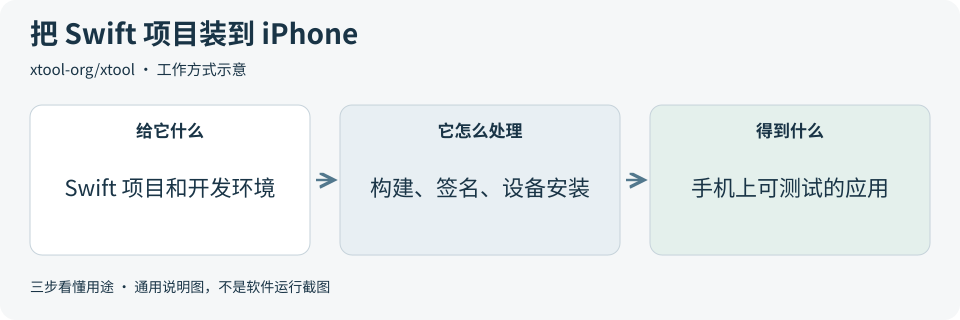

# 2026-10-14 · 每日开源项目推荐 5 个

每天在同一个仓库新增一份资料，每份 5 个项目，避开全部历史推荐。先看速览，再点项目查看图解和例子。

热度参考抓取时的 GitHub 滚动周榜，**不是一天内的新增 Star**。用途按公开文档整理，图解和例子用于解释用法；本期未实际安装或运行这些项目。

**先认两个词**　Agent 是能分步办事的 AI 助手；Skill 是写给 AI 助手的工作说明。Star 是关注热度，不代表质量。

## 本期速览

| 名次 | 项目 | 本周新增 Star | 一句话用途 | 可用场景 |
| --- | --- | ---: | --- | --- |
| 1 | [artcraft](#project-01) | +21,868 | 先摆好画面和角色，再用 AI 生成图片或视频的创作工具。 | 宣传图、视频分镜、角色场景 |
| 2 | [moli](#project-02) | +7,396 | 让 AI 助手读取网页、提取内容并执行浏览器操作。 | 公开资料采集、网页自动化 |
| 3 | [Kazumi](#project-03) | +5,073 | 用可编辑规则整理番剧目录，并提供分集播放的跨平台应用。 | 视频产品界面与播放流程参考 |
| 4 | [cc-switch](#project-04) | +3,955 | 在一个桌面界面里管理和切换多种 AI 编程工具的连接配置。 | 多工具配置、模型连接切换 |
| 5 | [xtool](#project-05) | +3,660 | 在 Linux、Windows（WSL）或 Mac 上构建和安装 Swift iOS 应用。 | iOS 原型、构建与设备安装 |

## 可以先看

做图像或视频素材，先看 **ArtCraft**；需要让 AI 读取网页，先看 **Moli**；经常切换 AI 编程工具的连接，先看 **CC Switch**。另外两项分别适合研究视频产品流程和 iOS 构建。

## 1. [artcraft](https://github.com/storytold/artcraft)

**一句话用途**　先摆好画面和角色，再用 AI 生成图片或视频的创作工具。

**举个例子**　要做一张“角色坐在窗边”的宣传图，可以先放好房间、角色和摄像机位置，再选模型生成。这样能把想要的画面直接摆出来，减少只靠文字描述时的歧义。

**适合什么情况**　做宣传图、故事分镜或角色场景时，可把构图、姿势和镜头先摆出来，再生成素材。它更适合作为创作工具使用。

**门槛与费用**　门槛中。可下载桌面版本，已有素材可用于构图。图像和视频生成费用取决于所选服务与账号，开源代码不等于免费生成。

**注意事项**　模型支持和可用功能会变化。角色一致性与生成效果仍需逐张检查，第三方素材的许可也要单独确认。

**小范围第一步**　先选一张自有产品图，摆出一个宣传画面，确认构图符合需求，再决定是否使用生成服务。

周新增 Star **+21,868** · 总 Star **27,276** · Rust · Apache-2.0 · 首次推荐

[官方文档](https://github.com/storytold/artcraft/blob/d4e4ac69bbd93d237eaf5d0260bc6a5ff3a5e373/README.md) · [仓库](https://github.com/storytold/artcraft)

## 2. [moli](https://github.com/lexmount/moli)

**一句话用途**　让 AI 助手读取网页、提取内容并执行浏览器操作。

**举个例子**　每天整理几家产品的公开更新日志时，可以让 Moli 先读取各页面正文，再交给 AI 汇总变化。浏览器取内容，AI 做总结，便于检查信息在哪一步遗漏。

**适合什么情况**　做公开资料整理或网页自动化时，可用它取回页面内容，再交给 AI 分析。它负责浏览器操作，不会自动判断资料是否可信。

**门槛与费用**　门槛中。可在本地独立运行，不必使用作者的云服务。需要接入自动化流程；后续 AI 分析的模型费用另算。

**注意事项**　截图和真实页面布局要显式开启。复杂 Canvas、WebGL 或视频页面的表现可能与 Chrome 不同，视觉检查需要另行核对。

**小范围第一步**　选一个无需登录的公开页面，尝试导出正文，再人工检查标题、段落和链接有没有遗漏。

周新增 Star **+7,396** · 总 Star **18,284** · Rust · Apache-2.0 · 首次推荐

[官方文档](https://github.com/lexmount/moli/blob/3cf565afe0c2868125ec8d677d636f4b0ff8a8b3/README.md) · [仓库](https://github.com/lexmount/moli)

## 3. [Kazumi](https://github.com/Predidit/Kazumi)

**一句话用途**　用可编辑规则整理番剧目录，并提供分集播放的跨平台应用。

**举个例子**　若要做课程播放产品，可以参考它的“目录 → 分集 → 播放 → 历史记录”设计，先用自有或获授权的视频验证。这里是产品实现思路，课程内容和后台仍需自己设计。

**适合什么情况**　做视频类产品时，可参考它的目录、搜索、分集播放和历史记录设计。它采用 Flutter，规则决定如何从页面读取内容。

**门槛与费用**　门槛中。应用代码开源。研究或改造需要 Flutter 开发能力；视频源的授权、可用性和网络条件另行确认，画质增强也会消耗显卡性能。

**注意事项**　代码采用 GPL-3.0；图标有独立版权说明。复用代码、图标或视频内容前分别核对许可，页面结构变化也可能让规则失效。

**小范围第一步**　先阅读规则示例和播放器相关代码，用自有或获授权的内容理解“目录到分集再到播放”的流程。

周新增 Star **+5,073** · 总 Star **36,504** · Dart · GPL-3.0 · 首次推荐

[官方文档](https://github.com/Predidit/Kazumi/blob/025dcb5c2f62db881382c72f191d08b49a9feb41/README.md) · [仓库](https://github.com/Predidit/Kazumi)

## 4. [cc-switch](https://github.com/farion1231/cc-switch)

**一句话用途**　在一个桌面界面里管理和切换多种 AI 编程工具的连接配置。

**举个例子**　一个开发任务要临时换模型时，可在 CC Switch 里选好已有连接，再让对应工具使用它；完成后切回原连接。这样不用反复手改多份配置文件。

**适合什么情况**　同时使用多种 AI 编程工具，或经常更换模型连接时，可以集中管理连接、工作说明和工具配置，减少手工修改文件。

**门槛与费用**　门槛低。桌面工具代码采用 MIT 许可。需要已有的工具和服务账号；模型调用或订阅费用仍由对应服务收取。

**注意事项**　它会读取和修改本地配置，部分功能还会读取会话日志。切换前先备份；配置列表里的服务不等于已验证可靠，密钥只交给可信服务。

**小范围第一步**　先备份现有配置，只给一个工具添加测试用连接，确认切换和恢复原配置都符合预期。

周新增 Star **+3,955** · 总 Star **144,201** · Rust · MIT · 首次推荐

[官方文档](https://github.com/farion1231/cc-switch/blob/51ac86f1c59abfefabadebd05ec5a5415b8ad72c/README.md) · [仓库](https://github.com/farion1231/cc-switch)

## 5. [xtool](https://github.com/xtool-org/xtool)

**一句话用途**　在 Linux、Windows（WSL）或 Mac 上构建和安装 Swift iOS 应用。

**举个例子**　要验证一个只有输入框和保存按钮的 iPhone 原型，可以用 xtool 构建并安装到测试机，再检查输入与保存流程。先做小原型，更容易定位环境或签名问题。

**适合什么情况**　用 Swift 开发 iPhone 原型、希望把构建和设备安装写成命令流程时，可以研究它。更适合按 SwiftPM 组织的项目。

**门槛与费用**　门槛高。工具代码采用 MIT 许可。需要 Swift 环境、iOS SDK、Apple 账号和测试设备；签名与分发条件按具体方式确认。

**注意事项**　现有项目的依赖、SDK 和签名兼容性需要单独检查。Windows 使用 WSL；构建成功、装到手机和正式分发是不同步骤。

**小范围第一步**　先读官方“第一个应用”教程，准备一个最小 SwiftPM 项目，验证它能否构建并安装到自己的测试设备。

周新增 Star **+3,660** · 总 Star **10,204** · Swift · MIT · 首次推荐

[官方文档](https://github.com/xtool-org/xtool/blob/b50173f7b1f7d13297b9c8229079038d47a2bb1d/README.md) · [仓库](https://github.com/xtool-org/xtool)

## 来源与选取方法

候选池 111 个，可识别开源许可证且未归档的候选 96 个。已核对 24 个历史推荐，剩余未介绍过的候选 76 个；再核对用途与许可，选出本期 5 个。抓取时间与原榜名次见 [本期数据](../data/2026-10-14.json)。

- [周榜来源 1](https://github.com/trending?since=weekly)
- [周榜来源 2](https://github.com/trending/python?since=weekly)
- [周榜来源 3](https://github.com/trending/typescript?since=weekly)
- [周榜来源 4](https://github.com/trending/javascript?since=weekly)
- [周榜来源 5](https://github.com/trending/go?since=weekly)
- [周榜来源 6](https://github.com/trending/rust?since=weekly)
- [周榜来源 7](https://github.com/trending/swift?since=weekly)
- [周榜来源 8](https://github.com/trending/dart?since=weekly)
- [周榜来源 9](https://github.com/trending/java?since=weekly)

[排名和更新规则](../UPDATE_GUIDE.md) · [通用应用场景](../USE_CASES.md)

序号是本期推荐顺序，不是 GitHub 官方总榜排名。图解和应用例子仅作说明。

[返回资料首页](../README.md)
