# 2026-10-14 · 开源项目图文资料 Top 20

每两天在同一个仓库新增一份资料，旧资料保留。先看速览，再点项目查看图解和例子。

热度参考抓取时的 GitHub 滚动周榜，**不是两天内的新增 Star**。用途按公开文档整理，图解和例子用于解释用法；本期未实际安装或运行这些项目。

**先认两个词**　Agent 是能分步办事的 AI 助手；Skill 是写给 AI 助手的工作说明。Star 是关注热度，不代表质量。

## 本期速览

| 名次 | 项目 | 本周新增 Star | 一句话用途 | 可用场景 |
| --- | --- | ---: | --- | --- |
| 1 | [rea](#project-01) | +183,758 | 给 AI 助手一套查程序内部的工具，帮助解释功能怎样实现。 | 应用分析与调试 |
| 2 | [AnyPS5](#project-02) | +28,663 | 尝试让 PS5 程序在 Linux 或 Windows 电脑上运行。 | 程序移植与兼容研究 |
| 3 | [skills](#project-03) | +11,955 | 给 AI 编程助手提供需求拆解、调试和测试的工作说明。 | 改善 AI 辅助开发步骤 |
| 4 | [diagram-design](#project-04) | +9,867 | 让 AI 把复杂流程画成能在浏览器打开的图解。 | 流程图与知识讲解 |
| 5 | [iFixAi](#project-05) | +5,547 | 检查 AI 助手是否按业务要求做事，并给出问题报告。 | AI 任务评估 |
| 6 | [openGym](#project-06) | +5,446 | 在自己管理的环境里记录训练、体重和运动进度。 | 健身记录与自托管应用 |
| 7 | [ghidra](#project-07) | +4,986 | 让专业人员查看程序内部结构和代码线索。 | 程序内部分析 |
| 8 | [hyperframes](#project-08) | +4,732 | 把网页文字、图片和动画导出成视频。 | 说明短片与产品视频 |
| 9 | [e2e](#project-09) | +4,426 | 让 AI 像用户一样操作应用，再检查事情是否办成。 | 完整用户流程测试 |
| 10 | [agent-skills](#project-10) | +4,302 | 给 AI 编程助手提供从需求到交付的质量检查方法。 | 开发质量与交付检查 |
| 11 | [claude-mem](#project-11) | +3,587 | 保存 AI 编程会话的观察和摘要，方便下次继续。 | 跨会话项目记忆 |
| 12 | [freellmapi](#project-12) | +3,412 | 把多个模型服务接到统一接口，并在失败时切换。 | 个人模型实验与备用路由 |
| 13 | [OpenMontage](#project-13) | +3,401 | 让 AI 组织脚本、素材和剪辑，完成一条视频制作流程。 | 完整视频制作流程 |
| 14 | [knowledge-work-plugins](#project-14) | +3,227 | 把岗位工作说明和工具连接打包，让 AI 按角色处理任务。 | 办公、产品与客服工作流 |
| 15 | [MiroFish](#project-15) | +2,222 | 让多个 AI 角色在模拟环境里互动，生成推演报告。 | 多角色模拟与假设探索 |
| 16 | [text-to-cad](#project-16) | +2,173 | 让 AI 助手根据要求生成 3D 工程模型和图纸。 | 3D 模型与实体设计 |
| 17 | [t3code](#project-17) | +1,574 | 从电脑、网页或手机控制本机已经可用的 AI 编程助手。 | 远程控制 AI 开发任务 |
| 18 | [skills](#project-18) | +1,561 | 帮助查找、安装、更新和管理 AI 助手的 Skills。 | Skill 查找与管理 |
| 19 | [heretic](#project-19) | +1,494 | 研究和改变开放权重模型何时会拒绝回答。 | 专业模型行为研究 |
| 20 | [video-shotcraft](#project-20) | +1,264 | 给 AI 提供镜头和动效模板，帮助制作产品介绍视频。 | 产品视频与镜头设计 |

## 可以先看

想看懂复杂流程，可以先看 **diagram-design**；想检查应用是否真的能用，可以看 **e2e**；想把已有网页素材做成视频，可以看 **HyperFrames**。这三个用途比较容易通过一个小例子理解。

## 1. [rea](https://github.com/morluto/rea)

**一句话用途**　给 AI 助手一套查程序内部的工具，帮助解释功能怎样实现。

**举个例子**　一个桌面应用切换页面时总会卡顿。可以让助手分析相关模块和运行过程，找出值得进一步检查的线索。

**适合什么情况**　适合分析自有或已获授权的应用。需要理解程序内部、调查异常或研究实现方法时，可以关注。

**门槛与费用**　门槛高。需要分析工具和 AI 助手；模型使用可能消耗订阅或 API 额度。

**注意事项**　它提供分析线索，不保证直接找出正确答案。结论仍需核对证据；原生程序分析还可能需要额外专业工具。

**小范围第一步**　先读一个桌面应用分析示例，看它给出的证据是否能回答实际问题。

周新增 Star **+183,758** · 总 Star **229,309** · TypeScript · MIT · 持平

[官方文档](https://github.com/morluto/rea/blob/eab789aed74acd6ef7c15d509e0f3de350be2733/README.md) · [仓库](https://github.com/morluto/rea)

## 2. [AnyPS5](https://github.com/boykopovar/AnyPS5)

**一句话用途**　尝试让 PS5 程序在 Linux 或 Windows 电脑上运行。

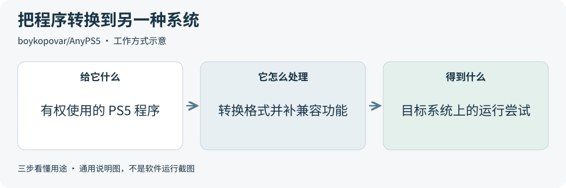

**举个例子**　研究人员想知道某个程序为什么只能在原来的设备上运行，可以用它观察系统接口和图形功能的兼容进展。

**适合什么情况**　主要适合程序移植与系统兼容研究。常规网站或办公应用开发通常用不上。

**门槛与费用**　门槛高。需要编译环境、图形与系统知识，以及有权使用的目标程序。

**注意事项**　有工具不等于所有程序都能运行。项目按具体程序记录进展和阻塞，需要逐项检查。

**小范围第一步**　先读兼容性进展页，确认研究目标是否已有实际进展。

周新增 Star **+28,663** · 总 Star **36,380** · C++ · GPL-2.0 · 持平

[官方文档](https://github.com/boykopovar/AnyPS5/blob/f3a826ba5c7a3a79500b53a2a4201f8493b20459/README.md) · [仓库](https://github.com/boykopovar/AnyPS5)

## 3. [skills](https://github.com/mattpocock/skills)

**一句话用途**　给 AI 编程助手提供需求拆解、调试和测试的工作说明。

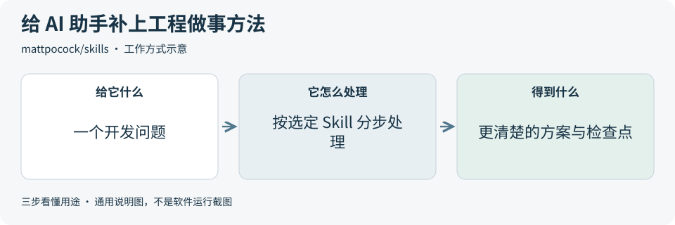

**举个例子**　准备修改保存按钮，可以先选需求或测试方面的 Skill，让助手明确成功条件，再开始修改。

**适合什么情况**　适合已经使用 AI 写代码，但希望某个工程环节更有条理的人。每次选一个具体方法即可。

**门槛与费用**　门槛低。需要可用的 AI 编程助手；工作说明本身开放。

**注意事项**　多套说明可能重复或冲突。它提供方法，不保证项目自动成功。

**小范围第一步**　找一个正在遇到的问题，阅读对应 Skill，再与原有工作方法比较。

周新增 Star **+11,955** · 总 Star **290,637** · Shell · MIT · 持平

[官方文档](https://github.com/mattpocock/skills/blob/49dd158d1076134a641b33efb035946536778336/README.md) · [仓库](https://github.com/mattpocock/skills)

## 4. [diagram-design](https://github.com/cathrynlavery/diagram-design)

**一句话用途**　让 AI 把复杂流程画成能在浏览器打开的图解。

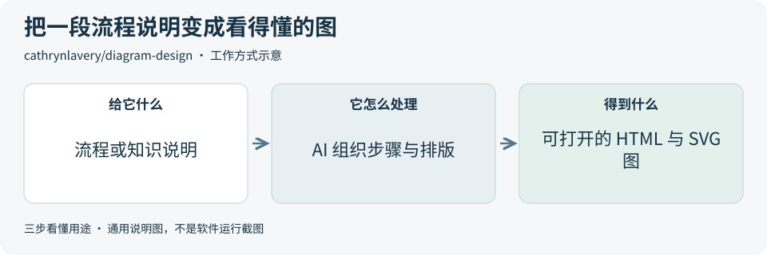

**举个例子**　把“上传文件、提取文字、检索资料、回答问题”画成一张流程图，讲方案时更容易看出各步关系。

**适合什么情况**　适合技术文档、产品方案、教程和演示材料。需要解释步骤或关系时很实用。

**门槛与费用**　门槛低。需要支持 Skill 的 AI 助手，生成过程使用现有模型额度。

**注意事项**　图画得清楚不代表内容正确。步骤、箭头和文字都要核对。

**小范围第一步**　用一段已经确认的流程做一张小图，检查是否比文字更容易理解。

周新增 Star **+9,867** · 总 Star **55,069** · HTML · MIT · 持平

[官方文档](https://github.com/cathrynlavery/diagram-design/blob/11b08eade8049c441ed3df1895e3b527c26c0fbe/README.md) · [仓库](https://github.com/cathrynlavery/diagram-design)

## 5. [iFixAi](https://github.com/ifixai-ai/iFixAi)

**一句话用途**　检查 AI 助手是否按业务要求做事，并给出问题报告。

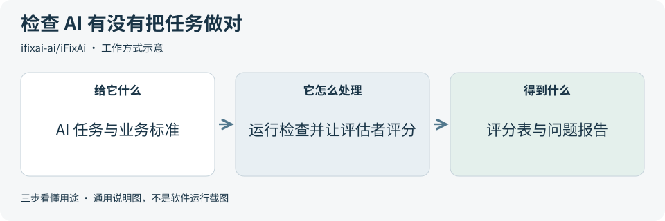

**举个例子**　客服助手回复得很快，但可能漏掉必要信息。可以把业务要求作为评估标准，检查它是否真的完成了任务。

**适合什么情况**　适合已有 AI 功能、需要系统检查行为和业务符合度的团队。

**门槛与费用**　门槛中。需要被测系统和评估模型配置；调用模型可能收费。

**注意事项**　评分依赖题目、标准和评估者。项目宣传的速度或效果，本期没有实测验证。

**小范围第一步**　先阅读评分表示例，选一个明确业务标准的小任务设计评估。

周新增 Star **+5,547** · 总 Star **26,708** · Python · Apache-2.0 · 新上榜

[官方文档](https://github.com/ifixai-ai/iFixAi/blob/d86ba616fa4736b1239e63dd2422fa152cebf7da/README.md) · [仓库](https://github.com/ifixai-ai/iFixAi)

## 6. [openGym](https://github.com/DuarteSantos8/openGym)

**一句话用途**　在自己管理的环境里记录训练、体重和运动进度。

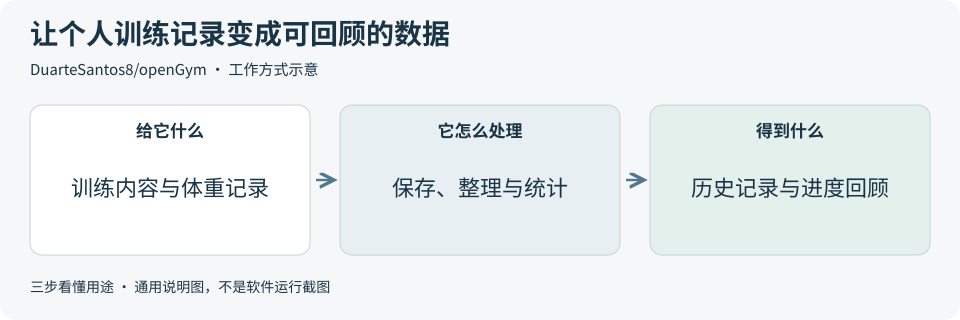

**举个例子**　记录每次训练用了什么重量、完成多少组，过一段时间再回看变化，不必只靠记忆。

**适合什么情况**　适合需要自管数据的健身记录，也可参考它的记录、登录和回顾流程。

**门槛与费用**　门槛中。自托管意味着需要准备和维护自己的运行环境。

**注意事项**　业务范围是运动记录。代码采用 AGPL-3.0，复用前应阅读相关许可证。

**小范围第一步**　先看官方截图，梳理一次记录、修改和回顾的流程。

周新增 Star **+5,446** · 总 Star **11,567** · JavaScript · AGPL-3.0 · 下降 1

[官方文档](https://github.com/DuarteSantos8/openGym/blob/e348fc17c42c7e9a211c5972e573ad3698190ee2/README.md) · [仓库](https://github.com/DuarteSantos8/openGym)

## 7. [ghidra](https://github.com/NationalSecurityAgency/ghidra)

**一句话用途**　让专业人员查看程序内部结构和代码线索。

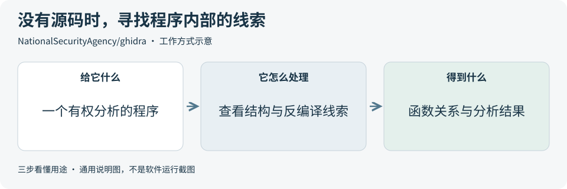

**举个例子**　只有编译好的程序文件，没有原始代码。分析人员可以查看函数、调用关系和近似代码，研究它在做什么。

**适合什么情况**　适合逆向分析、安全研究和旧程序调查。它是专业工具，不是普通网页开发工具。

**门槛与费用**　门槛高。需要配套 Java 环境和程序分析知识；分析工具本身开源。

**注意事项**　看到的近似代码不等于完整恢复原始源码。使用前还要检查版本说明和安全公告。

**小范围第一步**　先读官方入门说明，了解分析界面和它能提供的证据。

周新增 Star **+4,986** · 总 Star **86,897** · Java · Apache-2.0 · 新上榜

[官方文档](https://github.com/NationalSecurityAgency/ghidra/blob/918acd744d17e3b95fbde44ec6ab3e59b6dbd45f/README.md) · [仓库](https://github.com/NationalSecurityAgency/ghidra)

## 8. [hyperframes](https://github.com/heygen-com/hyperframes)

**一句话用途**　把网页文字、图片和动画导出成视频。

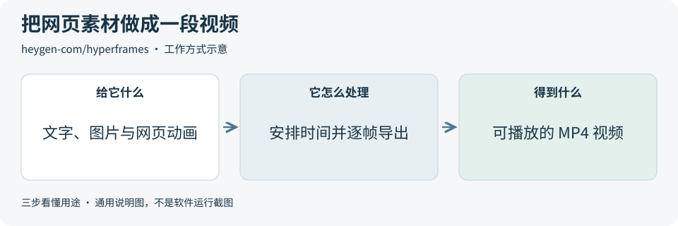

**举个例子**　已有三张知识卡片，可以给它们安排出场顺序、转场和字幕，制作一段简短讲解视频。

**适合什么情况**　适合已有网页素材、需要制作说明短片或产品演示的内容流程。

**门槛与费用**　门槛中。需要 Node.js 和 FFmpeg 等环境；外部素材或模型生成可能收费。

**注意事项**　网页预览和最终视频可能有差别。字体、画面时间和导出播放都要检查。

**小范围第一步**　用自有文字和图片做 10 秒小样，再检查导出视频。

周新增 Star **+4,732** · 总 Star **63,341** · TypeScript · Apache-2.0 · 下降 1

[官方文档](https://github.com/heygen-com/hyperframes/blob/b72c3fb25d725fe633ede9320f88ad92e19dd6c4/README.md) · [仓库](https://github.com/heygen-com/hyperframes)

## 9. [e2e](https://github.com/tester-army/e2e)

**一句话用途**　让 AI 像用户一样操作应用，再检查事情是否办成。

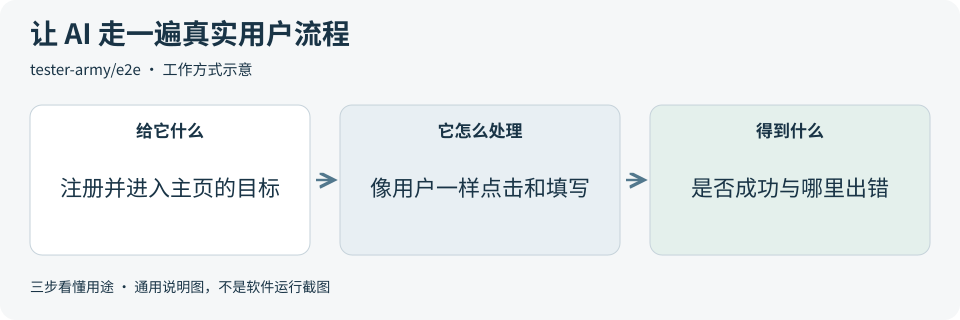

**举个例子**　告诉它“注册新账号并进入主页”。它执行操作后，还要检查主页是否真的出现，不能只看按钮有没有被点击。

**适合什么情况**　适合检查注册、登录、提交、查看详情等网页或手机应用的完整流程。

**门槛与费用**　门槛中。AI 操作步骤需要订阅、API 或本地模型；普通测试可以不用模型。

**注意事项**　必须写清楚什么算成功。AI 完成一次操作不等于业务目标已经达成。

**小范围第一步**　先选一个不含敏感数据的短流程，检查成功结果和失败记录。

周新增 Star **+4,426** · 总 Star **10,367** · TypeScript · Apache-2.0 · 下降 3

[官方文档](https://github.com/tester-army/e2e/blob/9c3b1cbd66e16a44625e41a10dce5dc99a9f1a6a/README.md) · [仓库](https://github.com/tester-army/e2e)

## 10. [agent-skills](https://github.com/addyosmani/agent-skills)

**一句话用途**　给 AI 编程助手提供从需求到交付的质量检查方法。

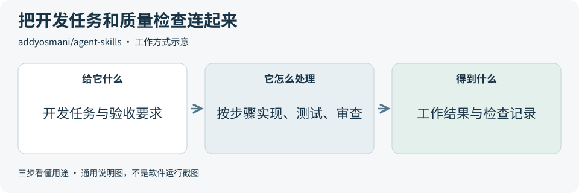

**举个例子**　完成一个页面后，让助手按方法检查错误状态、测试结果和代码质量，再决定是否交付。

**适合什么情况**　适合想把 AI 辅助开发做得更有条理的团队，可参考其中一个具体质量环节。

**门槛与费用**　门槛低。需要已有 AI 编程助手，费用取决于其运行方式。

**注意事项**　与已有工程规范可能重叠。方法可以借鉴，验收标准仍要对应实际产品。

**小范围第一步**　从测试或审查方法里挑一个检查点，应用到一个小功能。

周新增 Star **+4,302** · 总 Star **106,497** · JavaScript · MIT · 下降 2

[官方文档](https://github.com/addyosmani/agent-skills/blob/aeac41d4d005999432bb7312f7ff06383a91d59d/README.md) · [仓库](https://github.com/addyosmani/agent-skills)

## 11. [claude-mem](https://github.com/thedotmack/claude-mem)

**一句话用途**　保存 AI 编程会话的观察和摘要，方便下次继续。

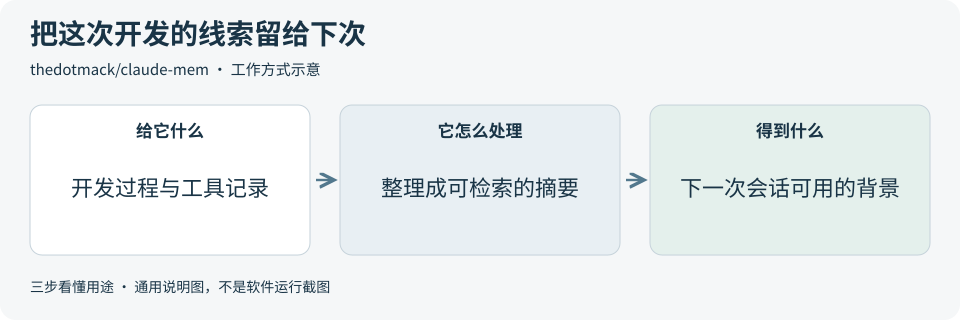

**举个例子**　上一轮已经排查过登录错误。下一轮继续时，可以检索当时的发现，减少重新解释背景。

**适合什么情况**　适合长时间、跨多次会话进行的 AI 辅助开发，或研究项目知识管理方法。

**门槛与费用**　门槛中。需配置记忆提供方；摘要模型或托管服务可能收费。

**注意事项**　先确认记录保存在本地还是托管服务。摘要可能遗漏细节，仍要保留来源。

**小范围第一步**　先看一个无敏感内容的会话如何记录、检索和修正。

周新增 Star **+3,587** · 总 Star **100,639** · TypeScript · Apache-2.0 · 下降 1

[官方文档](https://github.com/thedotmack/claude-mem/blob/fef3402e674bebbf72a23aeb735e91c92cd34afd/README.md) · [仓库](https://github.com/thedotmack/claude-mem)

## 12. [freellmapi](https://github.com/tashfeenahmed/freellmapi)

**一句话用途**　把多个模型服务接到统一接口，并在失败时切换。

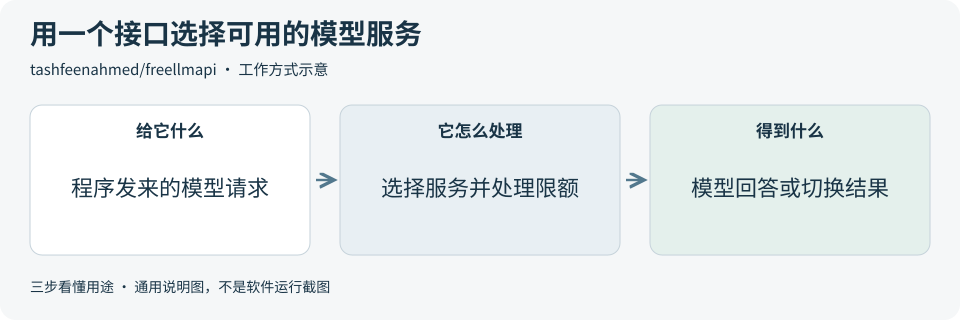

**举个例子**　做个人原型时，一家服务到达限额，可以研究怎样切换到另一家，而不让业务代码到处改接口。

**适合什么情况**　主要适合用公开样本进行个人实验，研究模型接口统一和限额处理。

**门槛与费用**　门槛中。需要各提供方账号或凭证；免费额度由服务方决定。

**注意事项**　项目明确面向个人实验。免费额度会变；路由也可能把请求发送到不同提供方。

**小范围第一步**　先阅读路由示例，确认实际可用的服务和请求去向。

周新增 Star **+3,412** · 总 Star **35,043** · TypeScript · MIT · 上升 2

[官方文档](https://github.com/tashfeenahmed/freellmapi/blob/bf1660454fd4e1889fe0c1b5cd10f2af6605afa0/README.md) · [仓库](https://github.com/tashfeenahmed/freellmapi)

## 13. [OpenMontage](https://github.com/calesthio/OpenMontage)

**一句话用途**　让 AI 组织脚本、素材和剪辑，完成一条视频制作流程。

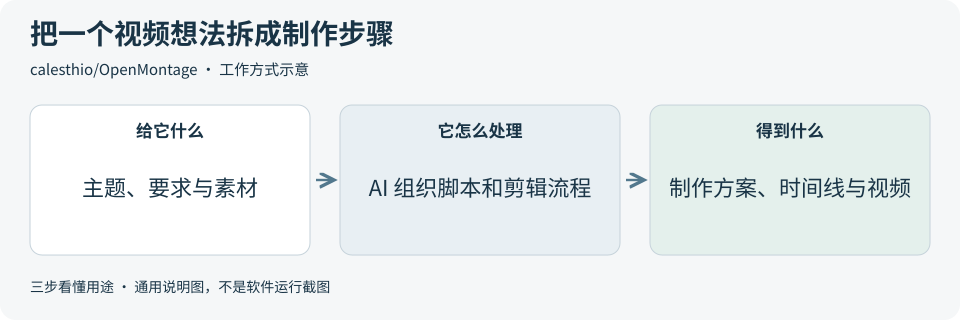

**举个例子**　准备一分钟科普视频，可以先写脚本，再找或生成素材，最后安排画面、声音和字幕。

**适合什么情况**　适合需要统一管理脚本、素材和剪辑的内容制作，尤其是比简单卡片视频更复杂的任务。

**门槛与费用**　门槛高。需要视频制作环境；所选图像、语音和视频服务可能收费。

**注意事项**　制作链较长，先确认素材来源和预算。开源代码不等于所有外部服务和素材免费。

**小范围第一步**　用自有素材定义一个短小样，先核对所需工具和费用。

周新增 Star **+3,401** · 总 Star **68,172** · Python · AGPL-3.0 · 下降 4

[官方文档](https://github.com/calesthio/OpenMontage/blob/e45f5b12bd46440b04f3675af9a77d0718e6a254/README.md) · [仓库](https://github.com/calesthio/OpenMontage)

## 14. [knowledge-work-plugins](https://github.com/anthropics/knowledge-work-plugins)

**一句话用途**　把岗位工作说明和工具连接打包，让 AI 按角色处理任务。

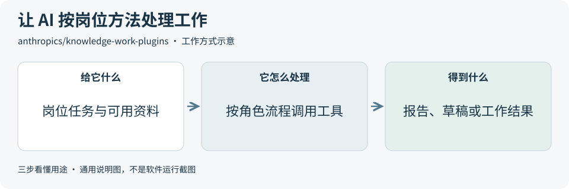

**举个例子**　客服角色需要读问题、查资料、整理回复。插件把这些步骤和工具组织起来，帮助任务保持一致。

**适合什么情况**　适合参考办公、产品管理和客户支持等岗位怎样组织 AI 工作流。

**门槛与费用**　门槛中。主要面向 Claude Cowork 与 Claude Code；工具连接还需要对应账号。

**注意事项**　能借鉴工作方法，不代表可原样装进任何应用。连接工具的权限也要单独配置。

**小范围第一步**　先读一个岗位插件，列出它接收什么、做哪些步骤、交付什么。

周新增 Star **+3,227** · 总 Star **29,619** · Python · Apache-2.0 · 下降 1

[官方文档](https://github.com/anthropics/knowledge-work-plugins/blob/02ffa99ff00ce4d3046ccebabb8357cb39f3ab06/README.md) · [仓库](https://github.com/anthropics/knowledge-work-plugins)

## 15. [MiroFish](https://github.com/666ghj/MiroFish)

**一句话用途**　让多个 AI 角色在模拟环境里互动，生成推演报告。

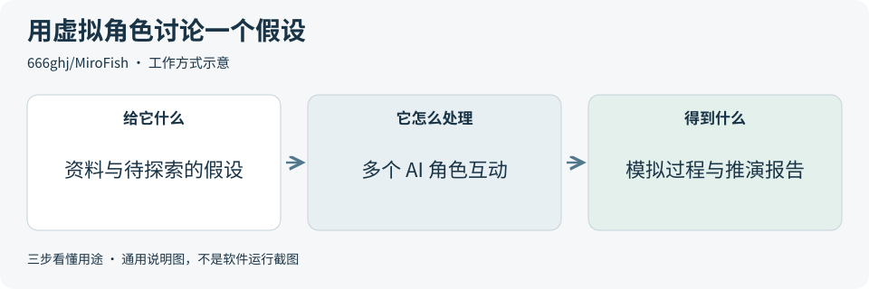

**举个例子**　对一个新功能做虚拟角色讨论，从报告中寻找值得向真实用户追问的问题。

**适合什么情况**　适合探索多角色模拟、内容情节或待验证假设。可以帮助提出问题，不能替代实证。

**门槛与费用**　门槛高。需要前后端环境和模型 API；多角色运行可能消耗较多额度。

**注意事项**　模拟结果不是实际用户反馈。项目的预测准确性，本期没有验证。

**小范围第一步**　先看官方演示，区分输入事实、模型设定和报告推断。

周新增 Star **+2,222** · 总 Star **79,099** · Python · AGPL-3.0 · 上升 1

[官方文档](https://github.com/666ghj/MiroFish/blob/7657031ac01184afe2cb220f5ee3545573b5e843/README.md) · [仓库](https://github.com/666ghj/MiroFish)

## 16. [text-to-cad](https://github.com/earthtojake/text-to-cad)

**一句话用途**　让 AI 助手根据要求生成 3D 工程模型和图纸。

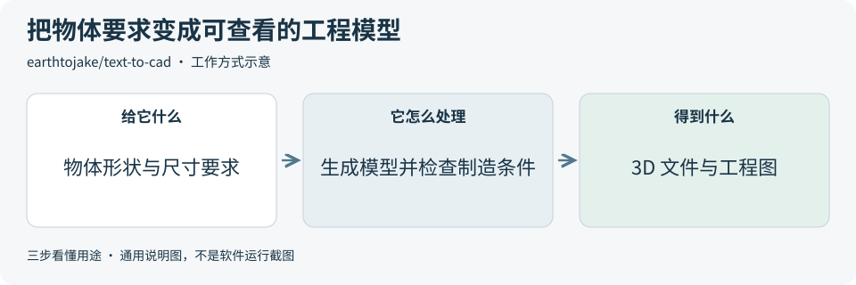

**举个例子**　想设计一个桌面支架，可以描述外形与尺寸，让助手生成模型，再检查结构是否符合要求。

**适合什么情况**　适合简单零件、摆件和需要工程尺寸的 3D 设计探索。

**门槛与费用**　门槛中。需要本地 CAD 环境和 AI 助手；打印与制造另有成本。

**注意事项**　模型能显示不代表可以可靠制造。尺寸、结构和可制造性仍需验证。

**小范围第一步**　先选一个尺寸明确的简单物体，查看模型和工程图示例。

周新增 Star **+2,173** · 总 Star **20,207** · Python · MIT · 下降 1

[官方文档](https://github.com/earthtojake/text-to-cad/blob/24573128ceaab564f497d7c12f995c41784c9539/README.md) · [仓库](https://github.com/earthtojake/text-to-cad)

## 17. [t3code](https://github.com/pingdotgg/t3code)

**一句话用途**　从电脑、网页或手机控制本机已经可用的 AI 编程助手。

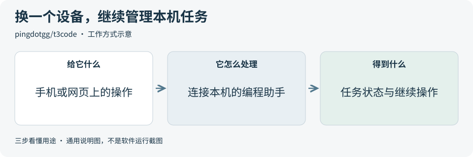

**举个例子**　电脑上的助手还在处理任务，外出时可以在手机上查看进展，并继续管理同一个工作过程。

**适合什么情况**　适合有远程查看和继续 AI 开发任务需求的人，也可参考任务控制界面。

**门槛与费用**　门槛中。需要先登录支持的编程助手；沿用其订阅或 API。

**注意事项**　它提供控制界面，不提供独立免费的模型。远程体验也依赖本机运行和连接状态。

**小范围第一步**　先看远程操作演示，确认它能解决一个具体的使用需求。

周新增 Star **+1,574** · 总 Star **27,512** · TypeScript · MIT · 上升 1

[官方文档](https://github.com/pingdotgg/t3code/blob/7ac952c630ef8a60d14ca8f6a0c7adce33db4bae/README.md) · [仓库](https://github.com/pingdotgg/t3code)

## 18. [skills](https://github.com/vercel-labs/skills)

**一句话用途**　帮助查找、安装、更新和管理 AI 助手的 Skills。

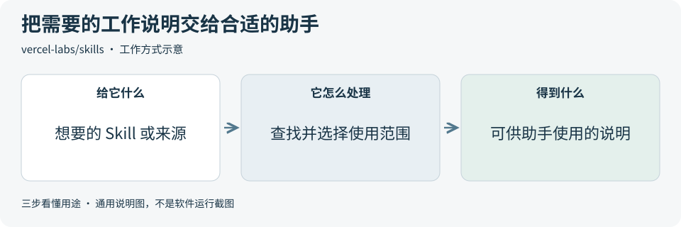

**举个例子**　找到一个画流程图的 Skill 后，可以选择只给一个项目使用，或整理给多个支持的助手使用。

**适合什么情况**　适合需要管理多种 Skills 和多个 AI 助手的人。它是管理工具，不是模型。

**门槛与费用**　门槛低。需要相应运行环境；使用 Skill 的模型费用另算。

**注意事项**　安装前先阅读说明与来源。工作说明也可能包含不合适的操作要求。

**小范围第一步**　先查看一个来源有哪些 Skills，再选一个实际需要的。

周新增 Star **+1,561** · 总 Star **34,859** · TypeScript · MIT · 新上榜

[官方文档](https://github.com/vercel-labs/skills/blob/13e4063a1cf913f5606d57d42ab83a86f5001e04/README.md) · [仓库](https://github.com/vercel-labs/skills)

## 19. [heretic](https://github.com/p-e-w/heretic)

**一句话用途**　研究和改变开放权重模型何时会拒绝回答。

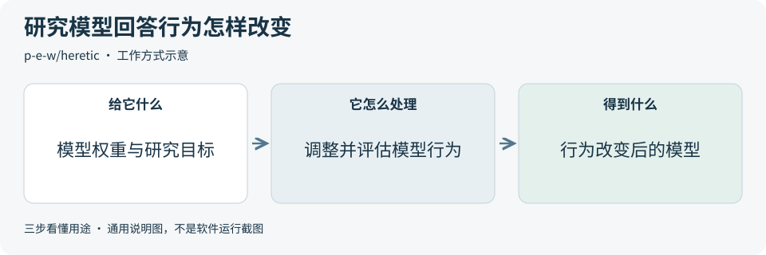

**举个例子**　研究人员比较模型修改前后的回答表现，检查拒绝行为改变时，其他能力是否也受到影响。

**适合什么情况**　适合专业模型行为研究。普通应用开发通常不需要直接修改模型权重。

**门槛与费用**　门槛高。需要可修改的模型权重和相应计算资源。

**注意事项**　减少拒绝不等于提高正确率，也可能改变其他行为。不能只看一种指标。

**小范围第一步**　先看评估方法，明确研究结果应该怎样衡量。

周新增 Star **+1,494** · 总 Star **35,208** · Python · AGPL-3.0 · 持平

[官方文档](https://github.com/p-e-w/heretic/blob/66a952b49b00bfd1854bdad769fee5fb225b53be/README.md) · [仓库](https://github.com/p-e-w/heretic)

## 20. [video-shotcraft](https://github.com/Vincentwei1021/video-shotcraft)

**一句话用途**　给 AI 提供镜头和动效模板，帮助制作产品介绍视频。

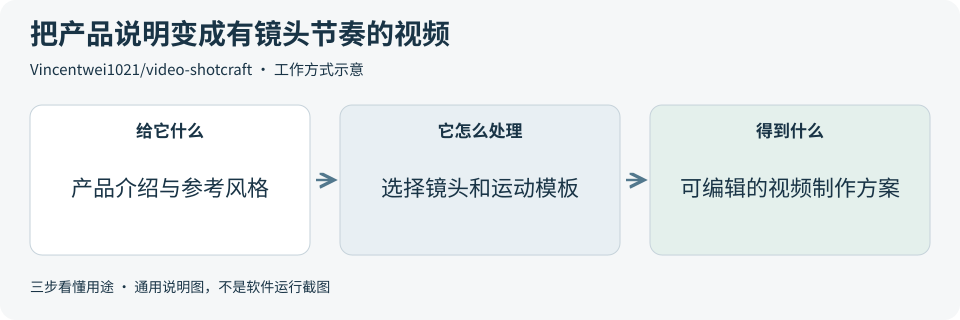

**举个例子**　介绍一个新工具时，可以从模板选择产品特写、文字出场和转场，让短片有更清楚的展示节奏。

**适合什么情况**　适合需要产品介绍、功能宣传或有镜头设计的视频内容。

**门槛与费用**　门槛中。需要配套视频制作环境；部分素材或模型生成可能收费。

**注意事项**　依赖 Remotion 等工具，采用前还要核对依赖的授权和费用。模板也不能代替内容与成片检查。

**小范围第一步**　先看镜头预览，选两三个适合主题的镜头做短小样。

周新增 Star **+1,264** · 总 Star **11,879** · TypeScript · Apache-2.0 · 新上榜

[官方文档](https://github.com/Vincentwei1021/video-shotcraft/blob/13c74a707786872a18e3317e48c5c94011027620/README.md) · [仓库](https://github.com/Vincentwei1021/video-shotcraft)

## 来源与选取方法

候选池 44 个，GitHub 可识别开源许可证且未归档的候选 34 个，人工复核后入榜 20 个。抓取时间与原榜名次见 [本期数据](../data/2026-10-14.json)。

- [chthollyphile/folia-major](https://github.com/chthollyphile/folia-major/blob/fb510b9d22e0f9a9f272aca5dd3e84e6f73c46c6/README.md) 暂未收录：仓库识别为 AGPL-3.0，但 README 另有仅个人学习与非营利用途的表述；许可说明有待确认，本期暂不收录。
- [周榜来源 1](https://github.com/trending?since=weekly)
- [周榜来源 2](https://github.com/trending/python?since=weekly)
- [周榜来源 3](https://github.com/trending/typescript?since=weekly)
- [周榜来源 4](https://github.com/trending/javascript?since=weekly)

[排名和更新规则](../UPDATE_GUIDE.md) · [通用应用场景](../USE_CASES.md)

名次变化比较本仓库上期资料，不是 GitHub 官方榜名次。图解和应用例子仅作说明。

[返回资料首页](../README.md)
