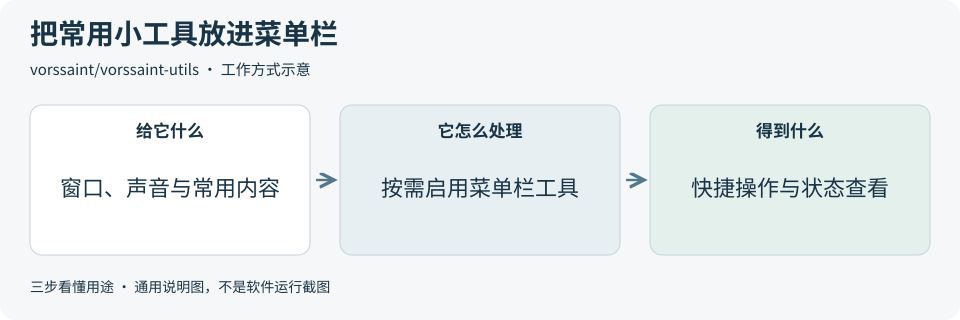
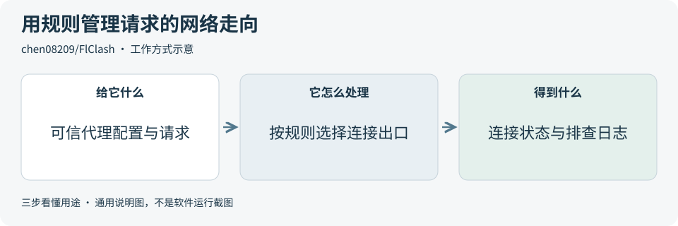

# 2026-10-15 · 每日开源项目推荐 5 个

每天在同一个仓库新增一份资料，每份 5 个项目，避开全部历史推荐。先看速览，再点项目查看图解和例子。

热度参考抓取时的 GitHub 滚动周榜，**不是一天内的新增 Star**。用途按公开文档整理，图解和例子用于解释用法；本期未实际安装或运行这些项目。

**先认两个词**　Agent 是能分步办事的 AI 助手；Skill 是写给 AI 助手的工作说明。Star 是关注热度，不代表质量。

## 本期速览

| 名次 | 项目 | 本周新增 Star | 一句话用途 | 可用场景 |
| --- | --- | ---: | --- | --- |
| 1 | [pentagi](#project-01) | +3,781 | 让多个 AI 助手协作做已授权的安全测试，并整理报告。 | 授权安全测试、测试报告 |
| 2 | [vorssaint-utils](#project-02) | +2,797 | 把窗口、声音和剪贴板等小工具集中到 Mac 菜单栏。 | 桌面效率工具、菜单栏设计 |
| 3 | [mxc](#project-03) | +1,403 | 让 AI 生成的代码、插件或命令在权限受限的环境里运行。 | AI 执行工具、插件隔离 |
| 4 | [xerj](#project-04) | +1,379 | 为本地文件夹建立搜索索引，让 AI 查到相关代码和资料片段。 | 文档问答、代码检索 |
| 5 | [FlClash](#project-05) | +1,176 | 管理已有代理连接和分流规则，并查看网络连接状态。 | 网络配置、请求走向排查 |

## 可以先看

做文档问答或代码检索，先看 **XERJ**；做会执行代码的 AI 产品，先看 **MXC**；想了解 Mac 效率工具，先看 **Vorssaint**。另外两项分别面向授权安全测试和网络请求排查。

## 1. [pentagi](https://github.com/vxcontrol/pentagi)

**一句话用途**　让多个 AI 助手协作做已授权的安全测试，并整理报告。

**举个例子**　准备发布一个测试网站时，可以先划定允许检查的测试地址与范围，让它组织检查、保存工具输出，再由安全人员复核报告，确定哪些问题需要修复。

**适合什么情况**　产品上线前需要安全检查时，可研究它如何拆分任务、调用检查工具并记录过程。适合有安全经验的团队评估，不宜把自动报告直接当成验收结论。

**门槛与费用**　门槛高。需要容器运行环境 Docker 和可用 AI 模型。云模型与搜索服务可能另收费；选本地模型则需评估硬件，部分企业能力也有独立服务条件。

**注意事项**　它会主动运行测试工具，只能在自有或明确授权的范围内使用。隔离配置、漏洞真实性和影响程度都需要专业人员复核。

**小范围第一步**　先读运行要求和示例报告，再在有明确授权的隔离测试环境中验证一个最小任务，检查全过程日志。

周新增 Star **+3,781** · 总 Star **29,482** · Go · MIT · 首次推荐

[官方文档](https://github.com/vxcontrol/pentagi/blob/843dfeb4bfc809c09d1bc5022e567c602d8fc9dd/README.md) · [仓库](https://github.com/vxcontrol/pentagi)

## 2. [vorssaint-utils](https://github.com/vorssaint/vorssaint-utils)

**一句话用途**　把窗口、声音和剪贴板等小工具集中到 Mac 菜单栏。

**举个例子**　一边开会一边看演示视频时，可以分别调节不同应用的音量，再用窗口布局把资料摆好。若做桌面工具产品，可参考这种把常用动作放在一个入口里的方式。

**适合什么情况**　日常可用来管理窗口和应用音量；开发桌面效率工具时，也可参考它的统一入口、按需启用功能和权限说明设计。

**门槛与费用**　门槛低。官方 README 说明可免费使用，无需账号或订阅。目前要求 Apple 芯片的 Mac，以及 macOS 14 或更新版本；改造代码另需开发环境。

**注意事项**　部分功能需要辅助功能或录屏等权限，要按实际启用项理解。源码采用 GPL-3.0 或更新版本，名称、图标和外观另有说明，复用前分别核对。

**小范围第一步**　先看功能与权限说明，只挑窗口布局或音量管理一项试用，确认操作和退出方式后再考虑其他功能。

周新增 Star **+2,797** · 总 Star **27,226** · Swift · GPL-3.0 · 首次推荐

[官方文档](https://github.com/vorssaint/vorssaint-utils/blob/794608a58d8a88608d3c3cb2e4f22373cf52bfdc/README.md) · [仓库](https://github.com/vorssaint/vorssaint-utils)

## 3. [mxc](https://github.com/microsoft/mxc)

**一句话用途**　让 AI 生成的代码、插件或命令在权限受限的环境里运行。

**举个例子**　一个表格助手只需读取测试文件并写出结果时，可以先限定读写目录，并在支持的后端配置网络限制。既检查任务能否完成，也检查越界访问是否被拒绝。

**适合什么情况**　做会执行脚本的 AI 产品时，可在生成代码与真正运行之间加入受限执行层，按任务只开放必要文件和网络权限。它是供产品接入的组件。

**门槛与费用**　门槛高。代码采用 MIT 许可。需要开发者接入组件、配置系统支持的隔离环境，并承担本地或服务器运行资源；不会自动提供 AI 模型。

**注意事项**　不同系统使用不同隔离后端，网络限制等能力也有差异，部分后端仍属实验性。权限配置和隔离效果需要实际验证。

**小范围第一步**　先用没有敏感信息的测试目录，验证允许读取的文件可访问、范围外的文件会被拒绝，再考虑接入产品。

周新增 Star **+1,403** · 总 Star **2,806** · Rust · MIT · 首次推荐

[官方文档](https://github.com/microsoft/mxc/blob/8188df6a8b211e5be99dd8d825a901cb6abea7e3/README.md) · [仓库](https://github.com/microsoft/mxc)

## 4. [xerj](https://github.com/xerj-org/xerj)

**一句话用途**　为本地文件夹建立搜索索引，让 AI 查到相关代码和资料片段。

**举个例子**　要做产品操作问答，可以先索引一份公开使用手册。用户问“怎样导出数据”时，先找相关章节，再让 AI 依据章节解释，并保留出处，便于读者核对。

**适合什么情况**　资料较多、AI 经常反复读文件时，可先建立索引，再按问题找相关片段。既可用于代码查找，也可作为文档问答的检索部分。

**门槛与费用**　门槛中。代码采用 Apache-2.0 许可，需要运行本地索引服务。默认文本索引可离线使用；语义模型、重排或 AI 问答的模型与服务成本需另行确认。

**注意事项**　先只索引愿意交给助手读取的内容，共享环境要正确配置认证。检索到相关段落后仍须核对原文，不能把作者的测试数字当作本期效果证明。

**小范围第一步**　用十来份公开文档建立小索引，提几个已经知道答案的问题，核对返回的段落、文件位置和遗漏情况。

周新增 Star **+1,379** · 总 Star **4,461** · Rust · Apache-2.0 · 首次推荐

[官方文档](https://github.com/xerj-org/xerj/blob/3a4374d64aa0fca32497b165bbcdf982b32034b3/README.md) · [仓库](https://github.com/xerj-org/xerj)

## 5. [FlClash](https://github.com/chen08209/FlClash)

**一句话用途**　管理已有代理连接和分流规则，并查看网络连接状态。

**举个例子**　调试一个同时访问内网接口和外部服务的工具时，可以通过分流规则安排请求走向，再到连接视图查看命中的规则与出口，帮助判断问题出在应用还是网络配置。

**适合什么情况**　开发时需要区分内网与其他网络请求，或排查某个服务的访问路径时，可用规则管理连接，并在请求与日志界面核对实际走向。

**门槛与费用**　门槛中。客户端开源，支持 Android、Windows、macOS 和 Linux。需要已有可信配置；代理服务和带宽可能另收费，改造代码还需 Flutter 等开发能力。

**注意事项**　客户端本身不附送代理节点。导入配置要确认来源，开启系统代理或网络接管模式会影响其他应用联网，测试后需核对恢复情况。

**小范围第一步**　先备份已有网络配置，在测试环境使用一个可信配置，检查一条请求的走向，以及关闭后能否恢复原来的访问方式。

周新增 Star **+1,176** · 总 Star **55,788** · Dart · GPL-3.0 · 首次推荐

[官方文档](https://github.com/chen08209/FlClash/blob/03f955382409a4a7ac1f3f92e46d9fcc6d39f106/README.md) · [仓库](https://github.com/chen08209/FlClash)

## 来源与选取方法

候选池 110 个，可识别开源许可证且未归档的候选 95 个。已核对 29 个历史推荐，剩余未介绍过的候选 70 个；再核对用途与许可，选出本期 5 个。抓取时间与原榜名次见 [本期数据](../data/2026-10-15.json)。

- [chthollyphile/folia-major](https://github.com/chthollyphile/folia-major/blob/7c5f67319cd36c3b7162d32ee7be81521062c55c/README.md) 暂未收录：元数据标为 AGPL-3.0，同版本 README 又限制个人学习、技术交流与非营利测试，并明确禁止商用。许可表述不一致，暂不收录，等待澄清。
- [周榜来源 1](https://github.com/trending?since=weekly)
- [周榜来源 2](https://github.com/trending/python?since=weekly)
- [周榜来源 3](https://github.com/trending/typescript?since=weekly)
- [周榜来源 4](https://github.com/trending/javascript?since=weekly)
- [周榜来源 5](https://github.com/trending/go?since=weekly)
- [周榜来源 6](https://github.com/trending/rust?since=weekly)
- [周榜来源 7](https://github.com/trending/swift?since=weekly)
- [周榜来源 8](https://github.com/trending/dart?since=weekly)
- [周榜来源 9](https://github.com/trending/java?since=weekly)

[排名和更新规则](../UPDATE_GUIDE.md) · [通用应用场景](../USE_CASES.md)

序号是本期推荐顺序，不是 GitHub 官方总榜排名。图解和应用例子仅作说明。

[返回资料首页](../README.md)
