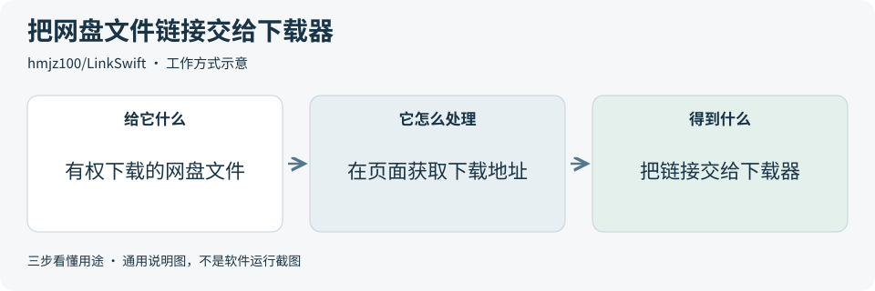
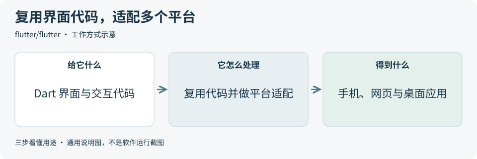
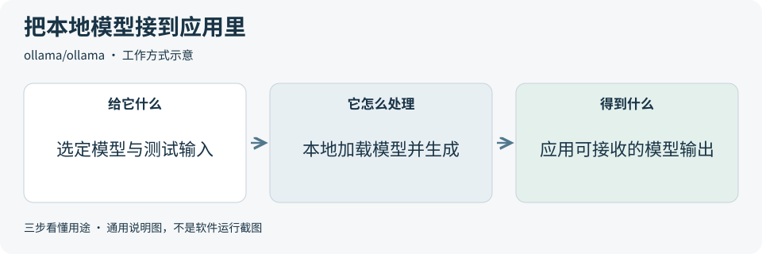
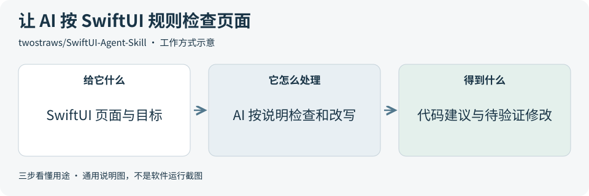

# 2026-10-16 · 每日开源项目推荐 5 个

每天在同一个仓库新增一份资料，每份 5 个项目，避开全部历史推荐。先看速览，再点项目查看图解和例子。

热度参考抓取时的 GitHub 滚动周榜，**不是一天内的新增 Star**。用途按公开文档整理，图解和例子用于解释用法；本期未实际安装或运行这些项目。

**先认两个词**　Agent 是能分步办事的 AI 助手；Skill 是写给 AI 助手的工作说明。Star 是关注热度，不代表质量。

## 本期速览

| 名次 | 项目 | 本周新增 Star | 一句话用途 | 可用场景 |
| --- | --- | ---: | --- | --- |
| 1 | [LinkSwift](#project-01) | +1,581 | 在网盘页面获取文件下载地址，再交给下载器处理。 | 合法文件下载、下载流程参考 |
| 2 | [flutter](#project-02) | +1,218 | 用一套 Dart 界面和交互代码开发手机、网页和桌面应用。 | 跨平台产品、交互原型 |
| 3 | [ollama](#project-03) | +1,038 | 在本机运行可下载的 AI 模型，并给应用提供调用接口。 | 本地 AI 原型、模型接口 |
| 4 | [SwiftUI-Agent-Skill](#project-04) | +900 | 给 AI 编程助手一套 SwiftUI 检查与写代码的工作说明。 | SwiftUI 开发、代码检查 |
| 5 | [ghidra-mcp](#project-05) | +791 | 把 AI 助手连接到 Ghidra，辅助查看编译后程序的函数和逻辑。 | 程序分析、函数说明整理 |

## 可以先看

做跨平台应用，先看 **Flutter**；想给产品接上本地模型，先看 **Ollama**；已有 SwiftUI 项目，可以看 **SwiftUI Agent Skill**。另外两项分别帮助衔接网盘下载流程，以及连接 AI 做程序分析。

## 1. [LinkSwift](https://github.com/hmjz100/LinkSwift)

**一句话用途**　在网盘页面获取文件下载地址，再交给下载器处理。

**举个例子**　整理一批自己上传的公开素材时，可以在网盘页面获取下载地址，再交给支持的下载器处理。若做文件管理工具，可参考这个衔接流程；实际速度仍取决于网盘服务。

**适合什么情况**　需要下载自己或获授权的网盘文件时，可研究它如何把页面里的下载操作接到其他下载器。开发文件工具时，也可参考这种网页脚本与下载器衔接的方式。

**门槛与费用**　门槛中。需要支持用户脚本的浏览器扩展，并在支持的网盘页面使用。脚本采用 AGPL-3.0 许可；网盘账号和服务条件另行确认。

**注意事项**　这是运行在网盘页面里的脚本，采用前核对来源与访问范围。作者明确不承诺破解限速，速度和可用性仍受平台、账号与网络影响。

**小范围第一步**　先查官方支持的网盘与安装源，用自己上传的一个测试文件，验证下载地址获取和下载器接收流程。

周新增 Star **+1,581** · 总 Star **22,914** · JavaScript · AGPL-3.0 · 首次推荐

[官方文档](https://github.com/hmjz100/LinkSwift/blob/88f775d84a57764def07a32da9457cf3043ad11b/README.md) · [仓库](https://github.com/hmjz100/LinkSwift)

## 2. [flutter](https://github.com/flutter/flutter)

**一句话用途**　用一套 Dart 界面和交互代码开发手机、网页和桌面应用。

**举个例子**　一个清单产品想同时提供手机端和桌面端，可以先共用列表与编辑页面，再为触屏、鼠标和不同窗口宽度调整交互。这样能复用一部分开发工作，同时保留平台适配。

**适合什么情况**　产品需要覆盖多个平台，且希望复用界面与业务交互时，可以考虑它。开发者通过组件搭页面，再为不同设备和系统做适配。

**门槛与费用**　门槛中。框架免费开源，采用 BSD-3-Clause 许可。需要学习 Dart 并准备目标平台的开发环境，应用发布、后端与其他服务费用另算。

**注意事项**　不同平台仍需分别打包和测试。文件访问、通知和系统窗口等能力，可能需要选用插件或补充平台代码，先核对目标平台支持。

**小范围第一步**　先做一个只有列表、编辑表单和本地保存的小样，选两种目标平台，分别验证输入、窗口尺寸与数据保存。

周新增 Star **+1,218** · 总 Star **180,228** · Dart · BSD-3-Clause · 首次推荐

[官方文档](https://github.com/flutter/flutter/blob/f7614d2898287d9a00e4fe7cc3b56ef32fa2837d/README.md) · [仓库](https://github.com/flutter/flutter)

## 3. [ollama](https://github.com/ollama/ollama)

**一句话用途**　在本机运行可下载的 AI 模型，并给应用提供调用接口。

**举个例子**　验证一个“给产品描述自动打标签”的小功能时，可把公开样例交给本地模型，再由应用调用 Ollama 接口取得标签。先检查准确率和等待时间，再判断是否值得接入。

**适合什么情况**　需要试验本地问答、分类或文本生成时，可让应用通过统一接口调用选定模型。它也提供 Python、JavaScript 等接入方式，并支持云端模型选项。

**门槛与费用**　门槛中。服务代码采用 MIT 许可。本地运行要准备模型下载空间和足够内存，大模型可能需要更强硬件；云模型或其他服务的费用需另外核对。

**注意事项**　本地与云端是不同运行方式，采用前确认数据发往哪里。每个模型的许可、能力和硬件要求也要单独核对，工具开源不等于所有模型都适用。

**小范围第一步**　先看官方模型说明，挑一个设备能承受的小模型，用十条公开样例评估输出、等待时间和资源占用。

周新增 Star **+1,038** · 总 Star **183,338** · Go · MIT · 首次推荐

[官方文档](https://github.com/ollama/ollama/blob/a5ab12cf9eda93ba4772b1ba8e775c3e64aca2eb/README.md) · [仓库](https://github.com/ollama/ollama)

## 4. [SwiftUI-Agent-Skill](https://github.com/twostraws/SwiftUI-Agent-Skill)

**一句话用途**　给 AI 编程助手一套 SwiftUI 检查与写代码的工作说明。

**举个例子**　一个设置页有开关、列表和页面跳转时，可让 AI 按这套说明检查状态更新、旧 API 和朗读标签，再在测试设备上确认开关变化、跳转和辅助朗读是否正常。

**适合什么情况**　已有 SwiftUI 项目、希望 AI 更注意状态管理、布局、性能和无障碍支持时，可用这套说明约束检查重点，帮助整理修改建议。

**门槛与费用**　门槛中。规则文件采用 MIT 许可。需要 SwiftUI 工程和支持 Skill 的 AI 编程助手；Skill 就是给 AI 的工作说明，助手订阅或模型费用另算，构建应用还需相应开发环境。

**注意事项**　规则面向较新的 Swift 与 iOS，已有项目的最低系统版本需要另外核对。AI 提出的改动仍须经过编译、实际运行和界面检查。

**小范围第一步**　选一个小页面，只让助手检查旧 API 或无障碍标签中的一项，逐条确认建议，再决定是否修改代码。

周新增 Star **+900** · 总 Star **6,096** · 未标注 · MIT · 首次推荐

[官方文档](https://github.com/twostraws/SwiftUI-Agent-Skill/blob/f9800713b24580bc444931949aad4519128605e8/README.md) · [仓库](https://github.com/twostraws/SwiftUI-Agent-Skill)

## 5. [ghidra-mcp](https://github.com/bethington/ghidra-mcp)

**一句话用途**　把 AI 助手连接到 Ghidra，辅助查看编译后程序的函数和逻辑。

**举个例子**　自己编译的测试程序中有“保存文件”流程时，可让 AI 读取函数列表和相关反编译结果，整理可能的调用关系，再与已知源代码对照，找出解释中的错误或遗漏。

**适合什么情况**　已有 Ghidra 分析工程、需要让 AI 读取函数、反编译文本和调用关系时，可研究这个桥接项目。适合有程序分析经验的开发者，帮助整理线索与说明。

**门槛与费用**　门槛高。代码采用 Apache-2.0 许可。需要版本匹配的 Ghidra 扩展、Java 与桥接组件，并连接支持工具接口的 AI 客户端；模型费用另算。

**注意事项**　只分析有权研究的程序，先使用工程副本。部分工具能修改分析结果或写文件；共享访问要配置认证，AI 对反编译结果的解释也需要人工复核。

**小范围第一步**　准备一个自己编译的小程序和新的分析工程，仅验证查看函数与反编译文本，再用已知源代码核对 AI 的解释。

周新增 Star **+791** · 总 Star **5,657** · Java · Apache-2.0 · 首次推荐

[官方文档](https://github.com/bethington/ghidra-mcp/blob/cf8b12db27eb139b28b90eaa3488306da910d759/README.md) · [仓库](https://github.com/bethington/ghidra-mcp)

## 来源与选取方法

候选池 111 个，可识别开源许可证且未归档的候选 93 个。已核对 34 个历史推荐，剩余未介绍过的候选 66 个；再核对用途与许可，选出本期 5 个。抓取时间与原榜名次见 [本期数据](../data/2026-10-16.json)。

- [chthollyphile/folia-major](https://github.com/chthollyphile/folia-major/blob/1b39fd868e2ddda95788f1baa839c032f3e7a285/README.md) 暂未收录：元数据标为 AGPL-3.0，同版本 README 又限制个人学习、技术交流与非营利测试，并明确禁止商用。许可表述不一致，暂不收录，等待澄清。
- [周榜来源 1](https://github.com/trending?since=weekly)
- [周榜来源 2](https://github.com/trending/python?since=weekly)
- [周榜来源 3](https://github.com/trending/typescript?since=weekly)
- [周榜来源 4](https://github.com/trending/javascript?since=weekly)
- [周榜来源 5](https://github.com/trending/go?since=weekly)
- [周榜来源 6](https://github.com/trending/rust?since=weekly)
- [周榜来源 7](https://github.com/trending/swift?since=weekly)
- [周榜来源 8](https://github.com/trending/dart?since=weekly)
- [周榜来源 9](https://github.com/trending/java?since=weekly)

[排名和更新规则](../UPDATE_GUIDE.md) · [通用应用场景](../USE_CASES.md)

序号是本期推荐顺序，不是 GitHub 官方总榜排名。图解和应用例子仅作说明。

[返回资料首页](../README.md)
