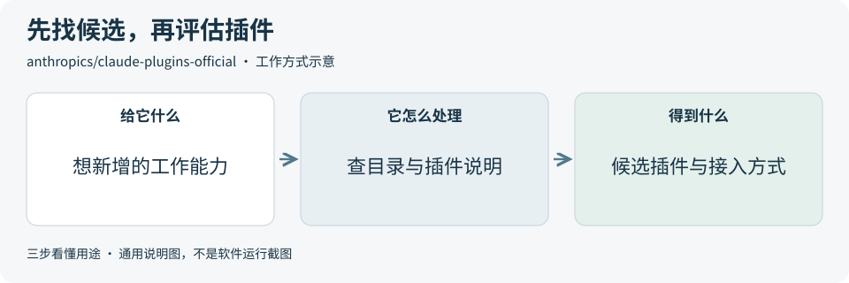

# 2026-10-17 · 每日开源项目推荐 5 个

每天在同一个仓库新增一份资料，每份 5 个项目，避开全部历史推荐。先看速览，再点项目查看图解和例子。

热度参考抓取时的 GitHub 滚动周榜，**不是一天内的新增 Star**。用途按公开文档整理，图解和例子用于解释用法；本期未实际安装或运行这些项目。

**先认两个词**　Agent 是能分步办事的 AI 助手；Skill 是写给 AI 助手的工作说明。Star 是关注热度，不代表质量。

## 本期速览

| 名次 | 项目 | 本周新增 Star | 一句话用途 | 可用场景 |
| --- | --- | ---: | --- | --- |
| 1 | [VoiceStudio](#project-01) | +14,708 | 把语音生成、录音转文字和视频配音集中到一个工作台。 | 配音原型、语音工作流 |
| 2 | [LibreTV](#project-02) | +4,775 | 把多个视频源的搜索结果聚合起来，在网页里选择来源播放。 | 多源视频目录、播放界面参考 |
| 3 | [scientific-agent-skills](#project-03) | +3,170 | 给 AI 提供数据分析、文献整理和科研工具的工作说明合集。 | 数据检查、研究辅助流程 |
| 4 | [ai-job-search](#project-04) | +2,752 | 把岗位评估、简历和求职信草稿、面试准备整理成 AI 工作流。 | 求职助手、申请材料整理 |
| 5 | [claude-plugins-official](#project-05) | +2,328 | 为 Claude Code 查找插件，并了解各插件的功能和接入方式。 | 编程助手扩展、插件结构参考 |

## 可以先看

做语音工作流原型，先看 **VoiceStudio**，并先核对模型与声音许可；做表格检查或资料分析，先看 **Scientific Agent Skills**；研究求职助手流程，可以看 **AI Job Search**。另外两项分别是视频聚合界面和 Claude Code 插件目录。

## 1. [VoiceStudio](https://github.com/debpalash/VoiceStudio)

**一句话用途**　把语音生成、录音转文字和视频配音集中到一个工作台。

**举个例子**　做一段不商用的功能演示时，可先生成一句解说，试听并调整停顿，再与视频时间对齐。若要用于商业内容，先逐项确认所选模型和输出音频的许可。

**适合什么情况**　需要做解说、转写或语音编辑原型时，可研究它如何把模型管理、输入材料、试听和导出串起来，也可参考它的本地接口接入方式。

**门槛与费用**　门槛中。应用按 AGPL-3.0 开放，Pro 功能和闭源集成另有商业许可方案。模型下载与硬件资源另算，可选远程服务也需核对费用；各平台支持情况不同。

**注意事项**　作者将默认模型权重标为 CC-BY-NC，不能据应用许可就判断生成音频可商用。模型、音频输出和声音授权要分别核对；克隆声音需获许可。

**小范围第一步**　先查所选平台和引擎的硬件要求，用公开练习文案及本人授权录音做不商用的短片段，检查发音、停顿和生成耗时。

周新增 Star **+14,708** · 总 Star **71,217** · Python · AGPL-3.0 · 首次推荐

[官方文档](https://github.com/debpalash/VoiceStudio/blob/f47221a1f0af89df27c34747471daa30391a9487/README.md) · [仓库](https://github.com/debpalash/VoiceStudio)

## 2. [LibreTV](https://github.com/LibreSpark/LibreTV)

**一句话用途**　把多个视频源的搜索结果聚合起来，在网页里选择来源播放。

**举个例子**　两个授权来源都收录同一课程时，可参考它把结果合并成一张卡片的方式，让读者选择来源播放，并在同一浏览器继续观看。课程接口仍需按格式适配。

**适合什么情况**　已有多个获授权视频目录时，可参考它的并行搜索、同名聚合、换源和续看流程。需要自己准备合适的数据源，接口格式也要适配。

**门槛与费用**　门槛中。代码采用 AGPL-3.0，运行需要服务器或容器环境，以及可用视频源。部署、带宽和内容服务的费用另算，代码许可不包含视频内容授权。

**注意事项**　只接入有权使用的数据源；公开部署前配置访问保护并核对代理接口限制。进度默认保存在本机浏览器，来源和网络变化仍可能影响播放。

**小范围第一步**　先用一个获授权的测试视频源，验证搜索、选来源、播放和同一浏览器续看，再考虑添加更多来源。

周新增 Star **+4,775** · 总 Star **18,837** · TypeScript · AGPL-3.0 · 首次推荐

[官方文档](https://github.com/LibreSpark/LibreTV/blob/9afeb3de0ae8824c97195bccfa956696d33cf066/README.md) · [仓库](https://github.com/LibreSpark/LibreTV)

## 3. [scientific-agent-skills](https://github.com/K-Dense-AI/scientific-agent-skills)

**一句话用途**　给 AI 提供数据分析、文献整理和科研工具的工作说明合集。

**举个例子**　一个数据导入功能需要先发现空值和字段问题时，可参考其探索性分析说明，用公开练习表生成汇总。先人工核对行列与缺失值统计，再考虑接入后续分析。

**适合什么情况**　做数据分析或资料辅助工具时，可参考先明确问题，再让 AI 按步骤调用分析工具和资料库，并保留可核对输出的方式；从一个小功能起步更容易评估。

**门槛与费用**　门槛中。仓库采用 MIT，个别 Skill 另有许可。需要 AI 助手与所选功能的依赖环境；模型调用和部分数据库服务可能收费，不能把整个目录理解成免费服务。

**注意事项**　它提供的是工作说明与工具包装。统计方法、图表和引文仍要回到数据与原文复核，每项 Skill、第三方软件及数据源的条件也要分别检查。

**小范围第一步**　先只选一个许可已核对的表格检查 Skill，用公开 CSV 核对行列、缺失值和输出，再决定是否添加其他分析工具。

周新增 Star **+3,170** · 总 Star **51,514** · Python · MIT · 首次推荐

[官方文档](https://github.com/K-Dense-AI/scientific-agent-skills/blob/a1043ef544e3a100c28e70a736b6cf32554d0677/README.md) · [仓库](https://github.com/K-Dense-AI/scientific-agent-skills)

## 4. [ai-job-search](https://github.com/MadsLorentzen/ai-job-search)

**一句话用途**　把岗位评估、简历和求职信草稿、面试准备整理成 AI 工作流。

**举个例子**　拿一份公开职位描述，先对照练习档案列出满足与欠缺条件，再生成求职信草稿。把已有证据和需要补充的经历分开，避免让 AI 替申请者编造项目。

**适合什么情况**　做求职或材料整理工具时，可参考先建立资料、再匹配岗位、起草并复核同一申请的流程。现成岗位搜索入口偏丹麦，其他地区需要改来源。

**门槛与费用**　门槛高。源码采用 MIT。完整流程主要基于 Claude Code，还需要 Python、Bun、LaTeX 等环境；AI 订阅或 API 调用费用另算，换地区和工具也需适配。

**注意事项**　申请内容必须与真实经历相符，个人资料会交给哪些模型服务要先核对。生成材料不代表已经投递，也不能把作者的求职经历当成效果保证。

**小范围第一步**　先用虚构练习档案和一份公开职位描述，只生成匹配分析与材料草稿，人工检查真实性和版式，再考虑真实流程。

周新增 Star **+2,752** · 总 Star **48,521** · Python · MIT · 首次推荐

[官方文档](https://github.com/MadsLorentzen/ai-job-search/blob/407dc34a2c4951e4ea3b047eaccdf2e4081a139a/README.md) · [仓库](https://github.com/MadsLorentzen/ai-job-search)

## 5. [claude-plugins-official](https://github.com/anthropics/claude-plugins-official)

**一句话用途**　为 Claude Code 查找插件，并了解各插件的功能和接入方式。

**举个例子**　想增加代码审查流程时，可以先找到目录里的 code-review 候选，查看操作方式、许可和会触及的仓库范围，再用示例变更做小范围测试。

**适合什么情况**　已经使用 Claude Code、想增加一项明确能力时，可从目录找到候选，再去插件说明里核对功能和条件。开发自己的插件时，也可参考它列出的标准结构。

**门槛与费用**　门槛中。目录代码采用 Apache-2.0，每个插件的许可、依赖与服务条件需单独确认。Claude Code、模型和第三方服务的费用另算，目录本身不提供这些服务。

**注意事项**　目录同时包含官方和外部插件，收录不等于每项都适合使用或已经由本期验证。采用前逐项核对来源、LICENSE 和读写范围。

**小范围第一步**　先读一个插件的说明和许可，在无敏感信息的小工程里只测试一项能力，确认读写范围与输出，再考虑长期启用。

周新增 Star **+2,328** · 总 Star **40,570** · Python · Apache-2.0 · 首次推荐

[官方文档](https://github.com/anthropics/claude-plugins-official/blob/ea10b213686c90bb1984b2016937310e05336cf3/README.md) · [仓库](https://github.com/anthropics/claude-plugins-official)

## 来源与选取方法

候选池 116 个，可识别开源许可证且未归档的候选 98 个。已核对 39 个历史推荐，剩余未介绍过的候选 71 个；再核对用途与许可，选出本期 5 个。抓取时间与原榜名次见 [本期数据](../data/2026-10-17.json)。

- [chthollyphile/folia-major](https://github.com/chthollyphile/folia-major/blob/190cb284204bb40fa5aca1bc985b565098ad3cc4/README.md) 暂未收录：元数据标为 AGPL-3.0，同版本 README 又限制个人学习、技术交流与非营利测试，并明确禁止商用。许可表述不一致，暂不收录，等待澄清。
- [周榜来源 1](https://github.com/trending?since=weekly)
- [周榜来源 2](https://github.com/trending/python?since=weekly)
- [周榜来源 3](https://github.com/trending/typescript?since=weekly)
- [周榜来源 4](https://github.com/trending/javascript?since=weekly)
- [周榜来源 5](https://github.com/trending/go?since=weekly)
- [周榜来源 6](https://github.com/trending/rust?since=weekly)
- [周榜来源 7](https://github.com/trending/swift?since=weekly)
- [周榜来源 8](https://github.com/trending/dart?since=weekly)
- [周榜来源 9](https://github.com/trending/java?since=weekly)

[排名和更新规则](../UPDATE_GUIDE.md) · [通用应用场景](../USE_CASES.md)

序号是本期推荐顺序，不是 GitHub 官方总榜排名。图解和应用例子仅作说明。

[返回资料首页](../README.md)
