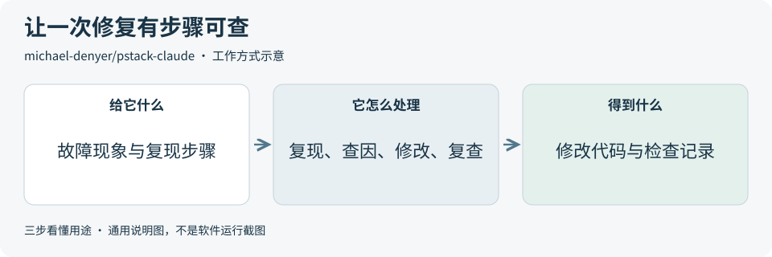
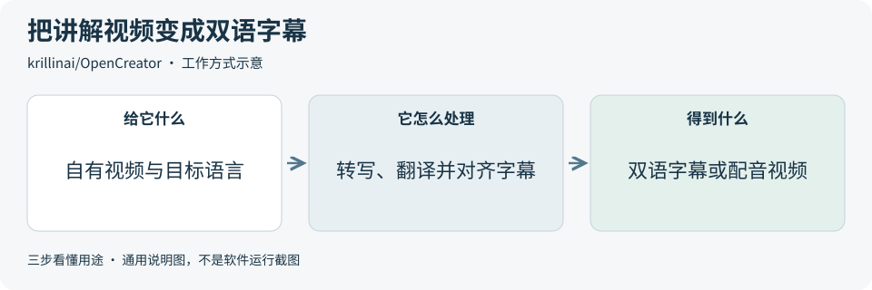
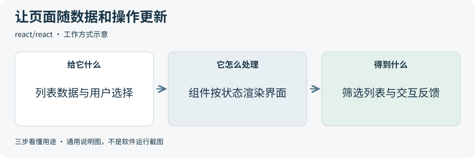
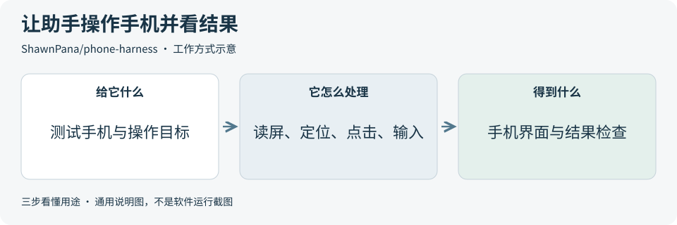

# 2026-10-18 · 每日开源项目推荐 5 个

每天在同一个仓库新增一份资料，每份 5 个项目，避开全部历史推荐。先看速览，再点项目查看图解和例子。

热度参考抓取时的 GitHub 滚动周榜，**不是一天内的新增 Star**。用途按公开文档整理，图解和例子用于解释用法；本期未实际安装或运行这些项目。

**先认两个词**　Agent 是能分步办事的 AI 助手；Skill 是写给 AI 助手的工作说明。Star 是关注热度，不代表质量。

## 本期速览

| 名次 | 项目 | 本周新增 Star | 一句话用途 | 可用场景 |
| --- | --- | ---: | --- | --- |
| 1 | [pstack-claude](#project-01) | +990 | 一套给 AI 编程助手用的工作说明，把修复问题组织成复现、查因、修改和复查。 | 软件排错、开发流程整理 |
| 2 | [OpenCreator](#project-02) | +946 | 把视频转写、字幕翻译、配音和导出放进一个可视化创作工作区。 | 视频字幕、内容生产流程 |
| 3 | [rakazo](#project-03) | +808 | 自托管的 AI 助手工作台，让机器人保留会话和记忆，并使用浏览器、终端与文件工具。 | 持续资料整理、助手原型 |
| 4 | [react](#project-04) | +695 | 用可复用的组件搭建网页界面，让按钮、表单和列表随数据变化更新。 | 交互网页、组件复用 |
| 5 | [phone-harness](#project-05) | +556 | 把看手机屏幕、点击和输入接给 AI 助手，用来操作真手机并检查界面结果。 | 手机流程演示、界面测试 |

## 可以先看

想让 AI 编程助手排错有章可循，先看 **pstack**；做双语视频字幕，先看 **OpenCreator**；检查手机上的点击与输入流程，先看 **Phone Harness**。另外两项分别适合研究持续工作的自托管助手和可复用网页组件。

## 1. [pstack-claude](https://github.com/michael-denyer/pstack-claude)

**一句话用途**　一套给 AI 编程助手用的工作说明，把修复问题组织成复现、查因、修改和复查。

**举个例子**　商品列表翻到第二页时，已选分类被清空。可让助手按这套流程找出状态丢失的位置，提出修改，并用同一组翻页操作复查。是否修好仍以实际检查为准。

**适合什么情况**　已经在用 AI 编程助手，想让它按固定步骤处理问题时，可借鉴这套流程；它也有规划、代码审查和性能排查等工作说明。

**门槛与费用**　门槛中。代码采用 MIT 许可；需要已有的 AI 编程工具和可用模型。模型调用按所选服务计费，多角色分工可能增加调用量；部分工作流另需 GitHub CLI 或 Bun。

**注意事项**　它依赖宿主工具执行，不能保证修复正确。助手读到的代码和会话内容仍会交给所选模型服务；重要修改需要人工审查，并按项目规则复查。

**小范围第一步**　挑一个可稳定复现的小问题，例如翻页后筛选条件丢失。让助手先复现，再修改，最后比较修改前后的同一组操作和检查记录。

周新增 Star **+990** · 总 Star **2,773** · JavaScript · MIT · 首次推荐

[官方文档](https://github.com/michael-denyer/pstack-claude/blob/7bad1ebc26faa268806bfbb84e5af55d178b68e4/README.md) · [仓库](https://github.com/michael-denyer/pstack-claude)

## 2. [OpenCreator](https://github.com/krillinai/OpenCreator)

**一句话用途**　把视频转写、字幕翻译、配音和导出放进一个可视化创作工作区。

**举个例子**　一段英文产品演示需要给中文观众看。可先导入自有视频，选择中英双语字幕，校对术语后导出 SRT 字幕文件；需要时再制作带字幕的视频。

**适合什么情况**　要把有权使用的讲解视频做成双语内容时，可研究它如何衔接转写、翻译、字幕样式和导出；也能参考它把对话操作与可视化设置结合的方式。

**门槛与费用**　门槛中。代码采用 Apache-2.0。桌面包包含执行引擎，模型任务仍需有效登录或自备服务配置；官方订阅、积分和外部模型服务分别核算。本地转写也需要计算资源。

**注意事项**　工作区保存在本地，所选云模型仍可能接收素材。字幕与翻译需要人工校对，配音需有声音授权；README 将自动剪辑和数字人列为开发中功能。

**小范围第一步**　只用一段约 30 秒的自有英文讲解，先生成中英双语字幕文件，核对人名、术语和时间轴，再考虑配音与成片导出。

周新增 Star **+946** · 总 Star **13,630** · TypeScript · Apache-2.0 · 首次推荐

[官方文档](https://github.com/krillinai/OpenCreator/blob/f4dbed139ac80a8d12952b64c9b6def59e42dbcc/README.md) · [仓库](https://github.com/krillinai/OpenCreator)

## 3. [rakazo](https://github.com/elie222/rakazo)

**一句话用途**　自托管的 AI 助手工作台，让机器人保留会话和记忆，并使用浏览器、终端与文件工具。

**举个例子**　比较两份公开产品说明时，可让机器人浏览资料、保存功能对照表。第二次会话再补充一份新说明，沿用既有记录继续整理，并逐项核对引用来源。

**适合什么情况**　希望同一个助手持续处理一类任务时，可参考它的机器人记忆、例行任务、工具连接和电脑环境管理；适合研究有记录可回看的工作流。

**门槛与费用**　门槛高。代码采用 Apache-2.0，目前为测试版。自托管需要 Docker 等运行环境和模型配置；本机计算、服务器、模型调用及可选云电脑或语音服务的费用另算。

**注意事项**　同一 Team 电脑内的机器人共享系统用户、工作区和浏览器资料，屏幕分开不等于进程隔离。不同信任范围的任务应使用独立电脑；外部模型和连接器另有数据与服务条款。

**小范围第一步**　先让一个机器人在独立测试电脑环境中整理两份公开资料并保存摘要，人工核对文件和工具记录，再尝试跨会话继续。

周新增 Star **+808** · 总 Star **4,467** · TypeScript · Apache-2.0 · 首次推荐

[官方文档](https://github.com/elie222/rakazo/blob/76f42599400335a57e0d0c85183d7fbbf4d7de7f/README.md) · [仓库](https://github.com/elie222/rakazo)

## 4. [react](https://github.com/react/react)

**一句话用途**　用可复用的组件搭建网页界面，让按钮、表单和列表随数据变化更新。

**举个例子**　一个商品目录需要分类筛选和收藏。可把商品卡片写成组件，用状态记录当前分类和收藏项；用户勾选后，界面显示对应列表与按钮状态。

**适合什么情况**　页面有筛选、编辑、展开或多处状态联动时，可用组件拆分界面，并逐步接入已有网站；重复出现的卡片、表单和列表能共用一套写法。

**门槛与费用**　门槛中。代码采用 MIT，库本身免费。需要理解 HTML、JavaScript 和界面状态；部署、后端、数据库及其他服务的费用另算。

**注意事项**　React 主要负责界面，账号验证、数据存储和业务接口需另行设计。默认分支用于开发，实际采用时应选择合适的正式版本与配套工具。

**小范围第一步**　从官方文档的在线示例开始，只做一个能按分类筛选的三条记录列表，再添加一个收藏按钮，观察数据变化如何影响界面。

周新增 Star **+695** · 总 Star **251,222** · JavaScript · MIT · 首次推荐

[官方文档](https://github.com/react/react/blob/098d2e87a1f7142947418d15f63f975b58c4685b/README.md) · [仓库](https://github.com/react/react)

## 5. [phone-harness](https://github.com/ShawnPana/phone-harness)

**一句话用途**　把看手机屏幕、点击和输入接给 AI 助手，用来操作真手机并检查界面结果。

**举个例子**　检查记事本的新建流程时，可让助手打开应用，创建“演示清单”，输入三项示例内容，再读取屏幕核对是否保存。图示只说明操作方式，不代表已经完成测试。

**适合什么情况**　想让助手走一遍手机应用的简单操作时，可研究它的屏幕读取、文字定位和点击工具。iPhone 通过 Mac 镜像窗口连接，Android 通过 adb 调试连接。

**门槛与费用**　门槛中。代码采用 MIT。需要 Python 3.12 和可用的 AI 助手；本地 iPhone 需支持镜像的 Mac 及辅助功能、录屏权限，Android 需调试授权。模型和可选云手机费用另算。

**注意事项**　文字识别无法直接理解无标签图标，这类操作需要能看图的模型。不支持多点触控、相机或 Face ID 流程；使用专门的测试手机，避免误点影响真实账号。

**小范围第一步**　先在测试手机的记事本里新建一条无敏感信息的笔记，检查标题、正文和保存结果；确认连接与读屏可靠后，再扩大测试范围。

周新增 Star **+556** · 总 Star **3,767** · Python · MIT · 首次推荐

[官方文档](https://github.com/ShawnPana/phone-harness/blob/840d2966c3b551710be6cb7fb6a060e84bb7554c/README.md) · [仓库](https://github.com/ShawnPana/phone-harness)

## 来源与选取方法

候选池 105 个，可识别开源许可证且未归档的候选 89 个。已核对 44 个历史推荐，剩余未介绍过的候选 63 个；再核对用途与许可，选出本期 5 个。抓取时间与原榜名次见 [本期数据](../data/2026-10-18.json)。

- [chthollyphile/folia-major](https://github.com/chthollyphile/folia-major/blob/d7bce036affb645bb407cff5409a53f0bffeb9f4/README.md) 暂未收录：固定版本 LICENSE 为 AGPL-3.0，同版本 README 又限制个人学习、技术交流与非营利测试，并明确禁止商用。许可表述不一致，暂不收录，等待澄清。
- [OpenCut-app/OpenCut](https://github.com/OpenCut-app/OpenCut/blob/e668010778568641babef2cc40be4703ae6916d6/README.md) 暂未收录：README 说明主仓库正从头重写，现阶段实际使用引向 classic 版本；编辑器 API、插件、MCP 和无界面渲染列在未来计划中。本期暂缓介绍，避免把重写计划当作现有功能。
- [corrinehu/dsh-workbuddy-connect](https://github.com/corrinehu/dsh-workbuddy-connect/blob/93aaecb2248084e2d306323c49f155ba2743a26d/README.md) 暂未收录：固定版本 LICENSE 为 MIT，同版本 README 的免责声明又限定个人学习研究并禁止商用。许可表述不一致，暂不收录，等待澄清。
- [周榜来源 1](https://github.com/trending?since=weekly)
- [周榜来源 2](https://github.com/trending/python?since=weekly)
- [周榜来源 3](https://github.com/trending/typescript?since=weekly)
- [周榜来源 4](https://github.com/trending/javascript?since=weekly)
- [周榜来源 5](https://github.com/trending/go?since=weekly)
- [周榜来源 6](https://github.com/trending/rust?since=weekly)
- [周榜来源 7](https://github.com/trending/swift?since=weekly)
- [周榜来源 8](https://github.com/trending/dart?since=weekly)
- [周榜来源 9](https://github.com/trending/java?since=weekly)

[排名和更新规则](../UPDATE_GUIDE.md) · [通用应用场景](../USE_CASES.md)

序号是本期推荐顺序，不是 GitHub 官方总榜排名。图解和应用例子仅作说明。

[返回资料首页](../README.md)
