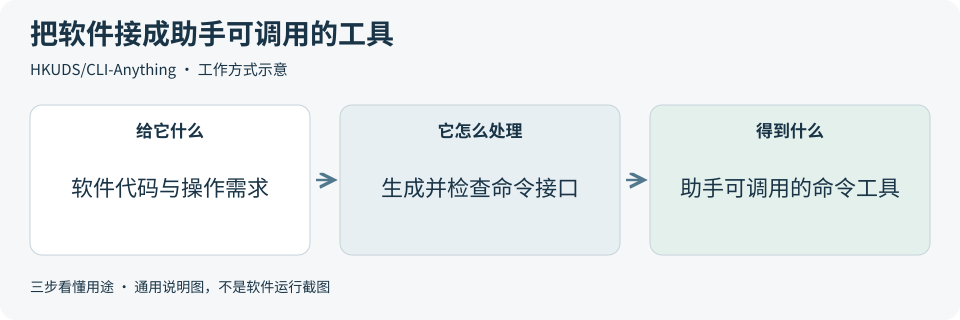
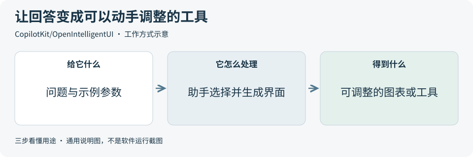
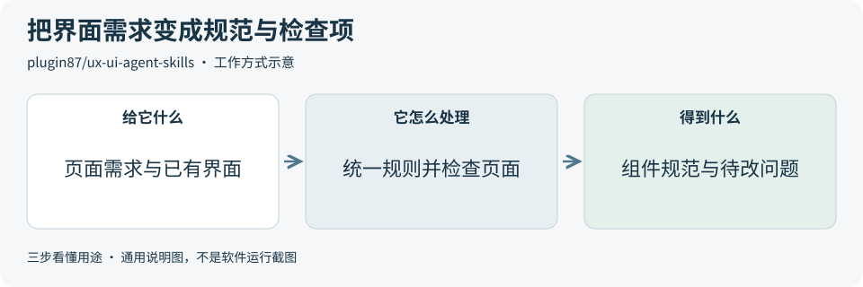
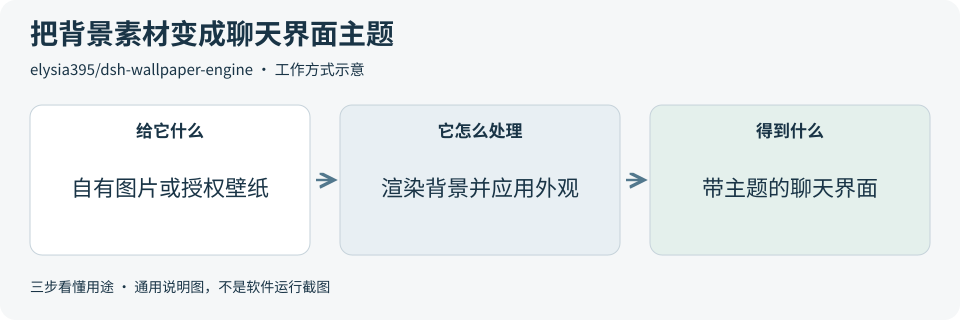

# 2026-10-19 · 每日开源项目推荐 5 个

每天在同一个仓库新增一份资料，每份 5 个项目，避开全部历史推荐。先看速览，再点项目查看图解和例子。

热度参考抓取时的 GitHub 滚动周榜，**不是一天内的新增 Star**。用途按公开文档整理，图解和例子用于解释用法；本期未实际安装或运行这些项目。

**先认两个词**　Agent 是能分步办事的 AI 助手；Skill 是写给 AI 助手的工作说明。Star 是关注热度，不代表质量。

## 本期速览

| 名次 | 项目 | 本周新增 Star | 一句话用途 | 可用场景 |
| --- | --- | ---: | --- | --- |
| 1 | [CLI-Anything](#project-01) | +2,563 | 为软件补上命令行入口，让 AI 助手用明确指令创建、编辑或导出文件。 | 软件自动化、工具接入 |
| 2 | [ruflo](#project-02) | +2,117 | 为 AI 编程助手提供任务分工、状态查看、记忆和操作记录等配套工具。 | 开发任务协调、过程记录 |
| 3 | [OpenIntelligentUI](#project-03) | +857 | 把聊天回答做成可操作的图表、解释页面或小工具，让读者边看边调整。 | 交互讲解、聊天内小工具 |
| 4 | [ux-ui-agent-skills](#project-04) | +692 | 给 AI 编程助手一套界面设计规范和检查脚本，帮助统一组件样式并发现使用障碍。 | 界面规范、表单与组件检查 |
| 5 | [dsh-wallpaper-engine](#project-05) | +551 | 给 DeepSeek Harness 的聊天界面添加壁纸、玻璃效果和可分享的外观预设。 | 聊天界面主题、桌面外观参考 |

## 可以先看

想把已有软件接进 AI 工作流，先看 **CLI-Anything**；希望聊天回答能调整参数、直接操作，先看 **Open Intelligent UI**；想统一表单与组件并检查可用性，先看 **UX/UI Agent Skills**。另外两项分别用于开发任务协调和聊天界面外观。

## 1. [CLI-Anything](https://github.com/HKUDS/CLI-Anything)

**一句话用途**　为软件补上命令行入口，让 AI 助手用明确指令创建、编辑或导出文件。

**举个例子**　要反复绘制“浏览器、服务端、数据库”的流程图时，可借用现成的 Draw.io 命令接口添加方框与连线，保存可编辑文件；配置好 Draw.io 桌面程序后再导出图片。

**适合什么情况**　已有软件想接进 AI 工作流，或需要重复处理文件时，可先找现成适配；没有合适入口时，再参考它分析软件、生成命令接口和检查结果的流程。

**门槛与费用**　门槛高。代码采用 Apache-2.0，生成接口需要 AI 编程助手和 Python 3.10+。模型调用、目标软件及其运行资源另算；例如 Draw.io 的图片导出还需要桌面程序。

**注意事项**　适配能力取决于目标软件和接口实现。生成的命令工具需要逐项检查，导出文件应交给真实软件打开验证；原软件和处理素材的许可仍要分别确认。

**小范围第一步**　先读固定版本的 [Draw.io 示例](https://github.com/HKUDS/CLI-Anything/blob/34f519533bc175d2fe287ab8316b0dd99bb9cc43/drawio/agent-harness/cli_anything/drawio/README.md)，只生成三框两箭头的可编辑文件。需要图片时，再按文档配置桌面程序并检查导出结果。

周新增 Star **+2,563** · 总 Star **54,594** · Python · Apache-2.0 · 首次推荐

[官方文档](https://github.com/HKUDS/CLI-Anything/blob/34f519533bc175d2fe287ab8316b0dd99bb9cc43/README.md) · [仓库](https://github.com/HKUDS/CLI-Anything)

## 2. [ruflo](https://github.com/ruvnet/ruflo)

**一句话用途**　为 AI 编程助手提供任务分工、状态查看、记忆和操作记录等配套工具。

**举个例子**　给演示站点增加深色主题时，可先登记目标，再把组件修改和切换行为检查拆成两项工作。完成后逐项查看实际代码、检查记录和任务状态，避免只看控制台的状态标签。

**适合什么情况**　开发任务需要规划、编码和检查多个步骤时，可参考它的任务控制台和助手分工机制，查看谁在做什么，并保留后续继续工作的上下文。

**门槛与费用**　门槛高。代码采用 MIT，实际执行仍依赖 AI 编程工具与模型服务。当前控制台和运行扩展要求匹配的 Claude Code 版本；其他客户端可通过工具连接协议 MCP 接入，支持范围不同。模型调用另计费。

**注意事项**　创建任务只说明目标已登记，是否实现要看真实文件与检查结果。部分扩展沿用账号权限运行；启用前阅读所选模块说明，并先在测试仓库内使用。

**小范围第一步**　先在测试仓库登记“增加深色主题开关”这一项任务，检查目标、状态和操作记录是否一致。确认记录可追踪后，再尝试把编码与检查分给不同角色。

周新增 Star **+2,117** · 总 Star **76,523** · TypeScript · MIT · 首次推荐

[官方文档](https://github.com/ruvnet/ruflo/blob/b93144803bb171b12993b715fe7b2dd936b6edd5/README.md) · [仓库](https://github.com/ruvnet/ruflo)

## 3. [OpenIntelligentUI](https://github.com/CopilotKit/OpenIntelligentUI)

**一句话用途**　把聊天回答做成可操作的图表、解释页面或小工具，让读者边看边调整。

**举个例子**　讨论一次聚餐如何分摊费用时，可让它生成带总额、人数和小费选项的计算器。读者改动人数后查看每人金额，并用手算结果核对公式。

**适合什么情况**　用户需要比较选项、改变参数或理解一个过程时，可参考它让助手选择文字、现成组件或定制交互界面的方式；接入自己的业务数据仍需开发。

**门槛与费用**　门槛高。代码采用 MIT。默认聊天流程需要 OpenAI 与 Jev 两家的 API 凭证，调用分别计费；开发还需 Node.js 22+、Python 3.12+ 等环境。前后端部署费用另算。

**注意事项**　生成的数字、公式和解释都需要复核，演示数据不能当作真实业务数据。用户自带的密钥会经应用服务器转发，应只在可信部署中使用。

**小范围第一步**　先用虚构数字做一个三人分账小工具，改变人数和总额，人工核对计算结果；这一小项确认后，再考虑连接真实数据。

周新增 Star **+857** · 总 Star **3,435** · TypeScript · MIT · 首次推荐

[官方文档](https://github.com/CopilotKit/OpenIntelligentUI/blob/8391a94c1c3939c679e40ddd7bfc08a9ef690e70/README.md) · [仓库](https://github.com/CopilotKit/OpenIntelligentUI)

## 4. [ux-ui-agent-skills](https://github.com/plugin87/ux-ui-agent-skills)

**一句话用途**　给 AI 编程助手一套界面设计规范和检查脚本，帮助统一组件样式并发现使用障碍。

**举个例子**　同一登录页的按钮颜色、输入框间距和错误提示风格不一致时，可先统一这几项规则，再检查能否只用键盘完成填写，以及窄屏下文字是否被截断。

**适合什么情况**　按钮、表单和页面样式不统一，或需要检查键盘操作、文字对比度和窄屏显示时，可借鉴它的设计规则与问题清单，逐步形成项目共用的组件规范。

**门槛与费用**　门槛中。代码采用 MIT，与已有 AI 编程助手配合使用，模型费用按所选服务计算。阅读规范即可参考；完整自动检查还需 Node、Python，以及 Playwright 和 Chrome 等浏览器依赖。

**注意事项**　自动化验收主要覆盖实际渲染的 HTML 与 React；Vue、Swift 等界面仍需另外验证。脚本通过后，也要人工检查信息是否清楚、操作是否顺畅。

**小范围第一步**　只检查一个表单的错误提示、键盘焦点和窄屏显示，让助手列出问题，再人工逐项操作；需要自动检查时，先确认浏览器依赖齐全。

周新增 Star **+692** · 总 Star **2,303** · JavaScript · MIT · 首次推荐

[官方文档](https://github.com/plugin87/ux-ui-agent-skills/blob/62092bd83bc3df0bcb9a2b3b643305ab11c547da/README.md) · [仓库](https://github.com/plugin87/ux-ui-agent-skills)

## 5. [dsh-wallpaper-engine](https://github.com/elysia395/dsh-wallpaper-engine)

**一句话用途**　给 DeepSeek Harness 的聊天界面添加壁纸、玻璃效果和可分享的外观预设。

**举个例子**　准备一个聊天产品演示时，可用自有风景图作背景，调暗背景并保持文字清晰，再把配色、字体和透明度保存成预设，供同一工具的其他演示环境导入。

**适合什么情况**　使用 DeepSeek Harness 并希望调整聊天界面外观时可以关注；开发类似产品时，也可参考它如何管理背景素材、主题参数和预设导入导出。

**门槛与费用**　门槛中。插件代码采用 MIT，依赖 DeepSeek Harness 内核 0.1.5-rc.1 及以上、Node.js 18+。自有图片和视频可作背景；Wallpaper Engine 软件与工坊素材的许可需要另外取得。

**注意事项**　复杂场景受浏览器 WebGL 与显卡驱动影响，Application 类型壁纸不支持。套用预设可能替换或清除自定义资产，先确认覆盖范围；macOS 没有 Wallpaper Engine 官方客户端。

**小范围第一步**　先用一张自有图片作静态背景，只调整文字可读性、透明度和配色，保存一个预设；确认清楚易读后，再尝试动态背景。

周新增 Star **+551** · 总 Star **1,561** · JavaScript · MIT · 首次推荐

[官方文档](https://github.com/elysia395/dsh-wallpaper-engine/blob/01fbb8b8e66fd7e405e9c878d18dbd456187f111/README.md) · [仓库](https://github.com/elysia395/dsh-wallpaper-engine)

## 来源与选取方法

候选池 104 个，可识别开源许可证且未归档的候选 88 个。已核对 49 个历史推荐，剩余未介绍过的候选 58 个；再核对用途与许可，选出本期 5 个。抓取时间与原榜名次见 [本期数据](../data/2026-10-19.json)。

- [chthollyphile/folia-major](https://github.com/chthollyphile/folia-major/blob/62c35156b01e165201dc999e0961f2e0e6dff68c/README.md) 暂未收录：固定版本 LICENSE 为 AGPL-3.0，同版本 README 又限定个人学习、技术交流与非营利测试，并明确禁止商用。许可表述不一致，暂不收录，等待澄清。
- [corrinehu/dsh-workbuddy-connect](https://github.com/corrinehu/dsh-workbuddy-connect/blob/49ec3410e17d801c8aed4e9d3322018f268a4246/README.md) 暂未收录：固定版本 LICENSE 为 MIT，同版本 README 的免责声明又限定个人学习研究并禁止商用。许可表述不一致，暂不收录，等待澄清。
- [周榜来源 1](https://github.com/trending?since=weekly)
- [周榜来源 2](https://github.com/trending/python?since=weekly)
- [周榜来源 3](https://github.com/trending/typescript?since=weekly)
- [周榜来源 4](https://github.com/trending/javascript?since=weekly)
- [周榜来源 5](https://github.com/trending/go?since=weekly)
- [周榜来源 6](https://github.com/trending/rust?since=weekly)
- [周榜来源 7](https://github.com/trending/swift?since=weekly)
- [周榜来源 8](https://github.com/trending/dart?since=weekly)
- [周榜来源 9](https://github.com/trending/java?since=weekly)

[排名和更新规则](../UPDATE_GUIDE.md) · [通用应用场景](../USE_CASES.md)

序号是本期推荐顺序，不是 GitHub 官方总榜排名。图解和应用例子仅作说明。

[返回资料首页](../README.md)
