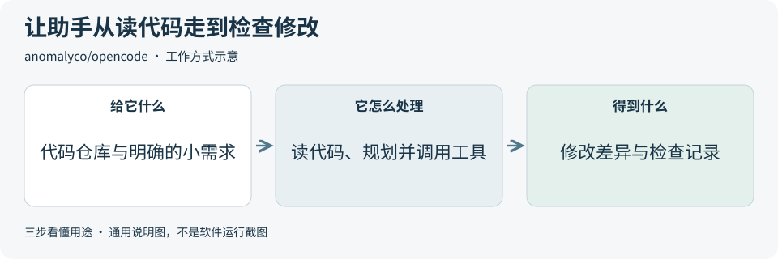
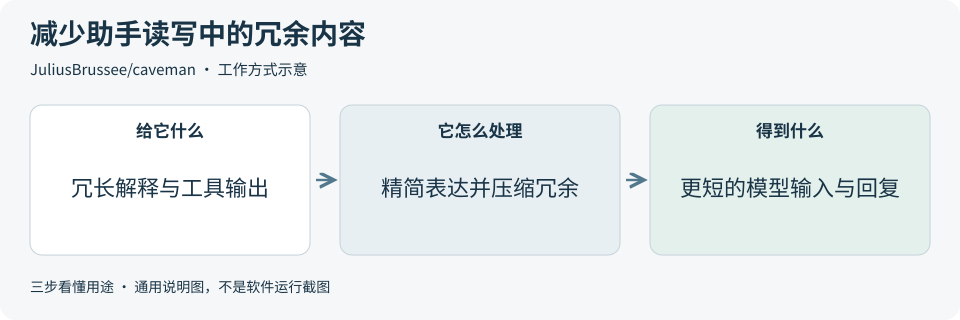
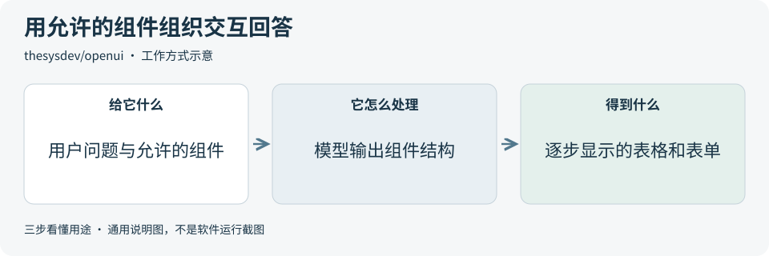
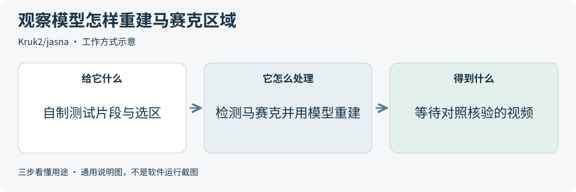

# 2026-10-20 · 每日开源项目推荐 5 个

每天在同一个仓库新增一份资料，每份 5 个项目，避开全部历史推荐。先看速览，再点项目查看图解和例子。

热度参考抓取时的 GitHub 滚动周榜，**不是一天内的新增 Star**。用途按公开文档整理，图解和例子用于解释用法；本期未实际安装或运行这些项目。

**先认两个词**　Agent 是能分步办事的 AI 助手；Skill 是写给 AI 助手的工作说明。Star 是关注热度，不代表质量。

## 本期速览

| 名次 | 项目 | 本周新增 Star | 一句话用途 | 可用场景 |
| --- | --- | ---: | --- | --- |
| 1 | [opencode](#project-01) | +4,917 | 让 AI 在终端或桌面客户端里阅读代码、规划修改并调用开发工具。 | 代码理解、小功能开发与排错 |
| 2 | [caveman](#project-02) | +2,606 | 帮助 AI 编程助手精简解释，并压缩日志等输入中的冗余内容。 | 简短回复、上下文整理 |
| 3 | [ai-memory](#project-03) | +1,976 | 把开发进展整理成可检索的知识页，让重开会话或换助手时更容易继续工作。 | 开发交接、跨工具知识检索 |
| 4 | [openui](#project-04) | +1,353 | 让开发者规定 AI 可以使用哪些界面组件，再把模型输出逐步渲染成表单、表格或图表。 | 聊天内业务界面、组件渲染 |
| 5 | [jasna](#project-05) | +808 | 在 GPU 上检测视频中的马赛克区域，并用模型进行画面重建。 | 区域重建研究、GPU 视频流程 |

## 可以先看

想让 AI 读代码并协助小修改，先看 **OpenCode**；跨会话或换工具继续开发，先看 **ai-memory**；给网页加入可操作的 AI 回答，先看 **OpenUI**。另外两项分别帮助研究上下文精简和视频区域重建，采用前需核对数据流、模型与许可边界。

## 1. [opencode](https://github.com/anomalyco/opencode)

**一句话用途**　让 AI 在终端或桌面客户端里阅读代码、规划修改并调用开发工具。

**举个例子**　一个列表页面需要增加空数据提示时，可先让助手找出列表组件和数据入口，再限定只改空状态显示。最后检查有数据、无数据两种情况，以及实际修改的文件。

**适合什么情况**　想把代码阅读、修改和检查放在同一个助手流程中时可以关注；它支持连接不同模型，也适合参考终端交互、权限控制和开发工具调用的设计。

**门槛与费用**　门槛中。代码采用 MIT，需要连接可用模型。托管模型按所选服务计费，本地模型则需要相应硬件；桌面客户端仍标为测试版，使用前核对平台支持。

**注意事项**　build 模式可以改文件并调用工具，先确认权限规则与工作范围。plan 模式默认禁止改文件，但命令执行仍需留意；所有代码修改都应查看差异并按项目要求检查。

**小范围第一步**　在测试仓库中先用 plan 模式，要求它解释一个函数和相关调用位置。核对引用后，再切到 build 模式处理一处小修改，并人工审查代码差异。

周新增 Star **+4,917** · 总 Star **217,818** · TypeScript · MIT · 首次推荐

[官方文档](https://github.com/anomalyco/opencode/blob/6e9c85390bc232866f83ca19dfb46bd9d39b7aa1/README.md) · [仓库](https://github.com/anomalyco/opencode)

## 2. [caveman](https://github.com/JuliusBrussee/caveman)

**一句话用途**　帮助 AI 编程助手精简解释，并压缩日志等输入中的冗余内容。

**举个例子**　解释一次保存失败时，可让助手先写“失败原因、受影响操作、下一步”，保留原始错误和必要代码。若进一步压缩长日志，再检查失败时间、错误编号和上下文是否仍可找到。

**适合什么情况**　助手解释过长，或反复读取大量日志、表格和测试输出时，可研究它的回答规则与输入压缩方式；需要保留原始材料，方便检查信息是否遗漏。

**门槛与费用**　门槛中。当前仓库代码采用 Apache-2.0，模型调用费用按所选服务计算；云端服务另有方案。实际费用应按完整会话统计，按请求计费时，缩短回复通常不会降低单次价格。

**注意事项**　压缩后的材料需要与原文对照，不能预设一定省钱或保持相同效果。CLI 默认发送使用统计；Auto 路由会向云端发送部分请求上下文，采用前应核对这些开关。

**小范围第一步**　先只参考回答风格说明，对一个无敏感信息的小问题比较普通回复和精简回复，核对结论、错误原文与下一步是否完整，再考虑输入压缩或自动路由。

周新增 Star **+2,606** · 总 Star **113,678** · Go · Apache-2.0 · 首次推荐

[官方文档](https://github.com/JuliusBrussee/caveman/blob/bad48a0e1df55e05e3f52249afa35ecc1909ee76/README.md) · [仓库](https://github.com/JuliusBrussee/caveman)

## 3. [ai-memory](https://github.com/akitaonrails/ai-memory)

**一句话用途**　把开发进展整理成可检索的知识页，让重开会话或换助手时更容易继续工作。

**举个例子**　为演示应用增加 CSV 导出时，可记录已选字段、放弃过的编码方案和剩余检查项。换一个编程助手后，先读取交接摘要，再对照当前导出代码继续处理。

**适合什么情况**　项目经常跨会话、跨设备或跨编程助手继续时，可参考它的记录采集、知识整理、检索和交接流程；知识页采用普通 Markdown，便于阅读与维护。

**门槛与费用**　门槛中。代码采用 MIT，需要运行记忆服务并准备存储。基础功能可不调用语言模型；可选的模型摘要、向量检索或远程部署会增加相应的服务与资源费用。

**注意事项**　它会采集提示、工具调用等开发记录，先设置采集范围、服务地址和用户权限。不同工具的适配程度不同；记忆可能遗漏或过期，继续开发前仍要核对当前代码。

**小范围第一步**　先在测试项目中记录一个已完成决定和一个待办，结束会话后查看生成的知识页，再开启新会话检查能否准确找回，并核对当前文件。

周新增 Star **+1,976** · 总 Star **11,348** · Rust · MIT · 首次推荐

[官方文档](https://github.com/akitaonrails/ai-memory/blob/11ab1003d9ef3788f5fc40b87fff54abf7f17dc0/README.md) · [仓库](https://github.com/akitaonrails/ai-memory)

## 4. [openui](https://github.com/thesysdev/openui)

**一句话用途**　让开发者规定 AI 可以使用哪些界面组件，再把模型输出逐步渲染成表单、表格或图表。

**举个例子**　做库存查询助手时，可允许它展示商品表格和分类筛选框，让用户调整查询条件。组件如何显示由框架处理，查询接口与权限检查由自己的业务系统提供。

**适合什么情况**　已有网页产品想加入由 AI 组织的交互界面时，可用它定义允许的组件及参数，再接入模型和渲染器；适合研究受组件约束的界面生成。

**门槛与费用**　门槛高。代码采用 MIT，需要前端开发环境、组件定义和可用模型。框架支持多种前端技术，模型调用、业务后端和部署资源的费用另算。

**注意事项**　界面渲染与真实业务操作需要分别实现和检查。模型给出的数字、字段和按钮状态都要核验；保存、确认等操作仍应由业务后端校验权限与输入。

**小范围第一步**　先只允许一个表格和一个筛选组件，用三条虚构库存记录测试生成与显示。人工核对字段、筛选行为和异常输出，再连接真实查询接口。

周新增 Star **+1,353** · 总 Star **12,212** · TypeScript · MIT · 首次推荐

[官方文档](https://github.com/thesysdev/openui/blob/9823ec05d4b29bc78d101676dc16b44fe17f1830/README.md) · [仓库](https://github.com/thesysdev/openui)

## 5. [jasna](https://github.com/Kruk2/jasna)

**一句话用途**　在 GPU 上检测视频中的马赛克区域，并用模型进行画面重建。

**举个例子**　保留一段自制测试片的原版，给副本中的自绘图形加马赛克。处理后并排比较原片与输出，观察图形、颜色和运动细节有哪些偏差，作为重建方法的评估练习。

**适合什么情况**　研究区域检测、模型重建和视频处理如何衔接时，可参考它的选区预览、处理队列和命令接口。先用自制测试素材判断适配情况，再决定是否值得继续研究。

**门槛与费用**　门槛高。公开应用代码主体按 AGPL-3.0 分发，基础模型可免费运行。需要受支持的 GPU 与驱动，AMD 支持仍为实验性；部分模型需付费支持者授权，模型和依赖另有许可。

**注意事项**　重建结果应视作模型估计，不能用来证明被遮挡内容的原貌。官方支持者版包含专有保护组件，公开源码无法完整复现该发布包；二次开发要分别核对代码、模型和发布包条款。

**小范围第一步**　先读固定版本的 [许可边界](https://github.com/Kruk2/jasna/blob/099af50a3aac06f14db8d048efd8c6562e2c3d25/LICENSING.md)，核对硬件条件后，仅用基础流程测试几秒自制画面，并与保留的原片对照。

周新增 Star **+808** · 总 Star **2,892** · Python · AGPL-3.0 · 首次推荐

[官方文档](https://github.com/Kruk2/jasna/blob/099af50a3aac06f14db8d048efd8c6562e2c3d25/README.md) · [仓库](https://github.com/Kruk2/jasna)

## 来源与选取方法

候选池 113 个，可识别开源许可证且未归档的候选 97 个。已核对 54 个历史推荐，剩余未介绍过的候选 64 个；再核对用途与许可，选出本期 5 个。抓取时间与原榜名次见 [本期数据](../data/2026-10-20.json)。

- [chthollyphile/folia-major](https://github.com/chthollyphile/folia-major/blob/26c57f9b1b26b402a09e8943171a332215418ce6/README.md) 暂未收录：固定版本 LICENSE 为 AGPL-3.0，同版本 README 又限定个人学习、技术交流与非营利测试，并明确禁止商用。许可表述不一致，暂不收录，等待澄清。
- [corrinehu/dsh-workbuddy-connect](https://github.com/corrinehu/dsh-workbuddy-connect/blob/70a72bc58911a858a4cef2b188221561bbcf23e3/README.md) 暂未收录：固定版本 LICENSE 为 MIT，同版本 README 的免责声明又限定个人学习研究并禁止商用。许可表述不一致，暂不收录，等待澄清。
- [周榜来源 1](https://github.com/trending?since=weekly)
- [周榜来源 2](https://github.com/trending/python?since=weekly)
- [周榜来源 3](https://github.com/trending/typescript?since=weekly)
- [周榜来源 4](https://github.com/trending/javascript?since=weekly)
- [周榜来源 5](https://github.com/trending/go?since=weekly)
- [周榜来源 6](https://github.com/trending/rust?since=weekly)
- [周榜来源 7](https://github.com/trending/swift?since=weekly)
- [周榜来源 8](https://github.com/trending/dart?since=weekly)
- [周榜来源 9](https://github.com/trending/java?since=weekly)

[排名和更新规则](../UPDATE_GUIDE.md) · [通用应用场景](../USE_CASES.md)

序号是本期推荐顺序，不是 GitHub 官方总榜排名。图解和应用例子仅作说明。

[返回资料首页](../README.md)
