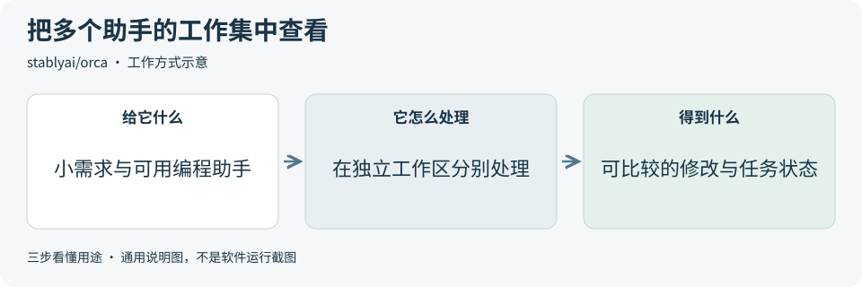
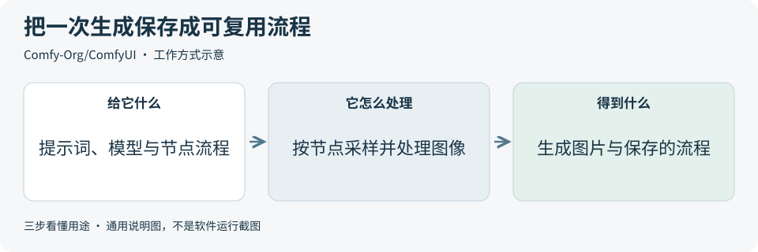
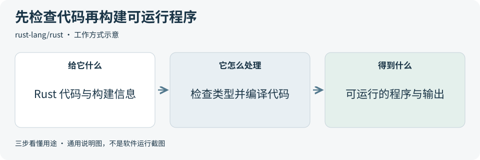
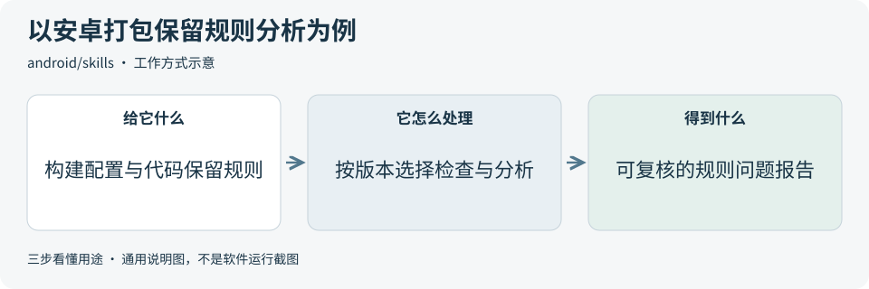
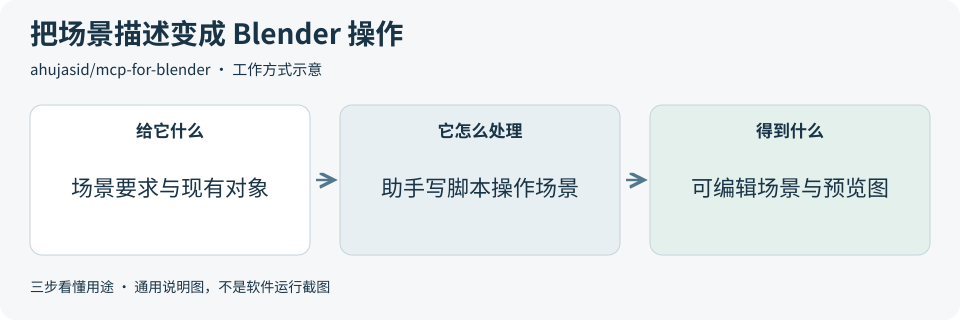

# 2026-10-21 · 每日开源项目推荐 5 个

每天在同一个仓库新增一份资料，每份 5 个项目，避开全部历史推荐。先看速览，再点项目查看图解和例子。

热度参考抓取时的 GitHub 滚动周榜，**不是一天内的新增 Star**。用途按公开文档整理，图解和例子用于解释用法；本期未实际安装或运行这些项目。

**先认两个词**　Agent 是能分步办事的 AI 助手；Skill 是写给 AI 助手的工作说明。Star 是关注热度，不代表质量。

## 本期速览

| 名次 | 项目 | 本周新增 Star | 一句话用途 | 可用场景 |
| --- | --- | ---: | --- | --- |
| 1 | [orca](#project-01) | +8,173 | 把多个 AI 编程助手和各自的 Git 工作区放进同一个桌面工作台管理。 | 开发任务并行、方案比较 |
| 2 | [ComfyUI](#project-02) | +3,364 | 把图像生成与处理步骤连成节点流程，保存后反复使用，也能接进应用。 | 图像工作流、内容生产原型 |
| 3 | [rust](#project-03) | +1,273 | 一种编程语言及其工具链，通过编译检查提早发现一部分类型和内存使用问题。 | 命令行工具、性能敏感模块 |
| 4 | [skills](#project-04) | +1,255 | Android 团队提供的专门工作说明，帮助 AI 助手按官方指导分析和处理安卓开发问题。 | 安卓专项排查、打包优化分析 |
| 5 | [mcp-for-blender](#project-05) | +1,172 | 通过工具连接协议 MCP，把 AI 助手接到 Blender，按描述创建和修改三维场景。 | 三维场景原型、对象与材质调整 |

## 可以先看

同时管理几个编程助手或比较修改方案，先看 **Orca**；把图像生成步骤保存复用，先看 **ComfyUI**；用自然语言搭建简单三维场景，先看 **MCP for Blender**。另外两项分别是 Rust 语言工具链和 Android 官方开发工作说明。

## 1. [orca](https://github.com/stablyai/orca)

**一句话用途**　把多个 AI 编程助手和各自的 Git 工作区放进同一个桌面工作台管理。

**举个例子**　为演示页面尝试两种按钮布局时，可把同一个小需求交给两个独立工作区里的助手，分别查看修改、预览和检查结果，再选择一个方案合并。

**适合什么情况**　已经使用终端编程助手，需要同时处理几个小任务或比较实现方案时，可参考它的工作区管理、运行状态和代码差异查看方式。

**门槛与费用**　门槛中。应用代码采用 MIT，需准备可运行的编程助手及其模型配置。助手订阅或 API 调用按所选服务计费；同时运行多个任务也会增加调用量和本机资源占用。

**注意事项**　各助手的工具和文件权限仍需按所用工具配置。工作区中的修改不能直接当成完成结果，合并前要人工审查代码差异，并核对实际检查记录。

**小范围第一步**　先只接入一个已有助手，在测试仓库完成一处小文案修改，确认目标文件与差异；之后再用第二个工作区比较另一种方案。

周新增 Star **+8,173** · 总 Star **99,756** · TypeScript · MIT · 首次推荐

[官方文档](https://github.com/stablyai/orca/blob/70b2197c97b164b16c618736a107967295e5af92/README.md) · [仓库](https://github.com/stablyai/orca)

## 2. [ComfyUI](https://github.com/Comfy-Org/ComfyUI)

**一句话用途**　把图像生成与处理步骤连成节点流程，保存后反复使用，也能接进应用。

**举个例子**　制作几张演示封面草图时，可固定图像尺寸与一套节点流程，只替换关于颜色和几何图形的提示词。把流程与模型版本一起记录，便于之后调整和比较。

**适合什么情况**　需要反复组合模型、提示词、采样和图像处理步骤时，可把流程保存成节点图，后续替换输入复用；它也提供本地 API，方便接入其他工具。

**门槛与费用**　门槛中。核心代码采用 GPL-3.0，本地运行的硬件和内存要求取决于模型与工作流。模型、扩展节点和素材各有许可；官方云端与合作方 API 节点可能收费。

**注意事项**　工作流可保存，结果仍受模型、参数和节点版本影响。采用前检查扩展节点与外部服务，更新后先验证兼容性；不能只根据核心代码许可判断素材和输出可否商用。

**小范围第一步**　先用官方基础文生图模板与许可明确的模型，以低分辨率输出一张测试图，再保存流程和参数，核对每个节点的作用。

周新增 Star **+3,364** · 总 Star **140,777** · Python · GPL-3.0 · 首次推荐

[官方文档](https://github.com/Comfy-Org/ComfyUI/blob/87ed5a066d9c4660ef42100fd01a888da6994856/README.md) · [仓库](https://github.com/Comfy-Org/ComfyUI)

## 3. [rust](https://github.com/rust-lang/rust)

**一句话用途**　一种编程语言及其工具链，通过编译检查提早发现一部分类型和内存使用问题。

**举个例子**　需要统计一份自造日志中各类错误出现的次数时，可写一个小命令行程序读取文本并输出计数，再检查空输入、缺少文件和异常格式这些情况。

**适合什么情况**　需要编写文件处理工具、底层模块或性能敏感服务时可以考虑；已有项目也可先选一小段独立逻辑，评估开发成本与实际收益。

**门槛与费用**　门槛高。工具链可免费使用，需学习类型、所有权和错误处理。Rust 主体使用 MIT/Apache-2.0 双许可，部分代码和第三方库另有声明；构建、运行与维护资源另算。

**注意事项**　编译检查有明确范围，业务逻辑仍需要测试；使用 unsafe 或外部库时也需要额外审查。实际采用应选择合适的正式工具链，通常不必从本仓库自行编译编译器。

**小范围第一步**　按官方入门材料建立最小项目，先统计三行写在代码里的示例文本，核对结果后再加入文件读取与错误处理。

周新增 Star **+1,273** · 总 Star **120,615** · Rust · Apache-2.0 · 首次推荐

[官方文档](https://github.com/rust-lang/rust/blob/19833af7224424e8b53e288097d56b6af43d5bcf/README.md) · [仓库](https://github.com/rust-lang/rust)

## 4. [skills](https://github.com/android/skills)

**一句话用途**　Android 团队提供的专门工作说明，帮助 AI 助手按官方指导分析和处理安卓开发问题。

**举个例子**　安卓应用安装包变大时，可用 R8 分析说明检查是否有范围过大的“代码不能删除”规则或重复的库规则，先生成查证报告，再由开发者结合测试决定如何调整。

**适合什么情况**　安卓项目需要打包优化、界面适配或版本迁移等专门排查时，可让已有编程助手参考相应说明；运行与修改仍依赖实际工程和工具。

**门槛与费用**　门槛中。说明与资源采用 Apache-2.0，需要可用的 AI 编程助手和对应安卓工程工具链。部分分析还需 Python 等依赖；模型调用与构建资源费用另算。

**注意事项**　例如 R8 打包优化分析会按构建插件和 R8 版本选择不同路径，部分旧版本只能得到启发式建议。报告不能代替正式包的构建与行为验证，也不能预先保证安装包能缩小多少。

**小范围第一步**　先读固定版本的 [R8 分析说明](https://github.com/android/skills/blob/a3f56b8fc83039c407e20a7b4789c2b6ea192d57/performance/r8-analyzer/SKILL.md)，对测试工程做一次只读规则审查，先看报告，再决定后续修改与验证。

周新增 Star **+1,255** · 总 Star **9,057** · Kotlin · Apache-2.0 · 首次推荐

[官方文档](https://github.com/android/skills/blob/a3f56b8fc83039c407e20a7b4789c2b6ea192d57/README.md) · [仓库](https://github.com/android/skills)

## 5. [mcp-for-blender](https://github.com/ahujasid/mcp-for-blender)

**一句话用途**　通过工具连接协议 MCP，把 AI 助手接到 Blender，按描述创建和修改三维场景。

**举个例子**　为产品演示搭一个简易展台时，可让助手创建底座、放置几个几何体并设置灯光，然后查看不同角度和渲染预览，人工确认尺寸、位置和材质。

**适合什么情况**　需要为游戏原型或产品演示搭建简单三维场景时，可研究它如何让助手操作对象、材质、灯光和镜头，并读取视图检查结果。它是第三方连接工具。

**门槛与费用**　门槛中。连接工具代码采用 MIT，需要 Blender 3.0+、Python 3.10+、uv 和支持 MCP 的 AI 客户端。模型调用、可选云端三维生成服务及外部资产的费用与许可另行核对。

**注意事项**　工具能在 Blender 中运行生成的 Python 代码，先保存场景并用副本测试。默认仍有最小匿名使用统计，内容采集需另行同意；使用前可按文档检查或关闭采集设置。

**小范围第一步**　先在空白场景中只创建一个立方体和一个球体，要求助手调整位置与颜色，并用多个视角核对；确认基本操作后，再扩大场景。

周新增 Star **+1,172** · 总 Star **31,788** · Python · MIT · 首次推荐

[官方文档](https://github.com/ahujasid/mcp-for-blender/blob/5a3618fccb2d982d0dd61e7a1879912c3100073b/README.md) · [仓库](https://github.com/ahujasid/mcp-for-blender)

## 来源与选取方法

候选池 119 个，可识别开源许可证且未归档的候选 101 个。已核对 59 个历史推荐，剩余未介绍过的候选 65 个；再核对用途与许可，选出本期 5 个。抓取时间与原榜名次见 [本期数据](../data/2026-10-21.json)。

- [chthollyphile/folia-major](https://github.com/chthollyphile/folia-major/blob/f3a90708afbec884934d8bca16bbd0a35feeb6a7/README.md) 暂未收录：固定版本 LICENSE 为 AGPL-3.0，同版本 README 又限定个人学习、技术交流与非营利测试，并明确禁止商用。许可表述不一致，暂不收录，等待澄清。
- [周榜来源 1](https://github.com/trending?since=weekly)
- [周榜来源 2](https://github.com/trending/python?since=weekly)
- [周榜来源 3](https://github.com/trending/typescript?since=weekly)
- [周榜来源 4](https://github.com/trending/javascript?since=weekly)
- [周榜来源 5](https://github.com/trending/go?since=weekly)
- [周榜来源 6](https://github.com/trending/rust?since=weekly)
- [周榜来源 7](https://github.com/trending/swift?since=weekly)
- [周榜来源 8](https://github.com/trending/dart?since=weekly)
- [周榜来源 9](https://github.com/trending/java?since=weekly)

[排名和更新规则](../UPDATE_GUIDE.md) · [通用应用场景](../USE_CASES.md)

序号是本期推荐顺序，不是 GitHub 官方总榜排名。图解和应用例子仅作说明。

[返回资料首页](../README.md)
