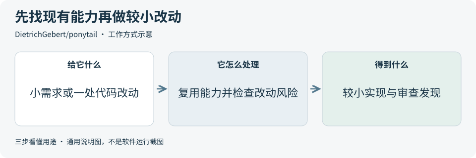
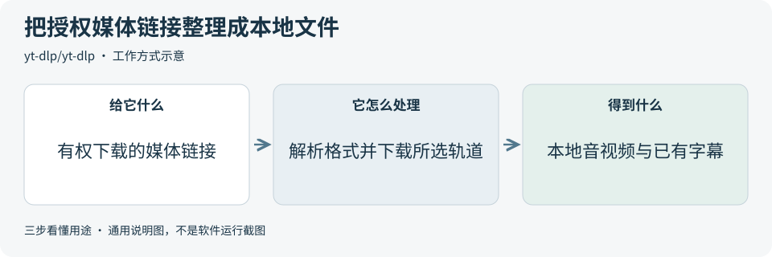
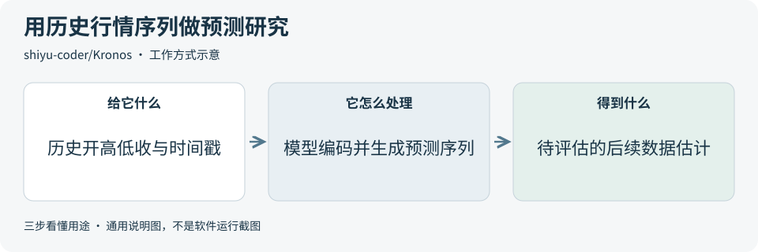
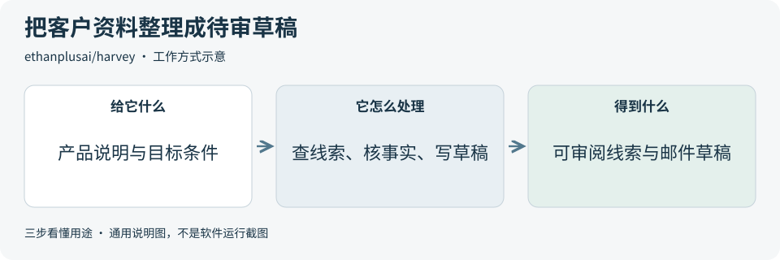

# 2026-10-22 · 每日开源项目推荐 5 个

每天在同一个仓库新增一份资料，每份 5 个项目，避开全部历史推荐。先看速览，再点项目查看图解和例子。

热度参考抓取时的 GitHub 滚动周榜，**不是一天内的新增 Star**。用途按公开文档整理，图解和例子用于解释用法；本期未实际安装或运行这些项目。

**先认两个词**　Agent 是能分步办事的 AI 助手；Skill 是写给 AI 助手的工作说明。Star 是关注热度，不代表质量。

## 本期速览

| 名次 | 项目 | 本周新增 Star | 一句话用途 | 可用场景 |
| --- | --- | ---: | --- | --- |
| 1 | [ponytail](#project-01) | +8,137 | 给 AI 编程助手一套工作规则，优先复用已有能力、减少冗余实现，并按风险审查改动。 | 小功能实现、代码审查与简化 |
| 2 | [MoneyPrinterTurbo](#project-02) | +3,129 | 把主题或文稿串成配音、素材、字幕和剪辑流程，合成短视频。 | 短视频草稿、内容生产流程 |
| 3 | [yt-dlp](#project-03) | +2,330 | 按链接保存音视频和已有字幕，支持选择格式、整理文件与批量处理。 | 授权媒体备份、素材整理 |
| 4 | [Kronos](#project-04) | +1,958 | 把历史 K 线中的开盘、最高、最低、收盘等序列输入模型，生成后续时间步的预测序列供研究。 | 行情序列研究、预测展示原型 |
| 5 | [harvey](#project-05) | +1,491 | 整理潜在客户资料并生成待审邮件草稿，配套线索队列和发送审批流程。 | 销售线索研究、草稿审核流程 |

## 可以先看

想让小功能实现更精简、审查更有依据，先看 **Ponytail**；把文案与素材做成短视频草稿，先看 **MoneyPrinterTurbo**；整理自己有权下载的音视频，先看 **yt-dlp**。另外两项分别用于行情序列研究和销售线索、待审草稿流程。

## 1. [ponytail](https://github.com/DietrichGebert/ponytail)

**一句话用途**　给 AI 编程助手一套工作规则，优先复用已有能力、减少冗余实现，并按风险审查改动。

**举个例子**　给表单加日期输入时，可先让助手评估现有输入组件与浏览器日期控件是否够用，再补必要封装，并检查标签、键盘操作和错误状态。

**适合什么情况**　助手容易为小需求引入过多依赖或复杂结构时，可参考它先理解实际流程、寻找现有能力，再选择较小实现的做法；也提供改动审查和仓库审查说明。

**门槛与费用**　门槛中。代码与说明采用 MIT，需要可用的 AI 编程助手。模型调用、可选的复核流程按所用工具计费；不同宿主支持的命令和附加界面不完全相同。

**注意事项**　精简不能删掉必要校验、错误处理或可访问性。审查发现仍需对照真实代码与检查结果；作者的演示和评测不代表每个项目都能节省同样的成本。

**小范围第一步**　挑一个小表单需求，让助手先列出现有组件、平台能力和最小改动，再审查方案是否满足约束，确认后才进入实现。

周新增 Star **+8,137** · 总 Star **171,663** · JavaScript · MIT · 首次推荐

[官方文档](https://github.com/DietrichGebert/ponytail/blob/09c434ab73ca43761c5d8b0c5d341926c2fba710/README.md) · [仓库](https://github.com/DietrichGebert/ponytail)

## 2. [MoneyPrinterTurbo](https://github.com/harry0703/MoneyPrinterTurbo)

**一句话用途**　把主题或文稿串成配音、素材、字幕和剪辑流程，合成短视频。

**举个例子**　制作一条植物养护练习视频时，可导入自有拍摄片段与已核对文案，生成配音和字幕，再检查每句话是否配到合适画面，最后保存成片供审阅。

**适合什么情况**　需要反复把已核对的文案做成带配音和字幕的短视频时，可参考它如何组合素材与合成步骤；也提供网页、API 和命令行入口，方便研究流程接入。

**门槛与费用**　门槛中。代码采用 MIT，本地部署需要 Python 3.11+ 和媒体处理依赖。可使用自有文稿、素材或配音；云端文本生成、语音、图像和视频服务可能另收费，硬件需求随流程变化。

**注意事项**　文案事实、素材匹配、字幕和配乐仍需人工复核，软件许可不包含所有素材与声音的授权。项目还带发布功能，生成成片与正式对外发布应分别确认。

**小范围第一步**　先用一段已核对的短文案和自有画面，制作十几秒的练习片，只检查配音、字幕时间和画面对应关系，再考虑批量处理。

周新增 Star **+3,129** · 总 Star **133,788** · Python · MIT · 首次推荐

[官方文档](https://github.com/harry0703/MoneyPrinterTurbo/blob/6992380c5e82f07f3e1fc46b90927b6f1c655407/README.md) · [仓库](https://github.com/harry0703/MoneyPrinterTurbo)

## 3. [yt-dlp](https://github.com/yt-dlp/yt-dlp)

**一句话用途**　按链接保存音视频和已有字幕，支持选择格式、整理文件与批量处理。

**举个例子**　创作者备份自己发布的一节短课程时，可保存视频和平台已有字幕，再交给本地剪辑或字幕校对工具处理。是否能获取取决于该链接和站点的实际支持情况。

**适合什么情况**　需要备份自己发布或有权下载的媒体，或把授权素材整理进离线剪辑流程时可以关注；它也能作为命令行工具接入其他处理程序。

**门槛与费用**　门槛中。仓库及 Python 包主体使用 Unlicense；部分打包可执行文件因附带第三方代码采用 GPLv3+ 等条款。源码运行需要 Python 3.11+，音视频合并通常还需 FFmpeg，部分站点需 JavaScript 运行环境。

**注意事项**　只处理自己有权下载的内容，软件许可不包含媒体和字幕权利。站点页面或接口变化可能导致失败；选择安装包时也要核对它附带的第三方许可。

**小范围第一步**　先选一条有权下载的短演示视频，查看可用格式和字幕，再保存一种格式，核对本地画面、声音与字幕是否完整。

周新增 Star **+2,330** · 总 Star **200,030** · Python · Unlicense · 首次推荐

[官方文档](https://github.com/yt-dlp/yt-dlp/blob/43a45ae37419b2a90db710c9fd06cd250ef524d3/README.md) · [仓库](https://github.com/yt-dlp/yt-dlp)

## 4. [Kronos](https://github.com/shiyu-coder/Kronos)

**一句话用途**　把历史 K 线中的开盘、最高、最低、收盘等序列输入模型，生成后续时间步的预测序列供研究。

**举个例子**　做行情预测教学原型时，可先用合成序列走通输入和展示，再把一段历史数据分成前后两部分，只输入前段，比较预测与保留后段的差异。

**适合什么情况**　研究行情数据如何表示、预测和可视化时，可参考它的分词器、预测接口和评估示例。适合做数据处理与模型比较实验，先明确输入字段和时间窗口。

**门槛与费用**　门槛高。代码采用 MIT；已核对的 [small 模型卡](https://huggingface.co/NeoQuasar/Kronos-small/blob/901c26c1332695a2a8f243eb2f37243a37bea320/README.md)和[配套分词器模型卡](https://huggingface.co/NeoQuasar/Kronos-Tokenizer-base/blob/0e0117387f39004a9016484a186a908917e22426/README.md)也标为 MIT。需要 Python 3.10+、相关深度学习依赖、模型文件和相应计算资源，使用的数据另查授权。

**注意事项**　README 明确示例不是生产级量化交易系统，预测与回测都不能视为收益保证。评估要按时间划分数据，防止把未来信息混进输入；不同模型也有不同上下文长度限制。

**小范围第一步**　先用一段自造的开、高、低、收序列和时间戳核对输入格式与预测图表，再用有权使用的历史切片做留出评估，记录预测与真实后续数据的偏差。

周新增 Star **+1,958** · 总 Star **42,833** · Python · MIT · 首次推荐

[官方文档](https://github.com/shiyu-coder/Kronos/blob/67b630e67f6a18c9e9be918d9b4337c960db1e9a/README.md) · [仓库](https://github.com/shiyu-coder/Kronos)

## 5. [harvey](https://github.com/ethanplusai/harvey)

**一句话用途**　整理潜在客户资料并生成待审邮件草稿，配套线索队列和发送审批流程。

**举个例子**　演示预约软件的销售流程时，可用虚构公司信息模拟“目标条件、资料核对、草稿、逐封审阅”四步，观察每条判断能否对应到来源和审核记录。

**适合什么情况**　需要研究如何把目标客户条件、企业资料、草稿和人工审核串起来时，可参考它的有状态工作流、资料来源记录与待发队列。

**门槛与费用**　门槛高。代码采用 MIT，需要 Python 3.11+、可用的编程助手及相应账号授权；真实部署还涉及邮件渠道配置。模型额度、线索发现、邮箱验证与邮件服务的开销需分别核算。

**注意事项**　项目也能真实发信和处理回复，默认逐封审批可被配置改变。运行前核对发送设置、收件信息和草稿事实，不能把自动整理的线索直接当成已经核实的结论。

**小范围第一步**　先对照固定版本的[逐封审核说明](https://github.com/ethanplusai/harvey/blob/55866a1830ea73b7d96127b10dc7ad38b838a663/README.md#nothing-sends-without-you)，用虚构产品和公司做一张流程样表，列出资料来源、草稿与人工审核项，再评估部署。

周新增 Star **+1,491** · 总 Star **1,999** · Python · MIT · 首次推荐

[官方文档](https://github.com/ethanplusai/harvey/blob/55866a1830ea73b7d96127b10dc7ad38b838a663/README.md) · [仓库](https://github.com/ethanplusai/harvey)

## 来源与选取方法

候选池 120 个，可识别开源许可证且未归档的候选 104 个。已核对 64 个历史推荐，剩余未介绍过的候选 70 个；再核对用途与许可，选出本期 5 个。抓取时间与原榜名次见 [本期数据](../data/2026-10-22.json)。

- [chthollyphile/folia-major](https://github.com/chthollyphile/folia-major/blob/bf7f24a527e52490b3e2852c7b379ba3552543d0/README.md) 暂未收录：固定版本 LICENSE 为 AGPL-3.0，同版本 README 又限定个人学习、技术交流与非营利测试，并明确禁止商用。许可表述不一致，暂不收录，等待澄清。
- [周榜来源 1](https://github.com/trending?since=weekly)
- [周榜来源 2](https://github.com/trending/python?since=weekly)
- [周榜来源 3](https://github.com/trending/typescript?since=weekly)
- [周榜来源 4](https://github.com/trending/javascript?since=weekly)
- [周榜来源 5](https://github.com/trending/go?since=weekly)
- [周榜来源 6](https://github.com/trending/rust?since=weekly)
- [周榜来源 7](https://github.com/trending/swift?since=weekly)
- [周榜来源 8](https://github.com/trending/dart?since=weekly)
- [周榜来源 9](https://github.com/trending/java?since=weekly)

[排名和更新规则](../UPDATE_GUIDE.md) · [通用应用场景](../USE_CASES.md)

序号是本期推荐顺序，不是 GitHub 官方总榜排名。图解和应用例子仅作说明。

[返回资料首页](../README.md)
