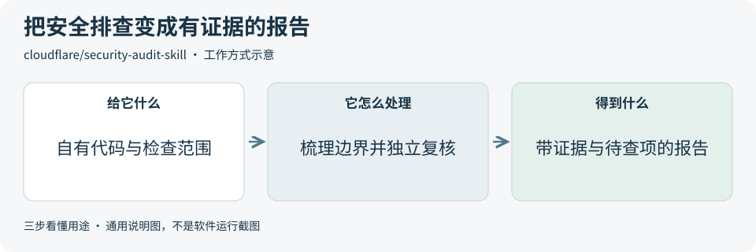

# 2026-10-23 · 每日开源项目推荐 5 个

每天在同一个仓库新增一份资料，每份 5 个项目，避开全部历史推荐。先看速览，再点项目查看图解和例子。

热度参考抓取时的 GitHub 滚动周榜，**不是一天内的新增 Star**。用途按公开文档整理，图解和例子用于解释用法；本期未实际安装或运行这些项目。

**先认两个词**　Agent 是能分步办事的 AI 助手；Skill 是写给 AI 助手的工作说明。Star 是关注热度，不代表质量。

## 本期速览

| 名次 | 项目 | 本周新增 Star | 一句话用途 | 可用场景 |
| --- | --- | ---: | --- | --- |
| 1 | [security-audit-skill](#project-01) | +9,270 | 让 AI 编程助手分阶段检查代码安全，把发现、复核证据和待核实问题整理成报告。 | 代码安全排查、审查记录 |
| 2 | [taste-skill](#project-02) | +4,037 | 给 AI 编程助手一套界面设计流程，从需求、配图到浏览器检查，帮助制作网页和应用界面。 | 产品页面、后台和界面改版 |
| 3 | [ziwei-doushu](#project-03) | +1,668 | 按传统紫微斗数规则，把日期、时辰等信息转换成排盘结构，并用网页展示。 | 传统文化排盘、规则可视化 |
| 4 | [ego-lite](#project-04) | +1,370 | 为 AI 助手提供读取网页、点击和填表的浏览器操作入口，让任务在独立空间中进行。 | 网页资料整理、表单与页面检查 |
| 5 | [vllm](#project-05) | +1,341 | 把已选好的语言模型运行成可调用的服务，也能集中处理一批文本生成任务。 | 模型接口服务、批量文本生成 |

## 可以先看

做代码安全排查先看 **security-audit-skill**；做界面设计先看 **Taste Skill**；让助手处理网页任务先看 **ego lite**。另外两项分别用于传统文化排盘演示和语言模型服务部署。

## 1. [security-audit-skill](https://github.com/cloudflare/security-audit-skill)

**一句话用途**　让 AI 编程助手分阶段检查代码安全，把发现、复核证据和待核实问题整理成报告。

**举个例子**　一个文件上传页面只允许本人读取文件时，可以让助手跟踪上传、存储和读取三个环节；报告需指明哪处代码实现访问检查、哪些推断仍需测试。

**适合什么情况**　需要在上线前检查输入、权限和数据边界时，可参考它如何先列出要检查的模块，再找问题、复核证据并生成报告；适合已有代码库的专项安全检查。

**门槛与费用**　门槛高。规则和脚本采用 MIT，需要支持工具调用与多个独立子助手的编程助手，以及 Node.js。完整流程可能多次调用模型，费用取决于仓库规模、模型和复核轮次；运行目标代码还需有资源限制与网络隔离的运行环境（沙箱）。

**注意事项**　报告会区分已证实、待验证和已排除的问题；代码线索不等于已证实漏洞。缺少安全沙箱时，流程应保留待验证状态，避免执行待查项目的构建和测试；报告也不代表已覆盖全部风险。

**小范围第一步**　先选一个自有小仓库的登录或文件上传流程，约定只读检查范围，要求列出输入、权限边界、已查文件和仍待验证的证据，再决定是否做运行验证。

周新增 Star **+9,270** · 总 Star **39,590** · JavaScript · MIT · 首次推荐

[官方文档](https://github.com/cloudflare/security-audit-skill/blob/c1c8a8c1471069fb0e188eeaff69b8e8db6564a8/README.md) · [仓库](https://github.com/cloudflare/security-audit-skill)

## 2. [taste-skill](https://github.com/Leonxlnx/taste-skill)

**一句话用途**　给 AI 编程助手一套界面设计流程，从需求、配图到浏览器检查，帮助制作网页和应用界面。

**举个例子**　为一家虚构咖啡店做介绍页时，先用营业信息、菜单与自有照片确定排版和配色，再检查手机上能否快速找到地址和菜单入口。

**适合什么情况**　准备做展示页、管理后台或改版时，可参考它把视觉方向、内容素材、页面结构和不同屏宽检查串起来的流程；规则可用于多种前端框架。

**门槛与费用**　门槛中。规则与脚本采用 MIT，需要可用的 AI 编程助手；配套脚本要求 Node.js 22+ 及 Chrome、Edge 或 Chromium。搜索图片需联网，模型调用按助手计费；多轮浏览器检查会增加时间与额度消耗。

**注意事项**　设计规则不能代替真实需求和人工验收。开放素材仍有各自署名或共享条件；作者示例效果不代表每次生成都相同，改版也要检查小屏、键盘操作和文字可读性。

**小范围第一步**　挑一个只有标题、说明、主按钮的简单页面，准备好真实文案和自有图片，先定视觉方向，再在电脑和手机宽度检查信息是否好找。

周新增 Star **+4,037** · 总 Star **101,131** · JavaScript · MIT · 首次推荐

[官方文档](https://github.com/Leonxlnx/taste-skill/blob/6010f91a9935f1c167dfc500fb1a475681892e6b/README.md) · [仓库](https://github.com/Leonxlnx/taste-skill)

## 3. [ziwei-doushu](https://github.com/Renhuai123/ziwei-doushu)

**一句话用途**　按传统紫微斗数规则，把日期、时辰等信息转换成排盘结构，并用网页展示。

**举个例子**　制作传统文化互动教材时，可让读者切换虚构案例的时辰或闰月规则，观察盘面怎样变化，用来讲解规则与数据结构，而不据此判断真实人物。

**适合什么情况**　想研究传统排盘规则、日期边界或结构化数据展示时，可参考它的 TypeScript 引擎、可配置规则和示例界面；也可观察同一输入如何生成不同视图。

**门槛与费用**　门槛中。代码采用 MIT，示例前端需 Node.js 与 npm 环境，基础排盘在浏览器完成，不需要模型接口。[数据集](https://github.com/Renhuai123/ziwei-doushu/blob/1059c347231c636bd86ddb78fd8ed430d5de8d2a/DATASET-LICENSE)要求注明来源（CC BY 4.0）；部分[课程引文](https://github.com/Renhuai123/ziwei-doushu/blob/1059c347231c636bd86ddb78fd8ed430d5de8d2a/docs/tianji-ziwei/LICENSE.md)限制非商业使用，改编后须用同样协议（CC BY-NC-SA 4.0）。

**注意事项**　这里只作传统文化与规则展示，解读不构成预测或建议。开源界面是演示版，不含线上断语库和 AI 后端；不同规则选项与数据版本可能得到不同输出。

**小范围第一步**　先用一组虚构日期和时辰做示例，只检查日期是否合法、时辰编号如何对应、规则切换是否按说明改变盘面，再考虑接入其他页面。

周新增 Star **+1,668** · 总 Star **6,332** · TypeScript · MIT · 首次推荐

[官方文档](https://github.com/Renhuai123/ziwei-doushu/blob/1059c347231c636bd86ddb78fd8ed430d5de8d2a/README.md) · [仓库](https://github.com/Renhuai123/ziwei-doushu)

## 4. [ego-lite](https://github.com/citrolabs/ego-lite)

**一句话用途**　为 AI 助手提供读取网页、点击和填表的浏览器操作入口，让任务在独立空间中进行。

**举个例子**　检查演示活动报名页时，可读取字段要求、填入虚构姓名与选择项，在提交前截图，供人工确认必填项、选项和页面提示是否正常。

**适合什么情况**　想让已有编程助手处理网页资料或检查页面流程时，可参考它的页面快照和 JavaScript 操作接口；不同任务用独立空间，便于观察操作过程。

**门槛与费用**　门槛中。本仓库的 Skill 与连接层内容采用 MIT，ego lite 浏览器为另行下载的免费软件。README 列出 macOS 和 Windows；还需要可用的 AI 助手，模型额度或账号费用另算。

**注意事项**　它能接触浏览器中的页面和登录会话，独立空间不等于对站点账号的权限限制。对发消息、提交或付款等操作，先明确范围与确认步骤；网页里的指令也需核对。

**小范围第一步**　先在无需登录的演示页读取三项内容并截图，对照原页核对准确性，再试一份使用虚构数据、停在提交前的表单任务。

周新增 Star **+1,370** · 总 Star **18,803** · JavaScript · MIT · 首次推荐

[官方文档](https://github.com/citrolabs/ego-lite/blob/d392204d1ea1a8027a591ab2b0129c2e11d85f26/README.md) · [仓库](https://github.com/citrolabs/ego-lite)

## 5. [vllm](https://github.com/vllm-project/vllm)

**一句话用途**　把已选好的语言模型运行成可调用的服务，也能集中处理一批文本生成任务。

**举个例子**　给一组虚构商品短描述写一句话摘要时，可把多个请求交给同一模型服务，逐条检查摘要是否保留关键事实，同时记录等待时间和内存占用。

**适合什么情况**　需要让多个应用共用一个自己部署的模型，或集中处理很多短文本时，可参考它的请求排队、批量计算与接口服务。部署前先确定模型许可、硬件与预期同时请求数量。

**门槛与费用**　门槛高。框架采用 Apache-2.0，模型文件另有各自许可。需要按官方文档匹配 Python、硬件后端和驱动；内存或显存用量随模型、上下文长度与并发变化，自有硬件、电力或云主机均有成本。

**注意事项**　接口兼容范围、支持模型与硬件后端都要按所用版本核对，输出质量仍取决于所选模型和任务。对外提供服务前，要设置访问控制与请求上限，并检查日志记录的内容。

**小范围第一步**　对照固定版本的[快速开始](https://github.com/vllm-project/vllm/blob/432b1003f8ea7c871750f27bc82815a7ad0252d5/docs/getting_started/quickstart.md)先核对环境与一款许可清楚的小模型，再用几条虚构文本检查输出格式、耗时与内存，最后逐步增加请求数。

周新增 Star **+1,341** · 总 Star **95,153** · Python · Apache-2.0 · 首次推荐

[官方文档](https://github.com/vllm-project/vllm/blob/432b1003f8ea7c871750f27bc82815a7ad0252d5/README.md) · [仓库](https://github.com/vllm-project/vllm)

## 来源与选取方法

候选池 122 个，可识别开源许可证且未归档的候选 106 个。已核对 69 个历史推荐，剩余未介绍过的候选 69 个；再核对用途与许可，选出本期 5 个。抓取时间与原榜名次见 [本期数据](../data/2026-10-23.json)。

- [chthollyphile/folia-major](https://github.com/chthollyphile/folia-major/blob/581ae3c2c8391deecdcc905a6c0c8b71b4d04e34/README.md) 暂未收录：固定版本 LICENSE 为 AGPL-3.0，同版本 README 又限定个人学习、技术交流与非营利测试，并明确禁止商用。许可表述不一致，暂不收录，等待澄清。
- [周榜来源 1](https://github.com/trending?since=weekly)
- [周榜来源 2](https://github.com/trending/python?since=weekly)
- [周榜来源 3](https://github.com/trending/typescript?since=weekly)
- [周榜来源 4](https://github.com/trending/javascript?since=weekly)
- [周榜来源 5](https://github.com/trending/go?since=weekly)
- [周榜来源 6](https://github.com/trending/rust?since=weekly)
- [周榜来源 7](https://github.com/trending/swift?since=weekly)
- [周榜来源 8](https://github.com/trending/dart?since=weekly)
- [周榜来源 9](https://github.com/trending/java?since=weekly)

[排名和更新规则](../UPDATE_GUIDE.md) · [通用应用场景](../USE_CASES.md)

序号是本期推荐顺序，不是 GitHub 官方总榜排名。图解和应用例子仅作说明。

[返回资料首页](../README.md)
