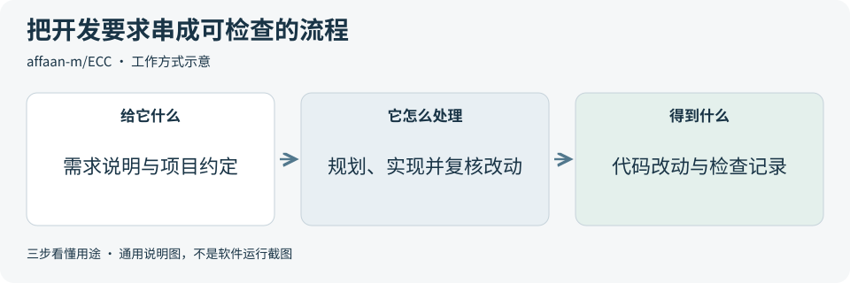
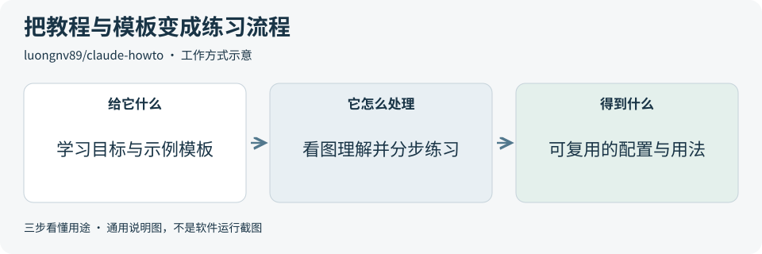
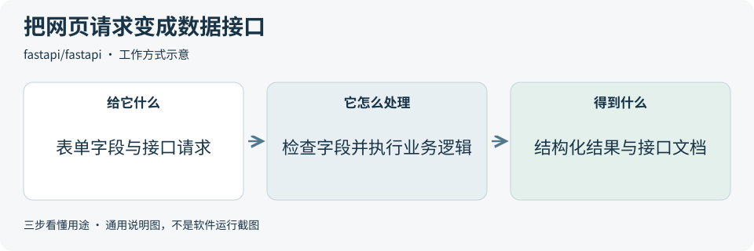
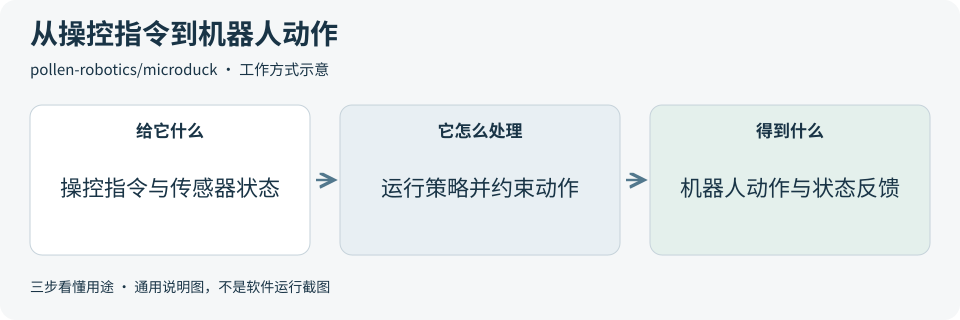
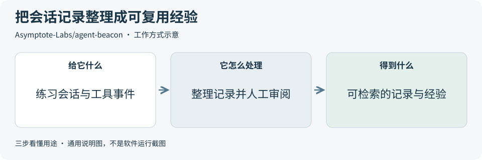

# 2026-10-24 · 每日开源项目推荐 5 个

每天在同一个仓库新增一份资料，每份 5 个项目，避开全部历史推荐。先看速览，再点项目查看图解和例子。

热度参考抓取时的 GitHub 滚动周榜，**不是一天内的新增 Star**。用途按公开文档整理，图解和例子用于解释用法；本期未实际安装或运行这些项目。

**先认两个词**　Agent 是能分步办事的 AI 助手；Skill 是写给 AI 助手的工作说明。Star 是关注热度，不代表质量。

## 本期速览

| 名次 | 项目 | 本周新增 Star | 一句话用途 | 可用场景 |
| --- | --- | ---: | --- | --- |
| 1 | [ECC](#project-01) | +6,418 | 给 AI 编程助手配上规划、开发、审查和检查流程，减少每次都重新交代工作规则。 | 编程工作流、代码审查与交接 |
| 2 | [claude-howto](#project-02) | +2,012 | 一套带图解和示例模板的 Claude Code 教程，帮助把命令、项目说明和自动检查组合成工作流程。 | 编程助手入门、团队学习材料 |
| 3 | [fastapi](#project-03) | +1,013 | 用 Python 搭建数据接口，按字段类型检查请求，并自动生成可交互的接口文档。 | 表单后端、工具接口、服务开发 |
| 4 | [microduck](#project-04) | +936 | Microduck 双足机器人的控制软件，把操控指令、传感器状态与运动策略连接起来，也提供仿真入口。 | 机器人控制研究、仿真与状态观察 |
| 5 | [agent-beacon](#project-05) | +856 | 归档编程助手的会话和工具事件，提供回看、检索及经验整理入口，帮助后续任务复用经过审核的知识。 | 编程会话回顾、项目经验复用 |

## 可以先看

想给编程助手建立固定开发流程，先看 **ECC**；想循序学习 Claude Code，先看 **claude-howto**；想给网页或工具做后端接口，先看 **FastAPI**。另外两项分别用于 Microduck 机器人控制与仿真，以及编程会话记录和经验复用。

## 1. [ECC](https://github.com/affaan-m/ECC)

**一句话用途**　给 AI 编程助手配上规划、开发、审查和检查流程，减少每次都重新交代工作规则。

**举个例子**　给一个虚构的待办应用加筛选功能时，可让助手先写方案、再实现，最后单独复核改动，并交付文件清单和检查结果。

**适合什么情况**　需要让助手遵循项目约定、先规划再改代码，并留下检查记录时，可参考它的规则、技能、专用子助手和自动触发脚本；也提供按需选择组件的方式。

**门槛与费用**　门槛中。开源仓库采用 MIT，通用安装工具要求 Node.js 18+，还需受支持的编程助手与对应运行环境。模型调用、外部工具服务另算；ECC Pro 是独立的托管服务，费用需另外核对。

**注意事项**　不同助手和操作系统支持的功能不完全相同，先看支持矩阵。自动触发脚本可能执行命令，启用前要看清作用与范围；流程产出仍需结合实际代码和检查结果判断。

**小范围第一步**　先核对所用助手的支持情况，在练习仓库只选择一项代码审查流程，观察它能否列清改动、发现和验证证据，理解自动触发脚本后再扩展。

周新增 Star **+6,418** · 总 Star **287,340** · JavaScript · MIT · 首次推荐

[官方文档](https://github.com/affaan-m/ECC/blob/90606c8315ee09cafc303515c5f33024db6b9882/README.md) · [仓库](https://github.com/affaan-m/ECC)

## 2. [claude-howto](https://github.com/luongnv89/claude-howto)

**一句话用途**　一套带图解和示例模板的 Claude Code 教程，帮助把命令、项目说明和自动检查组合成工作流程。

**举个例子**　每次修改练习页面后都希望检查命名和遗漏的错误处理，可以把要求整理成可重复使用的命令模板，再对照图解理解它如何与项目说明配合。

**适合什么情况**　已经能向 Claude Code 提问，却不清楚如何组织重复任务、保存项目约定或连接外部工具时，可以按它的学习路线分步练习，也可参考章节图解制作团队入门材料。

**门槛与费用**　门槛低。教程和示例采用 MIT，材料本身免费。实际练习需可用的 Claude Code 账号与运行环境；模型额度、外部工具和服务费用另外核算，不必一次启用全部示例。

**注意事项**　这是第三方学习资料，命令和配置需按正在使用的版本及官方说明核对。复制模板前先看它会运行什么；先掌握一个流程，再逐步增加工具。

**小范围第一步**　先读一章命令模板教程，只针对一个虚构小程序整理一条固定检查要求，手动核对助手的输出；熟悉后再学习项目说明和自动触发检查。

周新增 Star **+2,012** · 总 Star **44,015** · Python · MIT · 首次推荐

[官方文档](https://github.com/luongnv89/claude-howto/blob/188f468893231cbe4525f45e657d554746232072/README.md) · [仓库](https://github.com/luongnv89/claude-howto)

## 3. [fastapi](https://github.com/fastapi/fastapi)

**一句话用途**　用 Python 搭建数据接口，按字段类型检查请求，并自动生成可交互的接口文档。

**举个例子**　商品录入演示页提交名称和价格后，接口可先检查字段，再交给你编写的保存逻辑，最后返回结构化结果；前端同事能通过自动生成的文档试用这些输入。

**适合什么情况**　网页、移动应用或自动化工具需要向后端提交和读取数据时，可用它组织接口、声明输入输出并提供调试文档；适合已有 Python 基础、需要清楚接口约定的开发者。

**门槛与费用**　门槛中。框架采用 MIT，需要 Python 与运行接口的服务环境。演示可在本地进行；长期部署的主机、数据库与外部服务另算，云部署是可选项。

**注意事项**　字段类型检查不会自动完成账号权限、业务规则和数据保存。上线前仍需补齐认证、资源限制与错误处理，并核对交互文档页面的访问范围。

**小范围第一步**　做一个只处理虚构商品信息的小接口，声明名称必填、价格须为数字，再分别提交正确数据、缺失名称和无法转换成数字的价格，核对文档与错误响应。

周新增 Star **+1,013** · 总 Star **104,064** · Python · MIT · 首次推荐

[官方文档](https://github.com/fastapi/fastapi/blob/7a0a3f0b286c6c865cf4398ea0e957a87b8bffa4/README.md) · [仓库](https://github.com/fastapi/fastapi)

## 4. [microduck](https://github.com/pollen-robotics/microduck)

**一句话用途**　Microduck 双足机器人的控制软件，把操控指令、传感器状态与运动策略连接起来，也提供仿真入口。

**举个例子**　做机器人控制教学时，可先在虚拟场景中观察目标速度、关节状态和动作的关系，再对照服务图理解控制程序怎样接收指令；这一过程不等于已验证实体机器人。

**适合什么情况**　想了解小型机器人如何分开处理运动、通信、配置和更新时，可参考它的 Rust 服务结构、统一控制接口和配套仿真流程；实体运行面向配套 Microduck 硬件。

**门槛与费用**　门槛高。本仓库采用 Apache-2.0，开发需 Rust 工具链；[仿真说明](https://github.com/pollen-robotics/microduck/blob/942e58e3aa6dbb28e7037203fff11866122c7567/docs/robot/simulation.md)还要求配套 microduck_rl、MuJoCo 与相关运行依赖。实体硬件、配件和计算资源需另外准备，训练与模型资源也要单独核对。

**注意事项**　仿真能观察控制流程，但不模拟所有驱动、无线通信和真实传感器问题，仿真通过不能证明实体运行安全。架构页包含设计说明，应结合当前代码判断实际实现范围。

**小范围第一步**　先对照固定版本仿真文档核对依赖，只观察一个虚拟机器人的站立与状态反馈，确认能解释输入、动作和错误状态，再考虑实体实验。

周新增 Star **+936** · 总 Star **10,501** · Rust · Apache-2.0 · 首次推荐

[官方文档](https://github.com/pollen-robotics/microduck/blob/942e58e3aa6dbb28e7037203fff11866122c7567/README.md) · [仓库](https://github.com/pollen-robotics/microduck)

## 5. [agent-beacon](https://github.com/Asymptote-Labs/agent-beacon)

**一句话用途**　归档编程助手的会话和工具事件，提供回看、检索及经验整理入口，帮助后续任务复用经过审核的知识。

**举个例子**　记录一个虚构小程序从报错到修复的过程，整理错误原因、修改点和验证结果，下次遇到类似问题时可检索这条经过审核的经验，再核对是否适用。

**适合什么情况**　需要回查助手做过什么，或希望把修错过程和项目约定整理为可复用经验时，可以关注它的统一事件记录、本地看板及知识检索接口；不同助手的可采集事件不完全相同。

**门槛与费用**　门槛中。软件采用 MIT，本地模式需要保存会话日志的磁盘空间；如用 AI 助手整理经验，模型额度另算。Beacon Cloud 和其他日志平台是独立服务，费用按所选方案核对。

**注意事项**　交互设置会预选 Beacon Cloud，确认 Cloud 后会开始转发会话；先明确数据去向、采集内容和保留范围。会话可能含代码和敏感信息，提炼为记忆前也需人工审核。

**小范围第一步**　仅在使用虚构代码的练习仓库中选择本地模式，记录一次短会话并核对事件与原对话，再人工提炼一条经验；先不用真实业务资料。

周新增 Star **+856** · 总 Star **2,707** · Go · MIT · 首次推荐

[官方文档](https://github.com/Asymptote-Labs/agent-beacon/blob/473c18434d7336cccb34ef9ca3694339088bbbc8/README.md) · [仓库](https://github.com/Asymptote-Labs/agent-beacon)

## 来源与选取方法

候选池 127 个，可识别开源许可证且未归档的候选 109 个。已核对 74 个历史推荐，剩余未介绍过的候选 70 个；再核对用途与许可，选出本期 5 个。抓取时间与原榜名次见 [本期数据](../data/2026-10-24.json)。

- [chthollyphile/folia-major](https://github.com/chthollyphile/folia-major/blob/1f6d0f468f5bc81b23a8b40ad7ca96ccd4b1ecbe/README.md) 暂未收录：固定版本 LICENSE 为 AGPL-3.0，同版本 README 又限定个人学习、技术交流与非营利测试，并明确禁止商用。许可表述不一致，暂不收录，等待澄清。
- [iptv-org/iptv](https://github.com/iptv-org/iptv/blob/37a51365d85fefc456ad0864bae4a1752292cd70/README.md) 暂未收录：固定版本 README 的 License 区显示 CC0 标识，根目录 LICENSE 则为 Unlicense。许可表述不一致，暂不收录，等待澄清。
- [周榜来源 1](https://github.com/trending?since=weekly)
- [周榜来源 2](https://github.com/trending/python?since=weekly)
- [周榜来源 3](https://github.com/trending/typescript?since=weekly)
- [周榜来源 4](https://github.com/trending/javascript?since=weekly)
- [周榜来源 5](https://github.com/trending/go?since=weekly)
- [周榜来源 6](https://github.com/trending/rust?since=weekly)
- [周榜来源 7](https://github.com/trending/swift?since=weekly)
- [周榜来源 8](https://github.com/trending/dart?since=weekly)
- [周榜来源 9](https://github.com/trending/java?since=weekly)

[排名和更新规则](../UPDATE_GUIDE.md) · [通用应用场景](../USE_CASES.md)

序号是本期推荐顺序，不是 GitHub 官方总榜排名。图解和应用例子仅作说明。

[返回资料首页](../README.md)
