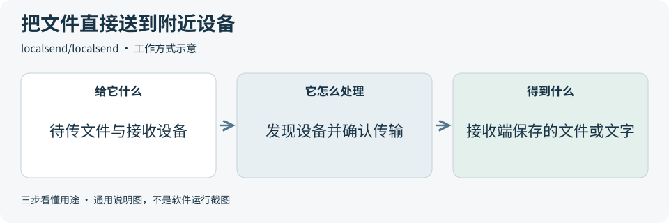
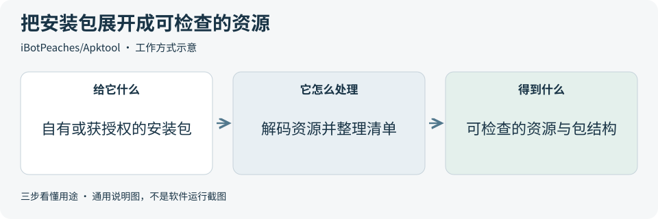

# 2026-10-25 · 每日开源项目推荐 5 个

每天在同一个仓库新增一份资料，每份 5 个项目，避开全部历史推荐。先看速览，再点项目查看图解和例子。

热度参考抓取时的 GitHub 滚动周榜，**不是一天内的新增 Star**。用途按公开文档整理，图解和例子用于解释用法；本期未实际安装或运行这些项目。

**先认两个词**　Agent 是能分步办事的 AI 助手；Skill 是写给 AI 助手的工作说明。Star 是关注热度，不代表质量。

## 本期速览

| 名次 | 项目 | 本周新增 Star | 一句话用途 | 可用场景 |
| --- | --- | ---: | --- | --- |
| 1 | [graphify](#project-01) | +6,868 | 把代码中的导入、调用等关系连成可查询的图，帮助理解项目结构和追踪功能路径。 | 代码阅读、架构梳理、影响范围检查 |
| 2 | [localsend](#project-02) | +833 | 让能互通的局域网设备直接传文件和文字，不需要外部中转服务器。 | 跨设备传文件、局域网资料交接 |
| 3 | [cindy](#project-03) | +756 | 一个开源 AI 助手客户端，把编程助手、文件与工具集中到桌面和移动端工作区。 | 助手客户端、任务工作区与多端界面 |
| 4 | [agents](#project-04) | +703 | 按开发任务整理的插件、专门角色和工作说明集合，供编程助手按需使用。 | 代码审查、测试建议与开发分工 |
| 5 | [Apktool](#project-05) | +687 | 把 Android 安装包里的资源和清单等内容解码为可检查的文件，也支持修改后重新构建。 | 授权安装包检查、资源与本地化排查 |

## 可以先看

想先弄清代码之间的关系，先看 **Graphify**；想在附近设备间传文件，先看 **LocalSend**；想研究 AI 助手客户端，先看 **Cindy**。另外两项分别提供开发插件与工作说明，以及 Android 安装包的资源检查工具。

## 1. [graphify](https://github.com/Graphify-Labs/graphify)

**一句话用途**　把代码中的导入、调用等关系连成可查询的图，帮助理解项目结构和追踪功能路径。

**举个例子**　理解一个虚构商城演示的登录流程时，可先沿调用关系找到账户查询和权限判断，再逐个回看对应文件，整理需要复核的链路。

**适合什么情况**　接手不熟悉的代码，或想知道一个函数会影响哪些文件时，可参考它的静态解析、关系查询和图形导出；它也能把文档与媒体接入图中，但处理方式和成本不同。

**门槛与费用**　门槛中。采用 Apache-2.0，需要 Python 3.10+。只分析代码可在本地完成，无需语言模型；文档、图片等语义分析可能调用所配模型，产生额度消耗。Graphify Cloud 是另行提供的云服务，费用需单独核对。

**注意事项**　动态调用、条件加载等关系要回看源代码；代码变更后需更新关系图。文档或媒体的语义分析还需核对模型供应商与数据去向，图上的连线也要抽样验证。

**小范围第一步**　先选一个公开示例仓库，只分析代码文件，检查三条已知的导入或调用关系是否与源码一致，再把关系图作为阅读辅助。

周新增 Star **+6,868** · 总 Star **134,479** · Python · Apache-2.0 · 首次推荐

[官方文档](https://github.com/Graphify-Labs/graphify/blob/92741d162b2094ffc2fed58cfbd8ee823e9da62c/README.md) · [仓库](https://github.com/Graphify-Labs/graphify)

## 2. [localsend](https://github.com/localsend/localsend)

**一句话用途**　让能互通的局域网设备直接传文件和文字，不需要外部中转服务器。

**举个例子**　为一次虚构课堂演示准备材料时，可把电脑上的公开课件发到同一局域网的平板，接收后打开文件核对，减少来回上传云盘的步骤。

**适合什么情况**　手机、电脑等附近设备需要互传图片、文档或一段文字时可以关注；也可参考它如何组织设备发现、接收确认和本地传输流程。

**门槛与费用**　门槛低。程序免费，采用 Apache-2.0。发送与接收设备需使用兼容版本，并处于能够互通的局域网；不需要模型服务或云存储账号，设备存储与网络条件仍需自行准备。

**注意事项**　同一个 Wi-Fi 名称不保证设备能够互相发现，访客网络隔离、系统权限或防火墙可能阻止通信。接收前核对设备与文件，传输后检查文件内容，避免误发给附近其他设备。

**小范围第一步**　先在两台自有设备间传一份无敏感内容的小测试文件，核对接收设备、文件名、大小和内容，再尝试更大的资料。

周新增 Star **+833** · 总 Star **95,457** · Dart · Apache-2.0 · 首次推荐

[官方文档](https://github.com/localsend/localsend/blob/a2f9e7e7ae73640d3dea779135940656e725a394/README.md) · [仓库](https://github.com/localsend/localsend)

## 3. [cindy](https://github.com/makecindy/cindy)

**一句话用途**　一个开源 AI 助手客户端，把编程助手、文件与工具集中到桌面和移动端工作区。

**举个例子**　整理一份虚构活动资料包时，可让助手读取说明和素材清单，先列执行计划，再生成给参与者看的说明草稿，人工检查是否遗漏时间和材料要求。

**适合什么情况**　想研究聊天、任务计划、工具执行和记忆怎样组织在一起时，可参考它的桌面端、移动端和共享包结构；后端服务不在本仓库内。

**门槛与费用**　门槛高。客户端免费，源代码采用 Apache-2.0；模型额度和 Cindy 云服务另算。源码开发需 Node.js 22.x、pnpm 10.x 与 Git LFS。模型、品牌素材及第三方组件有各自的授权条件。

**注意事项**　默认服务器为官方云服务；跳过登录可使用本地助手，但依赖服务器的功能不可用。客户端能够接触本地文件和已登录应用，先限定操作范围，并核对模型供应商与数据去向。

**小范围第一步**　先读固定版本 README 的账号与数据说明，选择只含公开材料的练习目录，要求先列计划和摘要，逐条核对后再增加文件操作权限。

周新增 Star **+756** · 总 Star **4,106** · TypeScript · Apache-2.0 · 首次推荐

[官方文档](https://github.com/makecindy/cindy/blob/784e8c477e13ebf5cc9fb40874310e8b49366fff/README.md) · [仓库](https://github.com/makecindy/cindy)

## 4. [agents](https://github.com/wshobson/agents)

**一句话用途**　按开发任务整理的插件、专门角色和工作说明集合，供编程助手按需使用。

**举个例子**　检查一个计算购物总价的练习函数时，可选择审查和测试相关组件，要求指出空列表、折扣和错误输入该怎样检查，再人工判断建议是否合理。

**适合什么情况**　希望为 Python 开发、代码审查、测试或基础设施工作选择一组现成工作说明时，可以从它的插件目录中挑选；不同编程工具有各自的安装与适配方式。

**门槛与费用**　门槛中。本仓库组件采用 MIT，外部插件另查授权。实际运行需要受支持的编程助手，模型调用和外部工具服务另外计费；安装与适配环境按所选平台文档准备。

**注意事项**　不同平台的默认模型、工具权限和组件能力有差异，先核对最终使用的配置。实际效果应在自己的小任务上验收，自带实验评测的分数也需结合人工检查。

**小范围第一步**　从目录中只挑一个代码审查插件，在虚构小项目上要求给出带文件依据的建议，核对模型与工具权限后再增加组件。

周新增 Star **+703** · 总 Star **41,643** · Python · MIT · 首次推荐

[官方文档](https://github.com/wshobson/agents/blob/0874a27b17a22e2b7c2e2bcd725768e0803cad06/README.md) · [仓库](https://github.com/wshobson/agents)

## 5. [Apktool](https://github.com/iBotPeaches/Apktool)

**一句话用途**　把 Android 安装包里的资源和清单等内容解码为可检查的文件，也支持修改后重新构建。

**举个例子**　排查演示应用某种语言缺少按钮文字时，可查看包内的语言资源与清单配置，对照原工程定位遗漏，再在自己的构建流程中验证修复。

**适合什么情况**　需要研究自有或获授权安装包的资源、语言文件或构建问题时，可参考它的解码和重建流程；适合具备 Android 资源结构基础的开发者。

**门槛与费用**　门槛高。采用 Apache-2.0，需要兼容所用版本的 Java 环境。源码编译、安装包重建和签名还需相应工具；工具许可不包含被处理应用的代码、图片等内容授权。

**注意事项**　解码结果不等于找回完整原始工程，修改后也可能出现资源兼容或签名问题。只处理自有或获授权的安装包，并保留原包；重建成功仍需另外验证实际运行。

**小范围第一步**　先拿自己制作的最小演示安装包，只查看清单和一处文字资源，核对解码结果与已知原工程，再考虑修改和重建。

周新增 Star **+687** · 总 Star **26,659** · Java · Apache-2.0 · 首次推荐

[官方文档](https://github.com/iBotPeaches/Apktool/blob/fd9d5d4dc7e45fa7f984698ded7a03c554d0a7b3/README.md) · [仓库](https://github.com/iBotPeaches/Apktool)

## 来源与选取方法

候选池 123 个，可识别开源许可证且未归档的候选 109 个。已核对 79 个历史推荐，剩余未介绍过的候选 70 个；再核对用途与许可，选出本期 5 个。抓取时间与原榜名次见 [本期数据](../data/2026-10-25.json)。

- [iptv-org/iptv](https://github.com/iptv-org/iptv/blob/12b8af1af80ce32e3ab53b586a0655eecb2f248d/README.md) 暂未收录：固定版本 README 的 License 区显示 CC0 标识，根目录 LICENSE 则为 Unlicense。许可表述不一致，暂不收录，等待澄清。
- [周榜来源 1](https://github.com/trending?since=weekly)
- [周榜来源 2](https://github.com/trending/python?since=weekly)
- [周榜来源 3](https://github.com/trending/typescript?since=weekly)
- [周榜来源 4](https://github.com/trending/javascript?since=weekly)
- [周榜来源 5](https://github.com/trending/go?since=weekly)
- [周榜来源 6](https://github.com/trending/rust?since=weekly)
- [周榜来源 7](https://github.com/trending/swift?since=weekly)
- [周榜来源 8](https://github.com/trending/dart?since=weekly)
- [周榜来源 9](https://github.com/trending/java?since=weekly)

[排名和更新规则](../UPDATE_GUIDE.md) · [通用应用场景](../USE_CASES.md)

序号是本期推荐顺序，不是 GitHub 官方总榜排名。图解和应用例子仅作说明。

[返回资料首页](../README.md)
