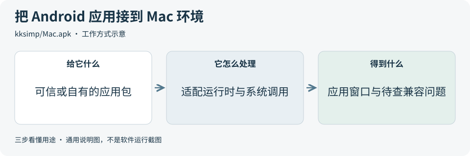
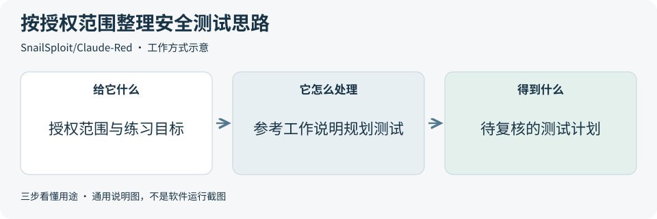

# 2026-10-28 · 每日开源项目推荐 5 个

每天在同一个仓库新增一份资料，每份 5 个项目，避开全部历史推荐。先看速览，再点项目查看图解和例子。

热度参考抓取时的 GitHub 滚动周榜，**不是一天内的新增 Star**。用途按公开文档整理，图解和例子用于解释用法；本期未实际安装或运行这些项目。

**先认两个词**　Agent 是能分步办事的 AI 助手；Skill 是写给 AI 助手的工作说明。Star 是关注热度，不代表质量。

## 本期速览

| 名次 | 项目 | 本周新增 Star | 一句话用途 | 可用场景 |
| --- | --- | ---: | --- | --- |
| 1 | [Mac.apk](#project-01) | +2,060 | 在 Apple Silicon Mac 上提供 Android 应用兼容环境，把应用作为普通 Mac 进程和窗口运行。 | Android 兼容研究、Mac 端应用测试 |
| 2 | [Claude-Red](#project-02) | +1,994 | 给 Claude 提供按安全测试主题组织的方法与工作说明，供获得授权的安全测试、攻防竞赛和研究参考。 | 授权安全研究、靶场训练与测试计划 |
| 3 | [postiz-app](#project-03) | +1,698 | 把多个社交平台的内容草稿、排期和发布状态放在一起管理，支持自托管与托管版。 | 内容排期、团队草稿与多渠道发布 |
| 4 | [infinite-canvas](#project-04) | +1,474 | 把图片、提示词和生成结果放进可连线的无限画布，用来组织和迭代 AI 图片方案。 | 视觉方案探索、图片工作流原型 |
| 5 | [gemini-cli](#project-05) | +1,248 | 在终端里读取项目、解释或修改代码的 AI 助手，也能通过工具和脚本接入开发流程。 | 终端助手研究、代码阅读与脚本接入 |

## 可以先看

想研究 Android 应用在 Mac 上的兼容运行，先看 **Mac.apk**，并先读权限提醒；想统一管理社交内容排期，先看 **Postiz**；想组织图片创作方案，先看 **无限画布**。另外两项分别是授权安全测试工作说明与带有迁移提示的 Gemini CLI。

## 1. [Mac.apk](https://github.com/kksimp/Mac.apk)

**一句话用途**　在 Apple Silicon Mac 上提供 Android 应用兼容环境，把应用作为普通 Mac 进程和窗口运行。

**举个例子**　研究一个自制便签演示应用的兼容性时，可检查窗口、键盘输入和测试文件保存是否符合预期，并把失败界面与日志整理成问题记录，不使用真实账号或重要资料。

**适合什么情况**　想了解 Android 应用如何在 macOS 上接入图形、输入和系统能力时，可参考它的框架重实现、运行时和兼容记录；是否能运行某个应用仍需单独核对。

**门槛与费用**　门槛高。官方应用免费，源代码采用 AGPL-3.0，并提供可选商业许可；商标与第三方库另有条款。固定 README 要求 Apple Silicon 和 macOS 26.4+，运行时及应用数据还需要磁盘空间。

**注意事项**　APK 会以普通 Mac 程序的用户权限运行，没有手机式应用隔离，可能读写该用户可访问的文件。只评估可信来源或自有应用；兼容表与作者演示不代表所有应用都可用。

**小范围第一步**　先读兼容表与文件权限说明，在独立测试账号中用自有最小 Android 示例核对启动、输入和文件访问，记录失败点，再评估正式使用条件。

周新增 Star **+2,060** · 总 Star **3,525** · Java · AGPL-3.0 · 首次推荐

[官方文档](https://github.com/kksimp/Mac.apk/blob/ce1499e8b856fb453c773acbf8584ad42307d312/README.md) · [仓库](https://github.com/kksimp/Mac.apk)

## 2. [Claude-Red](https://github.com/SnailSploit/Claude-Red)

**一句话用途**　给 Claude 提供按安全测试主题组织的方法与工作说明，供获得授权的安全测试、攻防竞赛和研究参考。

**举个例子**　为自建练习站点的登录功能设计测试时，可先列清允许检查的页面、测试账号与数据边界，再用相关说明补充检查项，形成待人工审核的测试计划。

**适合什么情况**　需要系统整理某类测试的范围、步骤与证据要求时，可参考它按主题组织的技能文档；适合已有安全基础、能辨别测试权限与风险的人员。

**门槛与费用**　门槛高。说明文件采用 MIT，需要能使用这些工作说明的 Claude 环境。模型调用、外部测试工具和隔离练习环境需另行准备；选用不同内容时，依赖与权限也不同。

**注意事项**　部分内容涉及主动探测和利用，只能限定在自有或明确获授权的环境。先审查会调用的工具、命令和数据去向，任何发现都需证据复核，不能把模型判断当成已确认漏洞。

**小范围第一步**　先选一份基础 Web 或 API 测试说明，在纸面写清授权范围、允许操作和停止条件，人工审阅后再在自建练习环境中评估。

周新增 Star **+1,994** · 总 Star **9,627** · Python · MIT · 首次推荐

[官方文档](https://github.com/SnailSploit/Claude-Red/blob/a8de813edc9f66f60d44cfe42d47750e89d9930b/README.md) · [仓库](https://github.com/SnailSploit/Claude-Red)

## 3. [postiz-app](https://github.com/gitroomhq/postiz-app)

**一句话用途**　把多个社交平台的内容草稿、排期和发布状态放在一起管理，支持自托管与托管版。

**举个例子**　整理虚构读书会的一周内容时，可统一预告、提醒和回顾的草稿、素材及发布时间，人工确认后再接入发布流程，减少来回切换多个平台。

**适合什么情况**　需要把文案、素材、渠道和发布时间统一整理时，可参考它的日历、跨渠道排期、接口和状态记录；接入每个平台仍有各自的账号与应用授权要求。

**门槛与费用**　门槛高。源代码采用 AGPL-3.0。自托管需配置数据库、队列、存储等基础设施，社交平台可能需要开发者应用审核；AI、API 和托管云服务按所选供应方或方案计费。

**注意事项**　保存草稿、进入队列和发布成功是不同状态，结果需从对应平台核对。接正式账号前检查渠道授权、时区、重复发布和内容权限；自托管也要维护更新与备份。

**小范围第一步**　先用三条虚构活动文案做排期样表，列清渠道、时区、审核状态和发布结果字段，再按官方文档评估账号接入。

周新增 Star **+1,698** · 总 Star **39,383** · TypeScript · AGPL-3.0 · 首次推荐

[官方文档](https://github.com/gitroomhq/postiz-app/blob/a5affe62c74e39c1e7ac960d50d8418b807d532c/README.md) · [仓库](https://github.com/gitroomhq/postiz-app)

## 4. [infinite-canvas](https://github.com/basketikun/infinite-canvas)

**一句话用途**　把图片、提示词和生成结果放进可连线的无限画布，用来组织和迭代 AI 图片方案。

**举个例子**　为虚构读书活动设计海报方案时，可把自有背景图和两版标题放在不同节点分支，对比参考图与生成结果，人工核对文字、布局和细节后再选版。

**适合什么情况**　需要把参考图、提示词和不同生成方向放在同一处比较时，可参考它的节点编排、分支、素材管理和画布助手；也支持自定义接口与可选的本地 Agent。

**门槛与费用**　门槛中。代码采用 MIT，本地开发与部署可参考 Bun 或 Docker 入口。图片、视频和问答生成调用所配置的接口，费用按供应方方案计算；可选本地 Agent 还需对应助手环境。

**注意事项**　项目处于开发阶段，存储格式可能变化，重要画布应导出备份。使用生成服务前核对输入会发送到哪里，并审核远程插件来源；模型额度与素材授权需分别确认。

**小范围第一步**　先导入一张自有图片，练习拖拽、连线和导出备份，再核对服务地址与单次调用费用，最后考虑少量生成，观察结果是否符合预期。

周新增 Star **+1,474** · 总 Star **9,260** · TypeScript · MIT · 首次推荐

[官方文档](https://github.com/basketikun/infinite-canvas/blob/9cd3deacbcc598361807afc16c059a80dd18b6f9/README.md) · [仓库](https://github.com/basketikun/infinite-canvas)

## 5. [gemini-cli](https://github.com/google-gemini/gemini-cli)

**一句话用途**　在终端里读取项目、解释或修改代码的 AI 助手，也能通过工具和脚本接入开发流程。

**举个例子**　阅读虚构小程序的文件名排序函数时，可要求助手说明输入、处理和返回值，列出对应源码位置，再人工检查它有没有忽略异常分支。

**适合什么情况**　适合研究终端助手如何读取项目、对话和调用工具，也可参考它的非交互脚本入口；实际采用前需核对当前账号适用范围和版本支持。

**门槛与费用**　门槛中。代码采用 Apache-2.0，固定版本运行要求 Node.js 20+ 与有效认证。模型、API 或组织账号有各自的计费与额度规则，费用应按当前 Google 方案核对。

**注意事项**　固定 README 对免费层与 Google One 用户给出了转向 Antigravity CLI 的提示，并注明未针对最新 Gemini 模型优化。先核对账号适用性，再限制助手可读写的目录与可执行命令。

**小范围第一步**　先读顶部迁移提示与认证说明，确认账号和目标模型仍适用，再在只有示例文件的练习目录中要求它只解释一个函数，逐条核对源码依据。

周新增 Star **+1,248** · 总 Star **108,582** · TypeScript · Apache-2.0 · 首次推荐

[官方文档](https://github.com/google-gemini/gemini-cli/blob/fa5c17365754a4936c3b97429df798966305267d/README.md) · [仓库](https://github.com/google-gemini/gemini-cli)

## 来源与选取方法

候选池 121 个，可识别开源许可证且未归档的候选 102 个。已核对 89 个历史推荐，剩余未介绍过的候选 62 个；再核对用途与许可，选出本期 5 个。抓取时间与原榜名次见 [本期数据](../data/2026-10-28.json)。

- [周榜来源 1](https://github.com/trending?since=weekly)
- [周榜来源 2](https://github.com/trending/python?since=weekly)
- [周榜来源 3](https://github.com/trending/typescript?since=weekly)
- [周榜来源 4](https://github.com/trending/javascript?since=weekly)
- [周榜来源 5](https://github.com/trending/go?since=weekly)
- [周榜来源 6](https://github.com/trending/rust?since=weekly)
- [周榜来源 7](https://github.com/trending/swift?since=weekly)
- [周榜来源 8](https://github.com/trending/dart?since=weekly)
- [周榜来源 9](https://github.com/trending/java?since=weekly)

[排名和更新规则](../UPDATE_GUIDE.md) · [通用应用场景](../USE_CASES.md)

序号是本期推荐顺序，不是 GitHub 官方总榜排名。图解和应用例子仅作说明。

[返回资料首页](../README.md)
