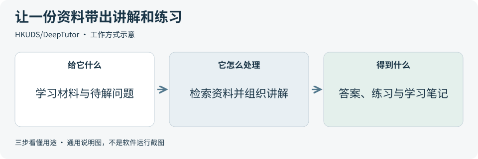
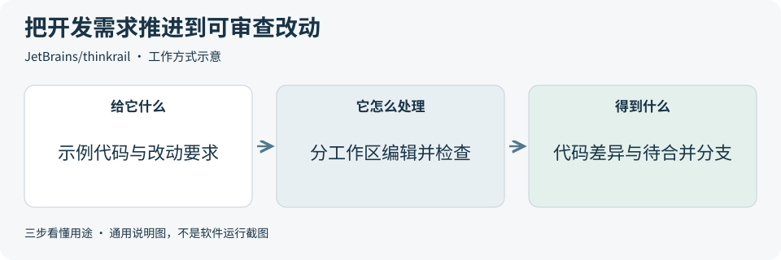
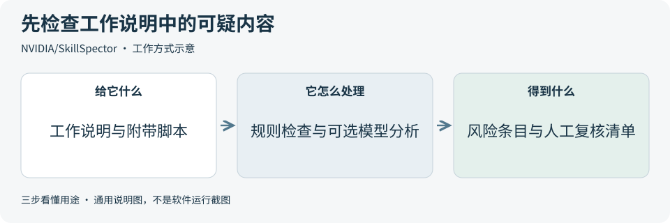
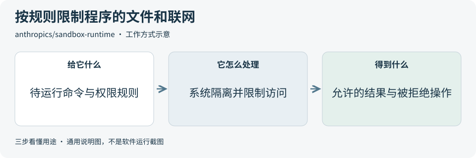
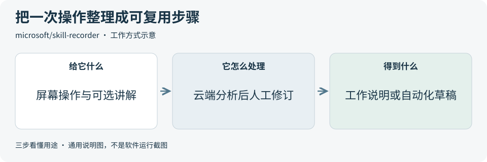

# 2026-10-29 · 每日开源项目推荐 5 个

每天在同一个仓库新增一份资料，每份 5 个项目，避开全部历史推荐。先看速览，再点项目查看图解和例子。

热度参考抓取时的 GitHub 滚动周榜，**不是一天内的新增 Star**。用途按公开文档整理，图解和例子用于解释用法；本期未实际安装或运行这些项目。

**先认两个词**　Agent 是能分步办事的 AI 助手；Skill 是写给 AI 助手的工作说明。Star 是关注热度，不代表质量。

## 本期速览

| 名次 | 项目 | 本周新增 Star | 一句话用途 | 可用场景 |
| --- | --- | ---: | --- | --- |
| 1 | [DeepTutor](#project-01) | +5,724 | 把学习资料、问答、练习和笔记放进同一个工作台，用 AI 辅助读懂材料、解题和复习。 | 资料学习、辅导原型与题目练习 |
| 2 | [thinkrail](#project-02) | +3,679 | 把 AI 编程助手、代码编辑器、终端和独立分支工作区放在一个界面，方便提出需求、检查改动和继续开发。 | AI 辅助开发、代码审查与分支协作 |
| 3 | [SkillSpector](#project-03) | +2,222 | 在安装 AI 工作说明前，检查其中的文本和脚本，找出可疑指令、敏感数据外传及依赖风险。 | 工作说明审阅、工具接入前检查 |
| 4 | [sandbox-runtime](#project-04) | +1,189 | 给命令或 AI 工具进程加上操作系统层的文件、联网等限制，按配置缩小它能接触的范围。 | 工具权限控制、自动化执行环境 |
| 5 | [skill-recorder](#project-05) | +1,187 | 录下电脑上的一次操作，用 Copilot 分析成意图和步骤，再整理为可复用的工作说明或自动化流程。 | 操作教程整理、重复任务流程提取 |

## 可以先看

想把学习资料变成讲解和练习，先看 **DeepTutor**；想在一个界面提需求、写代码和审查改动，先看 **ThinkRail**；想把一次电脑操作整理成可复用步骤，先看 **Skill Recorder**。另外两项分别帮助检查工作说明中的风险、限制程序的文件和联网权限。

## 1. [DeepTutor](https://github.com/HKUDS/DeepTutor)

**一句话用途**　把学习资料、问答、练习和笔记放进同一个工作台，用 AI 辅助读懂材料、解题和复习。

**举个例子**　学习一份公开的植物生长说明时，可围绕光照和浇水提问，把解释与原文对应，再生成一道小测验并保存复习笔记，人工检查题目和答案是否一致。

**适合什么情况**　需要围绕一批教材或公开文档反复提问、整理笔记和出练习题时，可以参考它的资料检索、学习工作区和练习记录，也适合研究学习助手如何衔接多个功能。

**门槛与费用**　门槛中。代码采用 Apache-2.0。完整应用可通过 Docker 运行，或准备 Python 3.11–3.14 与 Node.js 20+；语言模型需自行配置，文档索引、搜索、语音等服务按所选方案产生额外资源或接口费用。

**注意事项**　接入外部模型、搜索或解析服务前，先核对资料会发送到哪里。讲解、题目和引用仍需回看原文；功能较多，启用资料库和执行工具时要分别检查数据权限与设置。

**小范围第一步**　先选一页允许使用的公开科普材料，列出三道能从原文核对答案的问题；评估最小配置后，再少量试做问答和一道练习，逐条核对引用。

周新增 Star **+5,724** · 总 Star **47,994** · Python · Apache-2.0 · 首次推荐

[官方文档](https://github.com/HKUDS/DeepTutor/blob/1ea7df155447f4caf0e3abc86b3ff5395479cd4a/README.md) · [仓库](https://github.com/HKUDS/DeepTutor)

## 2. [thinkrail](https://github.com/JetBrains/thinkrail)

**一句话用途**　把 AI 编程助手、代码编辑器、终端和独立分支工作区放在一个界面，方便提出需求、检查改动和继续开发。

**举个例子**　给虚构待办演示页增加“按完成状态筛选”时，可在单独工作区说明预期、让助手修改代码，再在同一界面检查差异和筛选行为，确认后合并。

**适合什么情况**　同时推进多个小功能、又想分别查看代码改动时，可以参考它的独立工作区、需求说明文件和审查界面；项目说明随代码维护，也有助于下一次开发继续理解目标。

**门槛与费用**　门槛中。代码采用 Apache-2.0，提供桌面版和命令行入口；需要 Git，并连接 JetBrains AI 或其他支持的模型供应方。模型额度、订阅和调用费用由对应服务决定。

**注意事项**　独立分支工作区帮助分开代码改动，仍需核对助手可读取的资料、可执行的命令和外部工具权限。合并与发布前要人工看差异和测试结果；项目处于 JetBrains 孵化阶段。

**小范围第一步**　先准备只有示例代码的 Git 仓库，写清一个很小的改动与验收条件；评估模型接入后，在新工作区处理它，审查差异并运行对应检查，再决定是否合并。

周新增 Star **+3,679** · 总 Star **5,065** · TypeScript · Apache-2.0 · 首次推荐

[官方文档](https://github.com/JetBrains/thinkrail/blob/940d15ca5fb0838b9396832befd9ad60d6e51e66/README.md) · [仓库](https://github.com/JetBrains/thinkrail)

## 3. [SkillSpector](https://github.com/NVIDIA/SkillSpector)

**一句话用途**　在安装 AI 工作说明前，检查其中的文本和脚本，找出可疑指令、敏感数据外传及依赖风险。

**举个例子**　接入一个整理演示文件的 Skill 前，可检查它为何需要联网、是否读取无关文件，以及依赖是否有已知问题，把有疑问的条目交给维护者说明后再决定采用。

**适合什么情况**　收集第三方 Skill 或给团队维护工作说明库时，可把它放在接入前审查环节，输出风险项与对应文件位置，再由人决定哪些需要改写、隔离验证或暂缓使用。

**门槛与费用**　门槛中。代码采用 Apache-2.0，需要 Python 3.12+，也提供 Docker 入口。可关闭模型分析，仅做静态检查；启用模型分析时需配置相应服务，费用随模型、文件量和服务方案变化。

**注意事项**　默认启用的模型分析会把待分析文件内容发给所选供应方；关闭模型分析后，依赖检查仍可能把包名和版本发给 OSV。检查可能漏报或误报，扫描结果不能替代权限限制和人工复核。

**小范围第一步**　先选一份自己写的、不含秘密的工作说明，核对模型与联网设置；评估静态检查报告的覆盖范围和文件依据，再决定是否增加模型分析。

周新增 Star **+2,222** · 总 Star **23,074** · Python · Apache-2.0 · 首次推荐

[官方文档](https://github.com/NVIDIA/SkillSpector/blob/d501c0d5035c2ed6385740a384d942bb05651fda/README.md) · [仓库](https://github.com/NVIDIA/SkillSpector)

## 4. [sandbox-runtime](https://github.com/anthropics/sandbox-runtime)

**一句话用途**　给命令或 AI 工具进程加上操作系统层的文件、联网等限制，按配置缩小它能接触的范围。

**举个例子**　让脚本整理一份虚构 CSV 时，可只允许写入测试输出文件夹，并禁止联网；核对正常输出是否生成、越出允许范围的写入是否被拒绝，记录两类结果。

**适合什么情况**　需要让助手运行命令或调用本地工具，又希望限定可写目录和联网目标时，可参考它的命令行入口与程序库，把权限规则接入工具启动环节。

**门槛与费用**　门槛高。代码采用 Apache-2.0，固定版本[运行要求](https://github.com/anthropics/sandbox-runtime/blob/98a4016d27609ed34dd1fb43d23ed6efb6eeeb77/package.json)为 Node.js 22.12+，并需对应平台的隔离依赖。Linux 使用 bubblewrap 等组件；Windows 支持仍为 Alpha，初次设置需要管理员权限。它本身不提供模型服务。

**注意事项**　默认读取范围较宽，需要主动配置读取限制；网络白名单与写入范围也要逐项检查。项目属于研究预览，放宽隔离选项会改变保护边界，不能仅凭命令成功退出判断限制有效。

**小范围第一步**　先在只有虚构文件的练习环境写出允许与禁止清单，评估平台依赖后，分别验证一次允许写入、一次禁止写入和一次禁止联网，并查看实际结果。

周新增 Star **+1,189** · 总 Star **6,819** · TypeScript · Apache-2.0 · 首次推荐

[官方文档](https://github.com/anthropics/sandbox-runtime/blob/98a4016d27609ed34dd1fb43d23ed6efb6eeeb77/README.md) · [仓库](https://github.com/anthropics/sandbox-runtime)

## 5. [skill-recorder](https://github.com/microsoft/skill-recorder)

**一句话用途**　录下电脑上的一次操作，用 Copilot 分析成意图和步骤，再整理为可复用的工作说明或自动化流程。

**举个例子**　演示把一张虚构活动报名表按组分类并导出时，可记录操作与讲解，审阅分析是否遗漏分类规则、文件名和失败处理，再用第二份虚构表验证流程是否能复用。

**适合什么情况**　有一套自己能演示、却难以逐步写清的电脑操作时，可用它记录屏幕活动与可选讲解，再审阅和编辑步骤；适合把单次演示整理成可继续验证的流程草稿。

**门槛与费用**　门槛中。仓库源码采用 MIT；当前提供源码安装流程，会下载运行时并在本机构建。分析需要有 Copilot 访问权限的 GitHub 账号，额度按账号方案核对。第三方依赖另有许可，本机构建产物的分发需遵循[官方打包说明](https://github.com/microsoft/skill-recorder/blob/b05d59036182e897e1a60e90651e775cf5f97e8d/INSTALL.md#licensing-boundary)。

**注意事项**　录制可能包含屏幕、窗口标题、网页地址、剪贴板预览及录制终端内容。录制先存本机，点击“分析”后会发送相关数据到 GitHub 云端；生成步骤需要人工核对，能否复用仍需小范围验证。

**小范围第一步**　先用全是虚构资料的短任务写一份操作清单，核对采集与上传范围；决定试用后只录这段演示，检查记录与分析步骤，再评估是否导出工作说明。

周新增 Star **+1,187** · 总 Star **5,491** · TypeScript · MIT · 首次推荐

[官方文档](https://github.com/microsoft/skill-recorder/blob/b05d59036182e897e1a60e90651e775cf5f97e8d/README.md) · [仓库](https://github.com/microsoft/skill-recorder)

## 来源与选取方法

候选池 126 个，可识别开源许可证且未归档的候选 109 个。已核对 94 个历史推荐，剩余未介绍过的候选 67 个；再核对用途与许可，选出本期 5 个。抓取时间与原榜名次见 [本期数据](../data/2026-10-29.json)。

- [周榜来源 1](https://github.com/trending?since=weekly)
- [周榜来源 2](https://github.com/trending/python?since=weekly)
- [周榜来源 3](https://github.com/trending/typescript?since=weekly)
- [周榜来源 4](https://github.com/trending/javascript?since=weekly)
- [周榜来源 5](https://github.com/trending/go?since=weekly)
- [周榜来源 6](https://github.com/trending/rust?since=weekly)
- [周榜来源 7](https://github.com/trending/swift?since=weekly)
- [周榜来源 8](https://github.com/trending/dart?since=weekly)
- [周榜来源 9](https://github.com/trending/java?since=weekly)

[排名和更新规则](../UPDATE_GUIDE.md) · [通用应用场景](../USE_CASES.md)

序号是本期推荐顺序，不是 GitHub 官方总榜排名。图解和应用例子仅作说明。

[返回资料首页](../README.md)
