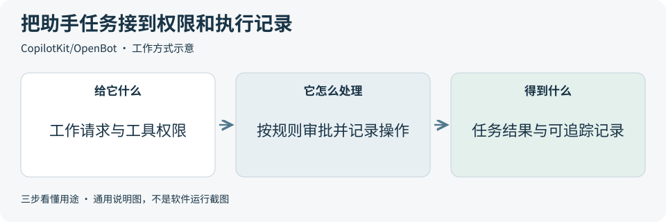

# 2026-10-31 · 每日开源项目推荐 5 个

每天在同一个仓库新增一份资料，每份 5 个项目，避开全部历史推荐。先看速览，再点项目查看图解和例子。

热度参考抓取时的 GitHub 滚动周榜，**不是一天内的新增 Star**。用途按公开文档整理，图解和例子用于解释用法；本期未实际安装或运行这些项目。

**先认两个词**　Agent 是能分步办事的 AI 助手；Skill 是写给 AI 助手的工作说明。Star 是关注热度，不代表质量。

## 本期速览

| 名次 | 项目 | 本周新增 Star | 一句话用途 | 可用场景 |
| --- | --- | ---: | --- | --- |
| 1 | [superpowers](#project-01) | +5,474 | 给 AI 编程助手一套开发工作说明，把需求澄清、任务拆分、编码、测试和审查串成流程。 | 开发流程整理、编程助手协作 |
| 2 | [OpenMausBot](#project-02) | +2,863 | 把不同 AI 助手放进聊天式桌面界面，集中查看任务进展、工具调用和需要人批准的操作。 | 多助手工作台、工具与审批交互 |
| 3 | [humanizer](#project-03) | +2,799 | 给 AI 助手一套改稿规则，删掉空话、重复和过度包装，让文字更直接，也可参考给定的风格样例。 | 公告改稿、文档表达与风格调整 |
| 4 | [OpenBot](#project-04) | +1,653 | 在自有环境部署 AI 助手工作台，把聊天、浏览器操作、权限规则和执行记录放在一起管理。 | 自托管助手平台、权限与执行记录 |
| 5 | [marketingskills](#project-05) | +1,330 | 给 AI 助手提供按主题组织的营销工作说明，帮助写页面文案、检查网站和设计增长实验。 | 产品文案、页面检查与营销方案 |

## 可以先看

想让编程助手按步骤澄清需求、实现和检查，先看 **Superpowers**；想把文字改得直接自然，先看 **Humanizer**；想整理产品页面和营销方案，先看 **marketingskills**。**OpenMausBot** 与 **OpenBot** 则分别提供聊天式多助手界面、可部署在自有环境的助手平台，采用前先看权限和服务费用。

## 1. [superpowers](https://github.com/obra/superpowers)

**一句话用途**　给 AI 编程助手一套开发工作说明，把需求澄清、任务拆分、编码、测试和审查串成流程。

**举个例子**　给虚构便签程序增加按关键词筛选时，可先明确空关键词和无结果时的行为，再拆分界面、筛选逻辑与验证任务，最后逐项检查代码和测试输出。

**适合什么情况**　助手容易直接写代码、遗漏需求或缺少验证时，可参考它的需求讨论、实施计划、调试和审查说明，把一个改动拆成能检查结果的小任务。

**门槛与费用**　门槛中。说明与代码采用 MIT，需要支持相应 Skill 或插件的编程助手。模型订阅或 API 费用按助手方案计算；多轮规划、分工和审查可能增加调用量，也需要 Git 与项目自身的测试环境。

**注意事项**　这些说明会改变助手的工作顺序，启用前先核对触发方式和适用范围。分工与测试记录都应回看实际代码和输出，不能把助手自述完成当成验收通过。

**小范围第一步**　先用示例仓库选一个小功能，写清预期行为，参照说明形成简短需求和任务清单；逐项查看差异与测试结果，再判断流程是否适合。

周新增 Star **+5,474** · 总 Star **309,475** · Shell · MIT · 首次推荐

[官方文档](https://github.com/obra/superpowers/blob/2ce8aa15d05bd57213e6f746f953aafb7ded7a8b/README.md) · [仓库](https://github.com/obra/superpowers)

## 2. [OpenMausBot](https://github.com/milind-soni/OpenMausBot)

**一句话用途**　把不同 AI 助手放进聊天式桌面界面，集中查看任务进展、工具调用和需要人批准的操作。

**举个例子**　整理一组虚构活动资料时，可给一个助手只分配整理目录和拟定文件名的任务，在聊天中检查它提出的修改，再核对文件变化及任务记录。

**适合什么情况**　需要给不同任务配置不同助手、在聊天中看执行过程并处理审批时，可参考它的助手列表、模型选择、电脑面板和连接应用；适用能力取决于所选模型、系统与接入服务。

**门槛与费用**　门槛中。开源部分采用 Apache-2.0；enterprise 目录另有许可，生产使用相关功能需满足其条件，详见[许可边界](https://github.com/milind-soni/OpenMausBot/blob/7de00e425848d5f1a2a845cb4784851b87d8cad2/LICENSING.md)。默认用法需准备已登录的助手命令行程序；模型、云电脑、连接应用及云端语音服务按各自方案计费。

**注意事项**　本地界面不代表所有处理都留在本机；模型、云电脑与连接应用各有数据去向和权限。项目仍在早期，不同系统的电脑控制能力不同，正式接入前应实测拒绝操作和取消任务是否生效。

**小范围第一步**　先核对一个助手环境与系统支持情况，在只有虚构文件的练习目录中完成一项整理任务，观察进度、审批和结果记录，再评估扩展工具权限。

周新增 Star **+2,863** · 总 Star **8,721** · TypeScript · Apache-2.0 · 首次推荐

[官方文档](https://github.com/milind-soni/OpenMausBot/blob/7de00e425848d5f1a2a845cb4784851b87d8cad2/README.md) · [仓库](https://github.com/milind-soni/OpenMausBot)

## 3. [humanizer](https://github.com/blader/humanizer)

**一句话用途**　给 AI 助手一套改稿规则，删掉空话、重复和过度包装，让文字更直接，也可参考给定的风格样例。

**举个例子**　把虚构读书会预告里的夸张宣传和重复铺垫删掉，保留时间、地点、参加方式与费用，再检查修改稿是否把任何条件写漏或写错。

**适合什么情况**　已有内容基本正确，却读起来绕、口号多或句式重复时，可参考它的表达检查项，先修改语言，再逐项核对事实；也适合整理团队常见改稿问题。

**门槛与费用**　门槛低。工作说明与代码采用 MIT，需要能读取这些说明的 AI 助手。改稿使用的模型订阅或 API 按所选服务计费；提供风格样例和多轮修改会增加输入与调用量。

**注意事项**　改写仍需人工检查人名、数字、日期、引文和专业术语。来源中的例子主要是英文，中文效果需要单独评估；语气自然和内容准确要分别核对，不以修改后的流畅程度判断事实。

**小范围第一步**　选一段公开且事实清楚的短公告，先列出必须保留的信息，再按检查项修改，对照原文标出每处删改，确认没有增加未经支持的细节。

周新增 Star **+2,799** · 总 Star **62,743** · Python · MIT · 首次推荐

[官方文档](https://github.com/blader/humanizer/blob/0ef9fe5bc3572734fd3ae6c448fe00a30cd5dcf0/README.md) · [仓库](https://github.com/blader/humanizer)

## 4. [OpenBot](https://github.com/CopilotKit/OpenBot)

**一句话用途**　在自有环境部署 AI 助手工作台，把聊天、浏览器操作、权限规则和执行记录放在一起管理。

**举个例子**　让测试助手从一份虚构活动说明里提取事项并保存摘要时，可限制可读文件和保存位置，同时检查一次越界请求是否被拒绝，核对摘要与操作记录。

**适合什么情况**　需要把不同助手接入统一界面，并按人和任务管理工具权限时，可参考它的浏览器工作环境、审批规则、操作记录及统一的助手接入接口；已有助手也可按协议接入。

**门槛与费用**　门槛高。仓库代码采用 MIT，源码开发要求 Docker 与 Bun 1.4+；还需用于会话等能力的 CopilotKit Intelligence 服务与相应许可，并自行配置模型。数据库、浏览器容器、模型和外部连接服务各有资源或方案费用。

**注意事项**　项目处于 Beta，实际能力受部署和规则配置影响。默认电脑环境按用户划分，单个助手可另选独立容器；接真实账号前，应核对数据会经过哪些服务，并验证允许、拒绝和人工接管的结果。

**小范围第一步**　先用虚构文件和测试网页定义一个小任务，只配置所需工具；评估部署条件后，分别检查一次允许操作和一次拒绝操作，再从记录中核对实际结果。

周新增 Star **+1,653** · 总 Star **8,837** · TypeScript · MIT · 首次推荐

[官方文档](https://github.com/CopilotKit/OpenBot/blob/743649efc3f21d7bf0badbe6af2bcd5daedd97ce/README.md) · [仓库](https://github.com/CopilotKit/OpenBot)

## 5. [marketingskills](https://github.com/coreyhaines31/marketingskills)

**一句话用途**　给 AI 助手提供按主题组织的营销工作说明，帮助写页面文案、检查网站和设计增长实验。

**举个例子**　为虚构读书会写报名页时，可整理参加对象、活动安排和报名步骤，比较两版标题是否清楚，列出需要检查的页面问题，不预先宣称报名率会提高。

**适合什么情况**　需要围绕产品、受众和目标整理首页、报名流程或内容计划时，可参考它的文案、页面检查、搜索优化与实验设计说明，把建议整理成待验证的改动清单。

**门槛与费用**　门槛低。工作说明与代码采用 MIT，需要支持 Skill 的 AI 助手。模型、搜索数据、广告和分析平台按所选服务分别计费；安装说明文件不会自动配置外部账号、接口或所需权限。

**注意事项**　建议能否改善报名、转化或搜索表现，需要用实际数据验证。文案中的数字、承诺和案例应有来源；接入账号、发布内容或投入预算前，要逐项核对权限、费用和最终操作。

**小范围第一步**　先列清一个虚构产品的功能、受众与目标，只选文案或页面检查说明生成一份草稿；标出每条主张的依据和验证方法，再评估是否接外部工具。

周新增 Star **+1,330** · 总 Star **57,526** · JavaScript · MIT · 首次推荐

[官方文档](https://github.com/coreyhaines31/marketingskills/blob/88c79f6528a9347420e57ceb1fff9a60de651768/README.md) · [仓库](https://github.com/coreyhaines31/marketingskills)

## 来源与选取方法

候选池 132 个，可识别开源许可证且未归档的候选 115 个。已核对 99 个历史推荐，剩余未介绍过的候选 76 个；再核对用途与许可，选出本期 5 个。抓取时间与原榜名次见 [本期数据](../data/2026-10-31.json)。

- [ruvnet/RuView](https://github.com/ruvnet/RuView/blob/5728b90949e60e3f908d996997d453147c1794e0/NOTICE) 暂未收录：README 和根 LICENSE 写 MIT，NOTICE 却把整个仓库称为 MIT 或 Apache-2.0，许可表述不一致；本期先跳过，待上游说明统一后再评估。
- [周榜来源 1](https://github.com/trending?since=weekly)
- [周榜来源 2](https://github.com/trending/python?since=weekly)
- [周榜来源 3](https://github.com/trending/typescript?since=weekly)
- [周榜来源 4](https://github.com/trending/javascript?since=weekly)
- [周榜来源 5](https://github.com/trending/go?since=weekly)
- [周榜来源 6](https://github.com/trending/rust?since=weekly)
- [周榜来源 7](https://github.com/trending/swift?since=weekly)
- [周榜来源 8](https://github.com/trending/dart?since=weekly)
- [周榜来源 9](https://github.com/trending/java?since=weekly)

[排名和更新规则](../UPDATE_GUIDE.md) · [通用应用场景](../USE_CASES.md)

序号是本期推荐顺序，不是 GitHub 官方总榜排名。图解和应用例子仅作说明。

[返回资料首页](../README.md)
