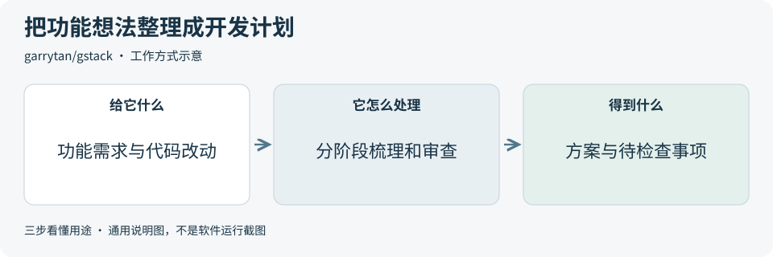
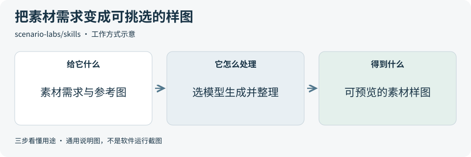
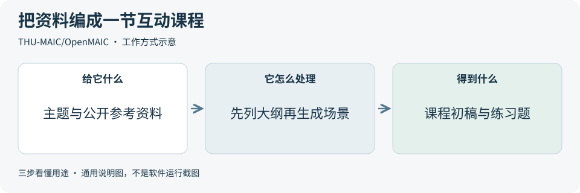
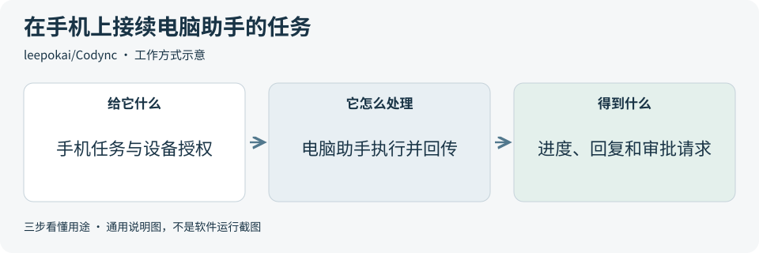

# 2026-11-06 · 每日开源项目推荐 5 个

每天在同一个仓库新增一份资料，每份 5 个项目，避开全部历史推荐。先看速览，再点项目查看图解和例子。

热度参考抓取时的 GitHub 滚动周榜，**不是一天内的新增 Star**。用途按公开文档整理，图解和例子用于解释用法；本期未实际安装或运行这些项目。

**先认两个词**　Agent 是能分步办事的 AI 助手；Skill 是写给 AI 助手的工作说明。Star 是关注热度，不代表质量。

## 本期速览

| 名次 | 项目 | 本周新增 Star | 一句话用途 | 可用场景 |
| --- | --- | ---: | --- | --- |
| 1 | [gstack](#project-01) | +1,721 | 给 AI 编程助手一套工作步骤，帮它梳理需求、审查改动、验证功能和准备发布。 | 功能规划、代码审查与发布检查 |
| 2 | [skills](#project-02) | +1,684 | 给 AI 助手提供素材制作步骤，让它用 Scenario 选模型、生成图片或视频，并把结果放进素材库。 | 游戏素材打样、图片变体与视频草稿 |
| 3 | [pr-agent](#project-03) | +1,355 | 读取代码合并请求里的改动，生成摘要、审查反馈和改进建议，供开发者核对。 | 合并前审查、改动解释与测试补漏 |
| 4 | [OpenMAIC](#project-04) | +1,018 | 把主题或参考资料整理成互动课程初稿，内容可包含讲解、测验和可操作的示例。 | 课程备课、互动演示与自学材料 |
| 5 | [Codync](#project-05) | +909 | 把电脑上的编程助手接到 iPhone 或桌面聊天窗口，可以发任务、看进度和处理授权请求。 | 跨设备接续任务与审批 |

## 可以先看

想梳理软件开发步骤，可先看 **gstack**。要给合并请求做审查，可看 **PR-Agent**。**Scenario Skills** 面向创作素材，**OpenMAIC** 面向互动课程初稿，**Codync** 可以从 iPhone 接续电脑上的助手任务。

## 1. [gstack](https://github.com/garrytan/gstack)

**一句话用途**　给 AI 编程助手一套工作步骤，帮它梳理需求、审查改动、验证功能和准备发布。

**举个例子**　为演示应用规划 CSV 导出，让助手先列出筛选条件、空结果和大数据量时的行为，再把确定的规则整理成实施和测试清单。

**适合什么情况**　适合希望把开发过程分成明确步骤的团队。可以只采用需求梳理或代码审查，让每一步留下可核对的计划和问题。

**门槛与费用**　门槛中。主项目采用 MIT，常规安装需要 Git、Bun 和兼容的编程助手，Windows 还需 Node.js。模型和可选服务按各自方案计费。随附材料按各自许可处理。[固定版本第三方许可说明](https://github.com/garrytan/gstack/blob/eaf1701da2d68b5c03136ff530aa228013eedb7c/NOTICE.md)

**注意事项**　不同助手支持的功能和权限限制有差异。部分步骤能改代码、操作浏览器或创建合并请求，外部复核还可能发送代码给所选模型服务。先确认允许的操作和数据范围。

**小范围第一步**　在练习仓库只做一次需求梳理，检查产出的方案是否说明了范围、待决定事项和验证方法。

周新增 Star **+1,721** · 总 Star **139,946** · TypeScript · MIT · 首次推荐

[官方文档](https://github.com/garrytan/gstack/blob/eaf1701da2d68b5c03136ff530aa228013eedb7c/README.md) · [仓库](https://github.com/garrytan/gstack)

## 2. [skills](https://github.com/scenario-labs/skills)

**一句话用途**　给 AI 助手提供素材制作步骤，让它用 Scenario 选模型、生成图片或视频，并把结果放进素材库。

**举个例子**　为虚构种植游戏制作浇水壶图标，给出蓝白配色和一张自制参考图，先选出合适的一版，再用同样的风格做其他道具。

**适合什么情况**　适合要把文字需求和参考图变成一批可比较素材的工作。也能参考它的流程，把选模型、确认费用、检查结果和归档拆成独立步骤。

**门槛与费用**　门槛中。技能采用 MIT。云端生成需要 Scenario 账号和支持连接其工具服务的助手，按使用量消耗团队算力额度。使用 API 密钥需付费套餐。本地专家工具另需对应的创作软件。[官方连接与额度说明](https://help.scenario.com/articles/2664328768-getting-started-with-the-scenario-mcp-server) · [API 费用说明](https://help.scenario.com/articles/7934059476-api-usage-and-credits-compute-units)

**注意事项**　参考图可能上传到所选工作区，生成任务会扣额度。先确认素材授权、工作区和模型的使用条件。交付前人工核对轮廓、文字和风格是否符合要求。

**小范围第一步**　先估算一张图标的用量，只做一张样图。缩到实际使用尺寸，检查主体能否辨认，再决定是否做变体。

周新增 Star **+1,684** · 总 Star **3,062** · Python · MIT · 首次推荐

[官方文档](https://github.com/scenario-labs/skills/blob/f29bf06ab89088695ed3431ac99d20a090441a2f/README.md) · [仓库](https://github.com/scenario-labs/skills)

## 3. [pr-agent](https://github.com/The-PR-Agent/pr-agent)

**一句话用途**　读取代码合并请求里的改动，生成摘要、审查反馈和改进建议，供开发者核对。

**举个例子**　审查一份修改表单校验的合并请求时，让工具检查空输入是否漏测。开发者对照实际代码与测试，再决定是否补上用例。

**适合什么情况**　适合合并请求较多、希望先看到主要改动和风险提示的团队。可先单独使用审查功能，再决定是否接入代码平台的自动检查。

**门槛与费用**　门槛中。采用 MIT，可用命令行、容器或代码平台的自动化流程。需要配置代码平台权限和可用的模型服务。模型用量和运行资源按所选方案计费。

**注意事项**　较大的改动可能因模型输入限制被省略，先看报告的覆盖范围。有发布权限时可向合并请求写入反馈，连接外部模型时应核对代码发送范围。[固定版本审查说明](https://github.com/The-PR-Agent/pr-agent/blob/6de02f5036ce9b250222f8be65f42a20694ff972/docs/docs/tools/review.md)

**小范围第一步**　先在练习仓库挑一个只改几行代码的合并请求，手动触发一次审查，核对它引用的改动和提示理由。

周新增 Star **+1,355** · 总 Star **15,093** · Python · MIT · 首次推荐

[官方文档](https://github.com/The-PR-Agent/pr-agent/blob/6de02f5036ce9b250222f8be65f42a20694ff972/README.md) · [仓库](https://github.com/The-PR-Agent/pr-agent)

## 4. [OpenMAIC](https://github.com/THU-MAIC/OpenMAIC)

**一句话用途**　把主题或参考资料整理成互动课程初稿，内容可包含讲解、测验和可操作的示例。

**举个例子**　用公开教材准备杠杆原理课，让模型先拟大纲，再做一个能改变力臂长度的演示和一道练习题。教师检查公式、示例和测验答案。

**适合什么情况**　适合已有资料、想先搭出课程结构的教师或内容制作者。也可以用它研究大纲、讲解和练习如何组合成一节课。

**门槛与费用**　门槛高。主项目采用 MIT。该版本本地部署需要 Node.js 22.19+、pnpm 10+ 和 PostgreSQL 16。模型、配音与存储费用取决于所选方案。再分发时另核对随附的 LGPL 组件。

**注意事项**　生成的讲解、公式、答案和交互行为需要人工验收。部署给多人使用时应明确课程归属、访问权限和模型数据去向。[固定版本托管说明](https://github.com/THU-MAIC/OpenMAIC/blob/8fc4fb7b20737121f495355a3a4ddc62b7baf141/packages/docs/content/docs/hosting.mdx)

**小范围第一步**　先用一页公开资料生成一段讲解和一道题，自己走完一遍，核对内容与答案后再扩成完整课程。

周新增 Star **+1,018** · 总 Star **42,739** · TypeScript · MIT · 首次推荐

[官方文档](https://github.com/THU-MAIC/OpenMAIC/blob/8fc4fb7b20737121f495355a3a4ddc62b7baf141/README.md) · [仓库](https://github.com/THU-MAIC/OpenMAIC)

## 5. [Codync](https://github.com/leepokai/Codync)

**一句话用途**　把电脑上的编程助手接到 iPhone 或桌面聊天窗口，可以发任务、看进度和处理授权请求。

**举个例子**　在 iPhone 上询问演示仓库里一次单元测试失败的原因，让电脑上的助手读取测试摘要并回复。如果助手请求运行命令，先查看申请的操作。

**适合什么情况**　适合需要暂时离开电脑，又希望继续查看助手进度的人。也可以为不同的练习目录设置独立助手，分别限定它们的权限。

**门槛与费用**　门槛中。源码采用 Apache-2.0。电脑端需要主机程序和自备的编程助手，模型或订阅按助手提供方计费。官方云中继免费供个人使用，多租户服务需自行运行中继和账号服务。[固定版本云服务与商标说明](https://github.com/leepokai/Codync/blob/e34b319afd44692e3826279d79121cec41d7968f/TRADEMARK.md)

**注意事项**　电脑端需保持在线，每台远端设备都要单独授权。助手可能在电脑上执行命令或改文件，先限定任务目录和权限，并核对所选模型会收到哪些资料。

**小范围第一步**　先用一个练习目录配对一台 iPhone，问一个只读问题。确认能看见进度和回复，再核对如何撤销设备授权。

周新增 Star **+909** · 总 Star **1,899** · Rust · Apache-2.0 · 首次推荐

[官方文档](https://github.com/leepokai/Codync/blob/e34b319afd44692e3826279d79121cec41d7968f/README.md) · [仓库](https://github.com/leepokai/Codync)

## 来源与选取方法

候选池 140 个，可识别开源许可证且未归档的候选 120 个。已核对 119 个历史推荐，剩余未介绍过的候选 78 个；再核对用途与许可，选出本期 5 个。抓取时间与原榜名次见 [本期数据](../data/2026-11-06.json)。

- [D4Vinci/Scrapling](https://github.com/D4Vinci/Scrapling/blob/bc602488b44e978da3266841e913af17577ec0fd/README.md) 暂未收录：根 LICENSE 与 README 许可章节写 BSD-3-Clause。README 的免责声明却称仅供教育与研究，适用范围尚未统一，本期跳过。
- [HunYiSage/dsh-purge](https://github.com/HunYiSage/dsh-purge/blob/fc6e787dda5cfbc48c342cf427831b403239b866/README.md) 暂未收录：根 LICENSE 与 NOTICE 标注 Apache-2.0。README 另有限制原版转售的条款，商业说明也对销售等用途另设条件，许可表述尚未统一，本期跳过。
- [周榜来源 1](https://github.com/trending?since=weekly)
- [周榜来源 2](https://github.com/trending/python?since=weekly)
- [周榜来源 3](https://github.com/trending/typescript?since=weekly)
- [周榜来源 4](https://github.com/trending/javascript?since=weekly)
- [周榜来源 5](https://github.com/trending/go?since=weekly)
- [周榜来源 6](https://github.com/trending/rust?since=weekly)
- [周榜来源 7](https://github.com/trending/swift?since=weekly)
- [周榜来源 8](https://github.com/trending/dart?since=weekly)
- [周榜来源 9](https://github.com/trending/java?since=weekly)

[排名和更新规则](../UPDATE_GUIDE.md) · [通用应用场景](../USE_CASES.md)

序号是本期推荐顺序，不是 GitHub 官方总榜排名。图解和应用例子仅作说明。

[返回资料首页](../README.md)
