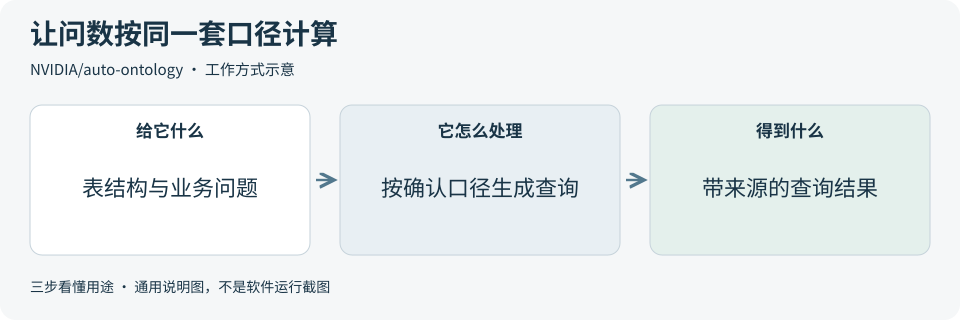
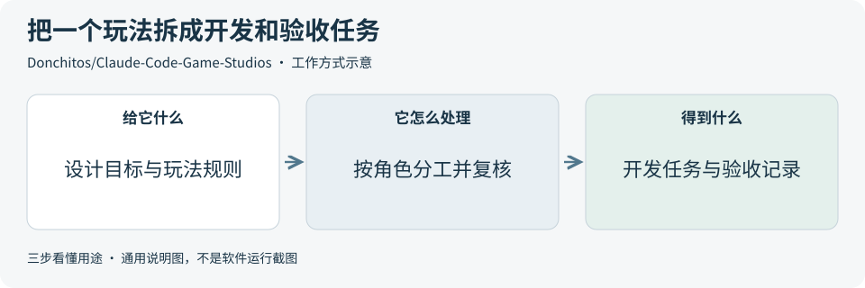
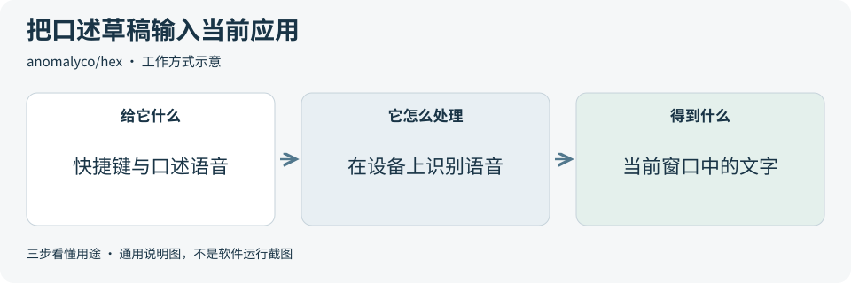
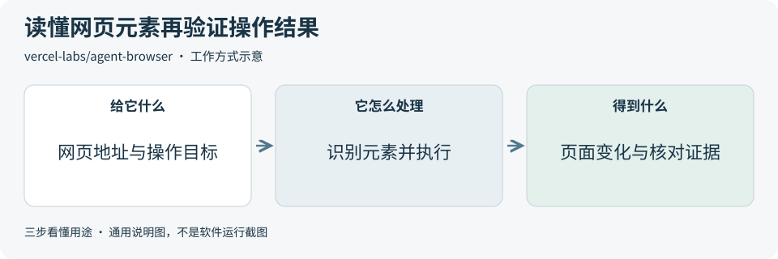
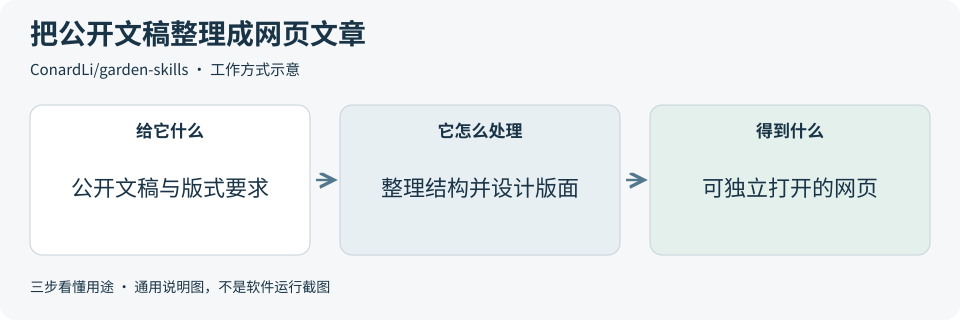

# 2026-11-07 · 每日开源项目推荐 5 个

每天在同一个仓库新增一份资料，每份 5 个项目，避开全部历史推荐。先看速览，再点项目查看图解和例子。

热度参考抓取时的 GitHub 滚动周榜，**不是一天内的新增 Star**。用途按公开文档整理，图解和例子用于解释用法；本期未实际安装或运行这些项目。

**先认两个词**　Agent 是能分步办事的 AI 助手；Skill 是写给 AI 助手的工作说明。Star 是关注热度，不代表质量。

## 本期速览

| 名次 | 项目 | 本周新增 Star | 一句话用途 | 可用场景 |
| --- | --- | ---: | --- | --- |
| 1 | [auto-ontology](#project-01) | +8,035 | 把业务数据库的字段含义、指标算法和表间关系整理成可审核的目录，让 AI 按确认过的口径查询并说明依据。 | 数据口径统一、业务问数与来源追溯 |
| 2 | [Claude-Code-Game-Studios](#project-02) | +6,018 | 给 Claude Code 一套游戏开发模板，把玩法设计、写代码和测试分给不同角色，并为各阶段设置检查点。 | 小型游戏原型、开发分工与试玩验收 |
| 3 | [hex](#project-03) | +4,291 | 按住快捷键说话，Hex 在设备上把语音转成文字，松开后把结果粘贴到当前应用。 | 桌面听写、速记与草稿录入 |
| 4 | [agent-browser](#project-04) | +1,404 | 让助手用命令打开网页、找出能操作的元素并点击或填表，再读取页面变化。 | 网页自动化、产品测试与操作取证 |
| 5 | [garden-skills](#project-05) | +1,124 | 给 AI 助手一组制作说明，可以把素材整理成网页文章、演示或动效片段。 | 公开文稿排版、网页演示与动效 |

## 可以先看

想统一数据指标的计算口径，可先看 **Auto Ontology**。**Hex** 用于本机语音听写，**agent-browser** 可用于网页操作和验证。做游戏原型可参考 **Claude Code Game Studios**，把文稿整理成网页可看 **Garden Skills**。

## 1. [auto-ontology](https://github.com/NVIDIA/auto-ontology)

**一句话用途**　把业务数据库的字段含义、指标算法和表间关系整理成可审核的目录，让 AI 按确认过的口径查询并说明依据。

**举个例子**　用样例订单库定义“已付款订单数”，确认按付款日期统计、按订单编号去重，再问某一周的订单数，与手工统计对照。

**适合什么情况**　同一个指标分散在多张表，接入问数助手前需要统一定义时，可以用它整理字段和算法，让相关人员核对后再用于回答。

**门槛与费用**　门槛高。主项目采用 Apache-2.0。快速部署需要 Docker Compose v2、uv 和可用的模型端点，目录存于 PostgreSQL。费用取决于托管模型用量或自建资源，外部服务和组件各有许可。[固定版本第三方说明](https://github.com/NVIDIA/auto-ontology/blob/c447003f72a822301e927196a4ecb5b597c308d5/THIRD_PARTY_NOTICES.md)

**注意事项**　系统会读取表结构与样例值，初步推断的关系和公式需要人审。若通过界面添加连接且未配置 Vault，连接信息会以未加密形式存入目录数据库。先用只读样例库，并核对模型收到的数据。[固定版本连接说明](https://github.com/NVIDIA/auto-ontology/blob/c447003f72a822301e927196a4ecb5b597c308d5/docs/connections.md)

**小范围第一步**　先选一个公开样例库，只定义一项指标。准备几个已知答案的问题，对照生成的查询语句和结果。

周新增 Star **+8,035** · 总 Star **9,036** · Python · Apache-2.0 · 首次推荐

[官方文档](https://github.com/NVIDIA/auto-ontology/blob/c447003f72a822301e927196a4ecb5b597c308d5/README.md) · [仓库](https://github.com/NVIDIA/auto-ontology)

## 2. [Claude-Code-Game-Studios](https://github.com/Donchitos/Claude-Code-Game-Studios)

**一句话用途**　给 Claude Code 一套游戏开发模板，把玩法设计、写代码和测试分给不同角色，并为各阶段设置检查点。

**举个例子**　做一个方块躲障碍原型时，先写清碰撞和失败条件，让程序角色实现，再让测试角色检查碰撞判定与重新开始。

**适合什么情况**　适合想把游戏想法拆成可交付任务的小团队或独立开发者。先选一条玩法，再让设计、程序和测试围绕同一组验收条件推进。

**门槛与费用**　门槛中。模板采用 MIT。完整流程需要 Claude Code、Git、Python 3 和 Bash。还需按项目选择游戏引擎。助手、引擎和素材费用取决于实际选型。[固定版本环境要求](https://github.com/Donchitos/Claude-Code-Game-Studios/blob/05ad7c8a5b8aa2aa86bbd3439ae7cf7295cac418/.claude/docs/setup-requirements.md)

**注意事项**　启动目录和自动化设置会影响检查和审批行为。先核对运行权限与任务范围，再实际试玩并确认画面、交互和重开流程。

**小范围第一步**　只做一个场景和一条玩法规则，让各角色分别写清任务、实现和验收方式，完成一次试玩再增加功能。

周新增 Star **+6,018** · 总 Star **36,128** · Shell · MIT · 首次推荐

[官方文档](https://github.com/Donchitos/Claude-Code-Game-Studios/blob/05ad7c8a5b8aa2aa86bbd3439ae7cf7295cac418/README.md) · [仓库](https://github.com/Donchitos/Claude-Code-Game-Studios)

## 3. [hex](https://github.com/anomalyco/hex)

**一句话用途**　按住快捷键说话，Hex 在设备上把语音转成文字，松开后把结果粘贴到当前应用。

**举个例子**　写一份活动通知时，先把三项准备事项口述到文本编辑器，再对照检查日期、活动名称和标点。

**适合什么情况**　适合想快速口述草稿、待办事项或短句的人，也可用于观察语音识别结果如何接到日常文字输入。

**门槛与费用**　门槛低。程序采用 MIT。首次使用要下载语音模型，需要麦克风和相应系统权限。基础听写使用本机资源。下载模型和第三方组件各有许可。[固定版本第三方说明](https://github.com/anomalyco/hex/blob/49de3e167598c3e1548c2438a0f4a8597e685346/THIRD_PARTY_NOTICES.md)

**注意事项**　在目标应用里核对输入焦点、快捷键和粘贴权限。Windows 和 Linux 的指南标注为测试版，专名、数字和标点也值得逐项检查。[固定版本平台指南](https://github.com/anomalyco/hex/blob/49de3e167598c3e1548c2438a0f4a8597e685346/docs/README.md)

**小范围第一步**　先在空白文档中口述两句通用例句，确认文字进入预期窗口，再检查断句和数字。

周新增 Star **+4,291** · 总 Star **5,536** · Rust · MIT · 首次推荐

[官方文档](https://github.com/anomalyco/hex/blob/49de3e167598c3e1548c2438a0f4a8597e685346/README.md) · [仓库](https://github.com/anomalyco/hex)

## 4. [agent-browser](https://github.com/vercel-labs/agent-browser)

**一句话用途**　让助手用命令打开网页、找出能操作的元素并点击或填表，再读取页面变化。

**举个例子**　在测试商品页勾选“仅看有库存”，核对结果是否还出现缺货商品，并保留筛选前后的页面快照供复查。

**适合什么情况**　适合用重复操作验证网页流程，也可以把操作前后的页面元素和截图留下来，帮助复查按钮、筛选条件和结果。

**门槛与费用**　门槛中。工具采用 Apache-2.0。默认使用 Chrome for Testing，本机操作需有可用的浏览器及系统依赖。接入 AI 助手或云浏览器时，相关服务费用另计。

**注意事项**　页面变化后要重新获取元素编号。若连接已登录的浏览器，会以该会话的权限操作网页。先用隔离的测试会话，确认可操作的页面与动作。

**小范围第一步**　打开一个无需登录的样例页面，先读到一个链接，再点击并核对目标地址或可见文字。

周新增 Star **+1,404** · 总 Star **46,314** · Rust · Apache-2.0 · 首次推荐

[官方文档](https://github.com/vercel-labs/agent-browser/blob/d44f6989bf5e9a9a1c6dd6d97175f8c33b138eca/README.md) · [仓库](https://github.com/vercel-labs/agent-browser)

## 5. [garden-skills](https://github.com/ConardLi/garden-skills)

**一句话用途**　给 AI 助手一组制作说明，可以把素材整理成网页文章、演示或动效片段。

**举个例子**　把一页公开展览介绍改成可独立打开的网页，先确定标题、目录和图文顺序，再核对展期、地点和原始链接。

**适合什么情况**　适合已有公开文稿、想改善阅读顺序和图文布局的场景。可先选文章技能，确定内容结构和保留范围，再生成便于分享的网页。

**门槛与费用**　门槛中。技能采用 MIT，需要能读取工作说明的 AI 助手。文章流程使用 Reacticle 组件生成 HTML，也可选 PDF。模型和外部工具的费用按所选流程计算。[固定版本文章技能说明](https://github.com/ConardLi/garden-skills/blob/2b9a89340b70f632d31c0f1c69fce94a7912423e/skills/beautiful-article/README.md)

**注意事项**　不同文章类型的改写和摘录幅度有差别。先约定哪些原句和引用要保留，交付前检查事实、链接、外部图片使用范围和窄屏排版。

**小范围第一步**　先选一页公开 Markdown，只做一版网页文章。确定文章类型和保留范围，再比较原文与页面里的关键信息。

周新增 Star **+1,124** · 总 Star **14,519** · JavaScript · MIT · 首次推荐

[官方文档](https://github.com/ConardLi/garden-skills/blob/2b9a89340b70f632d31c0f1c69fce94a7912423e/README.md) · [仓库](https://github.com/ConardLi/garden-skills)

## 来源与选取方法

候选池 138 个，可识别开源许可证且未归档的候选 119 个。已核对 124 个历史推荐，剩余未介绍过的候选 77 个；再核对用途与许可，选出本期 5 个。抓取时间与原榜名次见 [本期数据](../data/2026-11-07.json)。

- [D4Vinci/Scrapling](https://github.com/D4Vinci/Scrapling/blob/bc602488b44e978da3266841e913af17577ec0fd/README.md) 暂未收录：根 LICENSE 和 README 许可章节标注 BSD-3-Clause，但 README 免责声明称仅供教育与研究。用途范围尚未统一，本期跳过。
- [HunYiSage/dsh-purge](https://github.com/HunYiSage/dsh-purge/blob/fc6e787dda5cfbc48c342cf427831b403239b866/README.md) 暂未收录：根 LICENSE 和 NOTICE 标注 Apache-2.0，但 README 禁止原版转售，商业说明也对销售等用途另设条件。许可表述尚未统一，本期跳过。
- [周榜来源 1](https://github.com/trending?since=weekly)
- [周榜来源 2](https://github.com/trending/python?since=weekly)
- [周榜来源 3](https://github.com/trending/typescript?since=weekly)
- [周榜来源 4](https://github.com/trending/javascript?since=weekly)
- [周榜来源 5](https://github.com/trending/go?since=weekly)
- [周榜来源 6](https://github.com/trending/rust?since=weekly)
- [周榜来源 7](https://github.com/trending/swift?since=weekly)
- [周榜来源 8](https://github.com/trending/dart?since=weekly)
- [周榜来源 9](https://github.com/trending/java?since=weekly)

[排名和更新规则](../UPDATE_GUIDE.md) · [通用应用场景](../USE_CASES.md)

序号是本期推荐顺序，不是 GitHub 官方总榜排名。图解和应用例子仅作说明。

[返回资料首页](../README.md)
