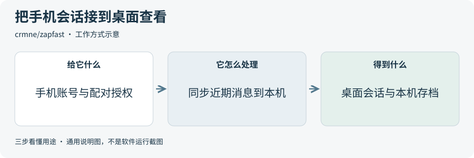
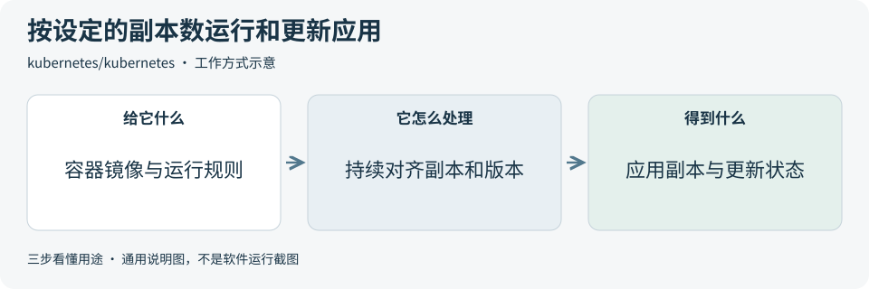

# 2026-11-08 · 每日开源项目推荐 5 个

每天在同一个仓库新增一份资料，每份 5 个项目，避开全部历史推荐。先看速览，再点项目查看图解和例子。

热度参考抓取时的 GitHub 滚动周榜，**不是一天内的新增 Star**。用途按公开文档整理，图解和例子用于解释用法；本期未实际安装或运行这些项目。

**先认两个词**　Agent 是能分步办事的 AI 助手；Skill 是写给 AI 助手的工作说明。Star 是关注热度，不代表质量。

## 本期速览

| 名次 | 项目 | 本周新增 Star | 一句话用途 | 可用场景 |
| --- | --- | ---: | --- | --- |
| 1 | [skills](#project-01) | +1,477 | 给 AI 助手提供 Google 产品的操作说明，帮助它按步骤拟配置、检查权限或排查问题。 | 云服务配置、权限梳理与排错 |
| 2 | [zapfast](#project-02) | +1,018 | 把 WhatsApp 账号关联到桌面应用，在电脑上看会话、切换号码并管理本机存档。 | 桌面查看会话、多账号切换与归档 |
| 3 | [oh-my-pi](#project-03) | +869 | 在终端里让 AI 助手读代码、预览改动并运行检查，可接不同模型。 | 代码修改、调试与差异复核 |
| 4 | [open-notebook](#project-04) | +707 | 把文档、网页和音视频整理进可自托管的笔记本，再按资料搜索或提问。 | 公开资料整理、带引用问答与研究笔记 |
| 5 | [kubernetes](#project-05) | +669 | 按设定的副本数和版本调度容器，帮助应用部署、逐步更新并替换故障实例。 | 多实例服务部署、升级与运行管理 |

## 可以先看

想查资料并回到原文，可先看 **Open Notebook**。想在终端边改代码边跑检查，可看 **Oh My Pi**。**Google Skills** 提供 Google 产品的操作说明，**ZapFast** 用于桌面查看 WhatsApp 会话，**Kubernetes** 管理容器应用的运行与更新。

## 1. [skills](https://github.com/google/skills)

**一句话用途**　给 AI 助手提供 Google 产品的操作说明，帮助它按步骤拟配置、检查权限或排查问题。

**举个例子**　为公开活动照片规划云存储，先描述文件量和哪些人可读，让助手拟出存储区域、访问规则与过期清理配置，再由管理员审核。

**适合什么情况**　适合需要在多个 Google 产品文档中找具体步骤的开发者。可以针对一个任务选一项技能，先核对它生成的配置方案，再决定是否执行。

**门槛与费用**　门槛中。技能采用 Apache-2.0。需要能读取这类工作说明的助手，使用 npx 配置时需要 Node.js。若连接云项目并调用资源，云服务与模型按各自方案计费。

**注意事项**　部分技能能生成或执行会改动云资源的操作。先核对目标项目、访问范围和费用，再审批具体配置。示例技能要求创建前确认。[固定版本云存储配置说明](https://github.com/google/skills/blob/2194d3b8b1f31975fef2f1a0ae6b9ab55bd7ceee/skills/cloud/google-cloud-storage-bucket-architect/SKILL.md)

**小范围第一步**　只选云存储配置技能，用虚构的归档需求生成一份方案，核对存储位置、访问范围和保留时间。

周新增 Star **+1,477** · 总 Star **23,405** · Python · Apache-2.0 · 首次推荐

[官方文档](https://github.com/google/skills/blob/2194d3b8b1f31975fef2f1a0ae6b9ab55bd7ceee/README.md) · [仓库](https://github.com/google/skills)

## 2. [zapfast](https://github.com/crmne/zapfast)

**一句话用途**　把 WhatsApp 账号关联到桌面应用，在电脑上看会话、切换号码并管理本机存档。

**举个例子**　在无敏感信息的演示环境里，依次打开两个已有会话，查看最近消息，再核对本机能否找到已保存的历史。

**适合什么情况**　适合想了解桌面聊天界面、键盘操作或本地历史保存方式的人。它能在同一窗口切换多个已关联号码，已保存的消息也可在本机查阅。

**门槛与费用**　门槛低。程序采用 MIT，提供 macOS、Windows 和 Linux 版本。需要现有 WhatsApp 账号和可关联的手机。运行主要用到设备、网络和本机存储，随附音效等按各自许可处理。[固定版本第三方许可](https://github.com/crmne/zapfast/blob/d85f73146b673ff09c093c655610f11e1c909f4c/THIRD-PARTY-NOTICES.md)

**注意事项**　这是第三方客户端，项目文档提示有触发平台条款或账号受限的风险。聊天记录可保存在本机，导出前要核对保存位置和访问范围。

**小范围第一步**　先读设备关联和解除关联的说明。在允许的演示环境中，只核对已有会话的显示和撤销关联的方式。

周新增 Star **+1,018** · 总 Star **3,363** · Rust · MIT · 首次推荐

[官方文档](https://github.com/crmne/zapfast/blob/d85f73146b673ff09c093c655610f11e1c909f4c/README.md) · [仓库](https://github.com/crmne/zapfast)

## 3. [oh-my-pi](https://github.com/can1357/oh-my-pi)

**一句话用途**　在终端里让 AI 助手读代码、预览改动并运行检查，可接不同模型。

**举个例子**　调整演示项目对空输入的处理时，先看它建议改哪几行，再运行相关单元测试，核对正常输入的行为是否仍符合预期。

**适合什么情况**　适合希望在同一个终端会话内定位代码问题、调整实现和检查结果的开发者。可先用一条小改动熟悉它的编辑预览和工具调用。

**门槛与费用**　门槛中。主项目采用 MIT，有预编译程序和 Bun 等安装方式。需要配置模型服务，远端用量按提供方计费，本地模型消耗设备资源。附带的第三方组件保留各自许可。[固定版本组件说明](https://github.com/can1357/oh-my-pi/blob/24439066040e006eb08da7b204f0ac41c79d2de9/packages/coding-agent/THIRD-PARTY-NOTICES.txt)

**注意事项**　助手能执行命令和修改文件。接入前先限定工作目录与可用工具，复查写入、网络和外部模型的数据范围。

**小范围第一步**　在练习项目里给一个小函数提出明确修改要求，先看改动预览，再核对测试输出和实际改到的文件。

周新增 Star **+869** · 总 Star **38,154** · TypeScript · MIT · 首次推荐

[官方文档](https://github.com/can1357/oh-my-pi/blob/24439066040e006eb08da7b204f0ac41c79d2de9/README.md) · [仓库](https://github.com/can1357/oh-my-pi)

## 4. [open-notebook](https://github.com/lfnovo/open-notebook)

**一句话用途**　把文档、网页和音视频整理进可自托管的笔记本，再按资料搜索或提问。

**举个例子**　把两份公开设备说明放进同一个笔记本，问其中一个型号的保养步骤，点开引用核对适用型号、条件和原文顺序。

**适合什么情况**　适合资料散在多个文件、需要一边提问一边找原文的人。按主题建笔记本，可控制哪些来源参与回答。

**门槛与费用**　门槛中。采用 MIT。常规部署使用 Docker Compose 和 SurrealDB，需要配置生成回答的语言模型和建立索引的向量模型。费用取决于云服务用量，或自建机器的算力与存储。

**注意事项**　默认部署会在网络接口开放服务，且未设密码。先限制访问范围，再处理非公开资料。若选云端模型，核对发送内容与服务条款。回答中的引用也应回到原文检查。[固定版本安全配置](https://github.com/lfnovo/open-notebook/blob/e5381b0c4956810f6d7d35f08e50051fbde06192/docs/5-CONFIGURATION/security.md)

**小范围第一步**　只导入一份短的公开说明，问两个有明确答案的问题，打开引用所指的资料，找到能支持答案的原文。

周新增 Star **+707** · 总 Star **41,737** · TypeScript · MIT · 首次推荐

[官方文档](https://github.com/lfnovo/open-notebook/blob/e5381b0c4956810f6d7d35f08e50051fbde06192/README.md) · [仓库](https://github.com/lfnovo/open-notebook)

## 5. [kubernetes](https://github.com/kubernetes/kubernetes)

**一句话用途**　按设定的副本数和版本调度容器，帮助应用部署、逐步更新并替换故障实例。

**举个例子**　把一个演示网页设为两个副本。更新镜像后，查看新实例何时就绪、旧实例何时退出，以及最终是否恢复到两个副本。

**适合什么情况**　适合已有容器镜像、想统一管理多个实例或分批更新服务的团队。先声明期望的运行状态，再查看集群把实际状态调整到了哪里。

**门槛与费用**　门槛高。源码采用 Apache-2.0。需要可运行容器的集群和管理工具。小规模可用本机测试环境，正式运行的机器、网络、存储和托管服务按部署方案计费。

**注意事项**　可用性依赖健康检查、资源配置和集群容量。保存状态的应用还要单独设计持久存储与备份。先在测试环境核对更新过程。[固定版本 Deployment 说明](https://github.com/kubernetes/website/blob/09b7af0f1d82bc812ad51b8b6033956fbaf73415/content/en/docs/concepts/workloads/controllers/deployment.md)

**小范围第一步**　在可丢弃的测试集群里运行一个演示服务，先确认副本数，再替换一次镜像，观察新旧实例的状态。

周新增 Star **+669** · 总 Star **128,903** · Go · Apache-2.0 · 首次推荐

[官方文档](https://github.com/kubernetes/kubernetes/blob/6b5d04cd0bf7e9aa953dc4a13028878a8a48bd6a/README.md) · [仓库](https://github.com/kubernetes/kubernetes)

## 来源与选取方法

候选池 141 个，可识别开源许可证且未归档的候选 123 个。已核对 129 个历史推荐，剩余未介绍过的候选 78 个；再核对用途与许可，选出本期 5 个。抓取时间与原榜名次见 [本期数据](../data/2026-11-08.json)。

- [D4Vinci/Scrapling](https://github.com/D4Vinci/Scrapling/blob/bc602488b44e978da3266841e913af17577ec0fd/README.md) 暂未收录：根 LICENSE 和 README 许可章节标注 BSD-3-Clause，但 README 免责声明称仅供教育与研究。用途范围尚未统一，本期跳过。
- [周榜来源 1](https://github.com/trending?since=weekly)
- [周榜来源 2](https://github.com/trending/python?since=weekly)
- [周榜来源 3](https://github.com/trending/typescript?since=weekly)
- [周榜来源 4](https://github.com/trending/javascript?since=weekly)
- [周榜来源 5](https://github.com/trending/go?since=weekly)
- [周榜来源 6](https://github.com/trending/rust?since=weekly)
- [周榜来源 7](https://github.com/trending/swift?since=weekly)
- [周榜来源 8](https://github.com/trending/dart?since=weekly)
- [周榜来源 9](https://github.com/trending/java?since=weekly)

[排名和更新规则](../UPDATE_GUIDE.md) · [通用应用场景](../USE_CASES.md)

序号是本期推荐顺序，不是 GitHub 官方总榜排名。图解和应用例子仅作说明。

[返回资料首页](../README.md)
