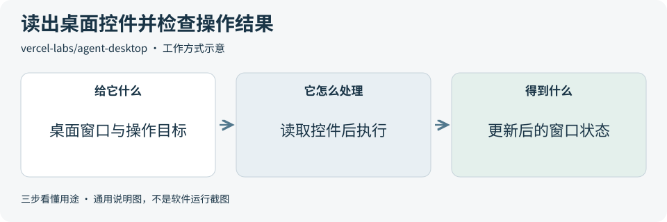
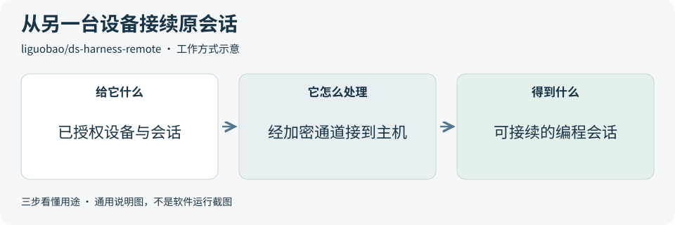
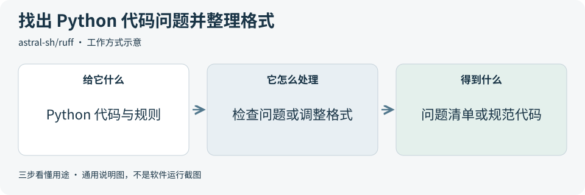
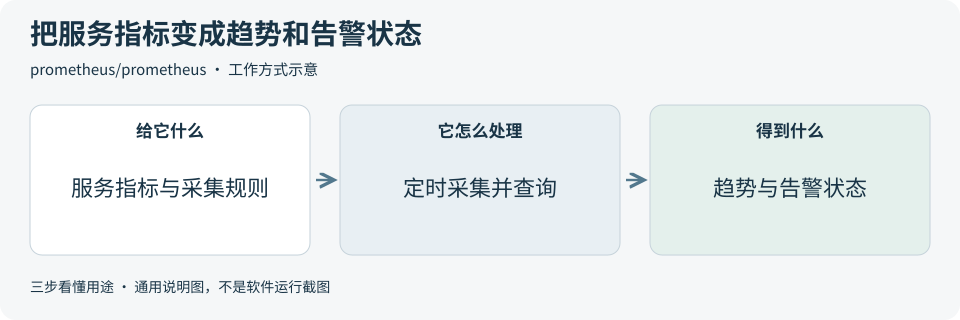

# 2026-11-09 · 每日开源项目推荐 5 个

每天在同一个仓库新增一份资料，每份 5 个项目，避开全部历史推荐。先看速览，再点项目查看图解和例子。

热度参考抓取时的 GitHub 滚动周榜，**不是一天内的新增 Star**。用途按公开文档整理，图解和例子用于解释用法；本期未实际安装或运行这些项目。

**先认两个词**　Agent 是能分步办事的 AI 助手；Skill 是写给 AI 助手的工作说明。Star 是关注热度，不代表质量。

## 本期速览

| 名次 | 项目 | 本周新增 Star | 一句话用途 | 可用场景 |
| --- | --- | ---: | --- | --- |
| 1 | [agent-desktop](#project-01) | +13,712 | 把桌面应用的按钮和输入框等控件读成结构化信息，让 AI 助手按控件标记点击、输入并查看变化。 | 桌面应用测试、重复操作与状态复查 |
| 2 | [Orkas](#project-02) | +2,074 | 在桌面应用里把一项复杂工作拆给不同 AI 助手，再汇总文档、演示稿或其他产物。 | 多步骤任务、资料整理与初稿制作 |
| 3 | [ds-harness-remote](#project-03) | +1,091 | 把另一台设备连到电脑上的 DeepSeek Harness，接续原有编程会话并查看执行进度。 | 跨设备接续会话与远程查看进度 |
| 4 | [ruff](#project-04) | +881 | 按规则找出 Python 代码里的问题，也可以统一代码格式并修复部分问题。 | 提交前检查、格式统一与代码整理 |
| 5 | [prometheus](#project-05) | +832 | 定时采集服务指标，保存成可查询的时间序列，并按规则判断何时触发告警。 | 服务监控、趋势查询与告警规则 |

## 可以先看

想让助手读取和操作桌面控件，可先看 **agent-desktop**。**Orkas** 把任务分给多个助手，**DS Harness Remote** 用于接续电脑上的编程会话。整理 Python 代码可看 **Ruff**，观察服务指标可看 **Prometheus**。

## 1. [agent-desktop](https://github.com/vercel-labs/agent-desktop)

**一句话用途**　把桌面应用的按钮和输入框等控件读成结构化信息，让 AI 助手按控件标记点击、输入并查看变化。

**举个例子**　在演示编辑器中找到“显示行号”复选框，切换后重新读取控件状态，再对照画面确认行号是否出现。

**适合什么情况**　适合需要复现桌面软件操作的开发者。可以把打开窗口、找到控件、执行动作和读回状态拆成可检查的步骤。

**门槛与费用**　门槛中。工具采用 Apache-2.0，提供命令行和 C 库。需要受支持的 macOS、Windows 或 Linux 环境，并按平台配置权限。macOS 需要辅助功能访问权限，接入助手时模型费用另计。

**注意事项**　能读到哪些控件取决于应用和系统提供的辅助功能信息。操作后要重新读取窗口确认结果。快照、剪贴板和调试截图可能包含其他内容，公开记录前先检查。[固定版本概念说明](https://github.com/vercel-labs/agent-desktop/blob/b43ac4f6e892ef608f8851428613c4009f0e84c7/CONCEPTS.md)

**小范围第一步**　先在空白的练习应用中读取一次窗口，核对标题、按钮和输入框，再对一个可恢复的控件验证读回结果。

周新增 Star **+13,712** · 总 Star **19,661** · Rust · Apache-2.0 · 首次推荐

[官方文档](https://github.com/vercel-labs/agent-desktop/blob/b43ac4f6e892ef608f8851428613c4009f0e84c7/README.md) · [仓库](https://github.com/vercel-labs/agent-desktop)

## 2. [Orkas](https://github.com/Orkas-AI/Orkas)

**一句话用途**　在桌面应用里把一项复杂工作拆给不同 AI 助手，再汇总文档、演示稿或其他产物。

**举个例子**　把公开展览介绍交给整理资料的助手提取亮点，再由制作演示稿的助手做三页初稿，人工对照原文核对展期和名称。

**适合什么情况**　适合经常把公开资料、提纲和成稿分开处理的人。项目可集中保存目标、规则、文件和待办，主助手据此分派任务。

**门槛与费用**　门槛中。源码采用 MIT。从源码运行需要 Node.js 22.12+ 和相应系统环境，可接云端或本地模型。模型用量按所选服务计费。云同步、共享项目和网页发布属于打包版功能，网页发布需付费套餐。

**注意事项**　项目资料默认在本机保存，选用云模型或开启云同步时要核对发送范围。打开自动推进或连接外部工具前，先限制可读写的内容，并审阅每一步的产物。

**小范围第一步**　只用一页公开资料，安排提炼要点和生成演示提纲两个步骤，检查分工、来源和输出。

周新增 Star **+2,074** · 总 Star **9,111** · JavaScript · MIT · 首次推荐

[官方文档](https://github.com/Orkas-AI/Orkas/blob/9ba0e36bd1cb2e40e306c3e26d744ffb061bbca3/README.md) · [仓库](https://github.com/Orkas-AI/Orkas)

## 3. [ds-harness-remote](https://github.com/liguobao/ds-harness-remote)

**一句话用途**　把另一台设备连到电脑上的 DeepSeek Harness，接续原有编程会话并查看执行进度。

**举个例子**　在测试电脑保留一次单元测试会话，换到浏览器客户端查看同一条测试输出，核对接续的是正确的主机和工作区。

**适合什么情况**　适合电脑保持在线、需要临时换设备查看任务的人。可以在网页或受支持的客户端里选主机和工作区，接回已有会话。

**门槛与费用**　门槛中。源码和插件采用 MIT。需要运行中的宿主程序、获授权的客户端和连接服务。可选项目托管服务或自建精简中继，主机、网络和模型用量按所选方案计算。[固定版本自建服务说明](https://github.com/liguobao/ds-harness-remote/blob/0a0ac9a1a647a171b79b19998d24bdd43bae9ea0/apps/server/README.md)

**注意事项**　同账号新设备首次连接可自动建立信任，需核对设备列表。远程终端默认启用，以宿主电脑用户权限运行，独立于助手的操作审批。试用前检查终端开关和撤销方式。[固定版本设备信任说明](https://github.com/liguobao/ds-harness-remote/blob/0a0ac9a1a647a171b79b19998d24bdd43bae9ea0/docs/end-to-end-encryption.md)

**小范围第一步**　用隔离的练习工作区接续一个会话，只查看一条已有结果，再确认如何撤销测试设备的连接。

周新增 Star **+1,091** · 总 Star **2,292** · TypeScript · MIT · 首次推荐

[官方文档](https://github.com/liguobao/ds-harness-remote/blob/0a0ac9a1a647a171b79b19998d24bdd43bae9ea0/README.md) · [仓库](https://github.com/liguobao/ds-harness-remote)

## 4. [ruff](https://github.com/astral-sh/ruff)

**一句话用途**　按规则找出 Python 代码里的问题，也可以统一代码格式并修复部分问题。

**举个例子**　检查一个新增的 Python 文件，先定位未使用的导入，再决定是否移除并统一格式，最后复查差异。

**适合什么情况**　适合希望把未使用的导入、风格问题和格式检查放进开发流程的团队。可先在一个目录试用选定规则，再接入自动检查。

**门槛与费用**　门槛低。项目采用 MIT。可在本机命令行或自动检查环境中运行，主要使用本机或构建机器的资源。规则可放在项目配置文件里。

**注意事项**　自动修复与格式化会写文件。先查看检查结果和启用的规则，只在小范围内应用修改，再运行项目测试。[固定版本规则与修复说明](https://github.com/astral-sh/ruff/blob/47daf1c20b23a76e415fb0b3f7ed2b6100ba7164/docs/linter.md)

**小范围第一步**　用一份含未使用导入的演示文件做一次 `ruff check`，核对行号、规则编号和提示内容。

周新增 Star **+881** · 总 Star **51,118** · Rust · MIT · 首次推荐

[官方文档](https://github.com/astral-sh/ruff/blob/47daf1c20b23a76e415fb0b3f7ed2b6100ba7164/README.md) · [仓库](https://github.com/astral-sh/ruff)

## 5. [prometheus](https://github.com/prometheus/prometheus)

**一句话用途**　定时采集服务指标，保存成可查询的时间序列，并按规则判断何时触发告警。

**举个例子**　采集测试服务的成功和失败请求数，查看失败比例随时间的变化，再用一个测试阈值观察规则何时进入告警状态。

**适合什么情况**　适合已经能输出请求量、延迟或错误计数的服务。可以把运行数据集中起来，对照时间变化定位异常出现的时段。

**门槛与费用**　门槛中。项目采用 Apache-2.0，可用二进制或容器运行。需要能访问的指标端点和存储空间，运行成本取决于采集频率、数据规模与保留时间。

**注意事项**　先确认指标含义、采集是否成功和告警条件持续多久。向外发送通知通常还要接 Alertmanager。可以先在本地界面检查告警状态。[固定版本告警规则说明](https://github.com/prometheus/prometheus/blob/1d4faeaf10281aa16c4a5e73e4bfda92f81bc366/docs/configuration/alerting_rules.md)

**小范围第一步**　只配置一个演示指标端点，核对采集状态和一条指标曲线，再为它添加一条测试规则。

周新增 Star **+832** · 总 Star **67,566** · Go · Apache-2.0 · 首次推荐

[官方文档](https://github.com/prometheus/prometheus/blob/1d4faeaf10281aa16c4a5e73e4bfda92f81bc366/README.md) · [仓库](https://github.com/prometheus/prometheus)

## 来源与选取方法

候选池 137 个，可识别开源许可证且未归档的候选 121 个。已核对 134 个历史推荐，剩余未介绍过的候选 75 个；再核对用途与许可，选出本期 5 个。抓取时间与原榜名次见 [本期数据](../data/2026-11-09.json)。

- [D4Vinci/Scrapling](https://github.com/D4Vinci/Scrapling/blob/30cadb56a407fd631391441709ab792ebca52b08/README.md) 暂未收录：根 LICENSE 和 README 许可章节标注 BSD-3-Clause，但 README 免责声明仍称仅供教育与研究。用途范围尚未统一，本期跳过。
- [周榜来源 1](https://github.com/trending?since=weekly)
- [周榜来源 2](https://github.com/trending/python?since=weekly)
- [周榜来源 3](https://github.com/trending/typescript?since=weekly)
- [周榜来源 4](https://github.com/trending/javascript?since=weekly)
- [周榜来源 5](https://github.com/trending/go?since=weekly)
- [周榜来源 6](https://github.com/trending/rust?since=weekly)
- [周榜来源 7](https://github.com/trending/swift?since=weekly)
- [周榜来源 8](https://github.com/trending/dart?since=weekly)
- [周榜来源 9](https://github.com/trending/java?since=weekly)

[排名和更新规则](../UPDATE_GUIDE.md) · [通用应用场景](../USE_CASES.md)

序号是本期推荐顺序，不是 GitHub 官方总榜排名。图解和应用例子仅作说明。

[返回资料首页](../README.md)
