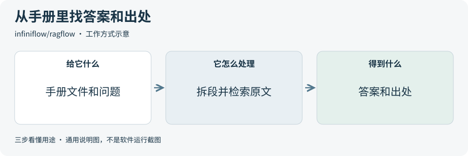
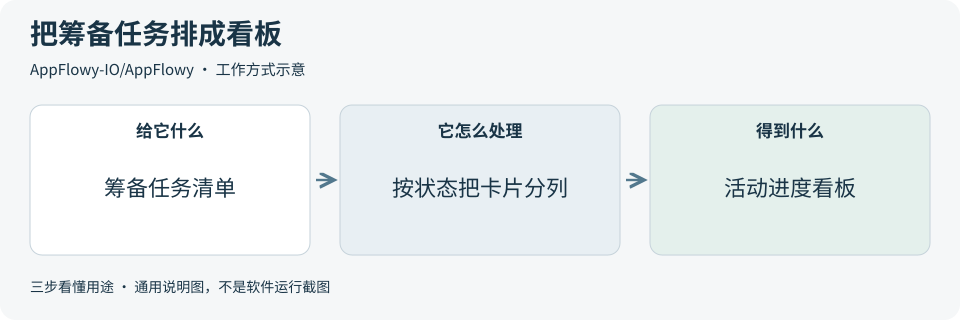

# 2026-11-10 · 每日开源项目推荐 5 个

每天在同一个仓库新增一份资料，每份 5 个项目，避开全部历史推荐。先看速览，再点项目查看图解和例子。

热度参考抓取时的 GitHub 滚动周榜，**不是一天内的新增 Star**。用途按公开文档整理，图解和例子用于解释用法；本期未实际安装或运行这些项目。

**先认两个词**　Agent 是能分步办事的 AI 助手；Skill 是写给 AI 助手的工作说明。Star 是关注热度，不代表质量。

## 本期速览

| 名次 | 项目 | 本周新增 Star | 一句话用途 | 可用场景 |
| --- | --- | ---: | --- | --- |
| 1 | [astryx](#project-01) | +5,406 | 用现成的 React 控件和主题搭网页，让多个页面的按钮、表单和弹窗保持同一风格。 | 统一网页控件和主题 |
| 2 | [claude-video](#project-02) | +624 | 让编程助手读短视频的画面和可用字幕，整理成带时间点的摘要。 | 从录屏提取关键步骤 |
| 3 | [ragflow](#project-03) | +568 | 把文档做成可提问的资料库，回答时可以附上引用，方便打开原文核对。 | 查手册和规则出处 |
| 4 | [AppFlowy](#project-04) | +518 | 把笔记、文档和任务看板放在一个工作区，方便边记信息边跟踪进度。 | 整理笔记和任务进度 |
| 5 | [go](#project-05) | +479 | Go 是一门带编译工具和标准库的编程语言，可用来写命令行工具和后台服务。 | 把重复的文件处理做成工具 |

## 可以先看

搭网页可看 **Astryx** 的现成控件，梳理视频可看 **Watch** 的带时间点摘要。**RAGFlow** 能从文档里找答案和出处，**AppFlowy** 可用看板跟踪任务，**Go** 可以把重复的表格处理写成小工具。

## 1. [astryx](https://github.com/meta/astryx)

**一句话用途**　用现成的 React 控件和主题搭网页，让多个页面的按钮、表单和弹窗保持同一风格。

**举个例子**　做活动报名页时，用现成的输入框收集信息，让用户在确认弹窗里复核后再提交。活动详情页也可以沿用同一主题。

**适合什么情况**　适合已经用 React 做网页，希望不同后台页面复用一套控件和样式的团队。

**门槛与费用**　门槛中。需要 React 19 或以上版本，并会用 React 组件。组件和主题可以按 MIT 许可使用。

**注意事项**　接入旧页面时，先确认 React 版本和原有样式是否兼容。用键盘走一遍表单和弹窗，检查焦点是否容易跟踪。

**小范围第一步**　在一个示例页用默认主题放一个输入框、一个按钮和一个确认弹窗，再试着改主题色。

周新增 Star **+5,406** · 总 Star **20,091** · TypeScript · MIT · 首次推荐

[官方文档](https://github.com/meta/astryx/blob/a0a09f9c2f3a60462d9578d8594e85ad78c3a24a/packages/core/README.md) · [仓库](https://github.com/meta/astryx)

## 2. [claude-video](https://github.com/bradautomates/claude-video)

**一句话用途**　让编程助手读短视频的画面和可用字幕，整理成带时间点的摘要。

**举个例子**　从一段设置教程里找出打开设置页和切换开关的时刻，把它们整理成两条带时间点的操作说明。

**适合什么情况**　适合把操作录屏改成简短教程，或在长视频里定位需要回看的片段。

**门槛与费用**　门槛中。需要能运行脚本的编程助手、Python 和 FFmpeg 等工具。读取网络视频还会用到 yt-dlp。助手用量及可选的云分析或转录服务可能计费。

**注意事项**　抽取画面可能漏掉一闪而过的操作，小字和时间点值得回看原片。启用云分析前，先确认视频可以上传。

**小范围第一步**　用一段 30 秒的公开或合成录屏，只做画面摘要。对照原片核对两个动作的顺序和时间点。

周新增 Star **+624** · 总 Star **20,358** · Python · MIT · 首次推荐

[官方文档](https://github.com/bradautomates/claude-video/blob/03ceb42f7fa2c4439aca01752118044baabffb8f/README.md) · [仓库](https://github.com/bradautomates/claude-video)

## 3. [ragflow](https://github.com/infiniflow/ragflow)

**一句话用途**　把文档做成可提问的资料库，回答时可以附上引用，方便打开原文核对。

**举个例子**　把活动场地的设备借用规则放进资料库，问投影仪要提前多久申请，再点开回答引用的段落核对期限。

**适合什么情况**　适合把手册、常见问题和制度文件整理到一起，让团队用自然语言找具体条款。

**门槛与费用**　门槛高。自建要会用 Docker。官方建议从 4 核、16 GB 内存和 50 GB 可用磁盘起步。还要配置对话和检索模型，选用外部模型服务时按服务计费。

**注意事项**　扫描件和表格可能被拆错。关键答案要点开引用核对，并检查资料里找不到答案时会怎样回答。

**小范围第一步**　用两份文字版公开手册建一个资料库，开启引用。提三个已知答案的问题，逐条对照原文。

周新增 Star **+568** · 总 Star **93,899** · Go · Apache-2.0 · 首次推荐

[官方文档](https://github.com/infiniflow/ragflow/blob/ed5a84fee9abc8091aea111d1195cf7768541ff1/docs/quickstart.mdx) · [仓库](https://github.com/infiniflow/ragflow)

## 4. [AppFlowy](https://github.com/AppFlowy-IO/AppFlowy)

**一句话用途**　把笔记、文档和任务看板放在一个工作区，方便边记信息边跟踪进度。

**举个例子**　筹备一次分享会时，把订场地、备讲稿和发通知建成任务卡。把卡片移到对应状态列，大家就能看见还有什么待做。

**适合什么情况**　适合需要把项目笔记和待办放在一起，或希望自行托管协作空间的小团队。

**门槛与费用**　门槛低。桌面客户端开源可下载。自行托管需要服务器和维护，托管服务和 AI 功能的费用看所选方案。

**注意事项**　多人一起用时，先确认同步方式和空间权限。若准备修改并对外提供服务，先核对 AGPL 条款。

**小范围第一步**　建一个小看板，放三张样例任务卡，试走一轮待办、进行中、完成的状态变化。

周新增 Star **+518** · 总 Star **78,593** · Dart · AGPL-3.0 · 首次推荐

[官方文档](https://github.com/AppFlowy-IO/AppFlowy/blob/8fcee27d9bd93aad4ee0191d5d8d915d6a9a4e93/README.md) · [仓库](https://github.com/AppFlowy-IO/AppFlowy)

## 5. [go](https://github.com/golang/go)

**一句话用途**　Go 是一门带编译工具和标准库的编程语言，可用来写命令行工具和后台服务。

**举个例子**　写一个小程序读取每周导出的销售表，按商品类别加总销量，输出一份清单给运营核对。

**适合什么情况**　适合能写代码、想把重复的文件处理自动化，或想开发服务接口的团队。

**门槛与费用**　门槛中。需要编程基础。Go 工具链和标准库开源可用，部署到服务器时另计主机资源。

**注意事项**　使用官方稳定版工具链。标准库可以读 CSV，列名检查、数字转换和汇总规则仍需在程序里写清。

**小范围第一步**　拿一张只有两类商品的样例表，用标准库的 `encoding/csv` 读出数据，再用手算结果核对分类合计。

周新增 Star **+479** · 总 Star **139,822** · Go · BSD-3-Clause · 首次推荐

[官方文档](https://github.com/golang/go/blob/6e61706b976dff01299814ed319bbea95722009e/README.md) · [仓库](https://github.com/golang/go)

## 来源与选取方法

候选池 129 个，可识别开源许可证且未归档的候选 111 个。已核对 139 个历史推荐，剩余未介绍过的候选 71 个；再核对用途与许可，选出本期 5 个。抓取时间与原榜名次见 [本期数据](../data/2026-11-10.json)。

- [D4Vinci/Scrapling](https://github.com/D4Vinci/Scrapling/blob/c5121c7c06a8595ed3a0a9b7b7dcd6802b5ebfc5/README.md) 暂未收录：根 LICENSE 和 README 的许可章节标注 BSD-3-Clause，但 README 的免责声明称仅供教育和研究。两处用途条件不一致，本期跳过。
- [周榜来源 1](https://github.com/trending?since=weekly)
- [周榜来源 2](https://github.com/trending/python?since=weekly)
- [周榜来源 3](https://github.com/trending/typescript?since=weekly)
- [周榜来源 4](https://github.com/trending/javascript?since=weekly)
- [周榜来源 5](https://github.com/trending/go?since=weekly)
- [周榜来源 6](https://github.com/trending/rust?since=weekly)
- [周榜来源 7](https://github.com/trending/swift?since=weekly)
- [周榜来源 8](https://github.com/trending/dart?since=weekly)
- [周榜来源 9](https://github.com/trending/java?since=weekly)

[排名和更新规则](../UPDATE_GUIDE.md) · [通用应用场景](../USE_CASES.md)

序号是本期推荐顺序，不是 GitHub 官方总榜排名。图解和应用例子仅作说明。

[返回资料首页](../README.md)
