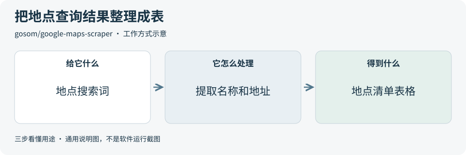

# 2026-11-12 · 每日开源项目推荐 5 个

每天在同一个仓库新增一份资料，每份 5 个项目，避开全部历史推荐。先看速览，再点项目查看图解和例子。

热度参考抓取时的 GitHub 滚动周榜，**不是一天内的新增 Star**。用途按公开文档整理，图解和例子用于解释用法；本期未实际安装或运行这些项目。

**先认两个词**　Agent 是能分步办事的 AI 助手；Skill 是写给 AI 助手的工作说明。Star 是关注热度，不代表质量。

## 本期速览

| 名次 | 项目 | 本周新增 Star | 一句话用途 | 可用场景 |
| --- | --- | ---: | --- | --- |
| 1 | [mujoco](#project-01) | +1,535 | 在电脑里模拟机械结构的运动和接触，方便观察关节、碰撞和摩擦怎样影响动作。 | 在仿真里比较机械动作 |
| 2 | [gbrain](#project-02) | +1,187 | 把事实、笔记和出处存进可搜索的资料库，让人和 AI 助手能找回之前记下的信息。 | 找回项目笔记和决策出处 |
| 3 | [google-maps-scraper](#project-03) | +597 | 从 Google 地图的搜索结果提取地点名称、地址和网址等字段，可导出成表格。 | 整理获准使用的地点查询结果 |
| 4 | [sniffnet](#project-04) | +550 | 监看选定网卡上的网络流量，用曲线和连接列表显示流量变化。 | 排查电脑的网络流量 |
| 5 | [vite](#project-05) | +397 | 给网页项目提供开发时的浏览器预览，保存改动后更新页面，也能打包生成上线用的文件。 | 预览并打包前端网页 |

## 可以先看

**MuJoCo** 可以先模拟机械动作，**GBrain** 用来找回项目笔记。**Google Maps Scraper** 能把地图搜索结果整理成表，**Sniffnet** 帮你看网络流量，**Vite** 用来预览和打包网页。

## 1. [mujoco](https://github.com/google-deepmind/mujoco)

**一句话用途**　在电脑里模拟机械结构的运动和接触，方便观察关节、碰撞和摩擦怎样影响动作。

**举个例子**　做抓取原型时，用同一个方块模型比较夹爪的两种控制设定，观察方块有没有滑落。

**适合什么情况**　适合做机器人控制或机械机构原型，先比较几种控制设定，再决定真机要验证哪些动作。

**门槛与费用**　门槛高。引擎开源免费。用 Python 编写仿真需要 3.11 或更高版本。搭自己的机械模型要懂关节、质量和接触参数。

**注意事项**　仿真结果受模型参数影响。准备把动作搬到真机时，先核对模型里的质量、摩擦和限位设定。

**小范围第一步**　打开官方的平面和方块示例，先观察方块下落和接触地面，再记录它在哪一步接触。

周新增 Star **+1,535** · 总 Star **17,650** · C++ · Apache-2.0 · 首次推荐

[官方文档](https://github.com/google-deepmind/mujoco/blob/71bc51ce2194ddcdf876de5ecd05bdf57a75e93b/doc/overview.rst) · [仓库](https://github.com/google-deepmind/mujoco)

## 2. [gbrain](https://github.com/garrytan/gbrain)

**一句话用途**　把事实、笔记和出处存进可搜索的资料库，让人和 AI 助手能找回之前记下的信息。

**举个例子**　项目组记过为什么选 CSV 导出。按关键词搜「导出格式」，找到记过这个决定的笔记，再打开原文确认原因。

**适合什么情况**　适合长期积累项目笔记，想让多次工作会话共用一批资料，并且可以打开原笔记核对的人。

**门槛与费用**　门槛中。可免费自托管，需要 Bun 1.4.4 或更高版本和基本的终端操作。本地关键词检索无需模型服务。选用托管、外部模型检索或回答生成时，费用取决于所用服务。

**注意事项**　索引可能还在重建。搜不到时先确认导入和索引状态。选用外部检索或回答服务前，核对哪些文本会发给服务商。

**小范围第一步**　用本地关键词模式导入三篇虚构的 Markdown 笔记，搜索只出现过一次的词，再核对找回了哪一篇。

周新增 Star **+1,187** · 总 Star **32,703** · TypeScript · MIT · 首次推荐

[官方文档](https://github.com/garrytan/gbrain/blob/47cbca02f919ae93e0137235f88ec1af14f4492b/README.md) · [仓库](https://github.com/garrytan/gbrain)

## 3. [google-maps-scraper](https://github.com/gosom/google-maps-scraper)

**一句话用途**　从 Google 地图的搜索结果提取地点名称、地址和网址等字段，可导出成表格。

**举个例子**　在获准使用的场地查询中，用「会议场地」作为搜索词，导出名称和地址交给活动策划逐条复核。

**适合什么情况**　适合已有明确数据使用授权，需要把允许获取的地点查询结果整理成结构化清单的场景。

**门槛与费用**　门槛中。工具开源免费。自建需准备 Docker 或项目支持的运行环境，服务器等费用取决于部署方式。

**注意事项**　Google 地图条款对批量下载和再分发设有限制。采集前核对条款及相关授权，再确定需要保留的字段。[Google 地图附加条款](https://maps.google.com/help/terms_maps/)

**小范围第一步**　按官方字段说明用三条虚构记录做一张样表，确认名称、地址和官网链接是否够用。

周新增 Star **+597** · 总 Star **7,920** · Go · MIT · 首次推荐

[官方文档](https://github.com/gosom/google-maps-scraper/blob/e0c1d501e49cdcd5c6b2cecd2a032831f6ee9ba8/README.md) · [仓库](https://github.com/gosom/google-maps-scraper)

## 4. [sniffnet](https://github.com/GyulyVGC/sniffnet)

**一句话用途**　监看选定网卡上的网络流量，用曲线和连接列表显示流量变化。

**举个例子**　播放一段公开视频前后，比较同一网卡的下载曲线，并打开连接列表查看变化出现在什么连接上。

**适合什么情况**　适合想知道自己电脑在某个时段用了多少网络流量，以及哪些连接值得进一步排查的人。

**门槛与费用**　门槛低。桌面工具可免费使用，代码采用 MIT 或 Apache-2.0 双许可。抓包可能需要系统授予权限。

**注意事项**　先选对网卡再比较流量。导出的抓包文件可能包含网络地址，分享前先核对内容。

**小范围第一步**　选自己电脑正在用的网卡，先看一分钟空闲流量，再在同一网卡下对比打开一个网页时的变化。

周新增 Star **+550** · 总 Star **42,467** · Rust · Apache-2.0 · 首次推荐

[官方文档](https://github.com/GyulyVGC/sniffnet/blob/f62af85e53253fd9983d4d04948c97cadf8a5356/README.md) · [仓库](https://github.com/GyulyVGC/sniffnet)

## 5. [vite](https://github.com/vitejs/vite)

**一句话用途**　给网页项目提供开发时的浏览器预览，保存改动后更新页面，也能打包生成上线用的文件。

**举个例子**　做活动报名页时，修改提交按钮的文案，保存后在浏览器看效果，再打包出交给托管服务的网页文件。

**适合什么情况**　适合做活动页或后台页面，希望一边改代码一边看效果，并能生成可部署网页文件的前端开发者。

**门槛与费用**　门槛中。Vite 开源免费。需要满足项目要求的 Node.js 版本和基本的网页开发知识。页面上线后可能产生托管费用。

**注意事项**　模板和插件可能有各自的版本要求。开发预览通过后，再用构建预览核对上线文件。

**小范围第一步**　拿官方示例页改一行文字，先看开发预览是否更新，再生成一次构建并打开构建预览。

周新增 Star **+397** · 总 Star **83,871** · TypeScript · MIT · 首次推荐

[官方文档](https://github.com/vitejs/vite/blob/bd32fea2cb171cf993c70b4dd12097d5166b3b28/docs/guide/index.md) · [仓库](https://github.com/vitejs/vite)

## 来源与选取方法

候选池 125 个，可识别开源许可证且未归档的候选 108 个。已核对 149 个历史推荐，剩余未介绍过的候选 63 个；再核对用途与许可，选出本期 5 个。抓取时间与原榜名次见 [本期数据](../data/2026-11-12.json)。

- [D4Vinci/Scrapling](https://github.com/D4Vinci/Scrapling/blob/bb223f2f5fc8f743772751a5ce283ef7851ca6be/README.md) 暂未收录：根许可证标注 BSD-3-Clause，README 的免责声明写明仅供教育和研究。两处用途条件不一致，本期跳过。
- [ruvnet/RuView](https://github.com/ruvnet/RuView/blob/ce8d296c98083528ef75f445f7e7c7e3c7b9ce84/NOTICE) 暂未收录：根 LICENSE 提供 MIT 文本，NOTICE 将整个仓库的许可写作 MIT 或 Apache-2.0。仓库许可说明不一致，本期跳过。
- [bggRGjQaUbCoE/PiliPlus](https://github.com/bggRGjQaUbCoE/PiliPlus/blob/cab0114a21ce7fad5b90b9a4d788d35d313d25f9/README.md) 暂未收录：根 LICENSE 为 GPL-3.0，README 声明仅供学习和测试，并要求下载后 24 小时内删除。两处使用条件不一致，本期跳过。
- [周榜来源 1](https://github.com/trending?since=weekly)
- [周榜来源 2](https://github.com/trending/python?since=weekly)
- [周榜来源 3](https://github.com/trending/typescript?since=weekly)
- [周榜来源 4](https://github.com/trending/javascript?since=weekly)
- [周榜来源 5](https://github.com/trending/go?since=weekly)
- [周榜来源 6](https://github.com/trending/rust?since=weekly)
- [周榜来源 7](https://github.com/trending/swift?since=weekly)
- [周榜来源 8](https://github.com/trending/dart?since=weekly)
- [周榜来源 9](https://github.com/trending/java?since=weekly)

[排名和更新规则](../UPDATE_GUIDE.md) · [通用应用场景](../USE_CASES.md)

序号是本期推荐顺序，不是 GitHub 官方总榜排名。图解和应用例子仅作说明。

[返回资料首页](../README.md)
