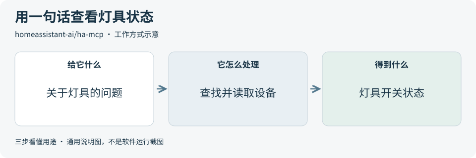
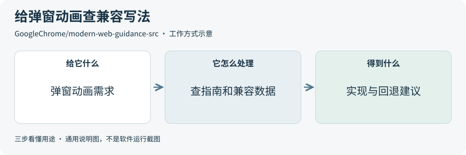
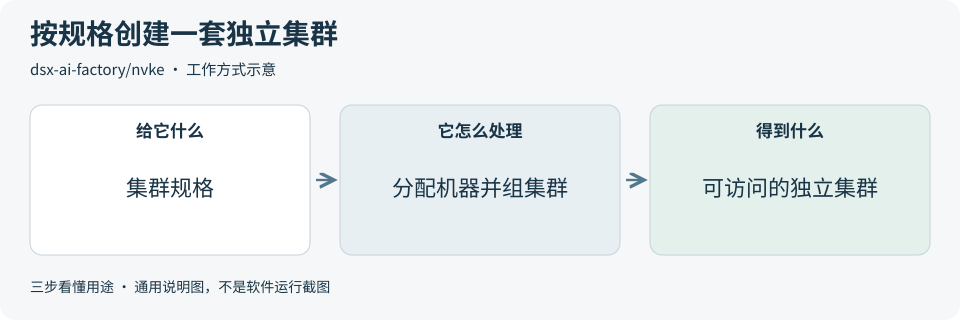
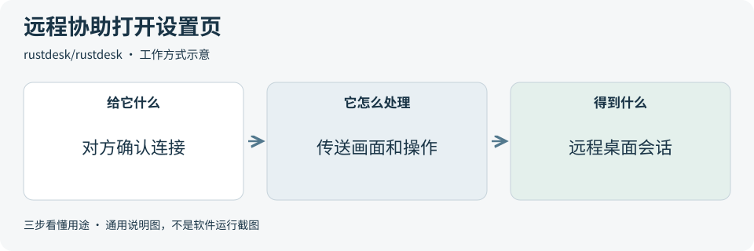
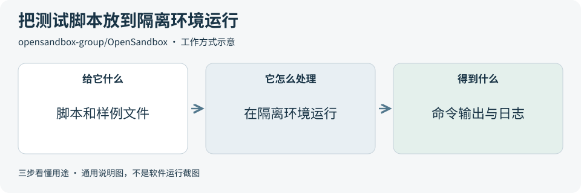

# 2026-11-13 · 每日开源项目推荐 5 个

每天在同一个仓库新增一份资料，每份 5 个项目，避开全部历史推荐。先看速览，再点项目查看图解和例子。

热度参考抓取时的 GitHub 滚动周榜，**不是一天内的新增 Star**。用途按公开文档整理，图解和例子用于解释用法；本期未实际安装或运行这些项目。

**先认两个词**　Agent 是能分步办事的 AI 助手；Skill 是写给 AI 助手的工作说明。Star 是关注热度，不代表质量。

## 本期速览

| 名次 | 项目 | 本周新增 Star | 一句话用途 | 可用场景 |
| --- | --- | ---: | --- | --- |
| 1 | [ha-mcp](#project-01) | +2,244 | 把 Home Assistant 接到 AI 助手，让助手用自然语言查设备状态，也能按授权控制设备。 | 查看智能家居设备状态 |
| 2 | [modern-web-guidance-src](#project-02) | +1,341 | 给编程助手提供现代网页开发指南，帮助它查到浏览器支持情况和兼容写法。 | 为网页功能查兼容方案 |
| 3 | [nvke](#project-03) | +1,124 | 在自有基础设施上创建和管理 Kubernetes 集群，让不同团队各自运行服务或计算任务。 | 给团队分配独立集群 |
| 4 | [rustdesk](#project-04) | +967 | 从一台设备查看和操作另一台设备的桌面，便于远程协助排查问题。 | 远程查看并操作桌面 |
| 5 | [OpenSandbox](#project-05) | +794 | 给 AI 应用提供隔离的工作环境，可在里面运行命令、读写文件并拿回结果。 | 隔离运行 AI 生成的代码 |

## 可以先看

**HA-MCP** 能让 AI 助手查看智能家居状态。**Modern Web Guidance** 帮编程助手查浏览器兼容性，**NVKE** 创建并管理 Kubernetes 集群，**RustDesk** 用来远程协助，**OpenSandbox** 给 AI 生成的代码单独准备运行环境。

## 1. [ha-mcp](https://github.com/homeassistant-ai/ha-mcp)

**一句话用途**　把 Home Assistant 接到 AI 助手，让助手用自然语言查设备状态，也能按授权控制设备。

**举个例子**　离开会议室前，问助手「演示区的灯现在开着吗？」助手从 Home Assistant 读取灯具状态，方便值班人员确认。

**适合什么情况**　适合已经用 Home Assistant 管理设备，希望用一句话查看设备状态或排查自动化规则的人。

**门槛与费用**　门槛中。连接工具开源。需要支持 MCP 的 AI 助手，连接自己的设备还需要 Home Assistant。费用取决于所用助手和远程接入方式。

**注意事项**　先用只读方式查状态。设备数据会交给所用的 AI 客户端处理，接入真实设备前先查看客户端的数据设置。

**小范围第一步**　先在官方演示环境选一个灯具，问它当前是开还是关，再到设备页面核对状态。

周新增 Star **+2,244** · 总 Star **7,690** · Python · MIT · 首次推荐

[官方文档](https://github.com/homeassistant-ai/ha-mcp/blob/40e86d65750ad8cfa4ed5ea933a5fbb82dec6ce2/README.md) · [仓库](https://github.com/homeassistant-ai/ha-mcp)

## 2. [modern-web-guidance-src](https://github.com/GoogleChrome/modern-web-guidance-src)

**一句话用途**　给编程助手提供现代网页开发指南，帮助它查到浏览器支持情况和兼容写法。

**举个例子**　给报名表加弹窗时，先搜索怎样为弹窗背景加淡入效果，看看指南对目标浏览器和兼容方案的建议。

**适合什么情况**　适合做网页界面时，需要了解某个功能在哪些浏览器能用，以及旧版本可以采用什么写法的开发者。

**门槛与费用**　门槛中。工具开源。固定版本的命令行工具要求 Node.js 22.18 或更高版本。使用关键词或语义搜索指南无需另外调用模型服务，编程助手的费用按所用方案计算。

**注意事项**　用目标浏览器复查建议。官方说明用量统计可包含搜索词，可按文档关闭。代码和指南分别采用 Apache-2.0 和 CC BY 4.0。

**小范围第一步**　先查弹窗背景动画这一条指南，记下它建议的实现和回退写法，再用一个空白示例页对照。

周新增 Star **+1,341** · 总 Star **3,041** · TypeScript · Apache-2.0 · 首次推荐

[官方文档](https://github.com/GoogleChrome/modern-web-guidance-src/blob/3bb177a6de62b7fd8cd0432c33756e6f3c9ece9d/README.md) · [仓库](https://github.com/GoogleChrome/modern-web-guidance-src)

## 3. [nvke](https://github.com/dsx-ai-factory/nvke)

**一句话用途**　在自有基础设施上创建和管理 Kubernetes 集群，让不同团队各自运行服务或计算任务。

**举个例子**　平台团队想给图像处理小组分配一套独立环境，可先在模拟器提交集群规格，核对创建后的节点清单。

**适合什么情况**　适合负责内部计算平台的团队，想通过统一入口创建和管理多套 Kubernetes 集群。

**门槛与费用**　门槛高。管理软件开源。官方本地模拟需要 Linux、Docker、至少 6 个 CPU、12 GiB 可用内存和 100 GiB 可用磁盘。正式运行还涉及硬件和运维成本。

**注意事项**　当前是预览版。先用模拟机器检查建集群流程，上真实机器前再核对网络、驱动和升级限制。

**小范围第一步**　按本地模拟指南规划一个控制节点和一个工作节点，创建后检查两个节点是否都进入就绪状态。

周新增 Star **+1,124** · 总 Star **1,206** · Go · Apache-2.0 · 首次推荐

[官方文档](https://github.com/dsx-ai-factory/nvke/blob/230d67b058537626a9d02dfbd1276a02b75fd7bf/docs/get-started/quickstart-local.md) · [仓库](https://github.com/dsx-ai-factory/nvke)

## 4. [rustdesk](https://github.com/rustdesk/rustdesk)

**一句话用途**　从一台设备查看和操作另一台设备的桌面，便于远程协助排查问题。

**举个例子**　同事找不到演示软件的设置页，先请他确认远程会话，再打开对应菜单，边操作边说明下一步。

**适合什么情况**　适合两端都同意连接，需要远程演示设置步骤或协助排查桌面问题的场景。

**门槛与费用**　门槛中。客户端开源。自行托管中转服务需要服务器资源，Server Pro 提供付费方案。[RustDesk 官方方案](https://rustdesk.com/pricing.html)

**注意事项**　先核对连接对象，按需开启键盘、鼠标、文件传输和剪贴板权限。[RustDesk 客户端文档](https://rustdesk.com/docs/en/client/)

**小范围第一步**　让对方在一台测试电脑上确认连接，先只看屏幕，再试一次经过授权的点击。

周新增 Star **+967** · 总 Star **129,226** · Rust · AGPL-3.0 · 首次推荐

[官方文档](https://github.com/rustdesk/rustdesk/blob/3ccb4c4b5b5a8422276dd5f6f211b42e05ec9534/README.md) · [仓库](https://github.com/rustdesk/rustdesk)

## 5. [OpenSandbox](https://github.com/opensandbox-group/OpenSandbox)

**一句话用途**　给 AI 应用提供隔离的工作环境，可在里面运行命令、读写文件并拿回结果。

**举个例子**　让代码助手在隔离环境里统计一份虚构清单的行数，只放入样例文件，再从日志读取输出。

**适合什么情况**　适合搭建会执行代码的助手，需要明确每个任务能访问哪些文件和网络的开发团队。

**门槛与费用**　门槛高。工具开源。本地示例需要 Docker 和 Python 3.10 或更高版本。长期运行要预留容器所需的计算和存储资源。

**注意事项**　运行陌生代码前，限制任务的网络、文件挂载和资源用量，再检查隔离配置是否符合需求。

**小范围第一步**　在一个空环境运行只打印一句话的示例命令，确认能读到输出，随后销毁该环境。

周新增 Star **+794** · 总 Star **17,254** · Go · Apache-2.0 · 首次推荐

[官方文档](https://github.com/opensandbox-group/OpenSandbox/blob/db708c218771a8d311356f0e96552c15df6e097a/README.md) · [仓库](https://github.com/opensandbox-group/OpenSandbox)

## 来源与选取方法

候选池 128 个，可识别开源许可证且未归档的候选 110 个。已核对 154 个历史推荐，剩余未介绍过的候选 68 个；再核对用途与许可，选出本期 5 个。抓取时间与原榜名次见 [本期数据](../data/2026-11-13.json)。

- [D4Vinci/Scrapling](https://github.com/D4Vinci/Scrapling/blob/bb223f2f5fc8f743772751a5ce283ef7851ca6be/README.md) 暂未收录：根许可证为 BSD-3-Clause，README 免责声明限定为教育和研究用途。用途条件不一致，本期跳过。
- [ZhuLinsen/daily_stock_analysis](https://github.com/ZhuLinsen/daily_stock_analysis/blob/b928d68c36ff77d40797dee4f12d765cec0a3b19/README.md) 暂未收录：根许可证为 MIT，README 免责声明写明项目仅供学习和研究使用。用途条件不一致，本期跳过。
- [ruvnet/RuView](https://github.com/ruvnet/RuView/blob/094e1400719ded1283c67d23b9c737f6738a3244/NOTICE) 暂未收录：根 LICENSE 提供 MIT 文本，NOTICE 将整个仓库写为 MIT 或 Apache-2.0。许可说明不一致，本期跳过。
- [周榜来源 1](https://github.com/trending?since=weekly)
- [周榜来源 2](https://github.com/trending/python?since=weekly)
- [周榜来源 3](https://github.com/trending/typescript?since=weekly)
- [周榜来源 4](https://github.com/trending/javascript?since=weekly)
- [周榜来源 5](https://github.com/trending/go?since=weekly)
- [周榜来源 6](https://github.com/trending/rust?since=weekly)
- [周榜来源 7](https://github.com/trending/swift?since=weekly)
- [周榜来源 8](https://github.com/trending/dart?since=weekly)
- [周榜来源 9](https://github.com/trending/java?since=weekly)

[排名和更新规则](../UPDATE_GUIDE.md) · [通用应用场景](../USE_CASES.md)

序号是本期推荐顺序，不是 GitHub 官方总榜排名。图解和应用例子仅作说明。

[返回资料首页](../README.md)
