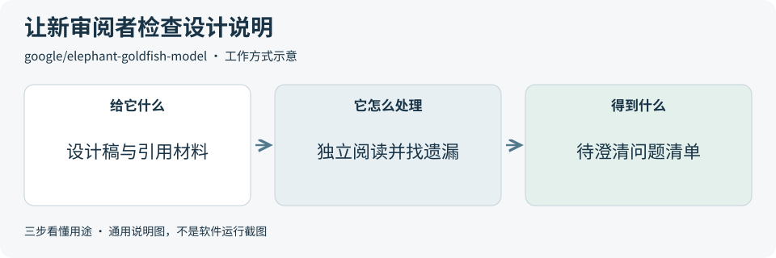
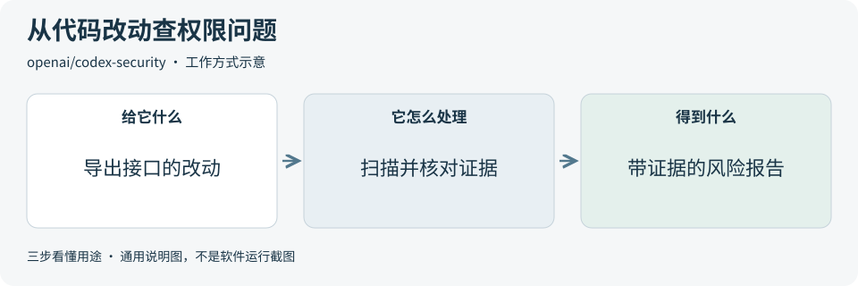
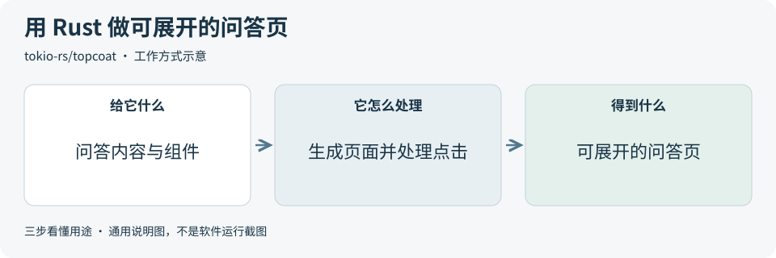

# 2026-11-14 · 每日开源项目推荐 5 个

每天在同一个仓库新增一份资料，每份 5 个项目，避开全部历史推荐。先看速览，再点项目查看图解和例子。

热度参考抓取时的 GitHub 滚动周榜，**不是一天内的新增 Star**。用途按公开文档整理，图解和例子用于解释用法；本期未实际安装或运行这些项目。

**先认两个词**　Agent 是能分步办事的 AI 助手；Skill 是写给 AI 助手的工作说明。Star 是关注热度，不代表质量。

## 本期速览

| 名次 | 项目 | 本周新增 Star | 一句话用途 | 可用场景 |
| --- | --- | ---: | --- | --- |
| 1 | [elephant-goldfish-model](#project-01) | +5,560 | 让 AI 助手起草设计，再让不读取先前讨论的助手根据文档和所引用的材料找遗漏。 | 审查需求与设计说明 |
| 2 | [codex-security](#project-02) | +1,712 | 扫描仓库或指定的 Git 改动，找潜在代码漏洞，生成带源码证据的报告。 | 核对改动中的安全问题 |
| 3 | [instagram-agent-skill](#project-03) | +1,213 | 给 AI 助手提供 Instagram 内容制作流程，可以起草配文、检查关键词并预览开头。 | 写短视频配文并检查开头 |
| 4 | [open-seo](#project-04) | +1,012 | 从指定网址逐页检查网站，列出断链、缺失标题和跳转问题，也提供关键词研究工具。 | 上线前排查网站断链和标题 |
| 5 | [topcoat](#project-05) | +868 | 用 Rust 一起写网页和服务端逻辑，由服务器生成页面，也能在浏览器里处理部分交互。 | 用 Rust 做有交互的网页 |

## 可以先看

**Elephant-Goldfish Model** 找设计说明里没写清的地方，**Codex Security** 检查代码改动里的潜在漏洞，**Instagram Agent Skill** 检查短视频配文，**OpenSEO** 找网站断链和缺失标题，**Topcoat** 用 Rust 写网页和服务端逻辑。

## 1. [elephant-goldfish-model](https://github.com/google/elephant-goldfish-model)

**一句话用途**　让 AI 助手起草设计，再让不读取先前讨论的助手根据文档和所引用的材料找遗漏。

**举个例子**　评审订单通知方案，把设计稿和接口说明交给新开的审阅会话，看看它能否指出「同一通知发两次时该怎么办」这样的遗漏。

**适合什么情况**　适合改动涉及多种场景、口头讨论多的项目，尤其适合在评审前检查新人能否仅凭文档理解设计。

**门槛与费用**　门槛中。插件开源。运行评审需要能启动独立审阅会话的编程助手，模型用量按所用助手的方案计费。

**注意事项**　审阅只能围绕提供的材料提出问题。涉及接口行为和边界条件的结论，要回到代码或测试核对。

**小范围第一步**　拿一份一页长的虚构设计说明做独立审阅，请它列出三条需要作者确认的假设。

周新增 Star **+5,560** · 总 Star **18,628** · Python · Apache-2.0 · 首次推荐

[官方文档](https://github.com/google/elephant-goldfish-model/blob/964a4f1ecd333961375c35cb37ed09364dab5e4e/README.md) · [仓库](https://github.com/google/elephant-goldfish-model)

## 2. [codex-security](https://github.com/openai/codex-security)

**一句话用途**　扫描仓库或指定的 Git 改动，找潜在代码漏洞，生成带源码证据的报告。

**举个例子**　合并文件导出接口前，只检查这一批 Git 改动，核对是否有人能用参数读到超出自身权限的文件。

**适合什么情况**　适合在合并代码前检查登录、权限或文件读取等改动，也可以用来复核已有修复。

**门槛与费用**　门槛中。工具代码开源。命令行需要受支持的 Node.js 和 Python 3.10 以上，以及可用的登录或模型服务。扫描费用按所选服务计算。

**注意事项**　只扫描获准检查的代码，读报告时核对证据和未覆盖范围。官方说明费用上限可能因已发出的请求而超出。

**小范围第一步**　先对一个授权示例仓库看扫描范围和费用预览，再走读报告示例里的源码证据与覆盖范围。

周新增 Star **+1,712** · 总 Star **13,139** · TypeScript · Apache-2.0 · 首次推荐

[官方文档](https://github.com/openai/codex-security/blob/f26b669b56a4423abd773c81f6c6c9c2ebadc42a/README.md) · [仓库](https://github.com/openai/codex-security)

## 3. [instagram-agent-skill](https://github.com/Jakeschincariol/instagram-agent-skill)

**一句话用途**　给 AI 助手提供 Instagram 内容制作流程，可以起草配文、检查关键词并预览开头。

**举个例子**　给烘焙教学短视频写配文，检查「全麦面包」有没有出现在正文，并确认开头讲的是哪一步。

**适合什么情况**　适合手里已有主题或视频素材，想在发布前快速检查文案长度、前几句和行动提示的人。

**门槛与费用**　门槛低。资料和检查脚本按 MIT 开源。本地检查需要 Python 3，使用 AI 助手写稿时按助手方案计费。

**注意事项**　脚本给出大致的截断位置，发布前以 Instagram 预览为准。稿件由发布者确认并手动发布。

**小范围第一步**　用一段旧配文和两个目标关键词检查开头，看看读者点开全文之前能读到什么。

周新增 Star **+1,213** · 总 Star **6,337** · Python · MIT · 首次推荐

[官方文档](https://github.com/Jakeschincariol/instagram-agent-skill/blob/d03c56bb598be770c60b201f94237e5d1a4268a6/skills/ig-caption/SKILL.md) · [仓库](https://github.com/Jakeschincariol/instagram-agent-skill)

## 4. [open-seo](https://github.com/every-app/open-seo)

**一句话用途**　从指定网址逐页检查网站，列出断链、缺失标题和跳转问题，也提供关键词研究工具。

**举个例子**　帮助中心改版后，从首页开始检查文档链接，把指向旧地址的断链和没有标题的页面列给维护者。

**适合什么情况**　适合维护官网或帮助中心，想在改版后按受影响的网址集中排查和修复网页问题的人。

**门槛与费用**　门槛中。代码开源。基础页面扫描不消耗点数，启用 JavaScript 渲染或 Lighthouse 性能检查可能收费。自托管使用外部搜索数据时由 DataForSEO 按量计费。

**注意事项**　网站的访问规则和防护可能挡住扫描。看问题数量前，先检查有哪些页面读取失败。

**小范围第一步**　选自己维护的小站，限制在少量页面，先做基础检查，再在浏览器逐个核对断链。

周新增 Star **+1,012** · 总 Star **27,624** · TypeScript · MIT · 首次推荐

[官方文档](https://github.com/every-app/open-seo/blob/2df84ff91461cc55b6c8bb98f3ce0f195d2e463d/web/content/docs/site-audits.md) · [仓库](https://github.com/every-app/open-seo)

## 5. [topcoat](https://github.com/tokio-rs/topcoat)

**一句话用途**　用 Rust 一起写网页和服务端逻辑，由服务器生成页面，也能在浏览器里处理部分交互。

**举个例子**　做常见问题页时，由服务器先生成问题列表，访客点击某一项时，在浏览器内展开对应答案。

**适合什么情况**　适合熟悉 Rust 的团队做小型管理页，希望用同一套代码处理页面和后端数据。

**门槛与费用**　门槛高。框架开源。开发需要 Rust 和 Cargo，以及基本的网页开发知识。部署后按使用的服务器资源计费。

**注意事项**　内置登录功能仍在路线图上。做业务页面前，先确认框架已覆盖必要功能。

**小范围第一步**　从官方最小示例加一个展开按钮，确认展开后只改变对应的一段内容。

周新增 Star **+868** · 总 Star **7,198** · Rust · MIT · 首次推荐

[官方文档](https://github.com/tokio-rs/topcoat/blob/b043a631622a91d603f0cdac86fcc927de9f0629/README.md) · [仓库](https://github.com/tokio-rs/topcoat)

## 来源与选取方法

候选池 127 个，可识别开源许可证且未归档的候选 110 个。已核对 159 个历史推荐，剩余未介绍过的候选 67 个；再核对用途与许可，选出本期 5 个。抓取时间与原榜名次见 [本期数据](../data/2026-11-14.json)。

- [D4Vinci/Scrapling](https://github.com/D4Vinci/Scrapling/blob/bb223f2f5fc8f743772751a5ce283ef7851ca6be/README.md) 暂未收录：根许可证为 BSD-3-Clause，README 免责声明限定为教育和研究用途。用途条件不一致，本期跳过。
- [ZhuLinsen/daily_stock_analysis](https://github.com/ZhuLinsen/daily_stock_analysis/blob/86d5d1c16f9df46b67dac2a4a17e788ad1bb7e2e/README.md) 暂未收录：根许可证为 MIT，README 免责声明写明项目仅供学习和研究。用途条件不一致，本期跳过。
- [ruvnet/RuView](https://github.com/ruvnet/RuView/blob/094e1400719ded1283c67d23b9c737f6738a3244/NOTICE) 暂未收录：根 LICENSE 提供 MIT 文本，NOTICE 将整个仓库写为 MIT 或 Apache-2.0。许可说明不一致，本期跳过。
- [jamiepine/voicebox](https://github.com/jamiepine/voicebox/blob/8af7efe62fab8d33e2a5dfbedabaa45f68a5184f/RESPONSIBLE_USE.md) 暂未收录：根许可证为 MIT，RESPONSIBLE_USE.md 另列禁止用途。两处说明对相关限制如何适用未给出统一口径，本期跳过。
- [周榜来源 1](https://github.com/trending?since=weekly)
- [周榜来源 2](https://github.com/trending/python?since=weekly)
- [周榜来源 3](https://github.com/trending/typescript?since=weekly)
- [周榜来源 4](https://github.com/trending/javascript?since=weekly)
- [周榜来源 5](https://github.com/trending/go?since=weekly)
- [周榜来源 6](https://github.com/trending/rust?since=weekly)
- [周榜来源 7](https://github.com/trending/swift?since=weekly)
- [周榜来源 8](https://github.com/trending/dart?since=weekly)
- [周榜来源 9](https://github.com/trending/java?since=weekly)

[排名和更新规则](../UPDATE_GUIDE.md) · [通用应用场景](../USE_CASES.md)

序号是本期推荐顺序，不是 GitHub 官方总榜排名。图解和应用例子仅作说明。

[返回资料首页](../README.md)
