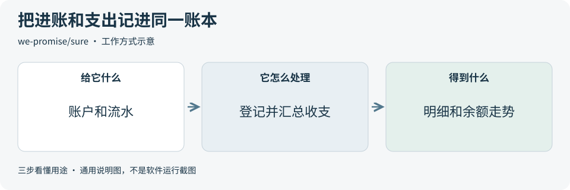
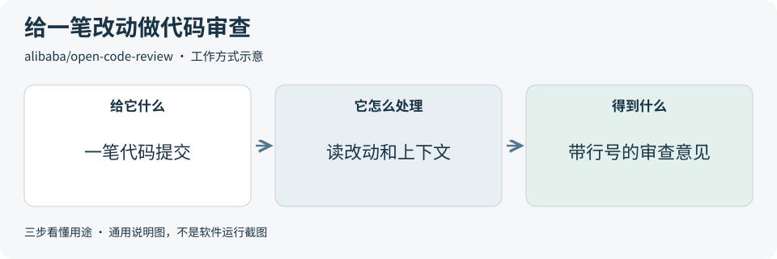
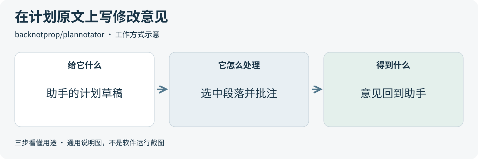
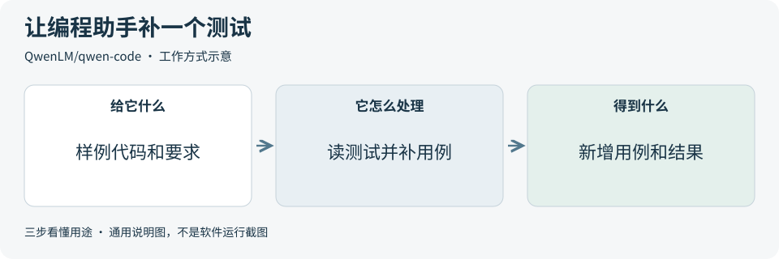
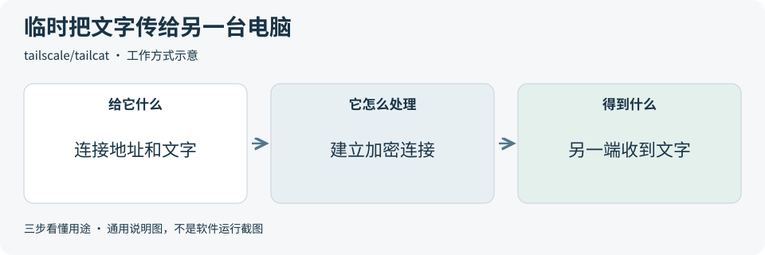

# 2026-11-16 · 每日开源项目推荐 5 个

每天在同一个仓库新增一份资料，每份 5 个项目，避开全部历史推荐。先看速览，再点项目查看图解和例子。

热度参考抓取时的 GitHub 滚动周榜，**不是一天内的新增 Star**。用途按公开文档整理，图解和例子用于解释用法；本期未实际安装或运行这些项目。

**先认两个词**　Agent 是能分步办事的 AI 助手；Skill 是写给 AI 助手的工作说明。Star 是关注热度，不代表质量。

## 本期速览

| 名次 | 项目 | 本周新增 Star | 一句话用途 | 可用场景 |
| --- | --- | ---: | --- | --- |
| 1 | [sure](#project-01) | +4,556 | 在一个地方记下各账户的收支，看交易明细和余额变化。 | 整理收支记录与账户余额 |
| 2 | [open-code-review](#project-02) | +2,238 | 读取 Git 提交中的代码改动，让 AI 按行给出审查意见。 | 合并前审查改动 |
| 3 | [plannotator](#project-03) | +1,719 | 在浏览器里逐段批注 AI 助手的计划或文档，再把意见发回原会话。 | 给 AI 的工作计划加批注 |
| 4 | [qwen-code](#project-04) | +1,469 | 在终端和 AI 一起读项目、修改代码和运行测试。 | 给小改动补自动化测试 |
| 5 | [tailcat](#project-05) | +1,148 | 让两台电脑通过加密连接临时传输文字、文件或指定的网络流量。 | 在两台测试机之间传数据 |

## 可以先看

**Sure** 可以把收支和余额放到一处。**Open Code Review** 用来查代码改动，**Plannotator** 适合逐段批注 AI 的计划，**Qwen Code** 能在终端帮你改代码和补测试，**Tailcat** 可以在两台电脑之间临时传文字或文件。

## 1. [sure](https://github.com/we-promise/sure)

**一句话用途**　在一个地方记下各账户的收支，看交易明细和余额变化。

**举个例子**　做一份虚构的家庭账本，记入一笔收入和两笔日常支出，再看交易历史和余额有没有对上。

**适合什么情况**　适合想在自己的服务器上管理账本，愿意手动录入或按需配置账户同步的人。

**门槛与费用**　门槛中。代码开源，自建通常需要 Docker Compose 和一台可持续运行的电脑或服务器。存储和备份由使用者自行承担。

**注意事项**　账目含有敏感信息。接入真实账户前先限制访问，核对同步设置，并试一次从备份恢复。

**小范围第一步**　建一个样例账户，手动记一笔虚构支出，在历史记录里确认金额和日期。

周新增 Star **+4,556** · 总 Star **15,751** · Ruby · AGPL-3.0 · 首次推荐

[官方文档](https://github.com/we-promise/sure/blob/755ce258cd5bd0f2e63b153a80c963412d0769b4/docs/onboarding/guide.md) · [仓库](https://github.com/we-promise/sure)

## 2. [open-code-review](https://github.com/alibaba/open-code-review)

**一句话用途**　读取 Git 提交中的代码改动，让 AI 按行给出审查意见。

**举个例子**　活动报名接口加了一条人数上限规则。审查这笔提交，看看空输入和超过上限的输入有没有被处理，再按文件和行号核对。

**适合什么情况**　适合维护代码仓库的团队，想先检查一笔提交可能带来的漏判、边界错误和其他问题，再由审阅者决定怎么处理。

**门槛与费用**　门槛中。工具开源，需要 Git 2.41 或更高版本。可配置模型服务，也可由编程助手调用自己的模型。费用取决于所用服务。

**注意事项**　模型可能读到改动之外的相关文件。用外部模型前先核对代码范围和授权，收到意见后再用测试确认。

**小范围第一步**　选一个可公开的样例仓库和一笔小改动，指定只审这笔提交，逐条查看评论指向的位置。

周新增 Star **+2,238** · 总 Star **52,240** · Go · Apache-2.0 · 首次推荐

[官方文档](https://github.com/alibaba/open-code-review/blob/7e5ce06c88de5ce81df5dc4f24e2e485b517fae8/README.md) · [仓库](https://github.com/alibaba/open-code-review)

## 3. [plannotator](https://github.com/backnotprop/plannotator)

**一句话用途**　在浏览器里逐段批注 AI 助手的计划或文档，再把意见发回原会话。

**举个例子**　审核预约页面方案时，选中提交步骤，标注「重复预约时要提示用户」，让助手按该处意见修订。

**适合什么情况**　适合让助手先写方案、自己再逐段把关的流程，尤其是需要指出究竟是哪句话有问题时。

**门槛与费用**　门槛低。本地工具可按 Apache-2.0 或 MIT 使用。接入计划流程需要兼容的编程助手，模型用量取决于所用服务。

**注意事项**　使用分享或 AI 审阅前，先确认链接和文档内容会发送到哪里。

**小范围第一步**　用一页样例计划，高亮一句模糊要求并写下具体意见，核对意见是否回到对应会话。

周新增 Star **+1,719** · 总 Star **11,953** · TypeScript · Apache-2.0 · 首次推荐

[官方文档](https://github.com/backnotprop/plannotator/blob/3893fea37b1256c8a3773e8aa1ad4622844db647/README.md) · [仓库](https://github.com/backnotprop/plannotator)

## 4. [qwen-code](https://github.com/QwenLM/qwen-code)

**一句话用途**　在终端和 AI 一起读项目、修改代码和运行测试。

**举个例子**　给一个文本读取工具补测试，交代「遇到空行要跳过」。助手查看现有测试写法，添加用例，再运行相应测试。

**适合什么情况**　适合在已有代码项目里查问题、加功能或补测试，并希望由人决定哪些改动和命令可以执行的人。

**门槛与费用**　门槛中。客户端开源。通过 npm 安装需要 Node.js 22 或更高版本。模型可用支持的订阅、按量服务或本地模型，开销取决于所选方式。

**注意事项**　先确认它能访问哪些文件和执行哪些命令。看清修改内容后，再批准需要的操作。

**小范围第一步**　选一个样例项目，请它先找出已有测试的位置，再只补一个边界用例。

周新增 Star **+1,469** · 总 Star **30,553** · TypeScript · Apache-2.0 · 首次推荐

[官方文档](https://github.com/QwenLM/qwen-code/blob/7f48cdeb514de5b1e14a4f82bab13fd3fe2a5cdc/docs/users/common-workflow.md) · [仓库](https://github.com/QwenLM/qwen-code)

## 5. [tailcat](https://github.com/tailscale/tailcat)

**一句话用途**　让两台电脑通过加密连接临时传输文字、文件或指定的网络流量。

**举个例子**　让两台测试机连起来，把一条虚构的日志从一台发到另一台，在终端查看接收到的文字。

**适合什么情况**　适合临时在两台获准使用的机器之间传小文件或测试文字，也能转发指定服务的流量。

**门槛与费用**　门槛中。命令行工具开源，两端需要能联网，无需 Tailscale 账户。默认提供有速率限制的免费中转，自建中转需要服务器。

**注意事项**　临时连接地址应只给指定接收方，测试结束后关闭监听。实际能否直连取决于两端网络。

**小范围第一步**　用两台自有测试机传一句样例文字，对照接收内容后结束连接。

周新增 Star **+1,148** · 总 Star **9,952** · Go · BSD-3-Clause · 首次推荐

[官方文档](https://github.com/tailscale/tailcat/blob/e00cdde6ff787f801361ff85ed085775c775d4c5/README.md) · [仓库](https://github.com/tailscale/tailcat)

## 来源与选取方法

候选池 121 个，可识别开源许可证且未归档的候选 106 个。已核对 164 个历史推荐，剩余未介绍过的候选 65 个；再核对用途与许可，选出本期 5 个。抓取时间与原榜名次见 [本期数据](../data/2026-11-16.json)。

- [ZhuLinsen/daily_stock_analysis](https://github.com/ZhuLinsen/daily_stock_analysis/blob/c820915ea0119b1b7952652d7fb148575400f2d9/README.md) 暂未收录：根许可证为 MIT，README 免责声明限定项目仅供学习和研究。用途条件不一致，本期跳过。
- [tradermonty/claude-trading-skills](https://github.com/tradermonty/claude-trading-skills/blob/340514edd2df922d3e834886a62745e55a409027/README.md) 暂未收录：根许可证为 MIT，README 将仓库用途限定为教育、研究与流程改进。用途条件不一致，本期跳过。
- [ruvnet/RuView](https://github.com/ruvnet/RuView/blob/3bae24a1231e0d9809e84eb35edba7231b8d1913/NOTICE) 暂未收录：根 LICENSE 提供 MIT 文本，NOTICE 将整个仓库许可写为 MIT 或 Apache-2.0。两处说明不一致，本期跳过。
- [周榜来源 1](https://github.com/trending?since=weekly)
- [周榜来源 2](https://github.com/trending/python?since=weekly)
- [周榜来源 3](https://github.com/trending/typescript?since=weekly)
- [周榜来源 4](https://github.com/trending/javascript?since=weekly)
- [周榜来源 5](https://github.com/trending/go?since=weekly)
- [周榜来源 6](https://github.com/trending/rust?since=weekly)
- [周榜来源 7](https://github.com/trending/swift?since=weekly)
- [周榜来源 8](https://github.com/trending/dart?since=weekly)
- [周榜来源 9](https://github.com/trending/java?since=weekly)

[排名和更新规则](../UPDATE_GUIDE.md) · [通用应用场景](../USE_CASES.md)

序号是本期推荐顺序，不是 GitHub 官方总榜排名。图解和应用例子仅作说明。

[返回资料首页](../README.md)
