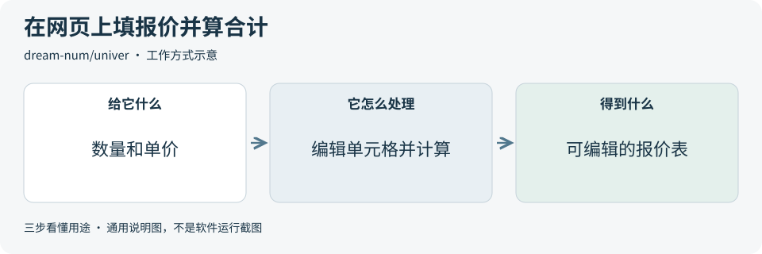
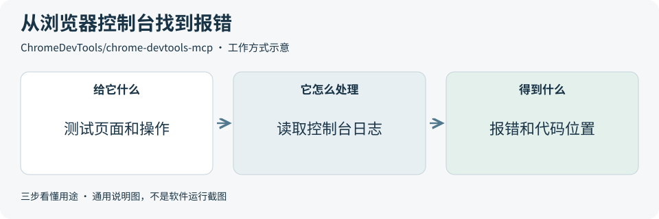
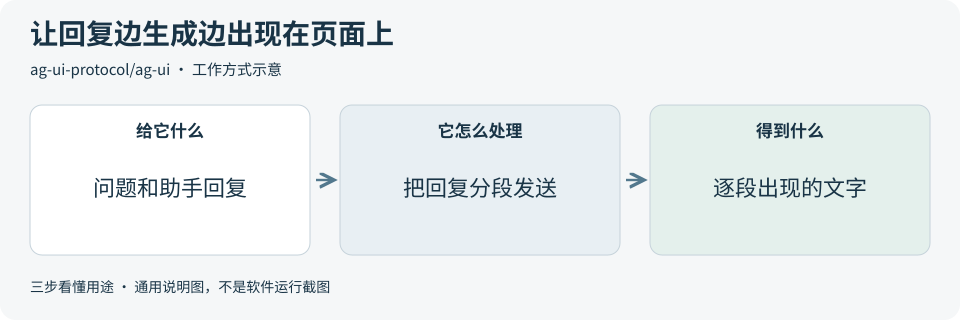
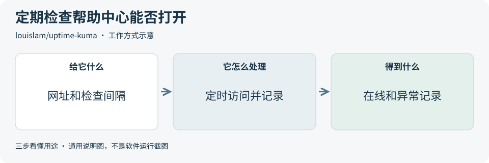
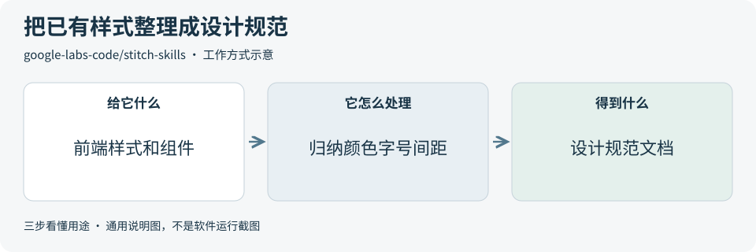

# 2026-11-17 · 每日开源项目推荐 5 个

每天在同一个仓库新增一份资料，每份 5 个项目，避开全部历史推荐。先看速览，再点项目查看图解和例子。

热度参考抓取时的 GitHub 滚动周榜，**不是一天内的新增 Star**。用途按公开文档整理，图解和例子用于解释用法；本期未实际安装或运行这些项目。

**先认两个词**　Agent 是能分步办事的 AI 助手；Skill 是写给 AI 助手的工作说明。Star 是关注热度，不代表质量。

## 本期速览

| 名次 | 项目 | 本周新增 Star | 一句话用途 | 可用场景 |
| --- | --- | ---: | --- | --- |
| 1 | [univer](#project-01) | +4,765 | 把可编辑的电子表格嵌进网页，支持输入数据、使用公式和设置格式。 | 在自己的网页里加表格 |
| 2 | [chrome-devtools-mcp](#project-02) | +2,593 | 让编程助手查看 Chrome 里的页面报错、网络请求和性能记录。 | 协助定位网页报错 |
| 3 | [ag-ui](#project-03) | +1,569 | 用一套统一的消息格式，把 AI 助手的回复片段、工具调用和完成状态送到前端。 | 让界面跟上助手的工作进度 |
| 4 | [uptime-kuma](#project-04) | +1,123 | 按设定间隔检查网址或服务是否可访问，在面板上记录状态，也能配置故障提醒。 | 定期检查网站是否在线 |
| 5 | [stitch-skills](#project-05) | +943 | 给 AI 助手提供网页设计流程，可以从已有前端源码整理出颜色、字号和间距等规范。 | 为已有网页整理设计规范 |

## 可以先看

**Univer** 可在网页里嵌入可编辑表格，**Chrome DevTools for agents** 帮助手查页面报错，**AG-UI** 让界面逐段显示助手回复，**Uptime Kuma** 定期检查网站是否在线，**Stitch Design Skills** 能从源码整理设计规范。

## 1. [univer](https://github.com/dream-num/univer)

**一句话用途**　把可编辑的电子表格嵌进网页，支持输入数据、使用公式和设置格式。

**举个例子**　做一个报价页，在表格里录入数量和单价，用公式算总金额。修改数量后，可以直接在页面上看合计的变化。

**适合什么情况**　适合网页产品需要让用户直接填表、筛选或计算的场景，比如报价、排班和清单录入。

**门槛与费用**　门槛中。需要懂 JavaScript 和网页构建。基础表格编辑器可以用 Apache-2.0 开源组件搭建，商业扩展另有许可和费用。

**注意事项**　接入前核对所需功能属于哪个版本。相关 Univer 组件应使用匹配的版本。

**小范围第一步**　在样例页嵌入官方基础表格，填两行虚构数据，加一个求和公式，再改一格验证重算。

周新增 Star **+4,765** · 总 Star **27,801** · TypeScript · Apache-2.0 · 首次推荐

[官方文档](https://github.com/dream-num/univer/blob/582f0c25898a7e2f2d5952919caede69b3eb259e/README.md) · [仓库](https://github.com/dream-num/univer)

## 2. [chrome-devtools-mcp](https://github.com/ChromeDevTools/chrome-devtools-mcp)

**一句话用途**　让编程助手查看 Chrome 里的页面报错、网络请求和性能记录。

**举个例子**　在测试网页点下按钮后页面没反应，让助手读取控制台错误和对应代码位置，再回到代码核对原因。

**适合什么情况**　适合正在排查网页的人，尤其是只有在浏览器里才能复现的按钮报错或接口请求失败。

**门槛与费用**　门槛中。工具开源，需要 Chrome 稳定版或更新版本，以及长期支持版 Node.js 和 npm。通过助手使用时，需要它可以接入 MCP 提供的工具，模型费用按所用服务计算。

**注意事项**　助手可读取连接的浏览器内容。调试时优先用只打开测试页的浏览器环境。

**小范围第一步**　打开一个带已知脚本错误的样例页，让助手列出一条控制台错误，再与 Chrome 开发者工具对照。

周新增 Star **+2,593** · 总 Star **57,693** · TypeScript · Apache-2.0 · 首次推荐

[官方文档](https://github.com/ChromeDevTools/chrome-devtools-mcp/blob/dc0055828a9fcdcf8c3e65f7ecd1847c53fd972a/README.md) · [仓库](https://github.com/ChromeDevTools/chrome-devtools-mcp)

## 3. [ag-ui](https://github.com/ag-ui-protocol/ag-ui)

**一句话用途**　用一套统一的消息格式，把 AI 助手的回复片段、工具调用和完成状态送到前端。

**举个例子**　做一个问答页面，助手开始工作时显示加载状态，收到文本片段就逐段追加，收到完成消息时关闭加载提示。

**适合什么情况**　适合给 AI 应用做交互界面，希望用户在任务进行中看到回复和状态变化。

**门槛与费用**　门槛中。协议和配套工具开源。要会连接前后端并处理连续消息。官方有模拟消息示例，可先验证这条链路，再按需接入模型服务。

**注意事项**　界面如何显示、失败后如何恢复，需要在应用里实现。先核对开始、正文和结束事件在界面上的表现。

**小范围第一步**　用官方模拟服务发一段短回复，在小页面验证文字出现的顺序和完成提示。

周新增 Star **+1,569** · 总 Star **19,023** · TypeScript · MIT · 首次推荐

[官方文档](https://github.com/ag-ui-protocol/ag-ui/blob/79530a25f3476d0abb93cb00761906fda757a2d5/README.md) · [仓库](https://github.com/ag-ui-protocol/ag-ui)

## 4. [uptime-kuma](https://github.com/louislam/uptime-kuma)

**一句话用途**　按设定间隔检查网址或服务是否可访问，在面板上记录状态，也能配置故障提醒。

**举个例子**　给帮助中心首页建一条 HTTP 检查。访问失败时，到面板看哪一段时间开始异常，再去查网站日志。

**适合什么情况**　适合维护小型网站或接口的人，想持续看到成功和失败记录，方便回看问题出现的时间。

**门槛与费用**　门槛低。软件开源，可用 Docker 自建。持续监控需要一台常在线的机器，主机和所选通知渠道可能产生费用。

**注意事项**　结果反映的是监控机访问该地址的情况。外地用户报错时，结合用户所在网络和网站日志核对。

**小范围第一步**　给自己维护的测试站加一条 HTTP 检查，等一轮后核对网址和成功记录。

周新增 Star **+1,123** · 总 Star **94,502** · JavaScript · MIT · 首次推荐

[官方文档](https://github.com/louislam/uptime-kuma/blob/e6ea9509e68b31a996f3fdf5c24cfba24340962b/README.md) · [仓库](https://github.com/louislam/uptime-kuma)

## 5. [stitch-skills](https://github.com/google-labs-code/stitch-skills)

**一句话用途**　给 AI 助手提供网页设计流程，可以从已有前端源码整理出颜色、字号和间距等规范。

**举个例子**　接手活动网站后，让助手读主题和按钮样式，把主色、标题字号和按钮间距写进 `DESIGN.md`，给新页面作参考。

**适合什么情况**　适合接手一个已有网页项目时，把散在样式和组件里的设计规则整理成一份可参考的文档。

**门槛与费用**　门槛中。流程文件开源。整理规范需要兼容的助手和可读取的前端源文件。连接 Stitch 做在线设计或上传时，还要配置对应服务，费用取决于所用助手和服务。

**注意事项**　生成的文档有可能把某个页面的写法当作通用规则。抽查源文件，分清全站规则和单页特例。

**小范围第一步**　用一个公开样例项目，只提取按钮的颜色、字号和间距，对照源码确认几项取值。

周新增 Star **+943** · 总 Star **9,739** · TypeScript · Apache-2.0 · 首次推荐

[官方文档](https://github.com/google-labs-code/stitch-skills/blob/0337446dadde6f8c94210444e2aa9d546126480f/plugins/stitch-design/skills/extract-design-md/SKILL.md) · [仓库](https://github.com/google-labs-code/stitch-skills)

## 来源与选取方法

候选池 123 个，可识别开源许可证且未归档的候选 109 个。已核对 169 个历史推荐，剩余未介绍过的候选 69 个；再核对用途与许可，选出本期 5 个。抓取时间与原榜名次见 [本期数据](../data/2026-11-17.json)。

- [ZhuLinsen/daily_stock_analysis](https://github.com/ZhuLinsen/daily_stock_analysis/blob/aa7228986f0ac8fc78e9147be81dddb277ef342d/README.md) 暂未收录：根许可证为 MIT，README 免责声明限定项目仅供学习和研究。两处用途条件不一致，本期跳过。
- [tradermonty/claude-trading-skills](https://github.com/tradermonty/claude-trading-skills/blob/60399452891edf47c1da5ce93c7664b31e3b001e/README.md) 暂未收录：根许可证为 MIT，README 将仓库用途限定为教育、研究与流程改进。两处用途条件不一致，本期跳过。
- [ruvnet/RuView](https://github.com/ruvnet/RuView/blob/3bae24a1231e0d9809e84eb35edba7231b8d1913/NOTICE) 暂未收录：根 LICENSE 提供 MIT 文本，NOTICE 将整个仓库写为 MIT 或 Apache-2.0。许可说明不一致，本期跳过。
- [周榜来源 1](https://github.com/trending?since=weekly)
- [周榜来源 2](https://github.com/trending/python?since=weekly)
- [周榜来源 3](https://github.com/trending/typescript?since=weekly)
- [周榜来源 4](https://github.com/trending/javascript?since=weekly)
- [周榜来源 5](https://github.com/trending/go?since=weekly)
- [周榜来源 6](https://github.com/trending/rust?since=weekly)
- [周榜来源 7](https://github.com/trending/swift?since=weekly)
- [周榜来源 8](https://github.com/trending/dart?since=weekly)
- [周榜来源 9](https://github.com/trending/java?since=weekly)

[排名和更新规则](../UPDATE_GUIDE.md) · [通用应用场景](../USE_CASES.md)

序号是本期推荐顺序，不是 GitHub 官方总榜排名。图解和应用例子仅作说明。

[返回资料首页](../README.md)
