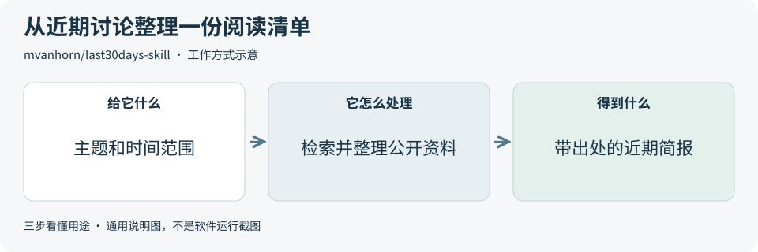
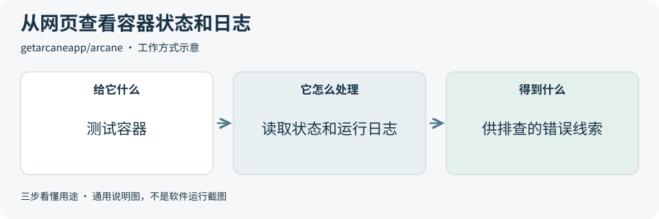

# 2026-11-18 · 每日开源项目推荐 5 个

每天在同一个仓库新增一份资料，每份 5 个项目，避开全部历史推荐。先看速览，再点项目查看图解和例子。

热度参考抓取时的 GitHub 滚动周榜，**不是一天内的新增 Star**。用途按公开文档整理，图解和例子用于解释用法；本期未实际安装或运行这些项目。

**先认两个词**　Agent 是能分步办事的 AI 助手；Skill 是写给 AI 助手的工作说明。Star 是关注热度，不代表质量。

## 本期速览

| 名次 | 项目 | 本周新增 Star | 一句话用途 | 可用场景 |
| --- | --- | ---: | --- | --- |
| 1 | [Claude-BugHunter](#project-01) | +2,508 | 给 Claude Code 补充安全测试工作说明，帮助核对发现并写成有证据的漏洞报告。 | 整理授权测试中的安全发现 |
| 2 | [last30days-skill](#project-02) | +1,548 | 围绕一个主题查找近 30 天的公开讨论和资料，整理成带出处的简报。 | 为选型或内容调研找近期资料 |
| 3 | [airgorah](#project-03) | +1,468 | 用图形界面检查 Wi-Fi 安全，可查看附近接入点和连接的终端。 | 检查自有实验 Wi-Fi 的设备 |
| 4 | [omnigraph](#project-04) | +956 | 把资料、结论及其关系存成可查询的数据，沿关系找回结论的依据。 | 给知识查询保留依据关系 |
| 5 | [arcane](#project-05) | +856 | 在网页里管理 Docker 容器，查看运行状态和日志。 | 集中查看容器状态与报错 |

## 可以先看

**Claude-BugHunter** 帮助整理安全测试报告，**last30days-skill** 汇总近 30 天的公开讨论，**Airgorah** 检查自有实验 Wi-Fi 的接入点和终端，**Omnigraph** 沿关系查找结论依据，**Arcane** 在网页查看容器状态和日志。

## 1. [Claude-BugHunter](https://github.com/elementalsouls/Claude-BugHunter)

**一句话用途**　给 Claude Code 补充安全测试工作说明，帮助核对发现并写成有证据的漏洞报告。

**举个例子**　在授权测试中发现一处权限问题，把已确认的现象和测试记录交给助手，按模板整理复现步骤、影响和修复建议，再由测试人员逐项核实。

**适合什么情况**　适合已有安全测试基础的人，想把零散发现整理成别人能复查的报告，或统一团队的报告格式。

**门槛与费用**　门槛高。需要 Claude Code 及相应付费额度；命令行工具还需 Python 3.9+。代码采用 MIT，方法文档等内容采用 CC BY 4.0，复用内容要署名并保留来源。

**注意事项**　只在授权范围内测试。助手给出的判断和报告需要人工复核，不能把推测写成已证实的漏洞。

**小范围第一步**　先读[官方报告模板](https://github.com/elementalsouls/Claude-BugHunter/blob/5d91c812ee25efc0c1d5191377632e3aed7e8d2d/skills/report-writing/SKILL.md)，用一份虚构测试记录检查复现步骤、证据和影响是否齐全。

周新增 Star **+2,508** · 总 Star **9,298** · Python · MIT · 首次推荐

[官方文档](https://github.com/elementalsouls/Claude-BugHunter/blob/5d91c812ee25efc0c1d5191377632e3aed7e8d2d/README.md) · [仓库](https://github.com/elementalsouls/Claude-BugHunter)

## 2. [last30days-skill](https://github.com/mvanhorn/last30days-skill)

**一句话用途**　围绕一个主题查找近 30 天的公开讨论和资料，整理成带出处的简报。

**举个例子**　调研“静态网站生成工具”，让它整理近 30 天的开发者讨论、发布日期和原文链接，形成一份选型时可回查的阅读清单。

**适合什么情况**　适合做技术选型、选题和市场观察，先集中找到近期讨论，再决定哪些原文值得细读。

**门槛与费用**　门槛中。MIT 开源，基础运行需 Python 3.12+，其他依赖随来源而定。部分来源无密钥可用；助手模型、付费搜索和抓取服务按配置另计费用。

**注意事项**　来源可能受访问或登录条件限制，摘要要回看原文。检索词会发给选用的搜索服务，启用模型重排时还会发送检索片段。

**小范围第一步**　按[来源配置说明](https://github.com/mvanhorn/last30days-skill/blob/a854f3bcb2c4344d7498426d653378510f8b253a/CONFIGURATION.md#source-requirements)选一个公开技术主题，先从无密钥来源试查，手动核对三条结果的原文和日期。

周新增 Star **+1,548** · 总 Star **69,062** · Python · MIT · 首次推荐

[官方文档](https://github.com/mvanhorn/last30days-skill/blob/a854f3bcb2c4344d7498426d653378510f8b253a/README.md) · [仓库](https://github.com/mvanhorn/last30days-skill)

## 3. [airgorah](https://github.com/martin-olivier/airgorah)

**一句话用途**　用图形界面检查 Wi-Fi 安全，可查看附近接入点和连接的终端。

**举个例子**　给自有实验 Wi-Fi 连上两台已知设备，用界面查看接入点和终端列表，再与手头的设备清单逐项对照。

**适合什么情况**　适合有无线网络基础的人，在自有实验网络中核对接入点和设备，了解无线安全检查的流程。

**门槛与费用**　门槛高。MIT 开源，仅支持 Linux。需要支持监听模式和数据包注入的无线网卡，部分操作需要系统授权；可能需要另购兼容网卡。

**注意事项**　工具也有断开连接、密码测试等主动功能，可能影响网络。只在明确授权的范围使用，先从设备观察开始。

**小范围第一步**　先按官方要求确认 Linux 和网卡兼容性，在自有实验网络查看接入点与终端，对照两台已知设备。

周新增 Star **+1,468** · 总 Star **6,601** · Rust · MIT · 首次推荐

[官方文档](https://github.com/martin-olivier/airgorah/blob/f5833ff068e7703fac33cc20442e2ceda190c3eb/README.md) · [仓库](https://github.com/martin-olivier/airgorah)

## 4. [omnigraph](https://github.com/ModernRelay/omnigraph)

**一句话用途**　把资料、结论及其关系存成可查询的数据，沿关系找回结论的依据。

**举个例子**　用虚构数据，把一份性能测试记录和一份运行记录连到“页面响应更快”的结论。查询这个结论时，返回两份材料的名称，方便回看依据。

**适合什么情况**　适合资料之间存在明确关系的知识库或 AI 应用，比如需要回答“这条结论由哪些记录支持”。

**门槛与费用**　门槛高。MIT 开源，需要懂命令行，并定义数据类型和关系。可先用本地文件保存小型数据，正式部署另计机器和存储成本。

**注意事项**　资料与结论之间的关系需要录入或由应用建立。查出支持材料后，仍需判断材料是否真实、是否足以支撑结论。

**小范围第一步**　照[官方快速入门](https://github.com/ModernRelay/omnigraph/blob/42013036b50ecfff3d63f071f32db951be9cbd54/docs/user/quickstart.md)，用两份虚构材料、一条结论和两条支持关系，查询材料名称。

周新增 Star **+956** · 总 Star **2,971** · Rust · MIT · 首次推荐

[官方文档](https://github.com/ModernRelay/omnigraph/blob/42013036b50ecfff3d63f071f32db951be9cbd54/docs/user/quickstart.md) · [仓库](https://github.com/ModernRelay/omnigraph)

## 5. [arcane](https://github.com/getarcaneapp/arcane)

**一句话用途**　在网页里管理 Docker 容器，查看运行状态和日志。

**举个例子**　一个测试网站的容器启动后退出，在面板找到这个容器，查看状态和最近日志，把其中的错误提示交给开发人员排查。

**适合什么情况**　适合已经用 Docker 部署小型服务，希望通过网页完成日常查看和管理的人。

**门槛与费用**　门槛中。BSD-3-Clause 开源，需要会使用 Docker，并准备运行面板的主机和存储；自行部署需承担相应资源成本。

**注意事项**　面板需要较高的 Docker 管理权限，应保护访问入口。所读 main 文档属于 v3，采用前核对目标版本对应的配置。

**小范围第一步**　先读[官方基本部署示例](https://github.com/getarcaneapp/arcane/blob/7e31e1820b7299629154a34ff546402e01e42f56/docker/examples/compose.basic.yaml)，在隔离测试环境接入一个样例容器，只核对状态和日志。

周新增 Star **+856** · 总 Star **9,329** · Go · BSD-3-Clause · 首次推荐

[官方文档](https://github.com/getarcaneapp/arcane/blob/7e31e1820b7299629154a34ff546402e01e42f56/README.md) · [仓库](https://github.com/getarcaneapp/arcane)

## 来源与选取方法

候选池 120 个，可识别开源许可证且未归档的候选 103 个。已核对 174 个历史推荐，剩余未介绍过的候选 62 个；再核对用途与许可，选出本期 5 个。抓取时间与原榜名次见 [本期数据](../data/2026-11-18.json)。

- [ZhuLinsen/daily_stock_analysis](https://github.com/ZhuLinsen/daily_stock_analysis/blob/cc85897bb44909b0b7582dcbd564dbb417c562f2/README.md) 暂未收录：根许可证为 MIT，README 免责声明限定项目仅供学习和研究。两处用途条件不一致，本期跳过。
- [tradermonty/claude-trading-skills](https://github.com/tradermonty/claude-trading-skills/blob/a627d17dd1d8fde1c8fa73b3cc69ffe83b33cb71/README.md) 暂未收录：根许可证为 MIT，README 将仓库用途限定为教育、研究与流程改进。两处用途条件不一致，本期跳过。
- [周榜来源 1](https://github.com/trending?since=weekly)
- [周榜来源 2](https://github.com/trending/python?since=weekly)
- [周榜来源 3](https://github.com/trending/typescript?since=weekly)
- [周榜来源 4](https://github.com/trending/javascript?since=weekly)
- [周榜来源 5](https://github.com/trending/go?since=weekly)
- [周榜来源 6](https://github.com/trending/rust?since=weekly)
- [周榜来源 7](https://github.com/trending/swift?since=weekly)
- [周榜来源 8](https://github.com/trending/dart?since=weekly)
- [周榜来源 9](https://github.com/trending/java?since=weekly)

[排名和更新规则](../UPDATE_GUIDE.md) · [通用应用场景](../USE_CASES.md)

序号是本期推荐顺序，不是 GitHub 官方总榜排名。图解和应用例子仅作说明。

[返回资料首页](../README.md)
