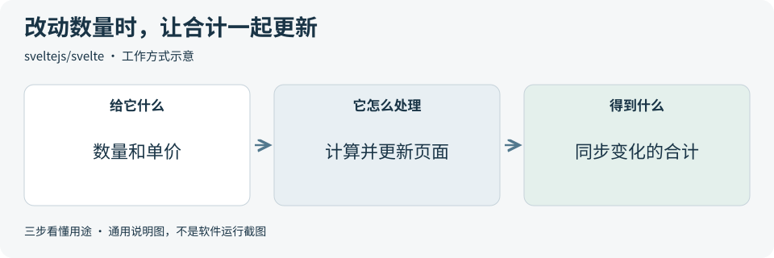
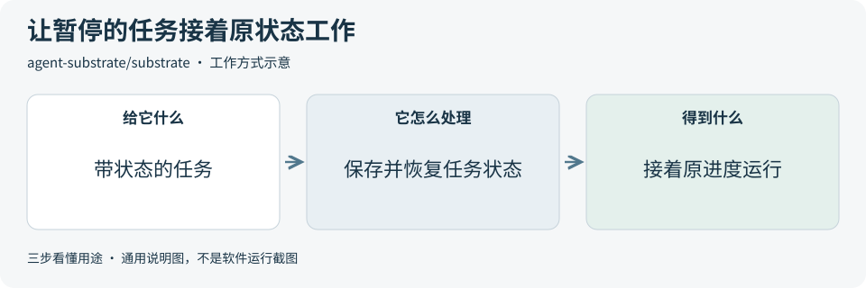
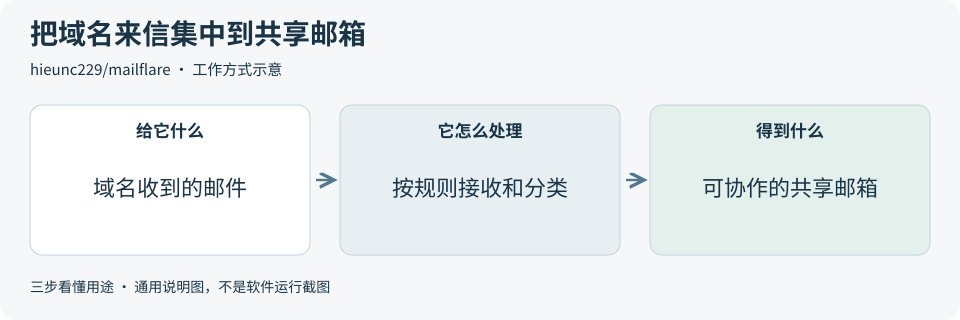
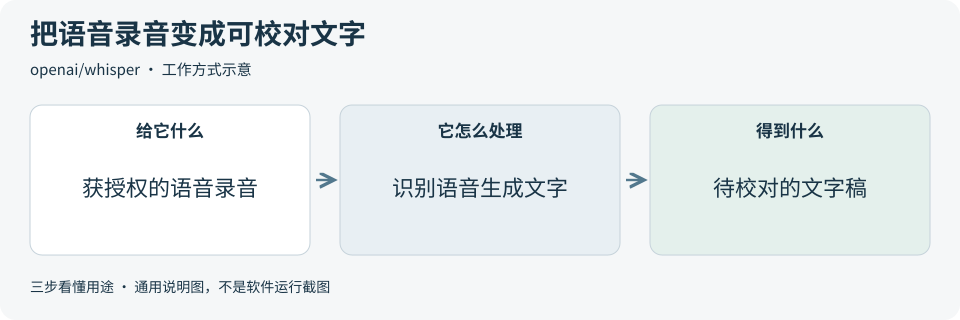
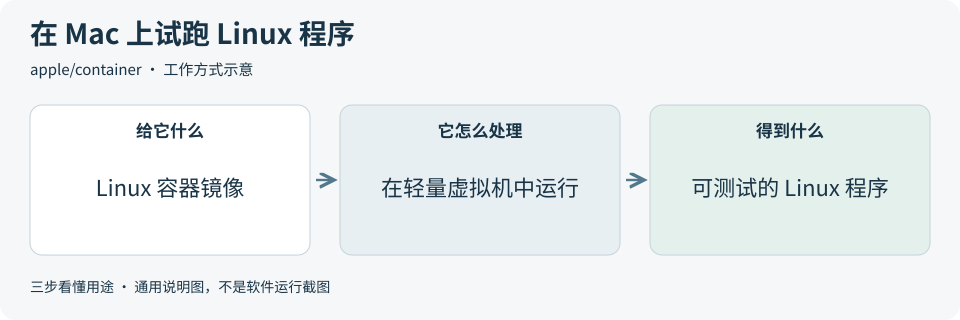

# 2026-11-19 · 每日开源项目推荐 5 个

每天在同一个仓库新增一份资料，每份 5 个项目，避开全部历史推荐。先看速览，再点项目查看图解和例子。

热度参考抓取时的 GitHub 滚动周榜，**不是一天内的新增 Star**。用途按公开文档整理，图解和例子用于解释用法；本期未实际安装或运行这些项目。

**先认两个词**　Agent 是能分步办事的 AI 助手；Skill 是写给 AI 助手的工作说明。Star 是关注热度，不代表质量。

## 本期速览

| 名次 | 项目 | 本周新增 Star | 一句话用途 | 可用场景 |
| --- | --- | ---: | --- | --- |
| 1 | [svelte](#project-01) | +1,433 | 用组件搭建网页交互，数据变化时自动更新对应的页面内容。 | 网页表单和交互小组件 |
| 2 | [substrate](#project-02) | +1,092 | 给多个任务提供隔离的运行环境，能保存状态并暂停闲置任务，收到请求后再恢复。 | 管理会等待和继续的 AI 任务 |
| 3 | [mailflare](#project-03) | +991 | 把自有域名的邮件接收、分类和共享邮箱放进自己部署的网页里管理。 | 小团队的域名邮箱和邮件协作 |
| 4 | [whisper](#project-04) | +910 | 把录音里的说话内容转成文字，支持多种语言，也提供译成英文的语音翻译功能。 | 录音整理和字幕初稿 |
| 5 | [container](#project-05) | +812 | 在 Apple 芯片 Mac 上运行 Linux 容器镜像，每个容器放在轻量虚拟机里。 | 在 Mac 上试跑 Linux 程序 |

## 可以先看

**Svelte** 适合做会随数据更新的网页组件，**Agent Substrate** 管理可暂停和恢复的任务环境，**Mailflare** 管理域名来信和共享邮箱，**Whisper** 把录音转成文字，**container** 让 Apple 芯片 Mac 运行 Linux 容器。

## 1. [svelte](https://github.com/sveltejs/svelte)

**一句话用途**　用组件搭建网页交互，数据变化时自动更新对应的页面内容。

**举个例子**　做一个报价小组件，用户点击按钮增减数量，页面同步显示数量和合计金额，方便确认这次选择要花多少钱。

**适合什么情况**　适合做报价页、筛选面板和小工具，希望把显示内容、样式与交互逻辑放在组件里维护。

**门槛与费用**　门槛中。框架采用 MIT，需懂 HTML、CSS 和 JavaScript。本地开发还需 Node.js 工具链，页面托管和外部服务按实际使用另计费用。

**注意事项**　账户权限、数据保存和服务端接口需要与后端方案一起设计；组件示例应与目标 Svelte 版本匹配。

**小范围第一步**　按[官方入门](https://github.com/sveltejs/svelte/blob/a0823d965a7894b621e0e30ad845ddd5a05d9d39/documentation/docs/01-introduction/02-getting-started.md)做一个数量加减按钮，再参照[派生值文档](https://github.com/sveltejs/svelte/blob/a0823d965a7894b621e0e30ad845ddd5a05d9d39/documentation/docs/02-runes/03-$derived.md)显示数量乘单价，核对合计是否同步变化。

周新增 Star **+1,433** · 总 Star **89,617** · JavaScript · MIT · 首次推荐

[官方文档](https://github.com/sveltejs/svelte/blob/a0823d965a7894b621e0e30ad845ddd5a05d9d39/README.md) · [仓库](https://github.com/sveltejs/svelte)

## 2. [substrate](https://github.com/agent-substrate/substrate)

**一句话用途**　给多个任务提供隔离的运行环境，能保存状态并暂停闲置任务，收到请求后再恢复。

**举个例子**　在测试集群运行官方计数器，访问一次记为 1，暂停后再访问继续计数，用它检查任务恢复后能否接着原状态工作。

**适合什么情况**　适合已有容器集群的团队，需要运行多个有状态的 AI 助手或工具任务，并控制它们之间的隔离和联网范围。

**门槛与费用**　门槛高。Apache-2.0 开源，需熟悉 Kubernetes（容器集群管理）和网络权限；开发示例还用到 Go、kubectl 和 Docker。集群、快照存储与网络有资源成本，接入模型时另计费用。

**注意事项**　安全文档中仍有开发中的边界控制；暂停后能恢复哪些状态，也取决于快照配置。先用无敏感数据验证。

**小范围第一步**　在独立开发集群按[官方计数器示例](https://github.com/agent-substrate/substrate/blob/40af7d0cc0218dfd952b8f40d0dec81a62a21e6b/demos/counter/README.md)做一次暂停和恢复，核对内存与文件计数是否连续，再考虑接入 AI 任务。

周新增 Star **+1,092** · 总 Star **7,615** · Go · Apache-2.0 · 首次推荐

[官方文档](https://github.com/agent-substrate/substrate/blob/40af7d0cc0218dfd952b8f40d0dec81a62a21e6b/README.md) · [仓库](https://github.com/agent-substrate/substrate)

## 3. [mailflare](https://github.com/hieunc229/mailflare)

**一句话用途**　把自有域名的邮件接收、分类和共享邮箱放进自己部署的网页里管理。

**举个例子**　把产品咨询邮件收进一个共享邮箱，按收件规则分类，让有权限的同事在同一处查看和处理，再由人工决定如何回复。

**适合什么情况**　适合想集中处理公共咨询邮件的小团队，并且愿意维护域名、收发服务、权限和备份。

**门槛与费用**　门槛高。采用 AGPL-3.0，需自有域名、DNS 配置和部署能力。域名、主机、存储及邮件提供商按实际资源计费，可选 AI 服务另计费用。

**注意事项**　修改后提供网络服务，要遵守 AGPL 的源码提供要求。共享邮箱需核对权限和备份，启用 AI 前还要确认模型服务及邮件访问范围。

**小范围第一步**　先读[Docker 自托管说明](https://github.com/hieunc229/mailflare/blob/06799fdaefe24390bdb2ae4483ba9bf748042fff/docs/self-hosting.md)，在隔离测试环境添加专用测试域名和一个样例邮箱，先核对页面、成员权限和备份位置。

周新增 Star **+991** · 总 Star **7,106** · TypeScript · AGPL-3.0 · 首次推荐

[官方文档](https://github.com/hieunc229/mailflare/blob/06799fdaefe24390bdb2ae4483ba9bf748042fff/README.md) · [仓库](https://github.com/hieunc229/mailflare)

## 4. [whisper](https://github.com/openai/whisper)

**一句话用途**　把录音里的说话内容转成文字，支持多种语言，也提供译成英文的语音翻译功能。

**举个例子**　把一段获授权的中文课程片段转成文字，人工核对术语、名字和数字后，用作字幕初稿或内容检索材料。

**适合什么情况**　适合把获授权的课程、访谈或产品演示录音变成可编辑文字，再交给人工校对和整理。

**门槛与费用**　门槛中。代码和模型权重采用 MIT。需要 Python、PyTorch、ffmpeg 并下载模型；本机推理的成本主要是硬件、存储和运行资源，大模型需要更多内存或显存。

**注意事项**　可能把没说过的话写进结果，也可能重复或误识别。重要内容要回听原音；语音翻译目标是英文，turbo 模型不支持这项翻译任务。

**小范围第一步**　按[官方命令行用法](https://github.com/openai/whisper/blob/86098128c0b4f24f0e2aa2994de830614b474227/README.md#command-line-usage)，用一段 30 秒、已知原文的普通话样例做转写，逐句核对，尤其检查人名和数字。

周新增 Star **+910** · 总 Star **113,015** · Python · MIT · 首次推荐

[官方文档](https://github.com/openai/whisper/blob/86098128c0b4f24f0e2aa2994de830614b474227/README.md) · [仓库](https://github.com/openai/whisper)

## 5. [container](https://github.com/apple/container)

**一句话用途**　在 Apple 芯片 Mac 上运行 Linux 容器镜像，每个容器放在轻量虚拟机里。

**举个例子**　按官方教程把一个简单网页服务打成 Linux 镜像，在 Mac 上启动容器并访问页面，用来检查服务能否在打包环境中运行。

**适合什么情况**　适合使用 Apple 芯片 Mac 的开发者，在本机测试 Linux 命令行工具或网页服务。

**门槛与费用**　门槛中。Apache-2.0 开源，需要 Apple 芯片 Mac 和 macOS 26 或更新系统。需预留镜像、Linux 内核及运行容器所需的存储和内存。

**注意事项**　先核对镜像架构、网络连接和目录挂载。项目仍在持续开发，跨大版本升级前要查看兼容性说明。

**小范围第一步**　参照[官方首次运行示例](https://github.com/apple/container/blob/16e8d488ee1d9ede35ab9cf21b9973ffdc9361b3/README.md#run-your-first-container)，先让 Alpine 容器输出一行文字并退出，确认启动与清理流程，再尝试网页服务。

周新增 Star **+812** · 总 Star **51,945** · Swift · Apache-2.0 · 首次推荐

[官方文档](https://github.com/apple/container/blob/16e8d488ee1d9ede35ab9cf21b9973ffdc9361b3/README.md) · [仓库](https://github.com/apple/container)

## 来源与选取方法

候选池 117 个，可识别开源许可证且未归档的候选 103 个。已核对 179 个历史推荐，剩余未介绍过的候选 62 个；再核对用途与许可，选出本期 5 个。抓取时间与原榜名次见 [本期数据](../data/2026-11-19.json)。

- [ZhuLinsen/daily_stock_analysis](https://github.com/ZhuLinsen/daily_stock_analysis/blob/3acb2c5b585cc038bad7ed3fcdb9a7f898667ff0/README.md) 暂未收录：根许可证为 MIT，README 免责声明限定项目仅供学习和研究。两处用途条件不一致，本期跳过。
- [tradermonty/claude-trading-skills](https://github.com/tradermonty/claude-trading-skills/blob/34b848b41f5741435bb4791692a6c0c7a66c0597/README.md) 暂未收录：根许可证为 MIT，README 将仓库用途限定为教育、研究与流程改进。两处用途条件不一致，本期跳过。
- [周榜来源 1](https://github.com/trending?since=weekly)
- [周榜来源 2](https://github.com/trending/python?since=weekly)
- [周榜来源 3](https://github.com/trending/typescript?since=weekly)
- [周榜来源 4](https://github.com/trending/javascript?since=weekly)
- [周榜来源 5](https://github.com/trending/go?since=weekly)
- [周榜来源 6](https://github.com/trending/rust?since=weekly)
- [周榜来源 7](https://github.com/trending/swift?since=weekly)
- [周榜来源 8](https://github.com/trending/dart?since=weekly)
- [周榜来源 9](https://github.com/trending/java?since=weekly)

[排名和更新规则](../UPDATE_GUIDE.md) · [通用应用场景](../USE_CASES.md)

序号是本期推荐顺序，不是 GitHub 官方总榜排名。图解和应用例子仅作说明。

[返回资料首页](../README.md)
