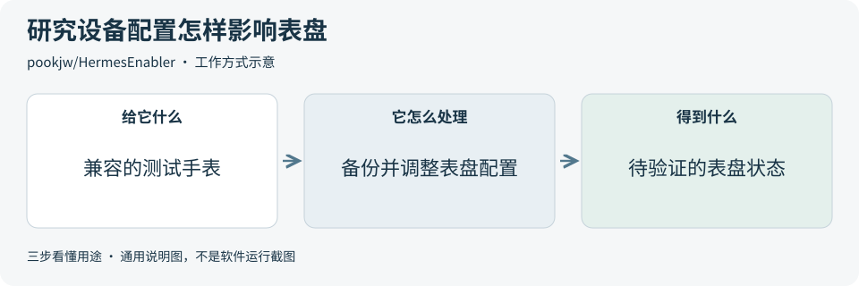
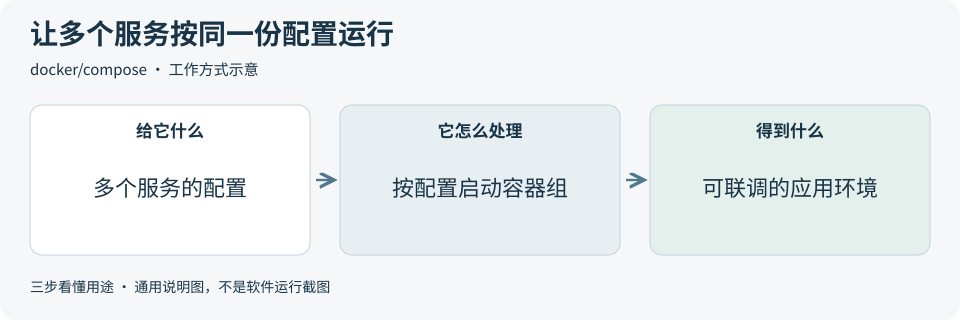

# 2026-11-20 · 每日开源项目推荐 5 个

每天在同一个仓库新增一份资料，每份 5 个项目，避开全部历史推荐。先看速览，再点项目查看图解和例子。

热度参考抓取时的 GitHub 滚动周榜，**不是一天内的新增 Star**。用途按公开文档整理，图解和例子用于解释用法；本期未实际安装或运行这些项目。

**先认两个词**　Agent 是能分步办事的 AI 助手；Skill 是写给 AI 助手的工作说明。Star 是关注热度，不代表质量。

## 本期速览

| 名次 | 项目 | 本周新增 Star | 一句话用途 | 可用场景 |
| --- | --- | ---: | --- | --- |
| 1 | [minimind](#project-01) | +1,612 | 用文本教小模型生成回答，提供训练、微调和测试的示例代码。 | 理解模型训练与小规模实验 |
| 2 | [HermesEnabler](#project-02) | +904 | 实验性地调整 Apple Watch 的设备配置，研究 Hermès、Ultra 等表盘的可用状态。 | 手表表盘与设备兼容性研究 |
| 3 | [autoclip](#project-03) | +717 | 把长视频整理成候选短片，配字幕、封面和发布文案，便于人工检查后导出。 | 访谈、演示和播客的短片制作 |
| 4 | [compose](#project-04) | +641 | 用一份配置描述多个容器服务，并一起启动、查看日志或停止。 | 网页、数据库和缓存的联合运行 |
| 5 | [claude-code-templates](#project-05) | +615 | 提供可预览的 Claude Code 配置目录，把角色说明、技能和工具连接配置引入项目。 | 给编程助手配置固定工作方式 |

## 可以先看

**MiniMind** 帮助理解小模型训练，**HermesEnabler** 用于手表表盘兼容性实验，**AutoClip** 把长视频整理成候选短片，**Docker Compose** 统一启动多个应用服务，**Claude Code Templates** 提供可挑选的助手配置。想先做一个直观的小验证，可以从视频内置示例或容器配置入手。

## 1. [minimind](https://github.com/jingyaogong/minimind)

**一句话用途**　用文本教小模型生成回答，提供训练、微调和测试的示例代码。

**举个例子**　准备一小组自编问答，用它练习指令微调，再用固定问题对照训练前后的回答，学习数据与输出之间的关系。

**适合什么情况**　适合想理解语言模型训练的人，或需要先用小模型探索数据格式、训练步骤和评估方法的团队。

**门槛与费用**　门槛高。代码采用 Apache-2.0，需 Python、PyTorch 和深度学习基础。训练建议准备可用 GPU；耗时与费用取决于硬件、数据和训练阶段，下载的数据和权重需另核对许可。

**注意事项**　训练配置、初始模型和数据版本要匹配，并用固定测试题检查回答。小样例适合验证流程，实际回答质量与训练耗时需要另测。

**小范围第一步**　先读[官方入门](https://github.com/jingyaogong/minimind/blob/cc9629e5f464ef46ef9411bfac916364e0a6dff1/README.md)，整理十条虚构问答并对照数据格式核对字段；确认设备和预算后，再考虑少量训练步骤。

周新增 Star **+1,612** · 总 Star **66,867** · Python · Apache-2.0 · 首次推荐

[官方文档](https://github.com/jingyaogong/minimind/blob/cc9629e5f464ef46ef9411bfac916364e0a6dff1/README.md) · [仓库](https://github.com/jingyaogong/minimind)

## 2. [HermesEnabler](https://github.com/pookjw/HermesEnabler)

**一句话用途**　实验性地调整 Apple Watch 的设备配置，研究 Hermès、Ultra 等表盘的可用状态。

**举个例子**　在备用手表上记录型号、系统构建和原始备份，对照配置调整前后哪些表盘选项发生变化，用于研究设备识别差异。

**适合什么情况**　主要面向 watchOS 系统研究者，适合观察设备标识与表盘可用性的关系；普通业务应用的直接复用价值有限。

**门槛与费用**　门槛高。代码采用 MIT，需要配对的 iPhone、兼容 Apple Watch，以及签名或构建工具。本期源版本列出的支持范围为 watchOS 27.0 至 27.3 beta 1，watchOS 26 不支持；主要成本是设备和研究时间。

**注意事项**　改动可能影响其他表盘和显示布局，效果受机型与系统构建限制。官方要求删除应用前先恢复设备配置备份。

**小范围第一步**　先读[官方表盘研究说明](https://github.com/pookjw/HermesEnabler/blob/f428f91d7270f53f738429a17fb6a5d51f924284/Research/WatchFaces/README.md)，核对型号、系统版本和备份恢复方案，再决定是否在备用设备上试验。

周新增 Star **+904** · 总 Star **2,250** · Objective-C · MIT · 首次推荐

[官方文档](https://github.com/pookjw/HermesEnabler/blob/f428f91d7270f53f738429a17fb6a5d51f924284/README.md) · [仓库](https://github.com/pookjw/HermesEnabler)

## 3. [autoclip](https://github.com/zhouxiaoka/autoclip)

**一句话用途**　把长视频整理成候选短片，配字幕、封面和发布文案，便于人工检查后导出。

**举个例子**　将一段自制产品访谈生成几个候选片段，选择竖版输出，逐段检查是否保留完整观点，再下载短片和配套文案。

**适合什么情况**　适合手里有自制或获授权的长视频，希望先生成一批候选片段，再人工挑选和校对的内容团队。

**门槛与费用**　门槛中。项目采用 MIT，剪辑和渲染使用本机资源。正式处理素材需配置分析模型，字幕可本地转写或用云端服务；本地模型需要相应硬件，云端按所选服务商用量计费。

**注意事项**　自动片段仍需检查上下文、字幕和素材授权。云端分析或转写会发送相应文字、抽样画面或音频；使用统计与崩溃报告设有开关。

**小范围第一步**　按[官方快速开始](https://github.com/zhouxiaoka/autoclip/blob/cd8e6bed18d87a81273d48bcd165751708ac715c/README.md)，先打开软件内置示例，不填 API 密钥，检查字幕、画幅和切点，再换成一段自有短素材。

周新增 Star **+717** · 总 Star **11,227** · Python · MIT · 首次推荐

[官方文档](https://github.com/zhouxiaoka/autoclip/blob/cd8e6bed18d87a81273d48bcd165751708ac715c/README.md) · [仓库](https://github.com/zhouxiaoka/autoclip)

## 4. [compose](https://github.com/docker/compose)

**一句话用途**　用一份配置描述多个容器服务，并一起启动、查看日志或停止。

**举个例子**　一个演示应用需要网页服务和 Redis 缓存，把两者写进同一份配置，统一启动，再通过日志和网页访问检查它们能否配合工作。

**适合什么情况**　适合本地开发、演示或小规模自托管，应用由网页、数据库、缓存等多个服务组成，希望保留一份可复用的启动配置。

**门槛与费用**　门槛中。Compose 采用 Apache-2.0，需要 Docker 运行环境和基础容器知识。资源成本来自运行容器的机器、存储与网络，运行环境的费用按所选方案核对。

**注意事项**　端口、环境变量、健康检查和数据卷需要明确配置。清理容器前先确认数据保存位置，删除数据卷会影响其中的内容。

**小范围第一步**　照[官方快速入门](https://github.com/docker/compose/blob/469ab94d72326565c6dfdf304a72882115011800/README.md)，从两个不含真实数据的样例服务开始，核对配置、启动和日志，再测试停止后的数据保留情况。

周新增 Star **+641** · 总 Star **39,047** · Go · Apache-2.0 · 首次推荐

[官方文档](https://github.com/docker/compose/blob/469ab94d72326565c6dfdf304a72882115011800/README.md) · [仓库](https://github.com/docker/compose)

## 5. [claude-code-templates](https://github.com/davila7/claude-code-templates)

**一句话用途**　提供可预览的 Claude Code 配置目录，把角色说明、技能和工具连接配置引入项目。

**举个例子**　为一个演示项目选择代码审查角色，让助手按固定检查点审阅一小段代码，再人工核对建议，决定哪些改动值得采用。

**适合什么情况**　适合已有 Claude Code 使用基础，希望为代码审查、文档整理等任务选取现成配置，再按团队要求修改的人。

**门槛与费用**　门槛中。安装工具采用 MIT，收录组件保留各自许可。按 npx 入门需 Node.js 和 Claude Code；模型用量及连接的第三方服务按各自条件计费。

**注意事项**　模板可能请求执行命令和写文件权限，先看内容再接入。只加载任务需要的组件，并单独核对来源、许可和所连服务。

**小范围第一步**　先预览[代码审查角色模板](https://github.com/davila7/claude-code-templates/blob/915ebd2c8ff332955104345472dd43bb5018771d/cli-tool/components/agents/development-tools/code-reviewer.md)，列出它要求读取、写入和执行的操作，再在无真实数据的演示项目只引入这一项，检查配置改动。

周新增 Star **+615** · 总 Star **34,014** · Python · MIT · 首次推荐

[官方文档](https://github.com/davila7/claude-code-templates/blob/915ebd2c8ff332955104345472dd43bb5018771d/README.md) · [仓库](https://github.com/davila7/claude-code-templates)

## 来源与选取方法

候选池 113 个，可识别开源许可证且未归档的候选 95 个。已核对 184 个历史推荐，剩余未介绍过的候选 60 个；再核对用途与许可，选出本期 5 个。抓取时间与原榜名次见 [本期数据](../data/2026-11-20.json)。

- [tradermonty/claude-trading-skills](https://github.com/tradermonty/claude-trading-skills/blob/f95e770591b56fd83b9917175f5a7e8fe9ac47dc/README.md) 暂未收录：根许可证为 MIT，README 将仓库用途限定为教育、研究与流程改进。两处用途条件不一致，本期跳过。
- [ZhuLinsen/daily_stock_analysis](https://github.com/ZhuLinsen/daily_stock_analysis/blob/92f0209ec5325c152a7532d714a69e09d102399a/README.md) 暂未收录：根许可证为 MIT，README 免责声明限定项目仅供学习和研究。两处用途条件不一致，本期跳过。
- [周榜来源 1](https://github.com/trending?since=weekly)
- [周榜来源 2](https://github.com/trending/python?since=weekly)
- [周榜来源 3](https://github.com/trending/typescript?since=weekly)
- [周榜来源 4](https://github.com/trending/javascript?since=weekly)
- [周榜来源 5](https://github.com/trending/go?since=weekly)
- [周榜来源 6](https://github.com/trending/rust?since=weekly)
- [周榜来源 7](https://github.com/trending/swift?since=weekly)
- [周榜来源 8](https://github.com/trending/dart?since=weekly)
- [周榜来源 9](https://github.com/trending/java?since=weekly)

[排名和更新规则](../UPDATE_GUIDE.md) · [通用应用场景](../USE_CASES.md)

序号是本期推荐顺序，不是 GitHub 官方总榜排名。图解和应用例子仅作说明。

[返回资料首页](../README.md)
