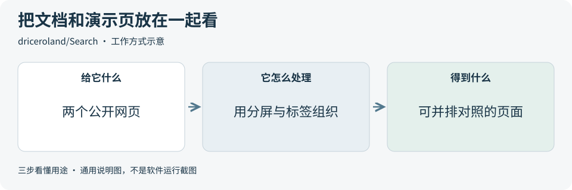
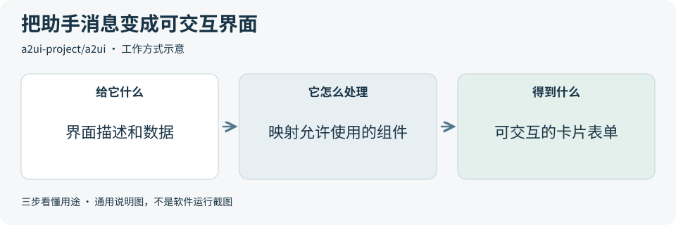
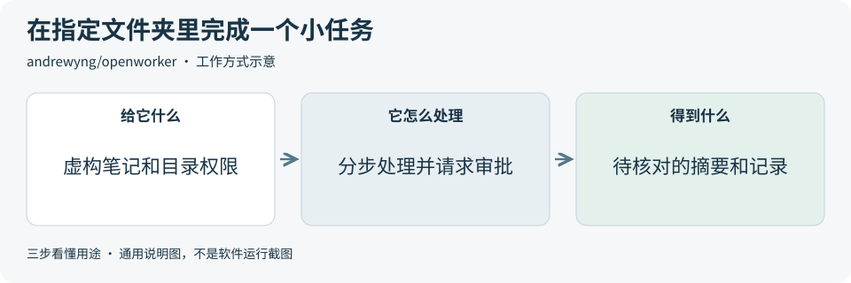

# 2026-11-21 · 每日开源项目推荐 5 个

每天在同一个仓库新增一份资料，每份 5 个项目，避开全部历史推荐。先看速览，再点项目查看图解和例子。

热度参考抓取时的 GitHub 滚动周榜，**不是一天内的新增 Star**。用途按公开文档整理，图解和例子用于解释用法；本期未实际安装或运行这些项目。

**先认两个词**　Agent 是能分步办事的 AI 助手；Skill 是写给 AI 助手的工作说明。Star 是关注热度，不代表质量。

## 本期速览

| 名次 | 项目 | 本周新增 Star | 一句话用途 | 可用场景 |
| --- | --- | ---: | --- | --- |
| 1 | [Search](#project-01) | +520 | 基于 Mac 自带的 WebKit 浏览网页，提供标签管理、并排分屏和阅读模式。 | 对照阅读资料与网页 |
| 2 | [jquery](#project-02) | +520 | 用 JavaScript 选中网页元素、响应点击和输入事件，并更新页面内容。 | 给已有网页补小范围交互 |
| 3 | [buzz](#project-03) | +436 | 把人和 AI 助手放进同一工作区，在频道、讨论线程和可搜索的记录中协作。 | 保留人与助手的协作记录 |
| 4 | [a2ui](#project-04) | +413 | 把助手发来的界面描述和数据，渲染成应用允许的卡片、按钮与表单。 | 让 AI 应用用界面引导操作 |
| 5 | [openworker](#project-05) | +398 | 让桌面助手在指定文件和工具中分步完成任务，也提供工具调用、审批和会话管理的开发 SDK。 | 桌面任务助手与 Agent 应用开发 |

## 可以先看

**Search** 可以并排对照文档和网页，**jQuery** 适合给已有页面补交互，**Buzz** 把团队讨论和 AI 助手放在同一工作区，**A2UI** 把助手消息变成可交互界面，**OpenWorker** 提供带权限和审批设置的桌面助手及开发 SDK。

## 1. [Search](https://github.com/driceroland/Search)

**一句话用途**　基于 Mac 自带的 WebKit 浏览网页，提供标签管理、并排分屏和阅读模式。

**举个例子**　把一个开源项目的说明页和演示页并排打开，一边阅读用法，一边查看页面表现，把常看的页面固定为标签。

**适合什么情况**　适合在 Mac 上经常对照文档和网页的人，也适合研究 Swift 与 WebKit 原生浏览器实现的开发者。

**门槛与费用**　门槛低。应用免费，代码采用 MIT。基础浏览需要 macOS 14 或更新系统，扩展功能需要 macOS 15.4 或更新系统；自行编译还需 Xcode 与 Swift 工具链。

**注意事项**　先测试常用网站和扩展的兼容性，并核对扩展访问权限。分发改版时，按 README 的品牌要求更名。

**小范围第一步**　参照[官方功能说明](https://github.com/driceroland/Search/blob/dbb8345d1703c71f70ba9c3e26196a6e316294b7/README.md)，打开两个公开页面试一次分屏，退出后重新打开，检查标签恢复和页面兼容性。

周新增 Star **+520** · 总 Star **3,574** · Swift · MIT · 首次推荐

[官方文档](https://github.com/driceroland/Search/blob/dbb8345d1703c71f70ba9c3e26196a6e316294b7/README.md) · [仓库](https://github.com/driceroland/Search)

## 2. [jquery](https://github.com/jquery/jquery)

**一句话用途**　用 JavaScript 选中网页元素、响应点击和输入事件，并更新页面内容。

**举个例子**　给一个静态商品清单加搜索框，输入关键词时只显示匹配条目，让页面上的列表随输入变化。

**适合什么情况**　适合维护已有网页或旧系统，想给列表、按钮和表单增加交互，也适合仍依赖 jQuery 插件的项目。

**门槛与费用**　门槛中。库采用 MIT，需 HTML、CSS 和 JavaScript 基础。可在已有网页中引入，主要资源费用来自页面托管和所调用的业务接口。

**注意事项**　本期源版本属于 4.x，旧插件升级前需核对兼容性。精简或自定义构建中包含的方法可能不同。

**小范围第一步**　先用三个虚构条目的静态页绑定输入事件，只检查筛选后的显示与隐藏；可对照[官方显示与隐藏实现](https://github.com/jquery/jquery/blob/effd615f0009e927dfd1f41d04fb6073478076d4/src/css/showHide.js)确认所用方法。

周新增 Star **+520** · 总 Star **60,107** · JavaScript · MIT · 首次推荐

[官方文档](https://github.com/jquery/jquery/blob/effd615f0009e927dfd1f41d04fb6073478076d4/README.md) · [仓库](https://github.com/jquery/jquery)

## 3. [buzz](https://github.com/block/buzz)

**一句话用途**　把人和 AI 助手放进同一工作区，在频道、讨论线程和可搜索的记录中协作。

**举个例子**　为一项虚构功能建频道，成员在同一线程提出问题，让已接入的助手整理相关消息链接，团队依据原记录继续讨论。

**适合什么情况**　适合需要围绕项目持续讨论、追溯处理依据的团队，并且愿意自行维护工作区服务。

**门槛与费用**　门槛高。代码采用 Apache-2.0。自行部署需中继服务、PostgreSQL、Redis 和对象存储；桌面客户端在另一个官方仓库。主机、存储、网络及接入的模型服务另计费用。

**注意事项**　README 将移动端和工作流审批流程列为仍在完善的功能。先限定助手能进入的频道和能执行的操作，再接入真实仓库或资料。

**小范围第一步**　按[官方部署说明](https://github.com/block/buzz/blob/8a3912f1511a46faf30b4cef774c634529e9f2f1/deploy/compose/README.md)建立独立测试工作区，只放虚构消息，检查一个频道的讨论线程与搜索，再考虑接入权限受限的助手。

周新增 Star **+436** · 总 Star **37,632** · Rust · Apache-2.0 · 首次推荐

[官方文档](https://github.com/block/buzz/blob/8a3912f1511a46faf30b4cef774c634529e9f2f1/README.md) · [仓库](https://github.com/block/buzz)

## 4. [a2ui](https://github.com/a2ui-project/a2ui)

**一句话用途**　把助手发来的界面描述和数据，渲染成应用允许的卡片、按钮与表单。

**举个例子**　做一个活动报名演示，让助手返回日期选项和确认按钮的界面描述。前端展示选择，把用户操作传回应用，再由业务接口处理报名。

**适合什么情况**　适合 AI 应用需要让用户选择、确认或填表的场景，希望前端按统一消息格式展示界面。

**门槛与费用**　门槛中。主体采用 Apache-2.0，需前端开发能力及配套渲染器。官方有固定消息样例，可先验证显示；接入真实模型和业务服务时另计相应费用。

**注意事项**　消息格式、组件目录和渲染器版本需要匹配。按钮触发的业务操作及权限，仍需应用自行校验。

**小范围第一步**　先照[React 固定消息样例](https://github.com/a2ui-project/a2ui/blob/5ff1b05f02d39f969b52a942e78e864ef3ac01fa/typescript/renderers/react/README.md)渲染标题和说明文字，修改一处数据观察界面更新，再扩展到交互组件。

周新增 Star **+413** · 总 Star **17,695** · TypeScript · Apache-2.0 · 首次推荐

[官方文档](https://github.com/a2ui-project/a2ui/blob/5ff1b05f02d39f969b52a942e78e864ef3ac01fa/README.md) · [仓库](https://github.com/a2ui-project/a2ui)

## 5. [openworker](https://github.com/andrewyng/openworker)

**一句话用途**　让桌面助手在指定文件和工具中分步完成任务，也提供工具调用、审批和会话管理的开发 SDK。

**举个例子**　给助手一个只含虚构会议笔记的演示目录，先整理提纲和待办，确认后再写出摘要文件，并核对读取与写入记录。

**适合什么情况**　适合需要 AI 处理文件并保留操作记录的人，也适合想在产品中复用工具调用、审批和会话机制的开发者。

**门槛与费用**　门槛中。代码采用 MIT。桌面版文档支持 Apple 芯片 Mac 和 Windows，需要配置云端模型或本地模型服务；模型用量、本地算力及外部连接服务按所选方案承担成本。

**注意事项**　使用云端模型时，任务所需的文件内容可能发给提供商。先限定目录、工具和审批规则，并按支持情况配置可选沙箱；桌面版仍处于公开测试阶段。

**小范围第一步**　照[官方首个任务示例](https://github.com/andrewyng/openworker/blob/d1b8cd69ceccb10e75bb58ea133a5cf7cb981b89/README.md)，只授权一个放有虚构笔记的目录，要求先给计划、写入前确认，最后核对摘要与操作记录。

周新增 Star **+398** · 总 Star **19,489** · Python · MIT · 首次推荐

[官方文档](https://github.com/andrewyng/openworker/blob/d1b8cd69ceccb10e75bb58ea133a5cf7cb981b89/README.md) · [仓库](https://github.com/andrewyng/openworker)

## 来源与选取方法

候选池 113 个，可识别开源许可证且未归档的候选 95 个。已核对 189 个历史推荐，剩余未介绍过的候选 55 个；再核对用途与许可，选出本期 5 个。抓取时间与原榜名次见 [本期数据](../data/2026-11-21.json)。

- [tradermonty/claude-trading-skills](https://github.com/tradermonty/claude-trading-skills/blob/901985468f4dd4a9c45f460345b7df1991302b24/README.md) 暂未收录：根许可证为 MIT，README 将用途限定为教育、研究与流程改进。用途范围表述不一致，本期跳过。
- [ZhuLinsen/daily_stock_analysis](https://github.com/ZhuLinsen/daily_stock_analysis/blob/fe3c03f7337971a639dfde23cfa11ff03a722606/README.md) 暂未收录：根许可证为 MIT，README 免责声明限定项目仅供学习和研究。用途范围表述不一致，本期跳过。
- [soxoj/maigret](https://github.com/soxoj/maigret/blob/441becf5358cd14d144365ddbb11c9a98a401d07/README.md) 暂未收录：README 的商用章节称 MIT 商用不受限制，免责声明又写仅供教育及合法目的。用途范围表述未统一，本期暂不收录。
- [bggRGjQaUbCoE/PiliPlus](https://github.com/bggRGjQaUbCoE/PiliPlus/blob/217fb54f51f6764176319bbdedab2a7522d75401/README.md) 暂未收录：根许可证为 GPL-3.0，README 又限定仅用于学习测试，并要求下载后 24 小时内删除。两处使用条件不一致，本期跳过。
- [z7786/wenxi](https://github.com/z7786/wenxi/blob/66a175b172ac3620a5e1baa07035fecedd7502b7/docs/LICENSING.md) 暂未收录：许可范围文档明确说明，内置第三方 SDK 的组合分发兼容性仍待确认。无法确认整包许可条件，本期暂不收录。
- [周榜来源 1](https://github.com/trending?since=weekly)
- [周榜来源 2](https://github.com/trending/python?since=weekly)
- [周榜来源 3](https://github.com/trending/typescript?since=weekly)
- [周榜来源 4](https://github.com/trending/javascript?since=weekly)
- [周榜来源 5](https://github.com/trending/go?since=weekly)
- [周榜来源 6](https://github.com/trending/rust?since=weekly)
- [周榜来源 7](https://github.com/trending/swift?since=weekly)
- [周榜来源 8](https://github.com/trending/dart?since=weekly)
- [周榜来源 9](https://github.com/trending/java?since=weekly)

[排名和更新规则](../UPDATE_GUIDE.md) · [通用应用场景](../USE_CASES.md)

序号是本期推荐顺序，不是 GitHub 官方总榜排名。图解和应用例子仅作说明。

[返回资料首页](../README.md)
