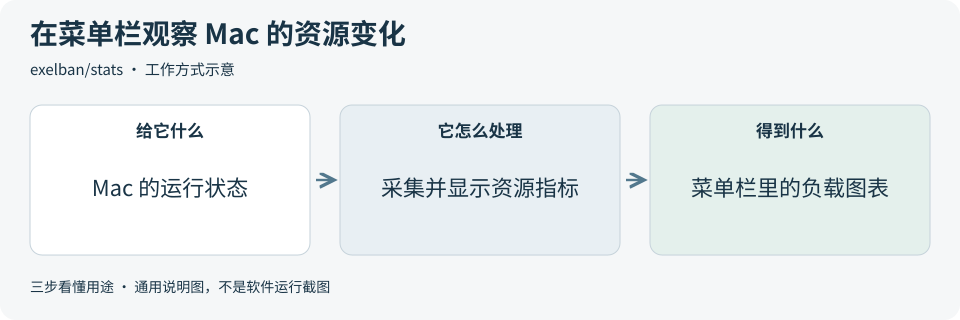

# 2026-11-23 · 每日开源项目推荐 5 个

每天在同一个仓库新增一份资料，每份 5 个项目，避开全部历史推荐。先看速览，再点项目查看图解和例子。

热度参考抓取时的 GitHub 滚动周榜，**不是一天内的新增 Star**。用途按公开文档整理，图解和例子用于解释用法；本期未实际安装或运行这些项目。

**先认两个词**　Agent 是能分步办事的 AI 助手；Skill 是写给 AI 助手的工作说明。Star 是关注热度，不代表质量。

## 本期速览

| 名次 | 项目 | 本周新增 Star | 一句话用途 | 可用场景 |
| --- | --- | ---: | --- | --- |
| 1 | [ardia](#project-01) | +519 | 基于 Chromium 浏览网页，把地址与标签管理放到侧边，支持分屏、扩展和开发者工具。 | 网页调试与分屏资料对照 |
| 2 | [gopeed](#project-02) | +218 | 把不同来源的文件下载放进统一任务列表，支持暂停、继续、重试和批量管理。 | 管理文件下载与自动化任务 |
| 3 | [kelivo](#project-03) | +214 | 用一个客户端连接多家模型，管理会话、助手配置，并按需接入工具。 | 比较模型与整理常用助手 |
| 4 | [qmd](#project-04) | +203 | 给本地 Markdown 文档建立索引，用关键词、语义或混合搜索找回相关原文片段。 | 为文档或助手提供资料检索 |
| 5 | [stats](#project-05) | +179 | 在 Mac 菜单栏显示 CPU、内存、磁盘、网络等资源使用情况。 | 观察本地应用运行时的负载 |

## 可以先看

**Ardia** 提供分屏、扩展与网页调试体验，**Gopeed** 统一管理下载，**Kelivo** 集中使用不同模型，**QMD** 检索本地 Markdown，**Stats** 观察 Mac 资源占用。想从小范围验证开始，可先看 QMD 的关键词搜索或 Stats 的只读监控。

## 1. [ardia](https://github.com/ardia-browser/ardia)

**一句话用途**　基于 Chromium 浏览网页，把地址与标签管理放到侧边，支持分屏、扩展和开发者工具。

**举个例子**　把接口说明与演示网页放进同一窗口并排查看，再打开开发者工具检查页面表现，减少来回切换标签的操作。

**适合什么情况**　适合需要同时对照说明页和演示页的人，也适合研究 Chromium 浏览器界面和扩展集成的开发者。

**门槛与费用**　门槛中。浏览器整包采用 GPLv3，Ardia 自有源码采用 Apache-2.0，其他组件保留各自许可。本期以 Mac 版为例，需要 Apple 芯片和 macOS 14 或更新版本；二次开发还需评估引擎构建资源。

**注意事项**　部分能力仍有限制，例如通行密钥与 DRM 支持并不完整，本地翻译另需 macOS 26。先核对功能状态，并检查扩展、同步等功能的数据访问范围。

**小范围第一步**　参照[官方功能与状态说明](https://github.com/ardia-browser/ardia/blob/80384b50c7e635cfed55f374a399ffead5347306/README.md)，用两个公开页面测试分屏、一个常用扩展和开发者工具，确认日常网页兼容性后再扩大使用范围。

周新增 Star **+519** · 总 Star **2,841** · TypeScript · GPL-3.0 · 首次推荐

[官方文档](https://github.com/ardia-browser/ardia/blob/80384b50c7e635cfed55f374a399ffead5347306/README.md) · [仓库](https://github.com/ardia-browser/ardia)

## 2. [gopeed](https://github.com/GopeedLab/gopeed)

**一句话用途**　把不同来源的文件下载放进统一任务列表，支持暂停、继续、重试和批量管理。

**举个例子**　把几份获授权的公开样例文件加入队列，查看各自进度，暂停其中一个任务后继续，完成后核对保存位置和文件校验值。

**适合什么情况**　适合集中处理合法授权的文件下载；需要程序发起任务时，也可研究它的 REST 接口、命令行和扩展机制。

**门槛与费用**　门槛中。代码采用 GPLv3，主要资源成本是网络流量、磁盘和运行设备。二次开发需要 Go、Flutter 等基础，扩展或第三方服务按各自条件使用。

**注意事项**　速度和续传能力受来源服务器、网络与协议限制。扩展和下载后脚本会增加执行权限，需核对来源；稳定版与 2.0 Beta 的功能应分别确认。

**小范围第一步**　按[官方使用说明](https://github.com/GopeedLab/gopeed/blob/996685c8478ac055f4842746682b1db2a8b810f8/README_zh-CN.md)，从可信且支持续传的测试源下载一个小样例文件，核对大小、校验值和保存位置，再测试暂停与继续。

周新增 Star **+218** · 总 Star **27,898** · Dart · GPL-3.0 · 首次推荐

[官方文档](https://github.com/GopeedLab/gopeed/blob/996685c8478ac055f4842746682b1db2a8b810f8/README.md) · [仓库](https://github.com/GopeedLab/gopeed)

## 3. [kelivo](https://github.com/Chevey339/kelivo)

**一句话用途**　用一个客户端连接多家模型，管理会话、助手配置，并按需接入工具。

**举个例子**　把同一段虚构需求分别交给两个模型会话，保存回答供人工对照，再把常用提示整理成一份助手配置。

**适合什么情况**　适合经常切换不同模型、想统一保存会话和提示配置的人，也适合研究跨平台模型客户端的开发者。

**门槛与费用**　门槛中。客户端代码采用 AGPL-3.0，需要自行准备可用模型连接。模型 API、订阅、搜索或语音服务按提供方计费；使用本地兼容服务则需相应硬件和配置。

**注意事项**　任务内容会发给所选模型或工具服务，应检查上下文日志和外发范围。备份、工作区和 MCP 工具按需要开放，凭据与备份文件需妥善保管。

**小范围第一步**　照[官方入门](https://github.com/Chevey339/kelivo/blob/e0832d2b4f447b41939048bd30a66a6305d0cc6d/README.md)只连接一个获授权的模型或本地兼容服务，用虚构文本开一个会话，查看上下文日志确认发送了什么，再决定是否启用工具或备份。

周新增 Star **+214** · 总 Star **4,736** · Dart · AGPL-3.0 · 首次推荐

[官方文档](https://github.com/Chevey339/kelivo/blob/e0832d2b4f447b41939048bd30a66a6305d0cc6d/README.md) · [仓库](https://github.com/Chevey339/kelivo)

## 4. [qmd](https://github.com/tobi/qmd)

**一句话用途**　给本地 Markdown 文档建立索引，用关键词、语义或混合搜索找回相关原文片段。

**举个例子**　把三篇虚构产品说明放进测试目录，先按功能名查关键词，再用同义说法做语义搜索，比较结果指向哪些原文片段。

**适合什么情况**　适合文档较多、希望按内容找回出处的团队，也可作为 AI 助手的文档检索工具；搜索结果仍需回到原文核对。

**门槛与费用**　门槛中。代码采用 MIT，需要符合官方版本要求的 Node.js 或 Bun 运行环境及索引依赖。语义检索和重排还需模型、磁盘与算力；远端服务费用和模型权重许可应单独核对。

**注意事项**　先限定被收录的目录。中文语义检索应通过已知问题验证召回效果；启用远端嵌入或重排时，需确认哪些文档片段会发给服务商。

**小范围第一步**　按[官方快速开始](https://github.com/tobi/qmd/blob/8be0c42395c02ff73bce6d6c2e67d7905b0a771c/README.md)只给一个示例目录建立集合，先验证关键词搜索和原文返回，再决定是否生成语义索引或接入 AI 客户端。

周新增 Star **+203** · 总 Star **31,349** · TypeScript · MIT · 首次推荐

[官方文档](https://github.com/tobi/qmd/blob/8be0c42395c02ff73bce6d6c2e67d7905b0a771c/README.md) · [仓库](https://github.com/tobi/qmd)

## 5. [stats](https://github.com/exelban/stats)

**一句话用途**　在 Mac 菜单栏显示 CPU、内存、磁盘、网络等资源使用情况。

**举个例子**　运行一个演示视频导出任务前后，比较 CPU 和内存变化，决定接下来应重点检查应用日志还是其他系统资源。

**适合什么情况**　适合在 Mac 上观察演示任务、导出任务或本地工具的资源变化，先找到值得进一步排查的资源项。

**门槛与费用**　门槛低。代码采用 MIT，文档支持正式版 macOS 12 或更新系统。监控本身也会占用资源，可按需要选择模块与刷新频率。

**注意事项**　传感器数据取决于机型和权限，名称不一定对应某个具体核心。文档将风扇控制标为未维护，初次使用先选择只读监控项。

**小范围第一步**　照[官方功能说明](https://github.com/exelban/stats/blob/f47dca1e2549db5efe776e8acdf3b5a108f6004d/README.md)只启用 CPU 和内存两个模块，运行一个小演示任务，核对刷新频率、显示单位以及空闲和运行时的差异。

周新增 Star **+179** · 总 Star **43,569** · Swift · MIT · 首次推荐

[官方文档](https://github.com/exelban/stats/blob/f47dca1e2549db5efe776e8acdf3b5a108f6004d/README.md) · [仓库](https://github.com/exelban/stats)

## 来源与选取方法

候选池 114 个，可识别开源许可证且未归档的候选 96 个。已核对 199 个历史推荐，剩余未介绍过的候选 47 个；再核对用途与许可，选出本期 5 个。抓取时间与原榜名次见 [本期数据](../data/2026-11-23.json)。

- [tradermonty/claude-trading-skills](https://github.com/tradermonty/claude-trading-skills/blob/bb4a8ff60c2054cc8b41807ae648041ff0922938/README.md) 暂未收录：根许可证为 MIT，README 将用途限定为教育、研究与流程改进。用途范围表述不一致，本期跳过。
- [ZhuLinsen/daily_stock_analysis](https://github.com/ZhuLinsen/daily_stock_analysis/blob/603a55e6ddac16aef96f4216847f87323c58d0cb/README.md) 暂未收录：根许可证为 MIT，README 免责声明限定项目仅供学习和研究。用途范围表述不一致，本期跳过。
- [soxoj/maigret](https://github.com/soxoj/maigret/blob/25125121b668de2505294f414892d2db06ddcaa8/README.md) 暂未收录：README 的商用章节称 MIT 商用不受限制，免责声明又写仅供教育及合法目的。用途范围表述未统一，本期暂不收录。
- [bggRGjQaUbCoE/PiliPlus](https://github.com/bggRGjQaUbCoE/PiliPlus/blob/217fb54f51f6764176319bbdedab2a7522d75401/README.md) 暂未收录：根许可证为 GPL-3.0，README 又限定仅用于学习测试，并要求下载后 24 小时内删除。两处使用条件不一致，本期跳过。
- [z7786/wenxi](https://github.com/z7786/wenxi/blob/66a175b172ac3620a5e1baa07035fecedd7502b7/docs/LICENSING.md) 暂未收录：许可范围文档明确说明，内置第三方 SDK 的组合分发兼容性仍待确认。无法确认整包许可条件，本期暂不收录。
- [周榜来源 1](https://github.com/trending?since=weekly)
- [周榜来源 2](https://github.com/trending/python?since=weekly)
- [周榜来源 3](https://github.com/trending/typescript?since=weekly)
- [周榜来源 4](https://github.com/trending/javascript?since=weekly)
- [周榜来源 5](https://github.com/trending/go?since=weekly)
- [周榜来源 6](https://github.com/trending/rust?since=weekly)
- [周榜来源 7](https://github.com/trending/swift?since=weekly)
- [周榜来源 8](https://github.com/trending/dart?since=weekly)
- [周榜来源 9](https://github.com/trending/java?since=weekly)

[排名和更新规则](../UPDATE_GUIDE.md) · [通用应用场景](../USE_CASES.md)

序号是本期推荐顺序，不是 GitHub 官方总榜排名。图解和应用例子仅作说明。

[返回资料首页](../README.md)
