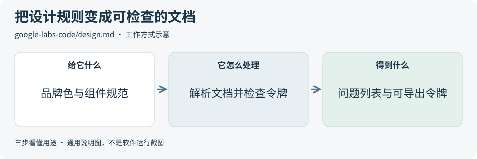
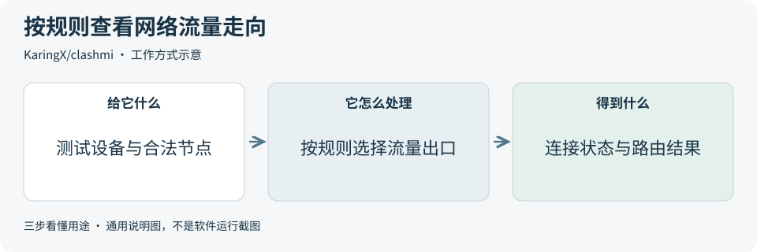
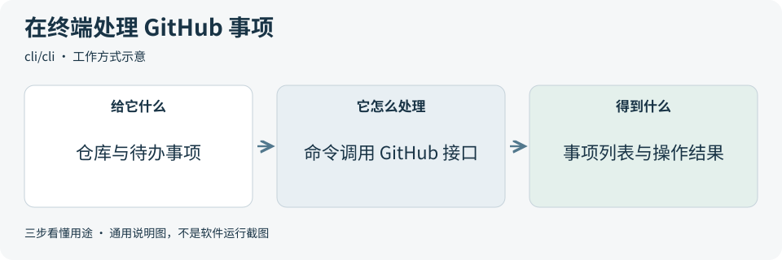
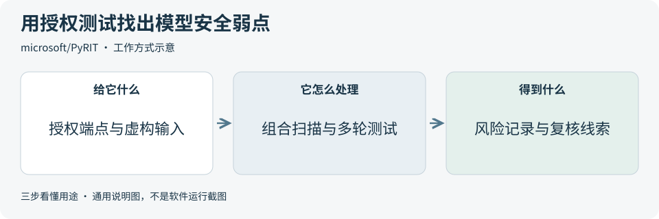
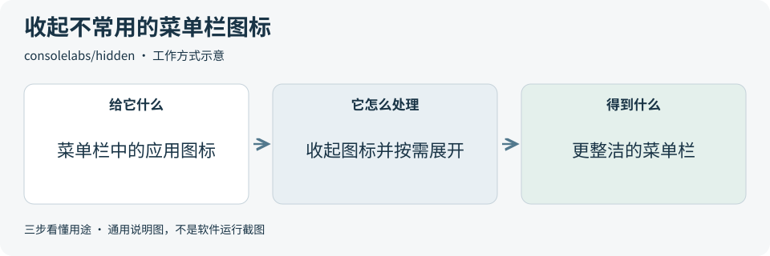

# 2026-11-24 · 每日开源项目推荐 5 个

每天在同一个仓库新增一份资料，每份 5 个项目，避开全部历史推荐。先看速览，再点项目查看图解和例子。

热度参考抓取时的 GitHub 滚动周榜，**不是一天内的新增 Star**。用途按公开文档整理，图解和例子用于解释用法；本期未实际安装或运行这些项目。

**先认两个词**　Agent 是能分步办事的 AI 助手；Skill 是写给 AI 助手的工作说明。Star 是关注热度，不代表质量。

## 本期速览

| 名次 | 项目 | 本周新增 Star | 一句话用途 | 可用场景 |
| --- | --- | ---: | --- | --- |
| 1 | [design.md](#project-01) | +187 | 用 DESIGN.md 把颜色、字体和组件规则写成编码工具能读取的格式，并检查文档结构与令牌。 | 统一设计规范与代码协作 |
| 2 | [clashmi](#project-02) | +181 | 用图形界面配置 Mihomo 网络代理规则，在手机和桌面设备上选择流量路由。 | 检查网络分流和代理配置 |
| 3 | [cli](#project-03) | +165 | 把 GitHub 仓库、Issue 和 Pull request 等操作放到终端，与 git 一起管理代码任务。 | 从终端查看仓库事项 |
| 4 | [PyRIT](#project-04) | +164 | 为生成式 AI 应用组织安全测试，组合自动扫描、多轮测试和人工复核。 | 评估自有 AI 应用的安全风险 |
| 5 | [hidden](#project-05) | +159 | 把 Mac 菜单栏里暂时用不到的图标收起来，需要时再展开查看。 | 整理 Mac 菜单栏图标 |

## 可以先看

本期先看 DESIGN.md 如何把设计规则写成可检查的文档，再看 GitHub CLI 的终端工作流。Clash Mi 用于管理网络分流，PyRIT 用于自有 AI 应用的授权安全测试，Hidden 用于整理 Mac 菜单栏。建议从只读操作、测试配置和虚构数据开始。

## 1. [design.md](https://github.com/google-labs-code/design.md)

**一句话用途**　用 DESIGN.md 把颜色、字体和组件规则写成编码工具能读取的格式，并检查文档结构与令牌。

**举个例子**　把品牌主色、正文字体和按钮圆角写进一份 DESIGN.md，用 lint 检查规则，再用 diff 对比改版前后的令牌变化。

**适合什么情况**　适合要让开发者和编码助手共用一份设计系统说明的网页项目，也可用于检查和导出设计令牌。

**门槛与费用**　门槛低。代码采用 [Apache-2.0](https://github.com/google-labs-code/design.md/blob/db977b3c1d1f309269f43d5d17ae828d54bd6ae3/LICENSE)。命令行需要 Node.js 和 npm；本地检查不需要模型服务。

**注意事项**　README 标明格式仍处于 alpha，规范与命令行工具还在开发。结构检查不保证页面视觉还原，也不能代替人工检查可读性与无障碍。

**小范围第一步**　照官方 README 的示例写一页包含颜色、字体和按钮规则的 DESIGN.md，运行 lint 看输出，再人工对照一个真实页面。

周新增 Star **+187** · 总 Star **29,065** · TypeScript · Apache-2.0 · 首次推荐

[官方文档](https://github.com/google-labs-code/design.md/blob/db977b3c1d1f309269f43d5d17ae828d54bd6ae3/README.md) · [仓库](https://github.com/google-labs-code/design.md)

## 2. [clashmi](https://github.com/KaringX/clashmi)

**一句话用途**　用图形界面配置 Mihomo 网络代理规则，在手机和桌面设备上选择流量路由。

**举个例子**　给测试设备导入一份获授权的规则配置，让演示应用的一个域名走指定出口，再核对是否按预期分流。

**适合什么情况**　适合需要在自有设备测试规则路由或管理合法代理节点的人，也可作为跨平台网络客户端的功能参考。

**门槛与费用**　门槛中。代码采用 [GPL-3.0](https://github.com/KaringX/clashmi/blob/62c15a2fb34fb3b4619a7d01d2a34c22935266f1/LICENSE)。软件代码本身无许可费；代理节点或订阅服务由第三方提供，可能收费。

**注意事项**　代理会改变设备的网络出口；只使用可信且获授权的节点，妥善保护订阅地址与账号。客户端可用平台和规则能力以固定版本文档为准。

**小范围第一步**　在测试设备用不含真实账号的配置，只检查一个域名的路由规则和停用后的网络恢复，确认出口符合预期再扩大范围。

周新增 Star **+181** · 总 Star **10,708** · Dart · GPL-3.0 · 首次推荐

[官方文档](https://github.com/KaringX/clashmi/blob/62c15a2fb34fb3b4619a7d01d2a34c22935266f1/README.md) · [仓库](https://github.com/KaringX/clashmi)

## 3. [cli](https://github.com/cli/cli)

**一句话用途**　把 GitHub 仓库、Issue 和 Pull request 等操作放到终端，与 git 一起管理代码任务。

**举个例子**　在一个公开仓库查看未关闭的 Issue 和当前 Pull request 状态，把待办留在终端里核对。

**适合什么情况**　适合开发者在代码目录里查看评审进度、列出 Issue 或处理 Pull request，也可用于经过审核的自动化脚本。

**门槛与费用**　门槛低。代码采用 [MIT](https://github.com/cli/cli/blob/761ea6d6915b74b5479e29e25019d4d9f09e58c7/LICENSE)，支持 macOS、Windows 和 Linux。GitHub 托管服务的套餐和 API 限制按账户类型执行。

**注意事项**　登录凭据权限决定可读写范围。创建、关闭或合并等操作会改变远端项目状态，执行前核对仓库和目标事项。

**小范围第一步**　按固定版本 README 配置最小必要登录，先对一个公开仓库使用只读命令查看 Issue 与 Pull request，再考虑写入命令。

周新增 Star **+165** · 总 Star **47,170** · Go · MIT · 首次推荐

[官方文档](https://github.com/cli/cli/blob/761ea6d6915b74b5479e29e25019d4d9f09e58c7/README.md) · [仓库](https://github.com/cli/cli)

## 4. [PyRIT](https://github.com/microsoft/PyRIT)

**一句话用途**　为生成式 AI 应用组织安全测试，组合自动扫描、多轮测试和人工复核。

**举个例子**　对隔离的测试聊天机器人提供虚构资料，检查一组预设提示是否诱导它泄露测试内容，并记录需要修复的情况。

**适合什么情况**　适合已搭建生成式 AI 功能、需要在发布前检查输入攻击和安全边界的团队；测试结果仍需人工解释。

**门槛与费用**　门槛高。代码采用 [MIT](https://github.com/microsoft/PyRIT/blob/a453984ca6921c8698a04966162ee8fbf24f9230/LICENSE)。需要 Python 环境和测试端点；本地模型消耗算力，外部模型接口可能收费。

**注意事项**　仅测试自有或获明确授权的系统。一次测试未发现问题不代表安全；外部模型可能记录输入，测试数据应使用虚构内容并核对服务条款。

**小范围第一步**　按官方 README 选择与安装版本匹配的文档，在隔离环境用虚构输入跑一个非破坏性测试，人工检查请求、输出和日志。

周新增 Star **+164** · 总 Star **5,039** · Python · MIT · 首次推荐

[官方文档](https://github.com/microsoft/PyRIT/blob/a453984ca6921c8698a04966162ee8fbf24f9230/README.md) · [仓库](https://github.com/microsoft/PyRIT)

## 5. [hidden](https://github.com/consolelabs/hidden)

**一句话用途**　把 Mac 菜单栏里暂时用不到的图标收起来，需要时再展开查看。

**举个例子**　把不常用的同步工具图标收进折叠区，需要检查时点箭头展开，不改变这些应用本身的运行状态。

**适合什么情况**　适合菜单栏图标较多、希望让常用状态更容易辨认的人，也可参考它的折叠和快捷键交互。

**门槛与费用**　门槛低。代码采用 [MIT](https://github.com/consolelabs/hidden/blob/a2f765d5040fb910393ef57ad33874970b9497a0/LICENSE)。项目要求 macOS 13 或更新版本；App Store 价格以商店页面为准。

**注意事项**　它只隐藏菜单栏图标，不会暂停后台应用。README 说明 macOS 27 上 App Store 版受沙盒限制，不能隐藏图标；需按官方渠道选择版本。

**小范围第一步**　先选一个非关键图标，按固定版本 README 的说明折叠再展开，确认重要状态提示仍能及时查看。

周新增 Star **+159** · 总 Star **15,578** · Swift · MIT · 首次推荐

[官方文档](https://github.com/consolelabs/hidden/blob/a2f765d5040fb910393ef57ad33874970b9497a0/README.md) · [仓库](https://github.com/consolelabs/hidden)

## 来源与选取方法

候选池 115 个，可识别开源许可证且未归档的候选 97 个。已核对 204 个历史推荐，剩余未介绍过的候选 43 个；再核对用途与许可，选出本期 5 个。抓取时间与原榜名次见 [本期数据](../data/2026-11-24.json)。

- [tradermonty/claude-trading-skills](https://github.com/tradermonty/claude-trading-skills/blob/4080042a7863f5eeb48aabeaf60bd547efb99949/README.md) 暂未收录：README 将用途限定为教育、研究和流程改进；其金融交易主题与面向一般软件项目的使用范围不匹配，本期跳过。
- [ZhuLinsen/daily_stock_analysis](https://github.com/ZhuLinsen/daily_stock_analysis/blob/45d9a0eee8e84ba9c7732f3ba1e7fd6a60ed0f63/README.md) 暂未收录：README 同时提供买卖点位等金融分析，并声明仅供学习和研究、不构成投资建议；用途边界不适合作为一般项目建议，本期跳过。
- [soxoj/maigret](https://github.com/soxoj/maigret/blob/327c2bc44546be2fee8d2342b1cfd79ba0a34cd6/README.md) 暂未收录：README 一处称 MIT 版本商业使用不受限制，另一处又限定仅用于教育及合法目的；许可与用途表述不一致，本期跳过。
- [bggRGjQaUbCoE/PiliPlus](https://github.com/bggRGjQaUbCoE/PiliPlus/blob/217fb54f51f6764176319bbdedab2a7522d75401/README.md) 暂未收录：README 将用途限定为学习和测试，并要求下载后 24 小时内删除；该范围与日常使用建议冲突，本期跳过。
- [z7786/wenxi](https://github.com/z7786/wenxi/blob/66a175b172ac3620a5e1baa07035fecedd7502b7/docs/LICENSING.md) 暂未收录：许可范围文档说明内置第三方 SDK 的组合分发兼容性仍待确认；整包许可尚不清楚，本期跳过。
- [misakano7545/workbuddy2api-panel](https://github.com/misakano7545/workbuddy2api-panel/blob/d221c721fc0ace6cfab3f4562ebe2a6d7344d117/README.md) 暂未收录：README 说明它是针对第三方服务的非官方 OAuth 网关，并将使用限制在本人授权账号与本机或私有环境测试，同时提示账号和上游可用性风险；不作为一般项目接入建议。
- [周榜来源 1](https://github.com/trending?since=weekly)
- [周榜来源 2](https://github.com/trending/python?since=weekly)
- [周榜来源 3](https://github.com/trending/typescript?since=weekly)
- [周榜来源 4](https://github.com/trending/javascript?since=weekly)
- [周榜来源 5](https://github.com/trending/go?since=weekly)
- [周榜来源 6](https://github.com/trending/rust?since=weekly)
- [周榜来源 7](https://github.com/trending/swift?since=weekly)
- [周榜来源 8](https://github.com/trending/dart?since=weekly)
- [周榜来源 9](https://github.com/trending/java?since=weekly)

[排名和更新规则](../UPDATE_GUIDE.md) · [通用应用场景](../USE_CASES.md)

序号是本期推荐顺序，不是 GitHub 官方总榜排名。图解和应用例子仅作说明。

[返回资料首页](../README.md)
