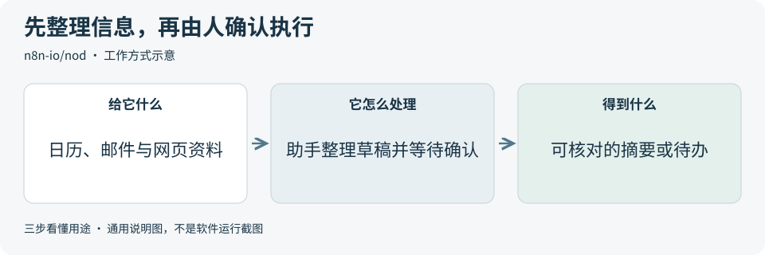
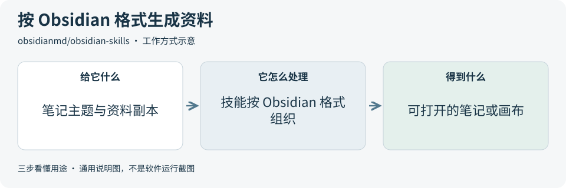
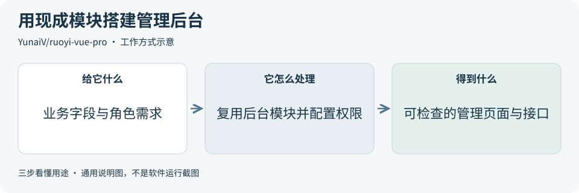
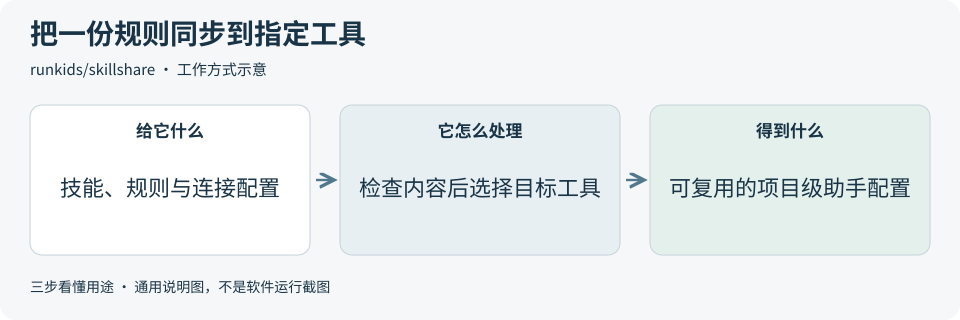
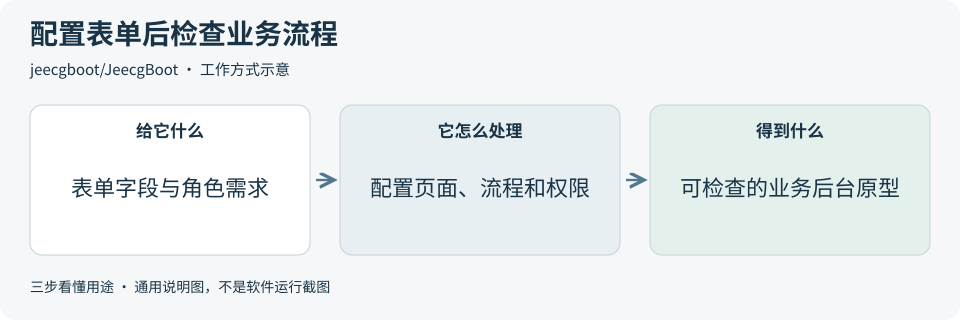

# 2026-11-27 · 每日开源项目推荐 5 个

每天在同一个仓库新增一份资料，每份 5 个项目，避开全部历史推荐。先看速览，再点项目查看图解和例子。

热度参考抓取时的 GitHub 滚动周榜，**不是一天内的新增 Star**。用途按公开文档整理，图解和例子用于解释用法；本期未实际安装或运行这些项目。

**先认两个词**　Agent 是能分步办事的 AI 助手；Skill 是写给 AI 助手的工作说明。Star 是关注热度，不代表质量。

## 本期速览

| 名次 | 项目 | 本周新增 Star | 一句话用途 | 可用场景 |
| --- | --- | ---: | --- | --- |
| 1 | [nod](#project-01) | +1,165 | 在电脑上操作网页和常用工作工具的个人 AI 助手，执行发送或提交等动作前会请求确认。 | 人工确认的桌面工作自动化 |
| 2 | [obsidian-skills](#project-02) | +704 | 给 AI 助手提供读写 Obsidian 笔记、画布和资料库的操作说明。 | 让 AI 按统一格式整理笔记 |
| 3 | [ruoyi-vue-pro](#project-03) | +138 | 提供 Java 后端与 Vue 管理页面的业务系统基础模块，含用户权限、接口和常见后台功能。 | 从现成后台基座搭建业务系统 |
| 4 | [skillshare](#project-04) | +130 | 在本地集中管理 AI 编程助手的技能、规则和连接配置，并按项目同步所需内容。 | 统一团队的 AI 编程配置 |
| 5 | [JeecgBoot](#project-05) | +125 | 面向 Java 项目的低代码开发平台，可配置表单、流程和报表，也提供可继续修改的源码。 | 快速搭建可扩展的业务后台 |

## 可以先看

本期从桌面自动化、Obsidian 笔记技能、Java 管理后台基座和 AI 编程配置管理中挑选。前两项可先在测试账号或笔记副本试用；后台框架需要较完整的开发与部署环境。榜单热度是滚动一周新增 Star。

## 1. [nod](https://github.com/n8n-io/nod)

**一句话用途**　在电脑上操作网页和常用工作工具的个人 AI 助手，执行发送或提交等动作前会请求确认。

**举个例子**　先用测试日历和虚构客户资料生成一页会前摘要，检查内容与来源后再决定是否连接真实工作区。

**适合什么情况**　适合想把日历、邮件或网页中的重复步骤整理成草稿，再由人确认后执行的个人或小团队。

**门槛与费用**　门槛中。代码采用 Apache-2.0，软件本身无许可费。README 标注目前为研究预览；模型账号或 API 可能收费，联网服务也需按各自套餐计费。

**注意事项**　研究预览阶段，连接器会接触工作区数据；先用测试账号和最小权限。确认提示不能替代检查收件人、内容和最终动作。

**小范围第一步**　在隔离的测试账号中连接一个只读来源，生成一份虚构会议摘要并核对引用内容；先不要开启发送或购买操作。

周新增 Star **+1,165** · 总 Star **4,011** · TypeScript · Apache-2.0 · 首次推荐

[官方文档](https://github.com/n8n-io/nod/blob/cdde2d12e35d02963659196a2190c4d85414ab5b/README.md) · [仓库](https://github.com/n8n-io/nod)

## 2. [obsidian-skills](https://github.com/obsidianmd/obsidian-skills)

**一句话用途**　给 AI 助手提供读写 Obsidian 笔记、画布和资料库的操作说明。

**举个例子**　在笔记副本上试用 Markdown 技能，创建一张包含三个主题卡片和连接线的 JSON Canvas，再打开检查布局。

**适合什么情况**　适合希望 AI 助手依照 Obsidian 的 Markdown、Bases 或 Canvas 格式创建和维护知识资料的人。

**门槛与费用**　门槛低。仓库采用 MIT，技能文件本身无许可费。使用 Obsidian 或 AI 助手时，账号、模型和同步服务可能另有费用。

**注意事项**　技能会把操作规则交给 AI 助手；使用前应阅读文件内容，并限制它能访问的笔记目录。第三方工具对技能格式的支持可能不同。

**小范围第一步**　只安装一个需要的技能，在不含私人资料的测试笔记或副本上运行一次，检查生成和修改的文件后再扩大范围。

周新增 Star **+704** · 总 Star **54,021** · Shell · MIT · 首次推荐

[官方文档](https://github.com/obsidianmd/obsidian-skills/blob/9c9560a870fd490b0e1a847f2c8401a50e2d931d/README.md) · [仓库](https://github.com/obsidianmd/obsidian-skills)

## 3. [ruoyi-vue-pro](https://github.com/YunaiV/ruoyi-vue-pro)

**一句话用途**　提供 Java 后端与 Vue 管理页面的业务系统基础模块，含用户权限、接口和常见后台功能。

**举个例子**　用精简版本做一个内部设备登记原型，先配置设备名称、状态和负责人字段，再检查不同角色的查看权限。

**适合什么情况**　适合需要用户角色、菜单、权限和管理页面，并愿意维护一套完整 Java 与 Vue 工程的团队。

**门槛与费用**　门槛高。仓库标注 MIT 许可，代码无许可费。运行需要 Java、前端依赖和数据库等环境；服务器、数据库托管及可选服务可能产生费用。

**注意事项**　完整版本和精简版本、JDK 与 Spring Boot 组合不同；先按选定分支的文档配套。权限配置和生成代码仍需开发人员审查。

**小范围第一步**　先选一个明确维护的版本分支，按固定版本 README 启动演示环境，用虚构数据检查一张列表和一个角色权限，再决定是否采用。

周新增 Star **+138** · 总 Star **40,654** · Java · MIT · 首次推荐

[官方文档](https://github.com/YunaiV/ruoyi-vue-pro/blob/e34c0f22dc542bd36aebc65afa4dd4ac81c88863/README.md) · [仓库](https://github.com/YunaiV/ruoyi-vue-pro)

## 4. [skillshare](https://github.com/runkids/skillshare)

**一句话用途**　在本地集中管理 AI 编程助手的技能、规则和连接配置，并按项目同步所需内容。

**举个例子**　把一份代码审查清单放进项目配置源，先审阅它会同步到哪些工具，再只同步到一个测试项目。

**适合什么情况**　适合多人使用不同 AI 编程工具，希望共用代码审查清单、项目规则并通过版本库维护的团队。

**门槛与费用**　门槛中。项目采用 MIT，CLI 无许可费。桌面应用或 AI 模型服务的费用按各自产品计算。

**注意事项**　同步规则、技能或 hooks 可能改变本机 AI 工具行为；先审查配置和安全检查结果，团队共享时也要避免提交密钥。

**小范围第一步**　在空白测试项目中加入一份只读审查规则，运行官方 audit，再同步给一个工具并核对实际生成的文件。

周新增 Star **+130** · 总 Star **3,372** · Go · MIT · 首次推荐

[官方文档](https://github.com/runkids/skillshare/blob/7fd2eaa68d348e5274d681934097afba3b20b368/README.md) · [仓库](https://github.com/runkids/skillshare)

## 5. [JeecgBoot](https://github.com/jeecgboot/JeecgBoot)

**一句话用途**　面向 Java 项目的低代码开发平台，可配置表单、流程和报表，也提供可继续修改的源码。

**举个例子**　用本地演示环境搭一张虚构的设备申领表，观察表单字段、审批流程和权限如何衔接。

**适合什么情况**　适合需要表单、审批或报表等常见后台功能，并能承担 Java 平台部署和维护成本的团队。

**门槛与费用**　门槛高。仓库标注 Apache-2.0，平台代码无许可费。部署需要数据库及配套运行环境；服务器、短信或可选模型服务可能收费。

**注意事项**　平台模块多、版本和部署方式会影响依赖；低代码生成结果仍要做权限、数据隔离和安全审查。README 描述的功能不代表已验证适配具体业务。

**小范围第一步**　使用测试环境和虚构数据，先启动官方示例，只配置一张简单表单并检查普通用户与管理员看到的内容差异。

周新增 Star **+125** · 总 Star **48,636** · Java · Apache-2.0 · 首次推荐

[官方文档](https://github.com/jeecgboot/JeecgBoot/blob/6184e2448fbf0a84e7f638596324c69c1a747549/README.md) · [仓库](https://github.com/jeecgboot/JeecgBoot)

## 来源与选取方法

候选池 120 个，可识别开源许可证且未归档的候选 102 个。已核对 209 个历史推荐，剩余未介绍过的候选 42 个；再核对用途与许可，选出本期 5 个。抓取时间与原榜名次见 [本期数据](../data/2026-11-27.json)。

- [tradermonty/claude-trading-skills](https://github.com/tradermonty/claude-trading-skills/blob/39c189daba13f63974b46ae58b202a31a67f9c89/README.md) 暂未收录：README 将用途限定为教育、研究和流程改进；项目聚焦金融交易，暂不作为通用软件项目应用建议。
- [ZhuLinsen/daily_stock_analysis](https://github.com/ZhuLinsen/daily_stock_analysis/blob/a780a5b15d8d67639c9db61a4d7914166c34e9ab/README.md) 暂未收录：README 提供金融分析与买卖点位，同时声明仅供学习研究；用途范围不适合一般项目建议。
- [bggRGjQaUbCoE/PiliPlus](https://github.com/bggRGjQaUbCoE/PiliPlus/blob/217fb54f51f6764176319bbdedab2a7522d75401/README.md) 暂未收录：README 将用途限制为学习和测试，并要求下载内容在 24 小时内删除，本期不推荐作日常使用。
- [soxoj/maigret](https://github.com/soxoj/maigret/blob/b815b91ceb17f20a6ddfbe71d395844960d8e60c/README.md) 暂未收录：README 对用途作教育及合法行为限制，项目针对账号线索检索；本期避免给出可能扩展到未经授权个人调查的通用建议。
- [z7786/wenxi](https://github.com/z7786/wenxi/blob/66a175b172ac3620a5e1baa07035fecedd7502b7/README.md) 暂未收录：许可证说明指出内置第三方 SDK 的组合分发兼容性尚未确认，整体分发许可边界不清。
- [MorpheApp/morphe-patches](https://github.com/MorpheApp/morphe-patches/blob/10b58e236a6ea07632a94eddf7e866a22336f5e2/README.md) 暂未收录：README 对 GPLv3 增列 Section 7 条件并要求一并查阅 NOTICE；涉及为第三方应用制作补丁，使用及再分发条件需要逐项核对。
- [misakano7545/workbuddy2api-panel](https://github.com/misakano7545/workbuddy2api-panel/blob/fba9e147e640095e3d3d2fcb4094408d2559d89f/README.md) 暂未收录：README 说明这是第三方服务的非官方 OAuth 代理，并把使用限定于本人授权账号及私有测试环境；不作一般服务接入建议。
- [TeamNewPipe/NewPipe](https://github.com/TeamNewPipe/NewPipe/blob/62c87aa6b7556e260d5639da1d23240cfba17e6e/README.md) 暂未收录：项目依赖第三方视频平台接口；平台规则与可用性会变化，本期不把它作为普遍的服务集成方案推荐。
- [周榜来源 1](https://github.com/trending?since=weekly)
- [周榜来源 2](https://github.com/trending/python?since=weekly)
- [周榜来源 3](https://github.com/trending/typescript?since=weekly)
- [周榜来源 4](https://github.com/trending/javascript?since=weekly)
- [周榜来源 5](https://github.com/trending/go?since=weekly)
- [周榜来源 6](https://github.com/trending/rust?since=weekly)
- [周榜来源 7](https://github.com/trending/swift?since=weekly)
- [周榜来源 8](https://github.com/trending/dart?since=weekly)
- [周榜来源 9](https://github.com/trending/java?since=weekly)

[排名和更新规则](../UPDATE_GUIDE.md) · [通用应用场景](../USE_CASES.md)

序号是本期推荐顺序，不是 GitHub 官方总榜排名。图解和应用例子仅作说明。

[返回资料首页](../README.md)
